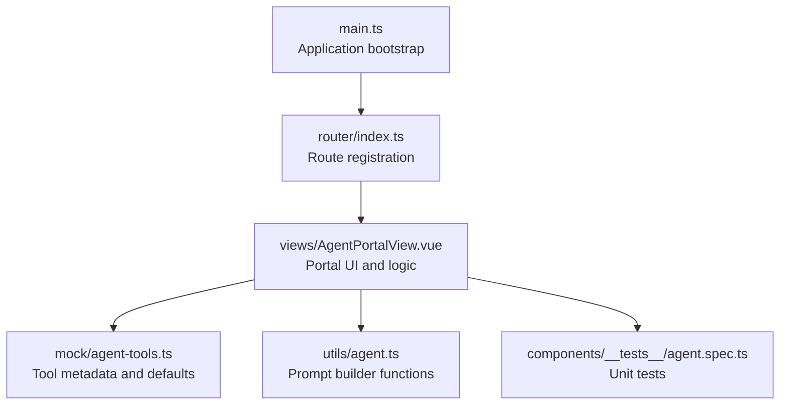
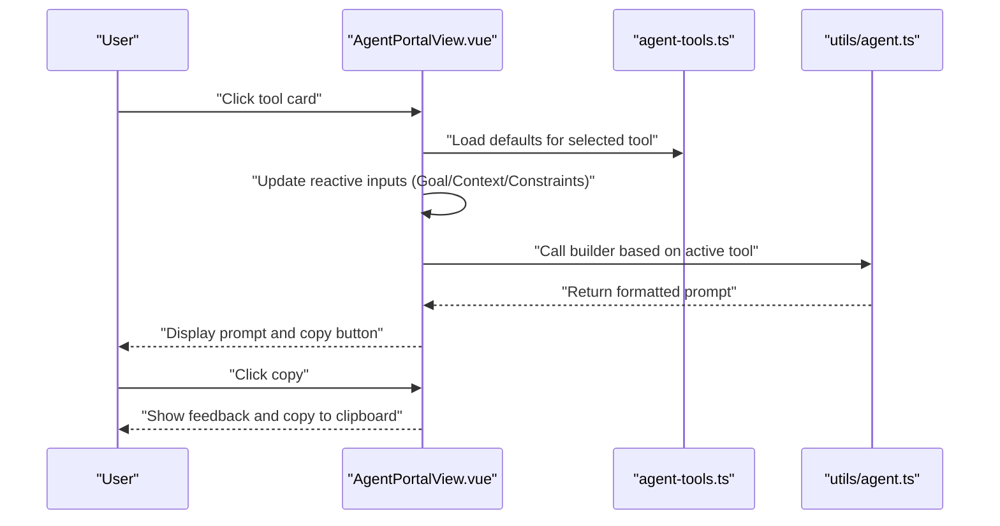
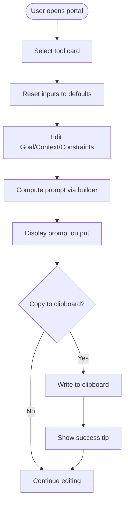
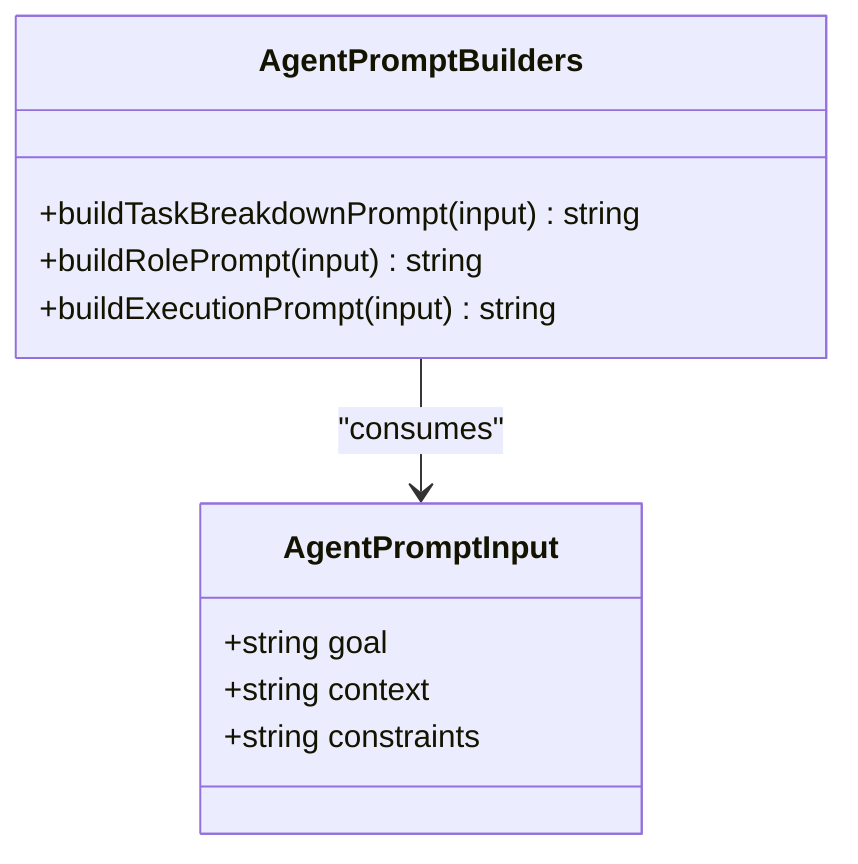
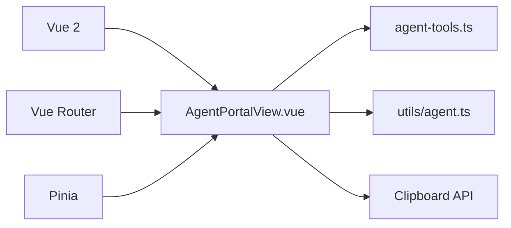

# Agent Tools Portal

<cite>
**Referenced Files in This Document**
- [AgentPortalView.vue](file://src/views/AgentPortalView.vue)
- [agent-tools.ts](file://src/mock/agent-tools.ts)
- [agent.ts](file://src/utils/agent.ts)
- [agent.spec.ts](file://src/components/__tests__/agent.spec.ts)
- [index.ts](file://src/router/index.ts)
- [main.ts](file://src/main.ts)
- [package.json](file://package.json)
</cite>

## Table of Contents
1. [Introduction](#introduction)
2. [Project Structure](#project-structure)
3. [Core Components](#core-components)
4. [Architecture Overview](#architecture-overview)
5. [Detailed Component Analysis](#detailed-component-analysis)
6. [Dependency Analysis](#dependency-analysis)
7. [Performance Considerations](#performance-considerations)
8. [Troubleshooting Guide](#troubleshooting-guide)
9. [Conclusion](#conclusion)
10. [Appendices](#appendices)

## Introduction
The Agent Tools Portal is a Vue 2 application feature designed to streamline the creation of high-quality prompts for AI agents. It provides a real-time editing interface with three specialized prompt builders:
- Execution Assistant: transforms goals into actionable, executable tasks for direct implementation.
- Task Breakdown Tool: decomposes complex goals into milestones, risks, and verification commands.
- Review Role Card: generates comprehensive code review prompts emphasizing risk assessment and regression checks.

The portal uses a template-based approach to consistently format prompts, integrates clipboard functionality for quick copying, and supports parameter customization via editable inputs. Mock data drives the initial tool configurations and default values, enabling demonstration and testing without backend dependencies.

## Project Structure
The Agent Tools Portal is implemented as a single-page application with a dedicated view, supporting utilities, and mock data. The routing configuration exposes the portal under a dedicated path.

**Diagram sources**
- [main.ts:1-16](file://src/main.ts#L1-L16)
- [index.ts:1-65](file://src/router/index.ts#L1-L65)
- [AgentPortalView.vue:1-239](file://src/views/AgentPortalView.vue#L1-L239)
- [agent-tools.ts:1-40](file://src/mock/agent-tools.ts#L1-L40)
- [agent.ts:1-47](file://src/utils/agent.ts#L1-L47)
- [agent.spec.ts:1-36](file://src/components/__tests__/agent.spec.ts#L1-L36)

**Section sources**
- [main.ts:1-16](file://src/main.ts#L1-L16)
- [index.ts:27-31](file://src/router/index.ts#L27-L31)

## Core Components
- AgentPortalView.vue: Hosts the interactive UI, manages active tool selection, binds editable inputs (Goal, Context, Constraints), computes the current prompt via template functions, and handles clipboard copy operations.
- agent-tools.ts: Defines the AgentTool interface and the list of tools with default values for Goal, Context, and Constraints.
- agent.ts: Implements three prompt builder functions:
  - buildTaskBreakdownPrompt: Produces a structured breakdown prompt.
  - buildRolePrompt: Generates a reviewer-focused prompt.
  - buildExecutionPrompt: Creates an execution-oriented prompt.
- agent.spec.ts: Provides unit tests validating prompt construction and fallback behavior.
- router/index.ts: Registers the "/agent-portal" route pointing to the portal view.
- main.ts: Initializes the Vue application with Pinia and mounts the root component.

Key capabilities:
- Real-time prompt generation based on user inputs.
- Clipboard integration for quick copy/paste workflows.
- Template-driven prompt composition with consistent formatting.
- Parameter customization per tool via default values and live edits.

**Section sources**
- [AgentPortalView.vue:1-239](file://src/views/AgentPortalView.vue#L1-L239)
- [agent-tools.ts:1-40](file://src/mock/agent-tools.ts#L1-L40)
- [agent.ts:1-47](file://src/utils/agent.ts#L1-L47)
- [agent.spec.ts:1-36](file://src/components/__tests__/agent.spec.ts#L1-L36)
- [index.ts:27-31](file://src/router/index.ts#L27-L31)
- [main.ts:1-16](file://src/main.ts#L1-L16)

## Architecture Overview
The portal follows a unidirectional data flow:
- User selects a tool card to set the active tool.
- Inputs (Goal, Context, Constraints) update the reactive state.
- A computed property triggers the appropriate prompt builder function.
- The resulting prompt is displayed and can be copied to the clipboard.

**Diagram sources**
- [AgentPortalView.vue:7-21](file://src/views/AgentPortalView.vue#L7-L21)
- [AgentPortalView.vue:23-45](file://src/views/AgentPortalView.vue#L23-L45)
- [AgentPortalView.vue:47-58](file://src/views/AgentPortalView.vue#L47-L58)
- [agent-tools.ts:11-39](file://src/mock/agent-tools.ts#L11-L39)
- [agent.ts:9-46](file://src/utils/agent.ts#L9-L46)

## Detailed Component Analysis

### AgentPortalView.vue
Responsibilities:
- Manage active tool selection and default input values.
- Watch tool changes to reset inputs to defaults.
- Compute the current prompt using the selected builder.
- Provide a copy-to-clipboard action with user feedback.

User interaction patterns:
- Clicking a tool card switches the active tool and resets inputs to defaults.
- Editing the textarea inputs updates the prompt in real time.
- Clicking the copy button writes the current prompt to the clipboard and shows a temporary tip.

Real-time editing behavior:
- Reactive refs bind to inputs; computed prompt reacts to changes.
- Watch handler ensures defaults align with the selected tool.

Clipboard integration:
- Uses the Clipboard API to write text.
- Provides user feedback via a transient tip message.

**Diagram sources**
- [AgentPortalView.vue:7-21](file://src/views/AgentPortalView.vue#L7-L21)
- [AgentPortalView.vue:23-45](file://src/views/AgentPortalView.vue#L23-L45)
- [AgentPortalView.vue:47-58](file://src/views/AgentPortalView.vue#L47-L58)

**Section sources**
- [AgentPortalView.vue:1-239](file://src/views/AgentPortalView.vue#L1-L239)

### Prompt Builders (agent.ts)
Template-based prompt engineering:
- Each builder composes a prompt from three core fields: goal, context, constraints.
- A helper ensures empty or whitespace-only inputs fall back to a placeholder.
- Builders enforce a consistent structure and explicit output expectations.

Builder-specific patterns:
- Execution Assistant: frames the agent as an executor and requests a plan, execution, and summary.
- Task Breakdown Tool: instructs decomposition into milestones, risks, and verification commands.
- Review Role Card: positions the agent as a reviewer and asks for severity-ranked issues, actionable fixes, and minimal validation steps.

**Diagram sources**
- [agent.ts:1-5](file://src/utils/agent.ts#L1-L5)
- [agent.ts:9-46](file://src/utils/agent.ts#L9-L46)

**Section sources**
- [agent.ts:1-47](file://src/utils/agent.ts#L1-L47)

### Tool Metadata and Defaults (agent-tools.ts)
The mock data defines:
- Tool identity (id, name, tag, description).
- Default values for Goal, Context, and Constraints used when a tool is selected.

These defaults seed the editor and demonstrate typical inputs for each tool type.

**Section sources**
- [agent-tools.ts:1-40](file://src/mock/agent-tools.ts#L1-L40)

### Routing and Application Bootstrap
- The "/agent-portal" route lazily loads the portal view.
- The application initializes Pinia and mounts the root component.

**Section sources**
- [index.ts:27-31](file://src/router/index.ts#L27-L31)
- [main.ts:1-16](file://src/main.ts#L1-L16)

### Unit Tests (agent.spec.ts)
Validation coverage:
- Ensures the task breakdown prompt includes expected structural markers.
- Verifies fallback behavior for empty inputs in the reviewer prompt.
- Confirms execution prompt content reflects provided inputs.

**Section sources**
- [agent.spec.ts:1-36](file://src/components/__tests__/agent.spec.ts#L1-L36)

## Dependency Analysis
External dependencies relevant to the portal:
- Vue 2 and Vue Router for UI and routing.
- Pinia for state management.
- Vitest for unit testing.

Internal dependencies:
- AgentPortalView depends on:
  - agent-tools.ts for tool metadata and defaults.
  - agent.ts for prompt building logic.
  - Browser Clipboard API for copy functionality.

**Diagram sources**
- [package.json:28-32](file://package.json#L28-L32)
- [AgentPortalView.vue:4-5](file://src/views/AgentPortalView.vue#L4-L5)
- [agent-tools.ts:1-40](file://src/mock/agent-tools.ts#L1-L40)
- [agent.ts:1-47](file://src/utils/agent.ts#L1-L47)

**Section sources**
- [package.json:28-32](file://package.json#L28-L32)
- [AgentPortalView.vue:4-5](file://src/views/AgentPortalView.vue#L4-L5)

## Performance Considerations
- Computed properties ensure prompt recomputation only when inputs change, minimizing unnecessary work.
- Clipboard operations are lightweight and asynchronous; the UI remains responsive during copy actions.
- The template-based approach keeps prompt construction deterministic and fast.
- Default values loaded from mock data avoid network overhead during development and demos.

## Troubleshooting Guide
Common issues and resolutions:
- Clipboard not supported: The copy action checks for the Clipboard API and displays a user-friendly tip when unavailable. Use a modern browser with clipboard permissions enabled.
- Empty or whitespace inputs: The prompt builders apply a fallback placeholder for missing values. Ensure meaningful inputs for clearer prompts.
- Tool defaults not loading: Verify the active tool selection and confirm the watch handler updates inputs when switching tools.
- Route not accessible: Confirm the "/agent-portal" route is registered and navigate to the correct path.

**Section sources**
- [AgentPortalView.vue:47-58](file://src/views/AgentPortalView.vue#L47-L58)
- [agent.ts:7](file://src/utils/agent.ts#L7)
- [index.ts:27-31](file://src/router/index.ts#L27-L31)

## Conclusion
The Agent Tools Portal provides a streamlined, template-driven solution for crafting high-quality AI prompts. Its real-time editing interface, consistent builder functions, and clipboard integration accelerate prompt authoring for execution, planning, and review use cases. The mock data-backed design enables rapid iteration and testing while maintaining a clean separation between presentation, logic, and data.

## Appendices

### Prompt Engineering Principles and Best Practices
- Clarity and specificity: Use precise Goal and Context statements to reduce ambiguity.
- Explicit structure: Request structured outputs (e.g., numbered lists) to improve agent adherence.
- Role framing: Position the agent clearly (executor, reviewer) to align behavior with intent.
- Constraint communication: Define boundaries early to guide safer, more predictable outcomes.
- Iterative refinement: Start with concise prompts and expand based on agent responses.

### Relationship Between Mock Data and Functionality
- Mock data supplies tool metadata and default inputs, seeding the editor and ensuring consistent initial states.
- Prompt builders operate independently of mock data, transforming inputs into standardized templates.
- Tests validate builder outputs against expected patterns and fallback behavior, decoupling logic from mock specifics.