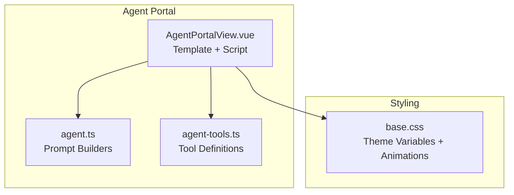
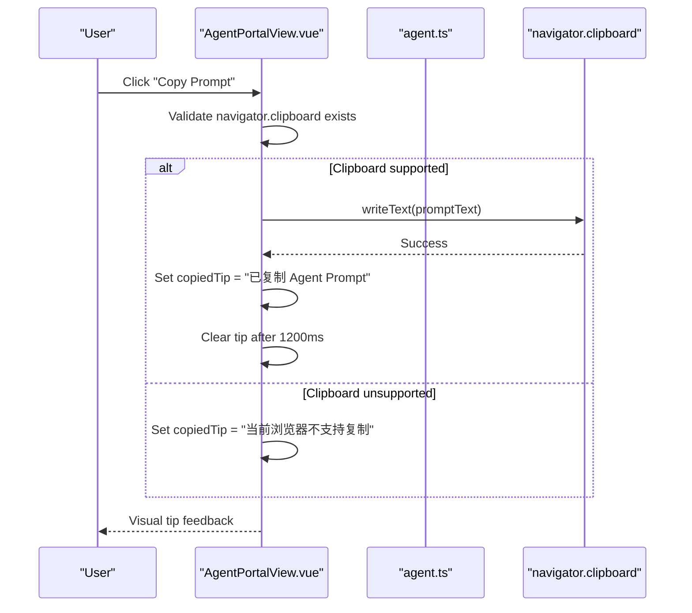
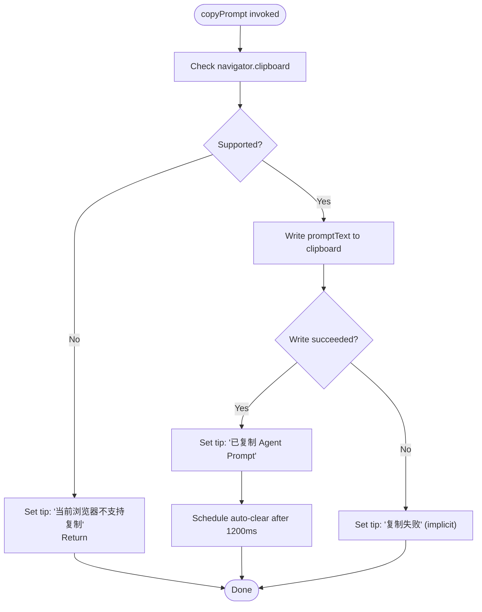
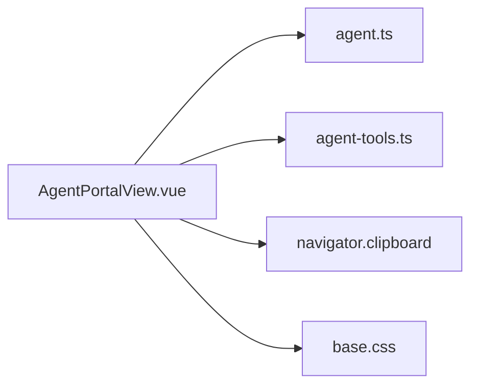

# Clipboard Integration & User Experience

<cite>
**Referenced Files in This Document**
- [AgentPortalView.vue](file://src/views/AgentPortalView.vue)
- [agent.ts](file://src/utils/agent.ts)
- [agent-tools.ts](file://src/mock/agent-tools.ts)
- [base.css](file://src/assets/base.css)
</cite>

## Table of Contents
1. [Introduction](#introduction)
2. [Project Structure](#project-structure)
3. [Core Components](#core-components)
4. [Architecture Overview](#architecture-overview)
5. [Detailed Component Analysis](#detailed-component-analysis)
6. [Dependency Analysis](#dependency-analysis)
7. [Performance Considerations](#performance-considerations)
8. [Troubleshooting Guide](#troubleshooting-guide)
9. [Conclusion](#conclusion)

## Introduction
This document explains the clipboard integration and user experience features in the Agent Tools Portal. It focuses on the copyPrompt function implementation, browser compatibility handling via the Clipboard API, and the visual feedback system that informs users of successful or failed copy actions. It also covers the reactive state integration with the UI, accessibility considerations, and the end-to-end UX flow for copying prompts.

## Project Structure
The clipboard functionality resides in a single Vue Single File Component responsible for building and copying prompt text. Supporting utilities generate the prompt content based on user-selected tools and inputs. Global CSS defines the theme and visual feedback colors.

**Diagram sources**
- [AgentPortalView.vue:1-239](file://src/views/AgentPortalView.vue#L1-L239)
- [agent.ts:1-47](file://src/utils/agent.ts#L1-L47)
- [agent-tools.ts:1-40](file://src/mock/agent-tools.ts#L1-L40)
- [base.css:1-64](file://src/assets/base.css#L1-L64)

**Section sources**
- [AgentPortalView.vue:1-239](file://src/views/AgentPortalView.vue#L1-L239)
- [agent.ts:1-47](file://src/utils/agent.ts#L1-L47)
- [agent-tools.ts:1-40](file://src/mock/agent-tools.ts#L1-L40)
- [base.css:1-64](file://src/assets/base.css#L1-L64)

## Core Components
- Reactive state: activeToolId, goal, context, constraints, copiedTip
- Computed promptText derived from activeToolId and inputs
- copyPrompt function orchestrating Clipboard API usage and feedback
- Template rendering of editor inputs, generated prompt, copy button, and tip message

Key implementation references:
- Reactive state and watchers: [AgentPortalView.vue:7-21](file://src/views/AgentPortalView.vue#L7-L21)
- Computed promptText: [AgentPortalView.vue:23-45](file://src/views/AgentPortalView.vue#L23-L45)
- copyPrompt and tip handling: [AgentPortalView.vue:47-58](file://src/views/AgentPortalView.vue#L47-L58)
- Template UI elements: [AgentPortalView.vue:86-111](file://src/views/AgentPortalView.vue#L86-L111)

**Section sources**
- [AgentPortalView.vue:7-21](file://src/views/AgentPortalView.vue#L7-L21)
- [AgentPortalView.vue:23-45](file://src/views/AgentPortalView.vue#L23-L45)
- [AgentPortalView.vue:47-58](file://src/views/AgentPortalView.vue#L47-L58)
- [AgentPortalView.vue:86-111](file://src/views/AgentPortalView.vue#L86-L111)

## Architecture Overview
The clipboard UX follows a straightforward reactive flow: user edits inputs → promptText recomputes → user clicks Copy → copyPrompt validates environment → Clipboard API writes text → UI updates with success/error tip → auto-clears tip after delay.

**Diagram sources**
- [AgentPortalView.vue:47-58](file://src/views/AgentPortalView.vue#L47-L58)
- [agent.ts:9-46](file://src/utils/agent.ts#L9-L46)

## Detailed Component Analysis

### copyPrompt Function Implementation
Behavior summary:
- Environment check: verifies navigator.clipboard availability
- Success path: writes promptText to clipboard, sets positive tip, schedules auto-clear
- Failure path: sets informative tip indicating lack of clipboard support

Implementation references:
- Function definition and logic: [AgentPortalView.vue:47-58](file://src/views/AgentPortalView.vue#L47-L58)

**Diagram sources**
- [AgentPortalView.vue:47-58](file://src/views/AgentPortalView.vue#L47-L58)

**Section sources**
- [AgentPortalView.vue:47-58](file://src/views/AgentPortalView.vue#L47-L58)

### Browser Compatibility Handling
- Feature detection: uses optional chaining on navigator.clipboard to guard against missing APIs
- Graceful degradation: displays a localized tip when clipboard is unavailable
- No polyfill or fallback mechanism is implemented; behavior is intentionally minimal

References:
- Feature check: [AgentPortalView.vue:48](file://src/views/AgentPortalView.vue#L48)
- Fallback tip: [AgentPortalView.vue:49](file://src/views/AgentPortalView.vue#L49)

**Section sources**
- [AgentPortalView.vue:48-49](file://src/views/AgentPortalView.vue#L48-L49)

### Visual Feedback System
- Tip state: managed by copiedTip reactive ref
- Rendering: conditionally shown below the copy button
- Color and styling: green-toned tip text for success contrast against dark theme
- Auto-clear: timeout-based clearing after 1200ms

References:
- State and template binding: [AgentPortalView.vue:11](file://src/views/AgentPortalView.vue#L11), [AgentPortalView.vue:108](file://src/views/AgentPortalView.vue#L108)
- Styles: [AgentPortalView.vue:224-227](file://src/views/AgentPortalView.vue#L224-L227), [base.css:1-64](file://src/assets/base.css#L1-L64)

**Section sources**
- [AgentPortalView.vue:11](file://src/views/AgentPortalView.vue#L11)
- [AgentPortalView.vue:108](file://src/views/AgentPortalView.vue#L108)
- [AgentPortalView.vue:224-227](file://src/views/AgentPortalView.vue#L224-L227)
- [base.css:1-64](file://src/assets/base.css#L1-L64)

### Clipboard API Usage
- API surface: writeText(text) used to place promptText onto the system clipboard
- Asynchronous operation: awaited to handle potential permission prompts or errors
- Error handling: no explicit try/catch; failures are implicitly handled by the absence of success tip

References:
- API call: [AgentPortalView.vue:53](file://src/views/AgentPortalView.vue#L53)
- Prompt builder utilities: [agent.ts:9-46](file://src/utils/agent.ts#L9-L46)

**Section sources**
- [AgentPortalView.vue:53](file://src/views/AgentPortalView.vue#L53)
- [agent.ts:9-46](file://src/utils/agent.ts#L9-L46)

### Temporary Tip Notification System
- Trigger: copyPrompt sets copiedTip upon success
- Duration: 1200ms auto-clear via setTimeout
- Purpose: brief acknowledgment without persistent UI clutter

References:
- Tip assignment and clear: [AgentPortalView.vue:54-57](file://src/views/AgentPortalView.vue#L54-L57)

**Section sources**
- [AgentPortalView.vue:54-57](file://src/views/AgentPortalView.vue#L54-L57)

### Accessibility Considerations
- Keyboard operability: button receives focus and can be activated via Enter/Space
- Screen reader friendliness: button has no ARIA attributes but relies on semantic button element and visible text
- Visual contrast: tip color (#a2f2c3) contrasts well against dark theme backgrounds
- Focus management: no explicit focus restoration or programmatic focus shifts occur post-copy

References:
- Button element: [AgentPortalView.vue:107](file://src/views/AgentPortalView.vue#L107)
- Tip color: [AgentPortalView.vue:224-227](file://src/views/AgentPortalView.vue#L224-L227), [base.css:1-64](file://src/assets/base.css#L1-L64)

**Section sources**
- [AgentPortalView.vue:107](file://src/views/AgentPortalView.vue#L107)
- [AgentPortalView.vue:224-227](file://src/views/AgentPortalView.vue#L224-L227)
- [base.css:1-64](file://src/assets/base.css#L1-L64)

### User Interaction Patterns
- Selection-driven generation: switching tools updates inputs and recomputes promptText
- Inline editing: users modify goal/context/constraints in-place
- One-click copy: prominent copy button positioned near the generated prompt
- Minimal friction: no modal dialogs or overlays; feedback appears immediately below the button

References:
- Tool selection and watcher: [AgentPortalView.vue:15-21](file://src/views/AgentPortalView.vue#L15-L21)
- Inputs and computed prompt: [AgentPortalView.vue:86-106](file://src/views/AgentPortalView.vue#L86-L106)

**Section sources**
- [AgentPortalView.vue:15-21](file://src/views/AgentPortalView.vue#L15-L21)
- [AgentPortalView.vue:86-106](file://src/views/AgentPortalView.vue#L86-L106)

### Integration Between Reactive State and UI Feedback
- State changes propagate to promptText automatically
- copyPrompt reads the latest promptText value reactively
- UI updates immediately reflect state changes (inputs, active tool, tip)

References:
- Reactive refs and computed: [AgentPortalView.vue:7-45](file://src/views/AgentPortalView.vue#L7-L45)

**Section sources**
- [AgentPortalView.vue:7-45](file://src/views/AgentPortalView.vue#L7-L45)

## Dependency Analysis
The clipboard UX depends on:
- Vue reactivity (ref, computed, watch)
- Utility functions that construct prompt text
- Browser Clipboard API (optional)
- Component template for rendering and binding

**Diagram sources**
- [AgentPortalView.vue:1-239](file://src/views/AgentPortalView.vue#L1-L239)
- [agent.ts:1-47](file://src/utils/agent.ts#L1-L47)
- [agent-tools.ts:1-40](file://src/mock/agent-tools.ts#L1-L40)
- [base.css:1-64](file://src/assets/base.css#L1-L64)

**Section sources**
- [AgentPortalView.vue:1-239](file://src/views/AgentPortalView.vue#L1-L239)
- [agent.ts:1-47](file://src/utils/agent.ts#L1-L47)
- [agent-tools.ts:1-40](file://src/mock/agent-tools.ts#L1-L40)
- [base.css:1-64](file://src/assets/base.css#L1-L64)

## Performance Considerations
- Clipboard write is asynchronous and typically fast; no noticeable latency expected
- Computation of promptText is lightweight string concatenation
- UI updates are minimal and DOM-bound to a small region around the copy button and tip

## Troubleshooting Guide
Common issues and resolutions:
- Clipboard not supported: The environment check prevents runtime errors; users see a localized tip indicating lack of support. Resolution: use a modern browser with Clipboard API support.
- Copy appears to do nothing: Verify clipboard support and permissions. On some browsers or contexts (e.g., insecure origins), write operations may be blocked.
- Tip remains visible: The 1200ms auto-clear is designed to prevent permanent UI clutter; if the page lifecycle interrupts, the tip may persist until next action.

References:
- Support check and fallback: [AgentPortalView.vue:48-50](file://src/views/AgentPortalView.vue#L48-L50)
- Auto-clear timing: [AgentPortalView.vue:55-57](file://src/views/AgentPortalView.vue#L55-L57)

**Section sources**
- [AgentPortalView.vue:48-50](file://src/views/AgentPortalView.vue#L48-L50)
- [AgentPortalView.vue:55-57](file://src/views/AgentPortalView.vue#L55-L57)

## Conclusion
The clipboard integration in the Agent Tools Portal is intentionally simple and robust: it detects clipboard support, writes the generated prompt text asynchronously, and provides immediate visual feedback. The design prioritizes clarity and speed, with minimal UI overhead and clear messaging for unsupported environments. Together with the reactive state system, this creates a smooth, predictable user experience for copying prompts.