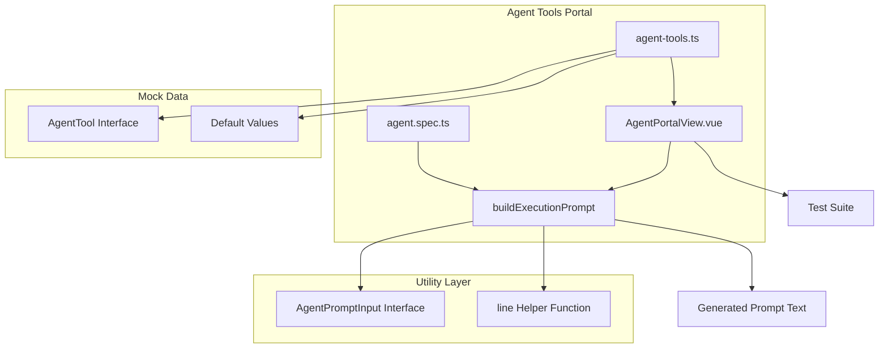
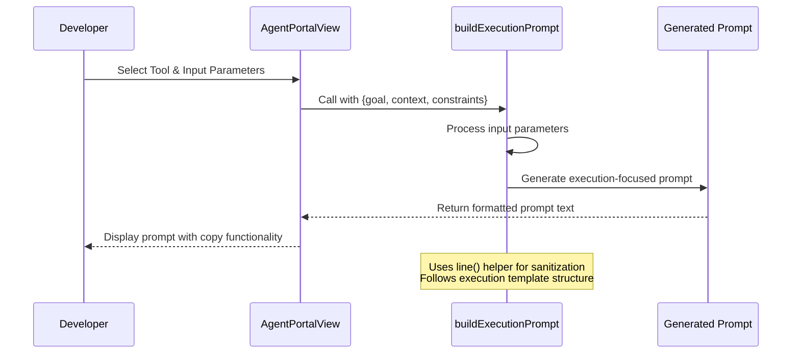
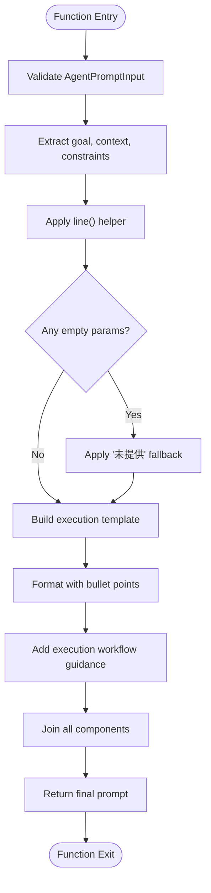
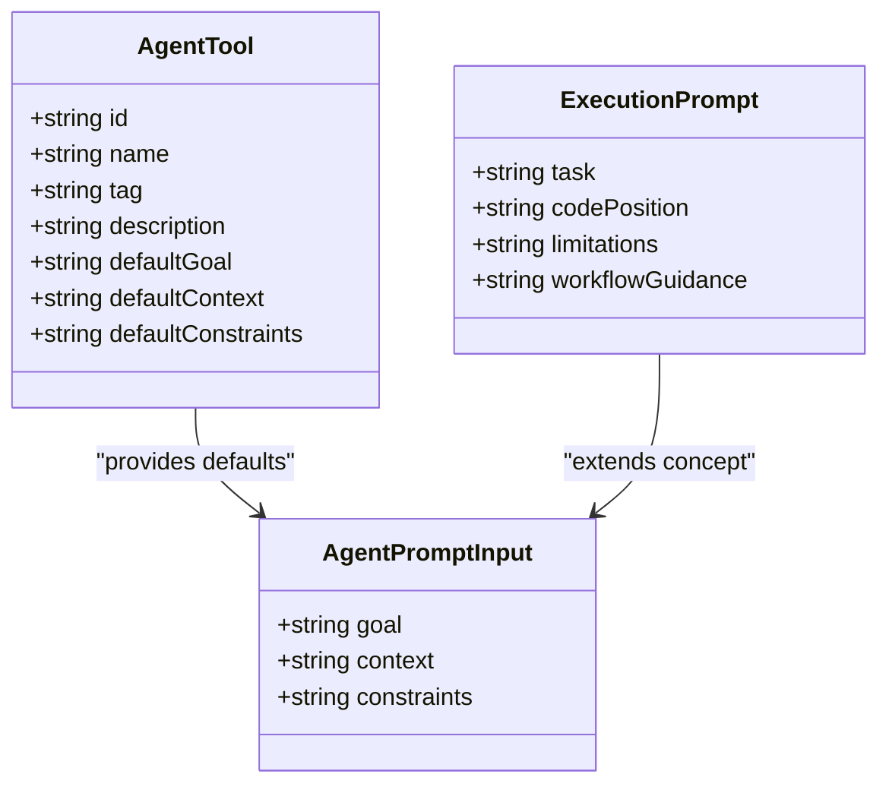
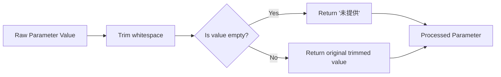

# Execution Assistant Tool

<cite>
**Referenced Files in This Document**
- [agent.ts](file://src/utils/agent.ts)
- [AgentPortalView.vue](file://src/views/AgentPortalView.vue)
- [agent-tools.ts](file://src/mock/agent-tools.ts)
- [agent.spec.ts](file://src/components/__tests__/agent.spec.ts)
</cite>

## Table of Contents
1. [Introduction](#introduction)
2. [Project Structure](#project-structure)
3. [Core Components](#core-components)
4. [Architecture Overview](#architecture-overview)
5. [Detailed Component Analysis](#detailed-component-analysis)
6. [Template Structure and Parameter Handling](#template-structure-and-parameter-handling)
7. [Execution-Focused Prompt Generation](#execution-focused-prompt-generation)
8. [Use Cases and Applications](#use-cases-and-applications)
9. [Prompt Optimization Techniques](#prompt-optimization-techniques)
10. [Best Practices for Execution-Focused AI Interactions](#best-practices-for-execution-focused-ai-interactions)
11. [Performance Considerations](#performance-considerations)
12. [Troubleshooting Guide](#troubleshooting-guide)
13. [Conclusion](#conclusion)

## Introduction

The Execution Assistant Tool is a specialized AI prompt engineering component designed to generate execution-focused prompts for AI agents. This tool transforms high-level requirements into actionable, implementable instructions that guide AI agents through the complete development lifecycle, from planning to implementation and testing verification.

The tool operates within the Agent Tools Portal, providing developers with a structured approach to creating prompts that drive concrete outcomes rather than abstract discussions. It focuses specifically on delivery-oriented tasks where the primary goal is to produce tangible code changes and improvements.

## Project Structure

The Execution Assistant Tool is part of a larger Vue.js application that provides an interactive portal for AI prompt engineering. The tool integrates seamlessly with the broader agent ecosystem through a clean separation of concerns between presentation, logic, and data.

**Diagram sources**
- [AgentPortalView.vue:1-60](file://src/views/AgentPortalView.vue#L1-L60)
- [agent.ts:1-46](file://src/utils/agent.ts#L1-L46)
- [agent-tools.ts:1-40](file://src/mock/agent-tools.ts#L1-L40)

**Section sources**
- [AgentPortalView.vue:1-112](file://src/views/AgentPortalView.vue#L1-L112)
- [agent.ts:1-46](file://src/utils/agent.ts#L1-L46)
- [agent-tools.ts:1-40](file://src/mock/agent-tools.ts#L1-L40)

## Core Components

The Execution Assistant Tool consists of several interconnected components that work together to provide a comprehensive prompt generation solution:

### Primary Components

1. **buildExecutionPrompt Function**: The core generator that creates execution-focused prompts
2. **AgentPromptInput Interface**: Defines the standardized input structure
3. **AgentPortalView Component**: Provides the user interface for prompt generation
4. **AgentTool Mock Data**: Contains predefined tool configurations and default values
5. **Test Suite**: Validates prompt generation behavior and edge cases

### Component Responsibilities

The buildExecutionPrompt function serves as the central orchestrator, transforming structured input data into coherent, action-oriented prompts. The AgentPortalView component manages user interaction and displays generated results, while the mock data provides contextual defaults for different tool categories.

**Section sources**
- [agent.ts:37-46](file://src/utils/agent.ts#L37-L46)
- [AgentPortalView.vue:23-45](file://src/views/AgentPortalView.vue#L23-L45)
- [agent-tools.ts:11-20](file://src/mock/agent-tools.ts#L11-L20)

## Architecture Overview

The Execution Assistant Tool follows a modular architecture that separates concerns between data input, prompt generation logic, and user interface presentation.

**Diagram sources**
- [AgentPortalView.vue:23-45](file://src/views/AgentPortalView.vue#L23-L45)
- [agent.ts:37-46](file://src/utils/agent.ts#L37-L46)

The architecture ensures that prompt generation remains independent of UI concerns, allowing for easy testing and potential reuse in different contexts. The modular design enables future expansion to support additional prompt generation strategies.

## Detailed Component Analysis

### buildExecutionPrompt Implementation

The buildExecutionPrompt function implements a sophisticated prompt generation strategy that balances specificity with flexibility. The function takes a structured input object and transforms it into a comprehensive execution directive.

**Diagram sources**
- [agent.ts:7-46](file://src/utils/agent.ts#L7-L46)

The implementation demonstrates several key design patterns:

1. **Input Validation**: Uses a helper function to sanitize and validate input parameters
2. **Template-Based Generation**: Employs a structured template approach for consistency
3. **Fallback Mechanisms**: Provides graceful degradation for missing parameters
4. **Execution Workflow Guidance**: Incorporates explicit steps for planning, execution, and verification

### AgentPromptInput Interface

The AgentPromptInput interface defines the contract for all prompt generation functions, ensuring consistency across different tool types and use cases.

**Diagram sources**
- [agent.ts:1-5](file://src/utils/agent.ts#L1-L5)
- [agent-tools.ts:1-9](file://src/mock/agent-tools.ts#L1-L9)

**Section sources**
- [agent.ts:1-46](file://src/utils/agent.ts#L1-L46)
- [agent-tools.ts:1-40](file://src/mock/agent-tools.ts#L1-L40)

## Template Structure and Parameter Handling

### Template Architecture

The execution prompt template follows a hierarchical structure designed to maximize AI agent effectiveness:

1. **Role Definition**: Establishes the AI agent's professional identity and responsibility
2. **Parameter Sections**: Structured presentation of goal, context, and constraints
3. **Execution Workflow**: Clear guidance on the implementation process
4. **Quality Assurance**: Verification and testing requirements

### Parameter Processing Logic

The line() helper function serves as the foundation for parameter processing, implementing intelligent fallback mechanisms:

**Diagram sources**
- [agent.ts:7](file://src/utils/agent.ts#L7)

The parameter handling ensures robustness against various input scenarios while maintaining readability and consistency in the generated prompts.

**Section sources**
- [agent.ts:7-46](file://src/utils/agent.ts#L7-L46)

## Execution-Focused Prompt Generation

### Prompt Composition Strategy

The buildExecutionPrompt function employs a strategic composition approach that prioritizes actionability and clarity:

1. **Professional Role Establishment**: Immediately establishes the AI agent's authoritative position
2. **Structured Information Presentation**: Uses bullet-point formatting for easy parsing
3. **Action-Oriented Language**: Emphasizes direct execution over analysis
4. **Workflow Specification**: Provides clear sequential steps for completion

### Quality Metrics

The generated prompts meet several quality criteria:

- **Specificity**: Targets concrete implementation tasks
- **Feasibility**: Includes practical constraints and limitations
- **Completeness**: Covers planning, execution, and verification phases
- **Clarity**: Uses straightforward, unambiguous language

**Section sources**
- [agent.ts:37-46](file://src/utils/agent.ts#L37-L46)

## Use Cases and Applications

### Primary Use Cases

The Execution Assistant Tool excels in scenarios requiring immediate, actionable outcomes:

1. **Feature Implementation**: Transforming feature requests into executable development tasks
2. **Bug Fix Coordination**: Creating precise instructions for resolving specific issues
3. **Code Refactoring**: Generating structured approaches for improving existing code
4. **Documentation Enhancement**: Producing clear guidelines for adding or updating documentation

### Contextual Applications

The tool adapts effectively across different development contexts:

- **Frontend Development**: HTML/CSS/JavaScript implementation tasks
- **Backend Development**: API endpoint creation and database schema modifications
- **Full-Stack Projects**: Comprehensive application feature development
- **Testing Infrastructure**: Test suite enhancement and coverage improvement

### Integration Scenarios

The tool integrates seamlessly with existing development workflows:

- **Agile Development**: Sprint planning and task breakdown
- **Code Review Processes**: Automated review prompt generation
- **Knowledge Transfer**: Documentation and onboarding assistance
- **Debugging Support**: Targeted problem-solving instructions

## Prompt Optimization Techniques

### Parameter Enhancement Strategies

Effective prompt optimization involves strategic enhancement of input parameters:

1. **Goal Clarification**: Transforming vague requirements into specific, measurable objectives
2. **Context Enrichment**: Providing relevant technical context and constraints
3. **Constraint Definition**: Establishing clear boundaries and acceptance criteria

### Template Adaptation Methods

The execution template supports various adaptation strategies:

- **Scope Adjustment**: Modifying the level of detail based on complexity
- **Workflow Modification**: Adjusting execution steps for different task types
- **Quality Standards**: Incorporating specific testing and validation requirements

### Performance Optimization

The prompt generation process incorporates several optimization techniques:

- **Efficient String Concatenation**: Using join() for optimal memory usage
- **Minimal Processing**: Reducing computational overhead through simple transformations
- **Consistent Formatting**: Maintaining uniform structure across all generated prompts

## Best Practices for Execution-Focused AI Interactions

### Input Parameter Best Practices

1. **Be Specific**: Provide concrete details rather than vague descriptions
2. **Include Context**: Reference relevant files, components, and architectural decisions
3. **Define Constraints**: Specify technical limitations and acceptance criteria
4. **Use Clear Language**: Avoid ambiguous terms that could lead to misinterpretation

### Prompt Structure Guidelines

1. **Establish Authority**: Begin with clear role definition and responsibility statement
2. **Present Information Systematically**: Use bullet points and logical grouping
3. **Provide Action Steps**: Include explicit planning, execution, and verification phases
4. **Maintain Clarity**: Use simple, direct language suitable for AI processing

### Quality Assurance Practices

1. **Test with Real Scenarios**: Validate prompts with actual development tasks
2. **Monitor Output Quality**: Track AI agent performance and adjust parameters accordingly
3. **Iterative Improvement**: Continuously refine templates based on feedback
4. **Documentation Standards**: Maintain clear records of successful prompt configurations

## Performance Considerations

### Computational Efficiency

The buildExecutionPrompt function is designed for optimal performance characteristics:

- **Constant Time Complexity**: O(1) processing regardless of input length
- **Minimal Memory Usage**: Single-pass string concatenation with efficient joins
- **No External Dependencies**: Pure function with no runtime dependencies

### Scalability Factors

The modular architecture supports scalable deployment:

- **Independent Operation**: Prompt generation works independently of UI concerns
- **Reusable Components**: Core logic can be adapted for different contexts
- **Testable Design**: Comprehensive test coverage ensures reliable operation

### Resource Management

The tool implements efficient resource management:

- **String Operations**: Optimized for typical prompt lengths
- **Memory Allocation**: Predictable memory usage patterns
- **Garbage Collection**: Minimal impact on long-running applications

## Troubleshooting Guide

### Common Issues and Solutions

#### Empty Parameter Handling

**Issue**: Generated prompts contain "未提供" placeholders
**Solution**: Ensure all input parameters are properly validated and sanitized

#### Prompt Quality Variations

**Issue**: AI agent responses vary significantly in quality
**Solution**: Refine input parameters to be more specific and provide additional context

#### Integration Problems

**Issue**: Prompt generation fails in different environments
**Solution**: Verify that the AgentPromptInput interface is properly implemented

### Debugging Strategies

1. **Input Validation**: Check that all required parameters are present
2. **Template Inspection**: Verify that the execution template structure is intact
3. **Helper Function Testing**: Validate the line() helper behavior with edge cases
4. **Integration Testing**: Test the complete workflow from input to output

### Error Prevention

The tool includes several built-in safeguards:

- **Fallback Mechanisms**: Graceful handling of missing or invalid parameters
- **Type Safety**: Strong typing prevents common parameter errors
- **Comprehensive Testing**: Extensive test coverage validates expected behavior

**Section sources**
- [agent.spec.ts:16-24](file://src/components/__tests__/agent.spec.ts#L16-L24)

## Conclusion

The Execution Assistant Tool represents a sophisticated approach to AI prompt engineering focused specifically on execution-oriented tasks. Through its structured template-based approach, intelligent parameter handling, and comprehensive workflow guidance, it enables developers to transform requirements into actionable AI-driven solutions.

The tool's strength lies in its balance between specificity and flexibility, providing clear execution directives while accommodating various development contexts and requirements. Its modular architecture ensures maintainability and extensibility, while comprehensive testing guarantees reliability across different use cases.

Future enhancements could include expanded template variations, additional parameter types, and integration with external AI services, building upon the solid foundation established by the current implementation.