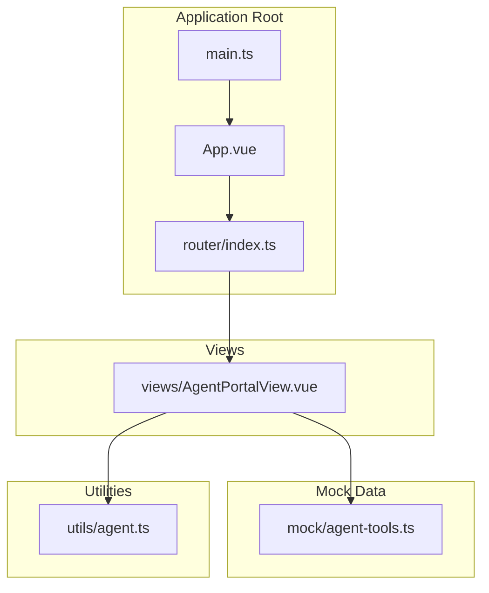
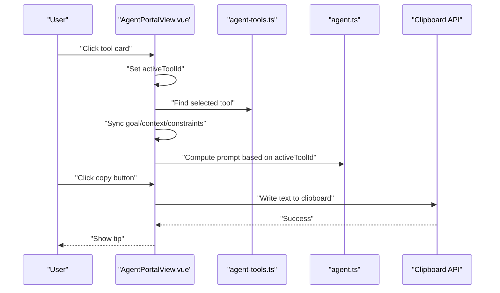
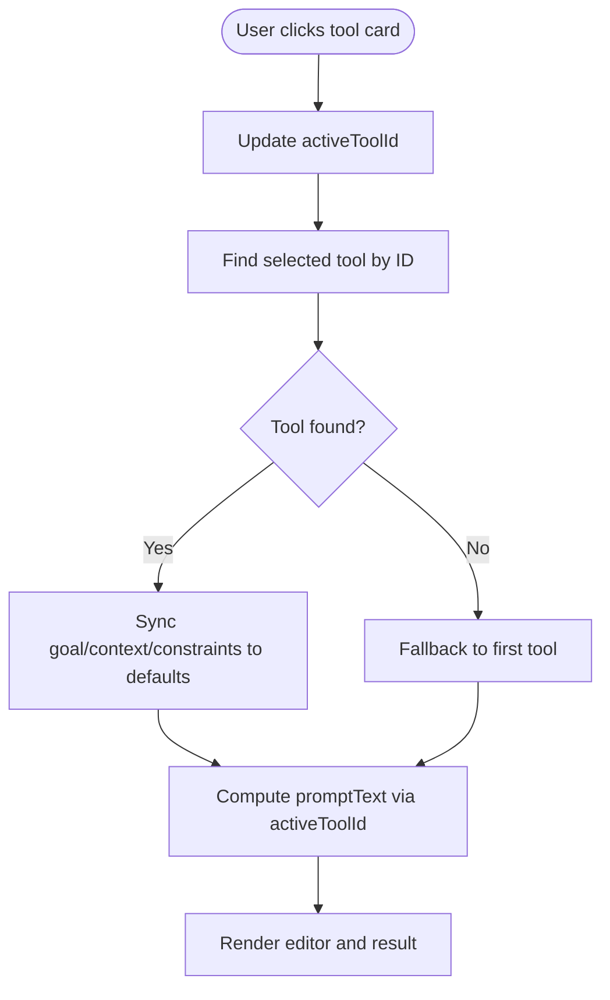
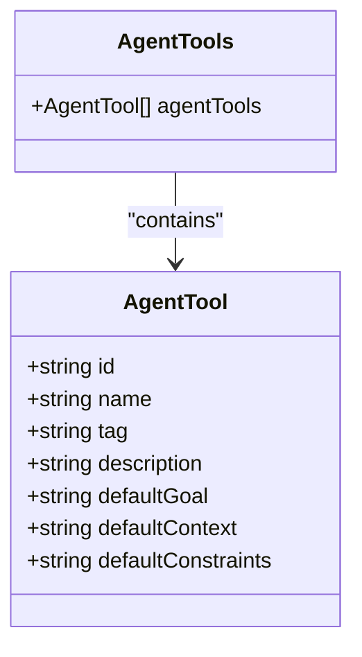
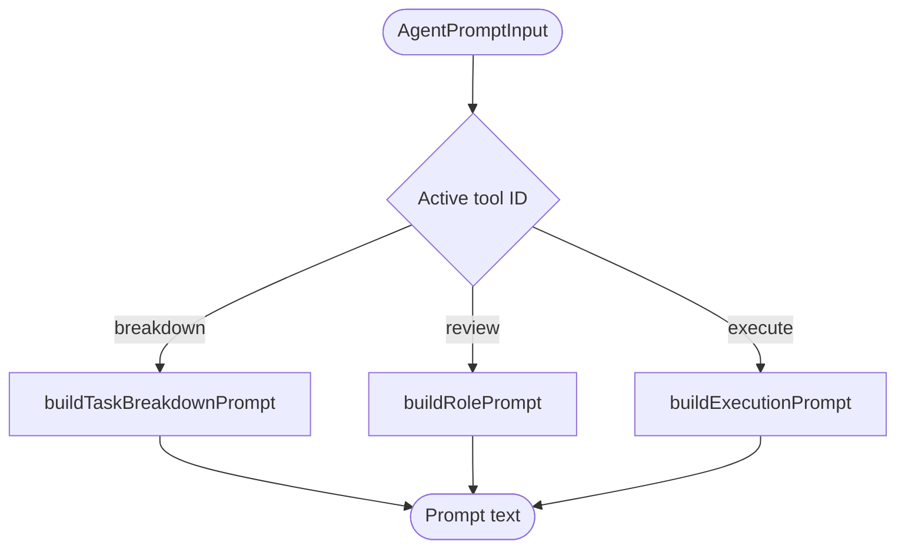
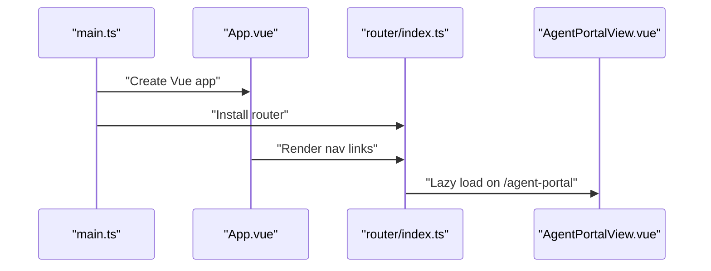
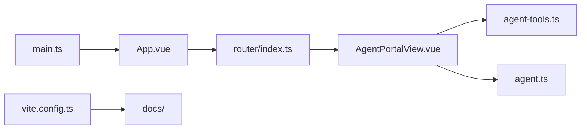

# Portal Architecture & Configuration

<cite>
**Referenced Files in This Document**
- [AgentPortalView.vue](file://src/views/AgentPortalView.vue)
- [agent-tools.ts](file://src/mock/agent-tools.ts)
- [agent.ts](file://src/utils/agent.ts)
- [index.ts](file://src/router/index.ts)
- [main.ts](file://src/main.ts)
- [App.vue](file://src/App.vue)
- [agent.spec.ts](file://src/components/__tests__/agent.spec.ts)
- [vite.config.ts](file://vite.config.ts)
- [package.json](file://package.json)
</cite>

## Table of Contents
1. [Introduction](#introduction)
2. [Project Structure](#project-structure)
3. [Core Components](#core-components)
4. [Architecture Overview](#architecture-overview)
5. [Detailed Component Analysis](#detailed-component-analysis)
6. [Dependency Analysis](#dependency-analysis)
7. [Performance Considerations](#performance-considerations)
8. [Troubleshooting Guide](#troubleshooting-guide)
9. [Conclusion](#conclusion)

## Introduction
This document explains the Agent Tools Portal architecture and configuration system. It focuses on the agentTools mock data structure, tool registration and selection mechanism, reactive state management for active tool tracking, component composition patterns, prop handling, computed property implementations, tool switching logic, default parameter initialization, and the overall portal workflow. It also documents the relationship between the view component and utility functions, highlighting separation of concerns and maintainability benefits.

## Project Structure
The Agent Tools Portal is implemented as a Vue 2 application with a single-page routing model. The portal view integrates with a mock dataset of agent tools and utility functions that generate prompts for different roles. The application is configured to build static assets into the docs directory for hosting.

**Diagram sources**
- [main.ts:1-16](file://src/main.ts#L1-L16)
- [App.vue:1-110](file://src/App.vue#L1-L110)
- [index.ts:1-65](file://src/router/index.ts#L1-L65)
- [AgentPortalView.vue:1-239](file://src/views/AgentPortalView.vue#L1-L239)
- [agent-tools.ts:1-40](file://src/mock/agent-tools.ts#L1-L40)
- [agent.ts:1-47](file://src/utils/agent.ts#L1-L47)

**Section sources**
- [main.ts:1-16](file://src/main.ts#L1-L16)
- [App.vue:1-110](file://src/App.vue#L1-L110)
- [index.ts:1-65](file://src/router/index.ts#L1-L65)
- [vite.config.ts:1-27](file://vite.config.ts#L1-L27)
- [package.json:1-61](file://package.json#L1-L61)

## Core Components
- AgentPortalView.vue: The primary view component that renders the portal UI, manages reactive state for active tool selection and input parameters, computes the prompt text based on the selected tool, and handles clipboard copy operations.
- agent-tools.ts: Defines the AgentTool interface and exports a static array of agent tools with default parameters for goal, context, and constraints.
- agent.ts: Provides utility functions to build role-specific prompts (task breakdown, role review, execution) from structured input.
- router/index.ts: Registers the AgentPortal route lazily and integrates with the application shell.
- main.ts and App.vue: Bootstrap the application, install Pinia, and render the navigation and routed views.

Key responsibilities:
- State management: Reactive refs track active tool ID and input parameters; a computed resolves the active tool object.
- Tool switching: Click handlers update the active tool ID; watchers synchronize input parameters to defaults of the newly selected tool.
- Prompt computation: Computed properties select the appropriate prompt builder based on the active tool ID.
- Clipboard integration: Copy-to-clipboard behavior with user feedback.

**Section sources**
- [AgentPortalView.vue:1-239](file://src/views/AgentPortalView.vue#L1-L239)
- [agent-tools.ts:1-40](file://src/mock/agent-tools.ts#L1-L40)
- [agent.ts:1-47](file://src/utils/agent.ts#L1-L47)
- [index.ts:27-31](file://src/router/index.ts#L27-L31)
- [main.ts:1-16](file://src/main.ts#L1-L16)
- [App.vue:1-110](file://src/App.vue#L1-L110)

## Architecture Overview
The portal follows a unidirectional data flow:
- The view component initializes reactive state from the mock tool set.
- User interactions update the active tool ID.
- Watchers synchronize input parameters to the selected tool’s defaults.
- Computed properties derive the prompt text based on the active tool and inputs.
- Utility functions encapsulate prompt construction logic, keeping the view lean.

**Diagram sources**
- [AgentPortalView.vue:7-58](file://src/views/AgentPortalView.vue#L7-L58)
- [agent-tools.ts:11-39](file://src/mock/agent-tools.ts#L11-L39)
- [agent.ts:9-46](file://src/utils/agent.ts#L9-L46)

## Detailed Component Analysis

### AgentPortalView.vue: State, Props, and Computed Properties
- Reactive state:
  - activeToolId: initialized to the first tool’s ID and updated on tool selection.
  - goal, context, constraints: initialized to the first tool’s defaults and synchronized when the active tool changes.
  - copiedTip: transient UI feedback for clipboard operations.
- Computed properties:
  - activeTool: resolves the currently selected tool object by ID.
  - promptText: selects the appropriate prompt builder based on activeToolId and composes the prompt text from inputs.
- Watcher:
  - On activeToolId change, synchronizes goal, context, and constraints to the selected tool’s defaults.
- Template bindings:
  - Renders a grid of tool cards, binds click events to switch tools, and binds form inputs to reactive parameters.
  - Displays the current tool name and computed prompt text; includes a copy-to-clipboard action.

**Diagram sources**
- [AgentPortalView.vue:7-21](file://src/views/AgentPortalView.vue#L7-L21)
- [AgentPortalView.vue:23-45](file://src/views/AgentPortalView.vue#L23-L45)

**Section sources**
- [AgentPortalView.vue:1-239](file://src/views/AgentPortalView.vue#L1-L239)

### Mock Data Model: agent-tools.ts
- Data contract:
  - AgentTool interface defines id, name, tag, description, and defaultGoal/defaultContext/defaultConstraints.
- Tool catalog:
  - Three tools are exported: execute, breakdown, and review.
  - Each tool includes default values for goal, context, and constraints used to initialize the view’s reactive inputs.

**Diagram sources**
- [agent-tools.ts:1-39](file://src/mock/agent-tools.ts#L1-L39)

**Section sources**
- [agent-tools.ts:1-40](file://src/mock/agent-tools.ts#L1-L40)

### Prompt Builders: agent.ts
- Input contract:
  - AgentPromptInput interface standardizes goal, context, and constraints.
- Builders:
  - buildTaskBreakdownPrompt: produces a structured breakdown prompt.
  - buildRolePrompt: produces a reviewer-centric prompt.
  - buildExecutionPrompt: produces an execution-focused prompt.
- Behavior:
  - Uses a helper to replace empty values with a placeholder, ensuring robustness.

**Diagram sources**
- [agent.ts:1-47](file://src/utils/agent.ts#L1-L47)
- [AgentPortalView.vue:23-45](file://src/views/AgentPortalView.vue#L23-L45)

**Section sources**
- [agent.ts:1-47](file://src/utils/agent.ts#L1-L47)

### Routing and Application Bootstrap
- Route registration:
  - The AgentPortal route is lazily loaded and titled for navigation.
- Application bootstrap:
  - Pinia is installed and created.
  - The App component renders the header with dynamic navigation and the routed view.

**Diagram sources**
- [main.ts:1-16](file://src/main.ts#L1-L16)
- [App.vue:1-110](file://src/App.vue#L1-L110)
- [index.ts:27-31](file://src/router/index.ts#L27-L31)

**Section sources**
- [index.ts:1-65](file://src/router/index.ts#L1-L65)
- [main.ts:1-16](file://src/main.ts#L1-L16)
- [App.vue:1-110](file://src/App.vue#L1-L110)

### Testing Strategy
- Unit tests validate prompt builders:
  - Task breakdown prompt includes expected sections and substitutions.
  - Role prompt uses placeholders for empty inputs.
  - Execution prompt includes expected framing and substitutions.

**Section sources**
- [agent.spec.ts:1-36](file://src/components/__tests__/agent.spec.ts#L1-L36)

## Dependency Analysis
- Internal dependencies:
  - AgentPortalView depends on agent-tools.ts for tool metadata and agent.ts for prompt builders.
  - Router depends on the view component for lazy loading.
  - main.ts and App.vue integrate the router and provide navigation.
- External dependencies:
  - Vue 2, Vue Router, and Pinia are used for framework and state management.
  - Vite builds the application and outputs to docs for static hosting.

**Diagram sources**
- [AgentPortalView.vue:1-239](file://src/views/AgentPortalView.vue#L1-L239)
- [agent-tools.ts:1-40](file://src/mock/agent-tools.ts#L1-L40)
- [agent.ts:1-47](file://src/utils/agent.ts#L1-L47)
- [index.ts:1-65](file://src/router/index.ts#L1-L65)
- [main.ts:1-16](file://src/main.ts#L1-L16)
- [App.vue:1-110](file://src/App.vue#L1-L110)
- [vite.config.ts:1-27](file://vite.config.ts#L1-L27)

**Section sources**
- [package.json:28-32](file://package.json#L28-L32)
- [vite.config.ts:1-27](file://vite.config.ts#L1-L27)

## Performance Considerations
- Computation cost:
  - Computed properties compute prompt text based on active tool ID and inputs; keep inputs small and avoid heavy transformations.
- Rendering:
  - The tool grid uses a simple loop; ensure minimal DOM updates by relying on reactive bindings.
- Clipboard operations:
  - Copy actions are asynchronous; provide immediate feedback to avoid perceived latency.
- Lazy loading:
  - The portal view is lazy-loaded by the router, reducing initial bundle size.

## Troubleshooting Guide
- Active tool not updating:
  - Verify the click handler updates activeToolId and that the watcher synchronizes inputs.
- Inputs not resetting:
  - Confirm the watcher finds the selected tool by ID and assigns defaults.
- Prompt not generated:
  - Check that activeToolId matches one of the supported IDs and that the corresponding builder is invoked.
- Clipboard errors:
  - The component checks for clipboard availability and sets a tip message; ensure browser permissions allow clipboard access.

**Section sources**
- [AgentPortalView.vue:7-58](file://src/views/AgentPortalView.vue#L7-L58)

## Conclusion
The Agent Tools Portal demonstrates a clean separation of concerns: the view component manages UI state and user interactions, the mock data provides a stable tool catalog, and utility functions encapsulate prompt building logic. The architecture is maintainable, testable, and extensible—adding new tools requires minimal changes to the mock data and template, while new prompt types can be introduced via additional builders.