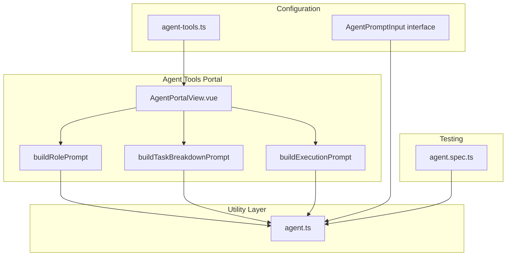
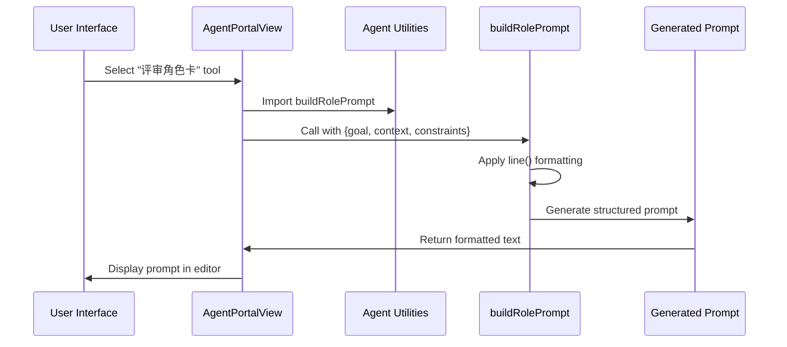
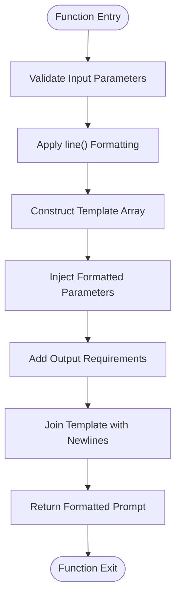
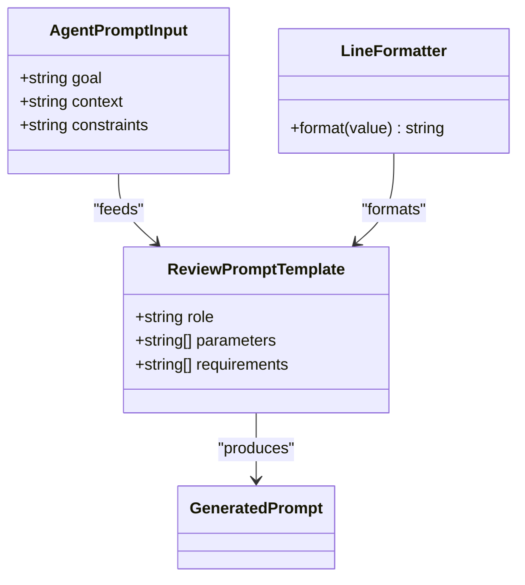
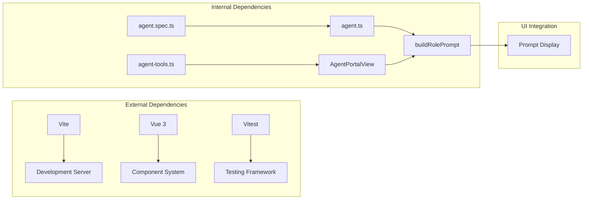

# Review Role Card Tool

<cite>
**Referenced Files in This Document**
- [agent.ts](file://src/utils/agent.ts)
- [agent-tools.ts](file://src/mock/agent-tools.ts)
- [AgentPortalView.vue](file://src/views/AgentPortalView.vue)
- [agent.spec.ts](file://src/components/__tests__/agent.spec.ts)
</cite>

## Table of Contents
1. [Introduction](#introduction)
2. [Project Structure](#project-structure)
3. [Core Components](#core-components)
4. [Architecture Overview](#architecture-overview)
5. [Detailed Component Analysis](#detailed-component-analysis)
6. [Dependency Analysis](#dependency-analysis)
7. [Performance Considerations](#performance-considerations)
8. [Troubleshooting Guide](#troubleshooting-guide)
9. [Conclusion](#conclusion)

## Introduction
The Review Role Card Tool is a specialized component designed to generate role-based review prompts for AI agents. It transforms user-provided goals, context, and constraints into structured prompts that guide AI reviewers through comprehensive code evaluation workflows. The tool serves as part of the Agent Tools Portal, enabling developers to quickly generate high-quality prompts for code review scenarios.

The tool focuses specifically on creating prompts that instruct AI agents to act as "AI Agent Reviewer" roles, emphasizing risk assessment, problem identification, and actionable remediation steps. It provides a standardized framework for quality assessment workflows while maintaining flexibility for various review scenarios.

## Project Structure
The Review Role Card Tool is organized within a modular architecture that separates concerns between prompt generation utilities, tool configuration, and user interface components.

**Diagram sources**
- [AgentPortalView.vue:1-59](file://src/views/AgentPortalView.vue#L1-L59)
- [agent.ts:1-46](file://src/utils/agent.ts#L1-L46)
- [agent-tools.ts:1-39](file://src/mock/agent-tools.ts#L1-L39)
- [agent.spec.ts:1-35](file://src/components/__tests__/agent.spec.ts#L1-L35)

**Section sources**
- [AgentPortalView.vue:1-112](file://src/views/AgentPortalView.vue#L1-L112)
- [agent.ts:1-46](file://src/utils/agent.ts#L1-L46)
- [agent-tools.ts:1-39](file://src/mock/agent-tools.ts#L1-L39)

## Core Components
The Review Role Card Tool consists of several interconnected components that work together to generate structured review prompts:

### Primary Prompt Generator
The `buildRolePrompt` function serves as the core generator for review-oriented AI interactions. It accepts structured input parameters and produces formatted prompts that define reviewer responsibilities and evaluation criteria.

### Input Parameter System
The tool utilizes a standardized input interface that captures three essential elements:
- **Goal**: The primary objective or target of the review
- **Context**: The repository or codebase context being evaluated  
- **Constraints**: Specific limitations or requirements for the review process

### Template Structure
The generated prompts follow a consistent template structure that establishes clear reviewer roles and evaluation frameworks. The template includes role definition, responsibility assignment, and output specification.

**Section sources**
- [agent.ts:23-35](file://src/utils/agent.ts#L23-L35)
- [agent.ts:7](file://src/utils/agent.ts#L7)
- [agent-tools.ts:11-39](file://src/mock/agent-tools.ts#L11-L39)

## Architecture Overview
The Review Role Card Tool follows a clean separation of concerns architecture that promotes modularity and maintainability.

**Diagram sources**
- [AgentPortalView.vue:23-45](file://src/views/AgentPortalView.vue#L23-L45)
- [agent.ts:23-35](file://src/utils/agent.ts#L23-L35)

The architecture ensures that:
- Input validation occurs through the `line()` utility function
- Template consistency is maintained across all prompt generations
- User interface remains decoupled from prompt generation logic
- Testing can be performed independently of the UI layer

**Section sources**
- [AgentPortalView.vue:1-59](file://src/views/AgentPortalView.vue#L1-L59)
- [agent.ts:1-46](file://src/utils/agent.ts#L1-L46)

## Detailed Component Analysis

### buildRolePrompt Function Implementation
The `buildRolePrompt` function implements a sophisticated template system that transforms raw input into structured review prompts. The function follows a multi-stage processing approach:

#### Input Processing Stage
The function begins by applying the `line()` utility to each input parameter, ensuring consistent formatting and fallback handling for empty values.

#### Template Construction Stage
The function constructs a multi-line template that includes:
- Role declaration establishing the AI reviewer identity
- Parameter injection with formatted labels
- Structured output requirements

#### Output Generation Stage
The template array is joined with newline separators to produce the final formatted prompt text.

**Diagram sources**
- [agent.ts:23-35](file://src/utils/agent.ts#L23-L35)
- [agent.ts:7](file://src/utils/agent.ts#L7)

#### Parameter Handling Mechanism
The `line()` utility function provides robust parameter handling through:
- **Trimming**: Removes leading and trailing whitespace
- **Fallback Logic**: Replaces empty strings with "未提供" (not provided)
- **Consistency**: Ensures uniform presentation across all parameters

#### Output Formatting Standards
The generated prompts adhere to strict formatting standards:
- **Role Declaration**: Clear identification of the reviewer role
- **Parameter Labels**: Consistent labeling with colon separation
- **Requirement Specification**: Structured output expectations
- **Line Separation**: Proper newline formatting for readability

**Section sources**
- [agent.ts:23-35](file://src/utils/agent.ts#L23-L35)
- [agent.ts:7](file://src/utils/agent.ts#L7)

### Template Structure for Evaluation and Critique Scenarios
The template structure for evaluation and critique scenarios follows a hierarchical organization that guides AI reviewers through comprehensive assessment workflows:

#### Role Assignment and Responsibility Definition
The template establishes clear reviewer responsibilities through:
- **Primary Role**: "AI Agent Reviewer" designation
- **Evaluation Scope**: Defined by goal and context parameters
- **Constraint Boundaries**: Established through constraint parameters

#### Output Specification Framework
The template defines three critical output categories:
1. **High-risk Issues**: Systematic identification and severity ranking
2. **Actionable Recommendations**: Specific repair suggestions
3. **Minimal Validation Steps**: Precise verification procedures

#### Template Composition Pattern
The template follows a consistent composition pattern:
- **Header Section**: Role and context establishment
- **Parameter Section**: Goal, context, and constraints
- **Directive Section**: Output requirements specification

**Section sources**
- [agent.ts:23-35](file://src/utils/agent.ts#L23-L35)

### Effective Review Prompt Construction Examples
The tool demonstrates effective prompt construction through several key patterns:

#### Example 1: Task Breakdown Scenario

**Diagram sources**
- [agent.ts:1-5](file://src/utils/agent.ts#L1-L5)
- [agent.ts:7](file://src/utils/agent.ts#L7)
- [agent.ts:23-35](file://src/utils/agent.ts#L23-L35)

#### Example 2: Parameter Fallback Handling
The tool demonstrates robust fallback handling through:
- **Empty Input Detection**: Identifies blank parameter values
- **Default Value Application**: Substitutes "未提供" for missing values
- **Consistent Presentation**: Maintains template integrity regardless of input state

**Section sources**
- [agent.spec.ts:16-24](file://src/components/__tests__/agent.spec.ts#L16-L24)
- [agent.ts:7](file://src/utils/agent.ts#L7)

### Quality Assessment Workflow Facilitation
The Review Role Card Tool facilitates quality assessment workflows through several mechanisms:

#### Standardized Evaluation Framework
The tool provides a consistent evaluation framework that ensures:
- **Structured Problem Identification**: Systematic risk assessment
- **Actionable Remediation**: Specific repair recommendations
- **Verification Protocols**: Minimal validation steps for quality assurance

#### Integration with Development Pipeline
The tool integrates seamlessly with development workflows by:
- **Providing Ready-to-Use Prompts**: Eliminating manual prompt creation
- **Maintaining Consistency**: Ensuring uniform review standards
- **Supporting Automation**: Enabling AI-assisted review processes

**Section sources**
- [AgentPortalView.vue:23-45](file://src/views/AgentPortalView.vue#L23-L45)
- [agent-tools.ts:30-38](file://src/mock/agent-tools.ts#L30-L38)

## Dependency Analysis
The Review Role Card Tool exhibits clean dependency relationships that promote maintainability and testability.

**Diagram sources**
- [agent.ts:1-46](file://src/utils/agent.ts#L1-L46)
- [agent-tools.ts:1-39](file://src/mock/agent-tools.ts#L1-L39)
- [AgentPortalView.vue:1-59](file://src/views/AgentPortalView.vue#L1-L59)

The dependency analysis reveals:
- **Low Coupling**: UI components depend on utility functions rather than vice versa
- **Clear Interfaces**: Well-defined input/output contracts for all functions
- **Testable Architecture**: Functions can be tested independently of UI concerns

**Section sources**
- [agent.ts:1-46](file://src/utils/agent.ts#L1-L46)
- [AgentPortalView.vue:1-59](file://src/views/AgentPortalView.vue#L1-L59)

## Performance Considerations
The Review Role Card Tool is designed for optimal performance characteristics:

### Memory Efficiency
- **String Concatenation**: Uses efficient array joining for template construction
- **Immutable Operations**: No state mutations during prompt generation
- **Minimal Allocations**: Single pass template construction reduces memory overhead

### Computational Complexity
- **Linear Time Complexity**: O(n) where n is the number of template segments
- **Constant Space Complexity**: Fixed memory usage regardless of input size
- **Predictable Performance**: Execution time scales linearly with template length

### Scalability Factors
- **Template Reusability**: Single function handles multiple prompt variations
- **Input Flexibility**: Supports various input configurations without modification
- **Integration Ready**: Designed for easy integration with larger systems

## Troubleshooting Guide
Common issues and their solutions when working with the Review Role Card Tool:

### Parameter Validation Issues
**Problem**: Empty or malformed input parameters cause unexpected output
**Solution**: Ensure all parameters are properly formatted and trimmed before processing

### Template Rendering Problems
**Problem**: Generated prompts appear incorrectly formatted
**Solution**: Verify that the template array is properly joined with newline separators

### Integration Challenges
**Problem**: Tool fails to integrate with existing systems
**Solution**: Check that the AgentPromptInput interface matches expected parameter structure

### Testing and Debugging
**Problem**: Difficulty verifying prompt correctness during development
**Solution**: Utilize the provided test suite to validate prompt generation behavior

**Section sources**
- [agent.spec.ts:1-35](file://src/components/__tests__/agent.spec.ts#L1-L35)
- [agent.ts:7](file://src/utils/agent.ts#L7)

## Conclusion
The Review Role Card Tool represents a sophisticated solution for generating role-based review prompts for AI agents. Through its clean architecture, robust parameter handling, and standardized template structure, it enables effective quality assessment workflows while maintaining flexibility for diverse review scenarios.

The tool's strength lies in its ability to transform simple input parameters into structured, actionable prompts that guide AI reviewers through comprehensive evaluation processes. Its modular design ensures maintainability and extensibility, while the comprehensive testing suite provides confidence in its reliability.

Future enhancements could include expanded template customization, support for additional review domains, and integration with external review systems. The current implementation provides a solid foundation for AI-assisted code review workflows and demonstrates best practices for prompt engineering in development tooling contexts.