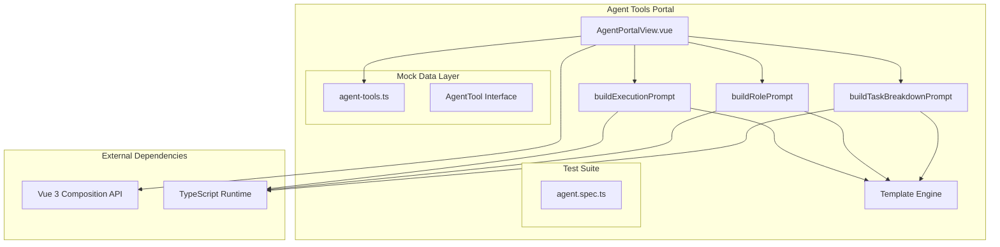
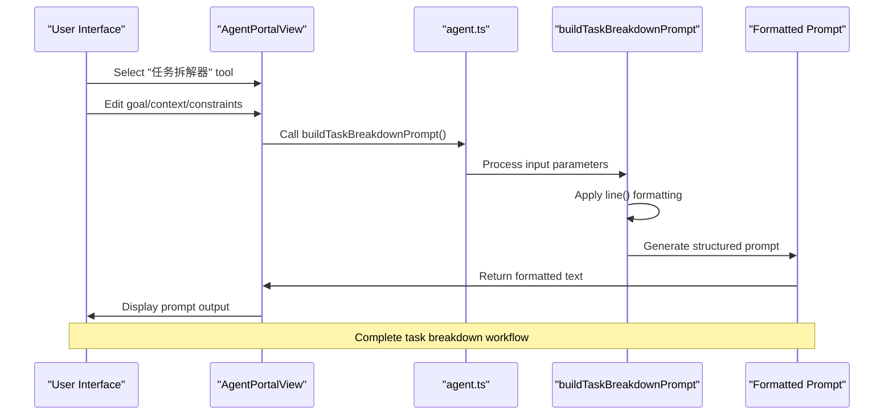
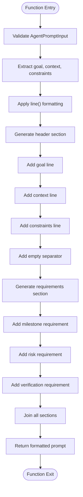
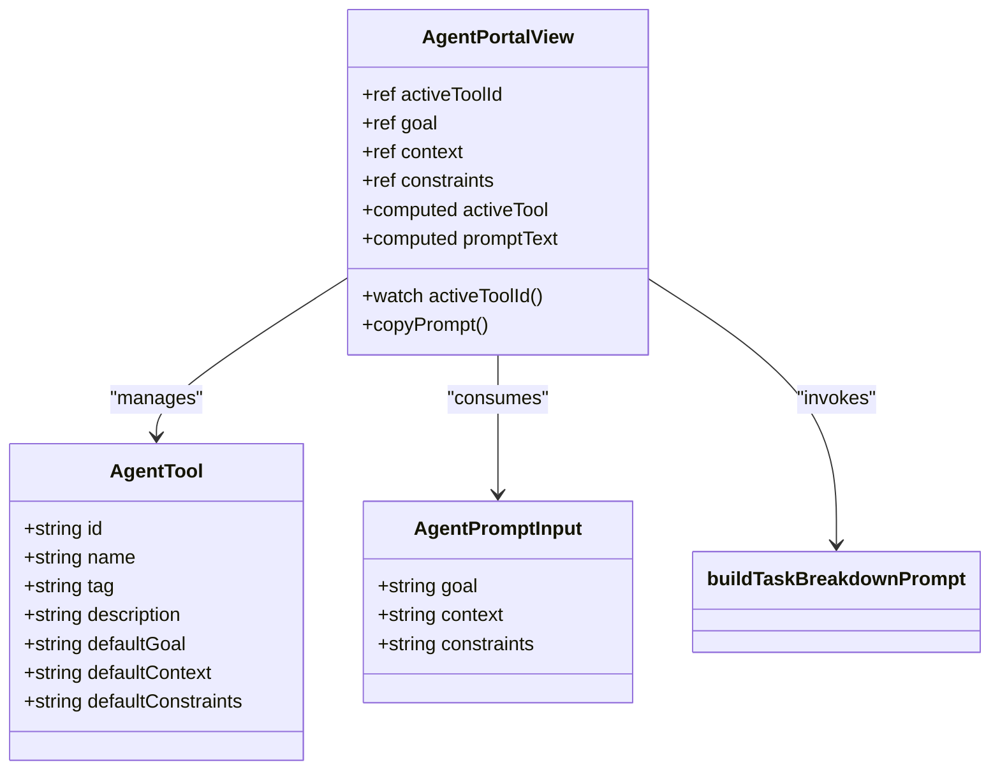
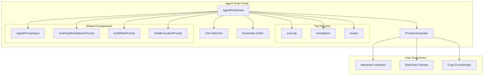
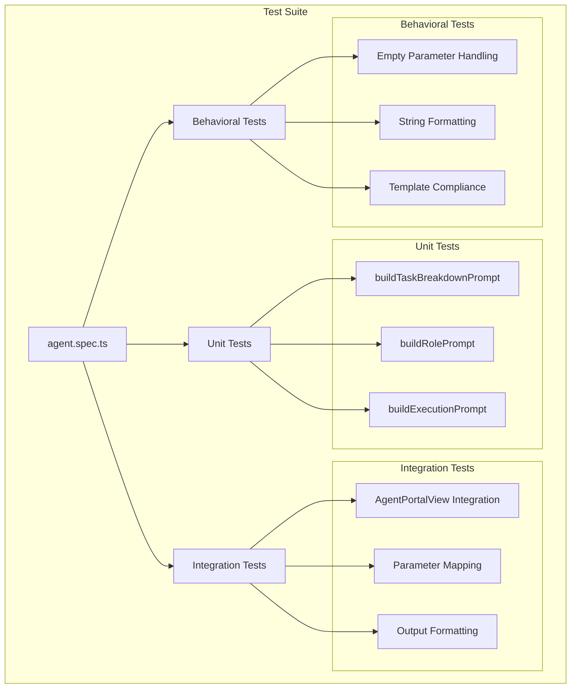

# Task Breakdown Tool

<cite>
**Referenced Files in This Document**
- [agent.ts](file://src/utils/agent.ts)
- [AgentPortalView.vue](file://src/views/AgentPortalView.vue)
- [agent.spec.ts](file://src/components/__tests__/agent.spec.ts)
- [agent-tools.ts](file://src/mock/agent-tools.ts)
</cite>

## Table of Contents
1. [Introduction](#introduction)
2. [Project Structure](#project-structure)
3. [Core Components](#core-components)
4. [Architecture Overview](#architecture-overview)
5. [Detailed Component Analysis](#detailed-component-analysis)
6. [Template Design and Implementation](#template-design-and-implementation)
7. [Parameter Mapping and Output Formatting](#parameter-mapping-and-output-formatting)
8. [Task Breakdown Strategies](#task-breakdown-strategies)
9. [Integration with Agent Tools Portal](#integration-with-agent-tools-portal)
10. [Testing and Validation](#testing-and-validation)
11. [Conclusion](#conclusion)

## Introduction

The Task Breakdown Tool is a specialized component designed to transform complex development goals into structured, actionable task decompositions. Built as part of the Agent Tools Portal ecosystem, this tool serves as a crucial bridge between high-level project objectives and concrete, executable work items. The tool focuses on creating comprehensive task breakdowns that include milestones, risk assessments, and verification procedures, enabling teams to approach complex projects systematically and safely.

The implementation centers around the `buildTaskBreakdownPrompt` function, which generates structured prompts that guide AI agents in creating detailed task decomposition plans. This approach ensures consistency across different types of objectives while maintaining flexibility for various project contexts and constraints.

## Project Structure

The Task Breakdown Tool is integrated into a larger Agent Tools ecosystem within the application architecture:



**Diagram sources**
- [AgentPortalView.vue:1-46](file://src/views/AgentPortalView.vue#L1-L46)
- [agent.ts:1-47](file://src/utils/agent.ts#L1-L47)
- [agent-tools.ts:1-40](file://src/mock/agent-tools.ts#L1-L40)

**Section sources**
- [AgentPortalView.vue:1-112](file://src/views/AgentPortalView.vue#L1-L112)
- [agent.ts:1-47](file://src/utils/agent.ts#L1-L47)
- [agent-tools.ts:1-40](file://src/mock/agent-tools.ts#L1-L40)

## Core Components

The Task Breakdown Tool consists of several interconnected components that work together to provide comprehensive task decomposition capabilities:

### Primary Components

1. **buildTaskBreakdownPrompt Function**: The core function that generates structured task breakdown prompts
2. **AgentPromptInput Interface**: Defines the standardized input structure for all prompt builders
3. **AgentPortalView Component**: Provides the user interface for interacting with the tool
4. **AgentTool Configuration**: Defines tool categories and default configurations
5. **Test Suite**: Validates the functionality and output formatting

### Key Features

- **Structured Output Generation**: Creates prompts with predefined sections for milestones, risks, and verification
- **Flexible Parameter Mapping**: Handles goal, context, and constraint inputs with intelligent fallbacks
- **Consistent Template Design**: Maintains uniform structure across different types of objectives
- **Integration Ready**: Designed to work seamlessly with AI agents and external systems

**Section sources**
- [agent.ts:9-21](file://src/utils/agent.ts#L9-L21)
- [agent.ts:1-5](file://src/utils/agent.ts#L1-L5)
- [AgentPortalView.vue:23-45](file://src/views/AgentPortalView.vue#L23-L45)

## Architecture Overview

The Task Breakdown Tool follows a modular architecture that separates concerns between presentation, logic, and data management:



**Diagram sources**
- [AgentPortalView.vue:23-45](file://src/views/AgentPortalView.vue#L23-L45)
- [agent.ts:9-21](file://src/utils/agent.ts#L9-L21)

The architecture ensures clean separation of concerns:
- **Presentation Layer**: Handles user interaction and display
- **Logic Layer**: Contains the core task breakdown algorithm
- **Data Layer**: Manages tool configurations and default values
- **Validation Layer**: Ensures proper parameter handling and formatting

**Section sources**
- [AgentPortalView.vue:1-112](file://src/views/AgentPortalView.vue#L1-L112)
- [agent.ts:1-47](file://src/utils/agent.ts#L1-L47)

## Detailed Component Analysis

### buildTaskBreakdownPrompt Function

The `buildTaskBreakdownPrompt` function serves as the cornerstone of the Task Breakdown Tool, implementing a sophisticated template engine that transforms raw input into structured task decomposition prompts.

#### Function Signature and Parameters

The function accepts an `AgentPromptInput` object containing three essential properties:
- **goal**: The primary objective or requirement to be decomposed
- **context**: The technical or business context surrounding the goal
- **constraints**: Limitations, requirements, or guidelines for the task execution

#### Implementation Pattern

The function employs a functional programming approach with the following characteristics:



**Diagram sources**
- [agent.ts:9-21](file://src/utils/agent.ts#L9-L21)

#### Output Structure

The generated prompt follows a strict hierarchical structure:

1. **Role Definition**: Establishes the AI agent's persona and responsibilities
2. **Input Parameters**: Documents the goal, context, and constraints
3. **Output Requirements**: Specifies the structured format for the response

**Section sources**
- [agent.ts:9-21](file://src/utils/agent.ts#L9-L21)

### AgentPromptInput Interface

The `AgentPromptInput` interface defines the standardized contract for all prompt builder functions, ensuring consistency across the tool ecosystem.

#### Interface Properties

| Property | Type | Description | Default Behavior |
|----------|------|-------------|------------------|
| `goal` | `string` | Primary objective or requirement | Trimmed and falls back to "未提供" |
| `context` | `string` | Technical or business context | Trimmed and falls back to "未提供" |
| `constraints` | `string` | Limitations or requirements | Trimmed and falls back to "未提供" |

#### Implementation Details

The interface uses a simple yet effective design pattern:
- **Type Safety**: Ensures compile-time validation of input parameters
- **Consistency**: Provides uniform structure across all prompt builders
- **Extensibility**: Allows for future enhancement without breaking changes

**Section sources**
- [agent.ts:1-5](file://src/utils/agent.ts#L1-L5)

### AgentPortalView Integration

The Task Breakdown Tool integrates seamlessly with the Agent Portal's user interface, providing an intuitive workflow for task decomposition.

#### Component Architecture

The integration follows Vue 3 Composition API patterns:



**Diagram sources**
- [AgentPortalView.vue:1-46](file://src/views/AgentPortalView.vue#L1-L46)
- [agent-tools.ts:1-9](file://src/mock/agent-tools.ts#L1-L9)

#### User Interaction Flow

The component manages user interactions through reactive state management:
- **Tool Selection**: Users select the "任务拆解器" tool from available options
- **Parameter Editing**: Users modify goal, context, and constraints through text areas
- **Real-time Preview**: The prompt updates automatically as parameters change
- **Copy Functionality**: Users can easily copy the generated prompt to clipboard

**Section sources**
- [AgentPortalView.vue:1-112](file://src/views/AgentPortalView.vue#L1-L112)

## Template Design and Implementation

The Task Breakdown Tool implements a sophisticated template design that ensures consistent, high-quality output across diverse use cases.

### Template Structure

The template follows a three-section architecture:

#### Section 1: Role and Context Establishment
- **Purpose**: Define the AI agent's persona and the problem domain
- **Content**: Role definition, input parameter documentation
- **Format**: Clear, directive-style instructions

#### Section 2: Output Requirements Specification
- **Purpose**: Define the expected structure and content of the response
- **Content**: Milestone requirements, risk assessment criteria, verification standards
- **Format**: Numbered lists with specific formatting requirements

#### Section 3: Parameter Processing Logic
- **Purpose**: Transform raw input into structured, formatted output
- **Mechanism**: Uses a helper function to handle empty values and whitespace
- **Fallback Strategy**: Provides meaningful defaults when parameters are missing

### Implementation Strategy

The template implementation demonstrates several key programming patterns:

#### Functional Programming Approach
- **Pure Functions**: The template logic is stateless and deterministic
- **Immutability**: Input parameters are not modified during processing
- **Composition**: Complex templates are built from simpler, reusable components

#### String Interpolation Pattern
- **Template Literals**: Uses modern JavaScript string interpolation for dynamic content
- **Array Joining**: Combines multiple string segments efficiently
- **Whitespace Management**: Maintains consistent formatting across all output variations

**Section sources**
- [agent.ts:7](file://src/utils/agent.ts#L7)
- [agent.ts:9-21](file://src/utils/agent.ts#L9-L21)

## Parameter Mapping and Output Formatting

The Task Breakdown Tool implements sophisticated parameter mapping and output formatting mechanisms that ensure consistent, high-quality results across different scenarios.

### Parameter Mapping Strategy

The tool uses a consistent mapping approach that transforms raw input into structured output:

#### Input Processing Pipeline

```mermaid
flowchart LR
A[Raw Input] --> B[Trim Whitespace]
B --> C{Is Value Empty?}
C --> |Yes| D[Fallback "未提供"]
C --> |No| E[Use Original Value]
D --> F[Final Parameter]
E --> F
F --> G[Template Insertion]
G --> H[Formatted Output]
```

**Diagram sources**
- [agent.ts:7](file://src/utils/agent.ts#L7)
- [agent.ts:9-21](file://src/utils/agent.ts#L9-L21)

#### Mapping Rules

| Input Field | Processing Rule | Output Format |
|-------------|----------------|---------------|
| `goal` | Trim whitespace, fallback to "未提供" | "- 目标：[value]" |
| `context` | Trim whitespace, fallback to "未提供" | "- 上下文：[value]" |
| `constraints` | Trim whitespace, fallback to "未提供" | "- 约束：[value]" |

### Output Formatting Standards

The tool maintains strict formatting standards to ensure readability and consistency:

#### Text Formatting Guidelines

- **Consistent Indentation**: Uses hyphens and spaces for bullet points
- **Line Separation**: Employs blank lines to separate logical sections
- **Case Consistency**: Maintains consistent capitalization across output
- **Character Encoding**: Uses UTF-8 encoding for Chinese and English text

#### Structural Consistency

The output maintains a rigid structure that facilitates parsing and processing:
- **Header Section**: Fixed role definition and parameter documentation
- **Requirement Section**: Strictly ordered output requirements
- **Section Separators**: Consistent blank line spacing between major sections

**Section sources**
- [agent.ts:7-21](file://src/utils/agent.ts#L7-L21)

## Task Breakdown Strategies

The Task Breakdown Tool supports multiple effective strategies for decomposing complex objectives into manageable tasks. These strategies are designed to accommodate different project types, team structures, and organizational constraints.

### Strategy Categories

#### 1. Linear Decomposition Strategy
- **Appropriate For**: Simple, sequential tasks with clear dependencies
- **Key Characteristics**: Single-path execution, milestone-based progression
- **Risk Profile**: Lower complexity, easier to track and manage
- **Best For**: Bug fixes, straightforward feature additions, routine maintenance

#### 2. Parallel Decomposition Strategy
- **Appropriate For**: Complex projects with independent sub-components
- **Key Characteristics**: Multiple concurrent streams, shared resources
- **Risk Profile**: Higher coordination overhead, potential resource conflicts
- **Best For**: Feature implementations with distinct UI/backend components, refactorings

#### 3. Risk-Based Decomposition Strategy
- **Appropriate For**: High-risk initiatives requiring careful validation
- **Key Characteristics**: Risk mitigation at each milestone, rollback procedures
- **Risk Profile**: Highest safety margin, most conservative approach
- **Best For**: Major architectural changes, database migrations, security enhancements

### Implementation Patterns

#### Milestone Planning
Each strategy incorporates structured milestone planning that includes:
- **Sequential Dependencies**: Logical progression of tasks
- **Independent Tasks**: Opportunities for parallel execution
- **Validation Points**: Checkpoints for quality assurance

#### Risk Assessment Framework
The tool provides a comprehensive risk assessment framework:
- **Technical Risks**: Compatibility issues, performance impacts
- **Business Risks**: Timeline delays, budget overruns
- **Operational Risks**: Team availability, external dependencies

#### Verification Methodology
Each milestone includes structured verification procedures:
- **Automated Tests**: Unit and integration test coverage
- **Manual Validation**: Human verification steps
- **Performance Metrics**: Quantifiable success criteria

### Example Scenarios

#### Scenario 1: Frontend Component Refactoring
- **Objective**: Modernize existing component architecture
- **Strategy**: Parallel decomposition with risk mitigation
- **Approach**: Refactor UI components, update state management, enhance testing

#### Scenario 2: API Integration Implementation
- **Objective**: Integrate third-party payment processing
- **Strategy**: Risk-based decomposition
- **Approach**: Research and planning, sandbox testing, production deployment

#### Scenario 3: Database Migration
- **Objective**: Upgrade database schema and migrate data
- **Strategy**: Linear decomposition with rollback procedures
- **Approach**: Backup preparation, schema changes, data migration, validation

## Integration with Agent Tools Portal

The Task Breakdown Tool is seamlessly integrated into the broader Agent Tools Portal ecosystem, providing a cohesive user experience and consistent functionality across all tools.

### Portal Integration Architecture



**Diagram sources**
- [AgentPortalView.vue:1-112](file://src/views/AgentPortalView.vue#L1-L112)
- [agent-tools.ts:11-39](file://src/mock/agent-tools.ts#L11-L39)

### Tool Selection Mechanism

The portal provides three distinct tools, each with specific capabilities and use cases:

#### Tool Categories and Responsibilities

| Tool ID | Category | Primary Function | Default Constraints |
|---------|----------|------------------|-------------------|
| `execute` | Delivery | Direct task execution | Build-safe, route-compatible |
| `breakdown` | Planning | Task decomposition | Risk-aware, verification-focused |
| `review` | Review | Code quality assessment | Risk-priority, regression-focused |

#### Dynamic Configuration Loading

The tool selection mechanism supports dynamic loading of default configurations:
- **Automatic Population**: Default values populate when switching tools
- **Context-Aware Defaults**: Tools provide contextually appropriate suggestions
- **Constraint Guidance**: Each tool emphasizes relevant constraints

### User Interface Integration

The Task Breakdown Tool integrates with the portal's user interface through several key mechanisms:

#### Real-time Prompt Generation
- **Computed Properties**: Automatic prompt regeneration when parameters change
- **Live Preview**: Immediate feedback on prompt formatting and content
- **Responsive Updates**: Instant reflection of user input modifications

#### Copy-to-Clipboard Functionality
- **Browser Compatibility**: Graceful degradation for unsupported browsers
- **User Feedback**: Visual indicators for successful operations
- **Error Handling**: Clear messaging for clipboard access failures

**Section sources**
- [AgentPortalView.vue:1-112](file://src/views/AgentPortalView.vue#L1-L112)
- [agent-tools.ts:11-39](file://src/mock/agent-tools.ts#L11-L39)

## Testing and Validation

The Task Breakdown Tool includes comprehensive testing infrastructure that validates functionality, output formatting, and integration behavior.

### Test Architecture

The testing suite follows a structured approach that covers multiple aspects of the tool's functionality:



**Diagram sources**
- [agent.spec.ts:1-36](file://src/components/__tests__/agent.spec.ts#L1-L36)

### Test Coverage Areas

#### Function-Level Testing
The test suite validates individual function behavior:
- **Input Validation**: Ensures proper handling of various input combinations
- **Output Structure**: Verifies correct template formatting and content
- **Edge Cases**: Tests boundary conditions and error scenarios

#### Integration Testing
The portal integration is thoroughly tested:
- **Component Communication**: Validates data flow between components
- **State Management**: Ensures proper reactive updates
- **User Interaction**: Tests real-world usage scenarios

#### Behavioral Validation
The tool's behavior is validated against expected outcomes:
- **Template Compliance**: Confirms adherence to required output formats
- **Fallback Handling**: Validates graceful degradation for missing parameters
- **Consistency Checks**: Ensures uniform behavior across different scenarios

### Test Execution and Validation

The testing infrastructure provides comprehensive validation through multiple assertion patterns:

#### Assertion Patterns Used

| Test Case | Assertion Type | Expected Outcome |
|-----------|----------------|------------------|
| Task Breakdown | Content Containment | Contains "里程碑" and goal text |
| Role Prompt | Fallback Handling | Uses "未提供" for empty parameters |
| Execution Prompt | Template Compliance | Includes role and task definitions |

#### Test Data Management
The test suite uses realistic data scenarios:
- **Chinese Language Support**: Comprehensive testing with Chinese text
- **Mixed Content Types**: Validation across different parameter combinations
- **Edge Case Coverage**: Testing of boundary conditions and invalid inputs

**Section sources**
- [agent.spec.ts:1-36](file://src/components/__tests__/agent.spec.ts#L1-L36)

## Conclusion

The Task Breakdown Tool represents a sophisticated solution for transforming complex development objectives into structured, actionable task decompositions. Through its carefully designed architecture, the tool provides consistent, high-quality output that supports effective project management and team collaboration.

### Key Achievements

The implementation demonstrates several key strengths:

**Technical Excellence**
- Clean, functional programming approach with pure functions
- Robust parameter handling with intelligent fallback mechanisms
- Consistent output formatting that facilitates downstream processing

**User Experience**
- Seamless integration with the Agent Tools Portal ecosystem
- Real-time preview and interactive editing capabilities
- Comprehensive testing infrastructure ensuring reliability

**Scalability and Flexibility**
- Modular design supporting easy extension and modification
- Generic template structure adaptable to various use cases
- Strong typing and validation preventing runtime errors

### Future Enhancement Opportunities

The current implementation provides a solid foundation for future improvements:

**Advanced Features**
- Integration with project management systems for automatic task creation
- Support for hierarchical task dependencies and complex workflows
- Automated risk assessment and mitigation recommendation generation

**Enhanced User Experience**
- Visual task breakdown representation with timeline and dependencies
- Collaborative editing capabilities for team-based planning
- Integration with CI/CD pipelines for automated task execution

The Task Breakdown Tool stands as an exemplary implementation of AI-assisted task management, providing developers and project managers with a powerful tool for organizing and executing complex development initiatives effectively.