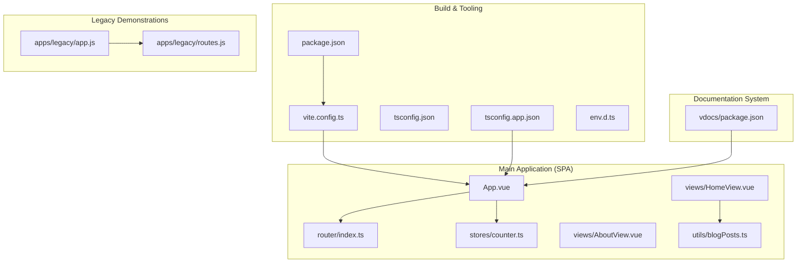
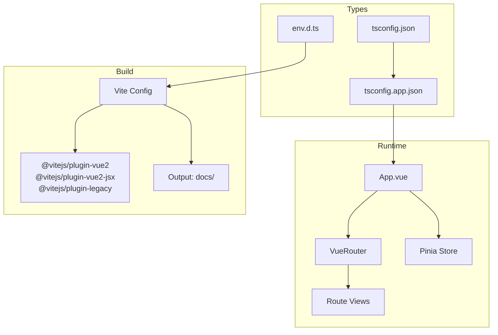
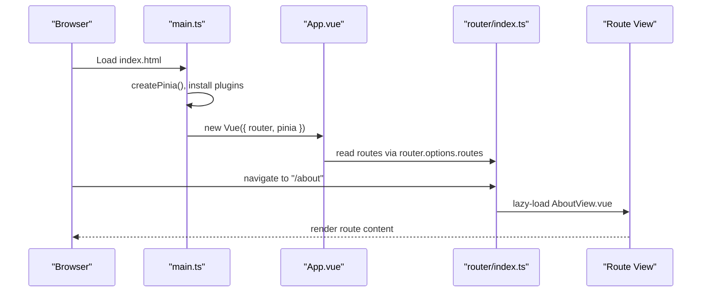
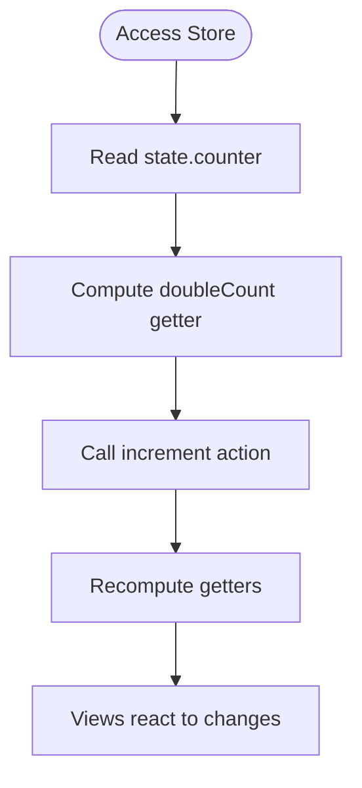
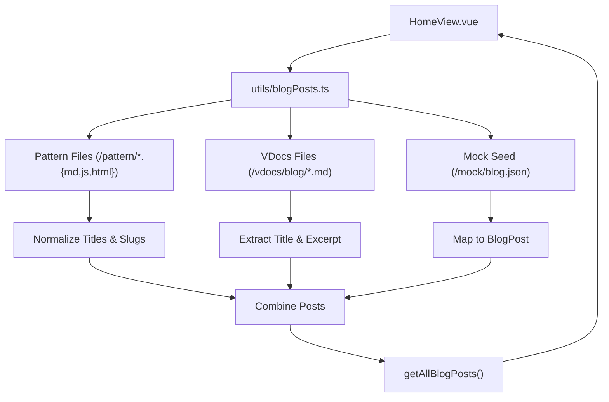
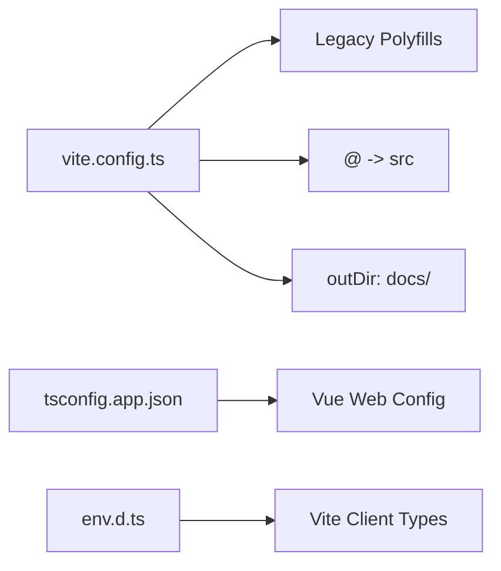
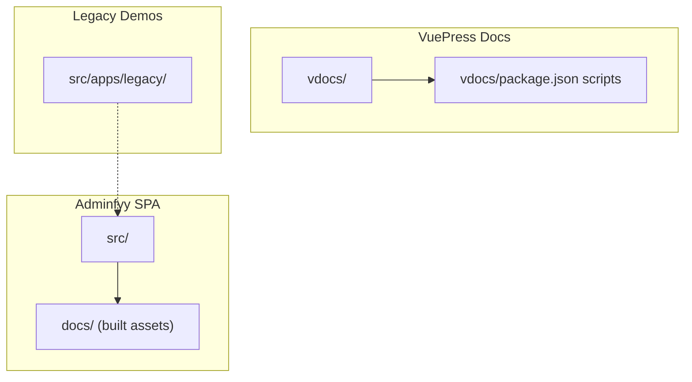
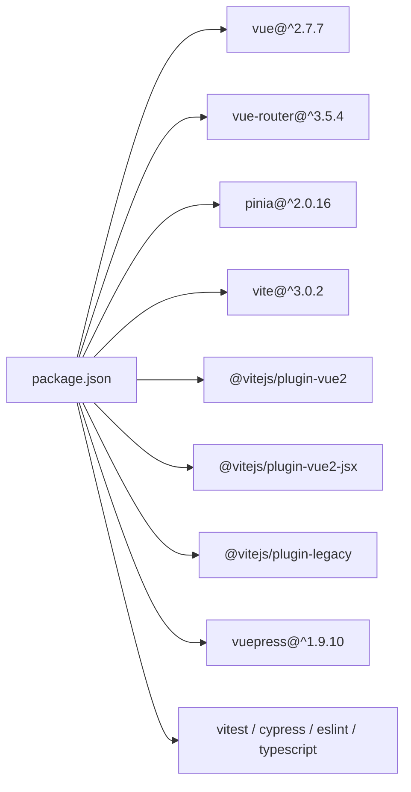

# Architecture Overview

<cite>
**Referenced Files in This Document**
- [App.vue](file://src/App.vue)
- [main.ts](file://src/main.ts)
- [router/index.ts](file://src/router/index.ts)
- [stores/counter.ts](file://src/stores/counter.ts)
- [vite.config.ts](file://vite.config.ts)
- [package.json](file://package.json)
- [tsconfig.json](file://tsconfig.json)
- [tsconfig.app.json](file://tsconfig.app.json)
- [env.d.ts](file://env.d.ts)
- [views/HomeView.vue](file://src/views/HomeView.vue)
- [views/AboutView.vue](file://src/views/AboutView.vue)
- [utils/blogPosts.ts](file://src/utils/blogPosts.ts)
- [apps/legacy/app.js](file://src/apps/legacy/app.js)
- [apps/legacy/routes.js](file://src/apps/legacy/routes.js)
- [vdocs/package.json](file://vdocs/package.json)
</cite>

## Table of Contents
1. [Introduction](#introduction)
2. [Project Structure](#project-structure)
3. [Core Components](#core-components)
4. [Architecture Overview](#architecture-overview)
5. [Detailed Component Analysis](#detailed-component-analysis)
6. [Dependency Analysis](#dependency-analysis)
7. [Performance Considerations](#performance-considerations)
8. [Troubleshooting Guide](#troubleshooting-guide)
9. [Conclusion](#conclusion)
10. [Appendices](#appendices)

## Introduction
This document describes the architecture of the Adminfyy application, a Vue.js 2.7-powered frontend showcasing route-based views, Pinia state management, and a Vite build pipeline. It also documents the separation between the main application, a VuePress-based documentation system, and standalone design pattern demonstrations. The system follows an MVVM pattern with a clear separation of concerns: views (MVVM View), router (MVVM ViewModel), and stores (MVVM Model). Cross-cutting concerns include legacy browser support, TypeScript integration, asset management, state persistence, navigation guards, and performance optimization.

## Project Structure
The repository is organized into three primary areas:
- Main application: Vue 2.7 SPA under src/, built via Vite and served as static assets.
- Documentation system: VuePress v2 site under vdocs/ for knowledge articles and design notes.
- Legacy demonstrations: A separate Vue 2 app under src/apps/legacy/ for historical routing patterns.

**Diagram sources**
- [App.vue:1-110](file://src/App.vue#L1-L110)
- [router/index.ts:1-65](file://src/router/index.ts#L1-L65)
- [stores/counter.ts:1-17](file://src/stores/counter.ts#L1-L17)
- [views/HomeView.vue:1-648](file://src/views/HomeView.vue#L1-L648)
- [views/AboutView.vue:1-143](file://src/views/AboutView.vue#L1-L143)
- [utils/blogPosts.ts:1-110](file://src/utils/blogPosts.ts#L1-L110)
- [vite.config.ts:1-27](file://vite.config.ts#L1-L27)
- [package.json:1-61](file://package.json#L1-L61)
- [tsconfig.json:1-15](file://tsconfig.json#L1-L15)
- [tsconfig.app.json:1-13](file://tsconfig.app.json#L1-L13)
- [env.d.ts:1-2](file://env.d.ts#L1-L2)
- [vdocs/package.json:1-17](file://vdocs/package.json#L1-L17)
- [apps/legacy/app.js:1-13](file://src/apps/legacy/app.js#L1-L13)
- [apps/legacy/routes.js:1-21](file://src/apps/legacy/routes.js#L1-L21)

**Section sources**
- [package.json:1-61](file://package.json#L1-L61)
- [vite.config.ts:1-27](file://vite.config.ts#L1-L27)
- [tsconfig.json:1-15](file://tsconfig.json#L1-L15)
- [tsconfig.app.json:1-13](file://tsconfig.app.json#L1-L13)
- [env.d.ts:1-2](file://env.d.ts#L1-L2)

## Core Components
- Root component: App.vue renders the header and global navigation, delegating page rendering to router-view.
- Routing: router/index.ts defines history-mode routes with lazy-loaded views and metadata-driven navigation.
- State: stores/counter.ts demonstrates Pinia store creation with state, getters, and actions.
- Views: HomeView.vue and AboutView.vue are script-setup single-file components with scoped styles.
- Build: vite.config.ts configures Vue 2 plugin, JSX support, legacy polyfills, alias resolution, and output directory.
- Type safety: tsconfig.* files enable Vue-specific web configs, path aliases, and Vite client types.

Key architectural decisions:
- MVVM alignment: App.vue (View) binds to router (ViewModel) and Pinia (Model).
- Route-based composition: Lazy-loaded components reduce initial bundle size.
- TypeScript-first: Strict compiler options and path aliases improve developer experience.
- Legacy compatibility: @vitejs/plugin-legacy targets IE 11+ with regenerator runtime polyfill.

**Section sources**
- [App.vue:1-110](file://src/App.vue#L1-L110)
- [router/index.ts:1-65](file://src/router/index.ts#L1-L65)
- [stores/counter.ts:1-17](file://src/stores/counter.ts#L1-L17)
- [views/HomeView.vue:1-648](file://src/views/HomeView.vue#L1-L648)
- [views/AboutView.vue:1-143](file://src/views/AboutView.vue#L1-L143)
- [vite.config.ts:1-27](file://vite.config.ts#L1-L27)
- [tsconfig.app.json:1-13](file://tsconfig.app.json#L1-L13)
- [env.d.ts:1-2](file://env.d.ts#L1-L2)

## Architecture Overview
High-level MVVM flow:
- View (App.vue): Renders header and router-view.
- ViewModel (router/index.ts): Manages navigation, route metadata, and lazy-loaded components.
- Model (stores/counter.ts): Provides reactive state and derived data.
- Build (vite.config.ts): Compiles Vue 2 SFCs, JSX, legacy polyfills, and outputs to docs/.
- Types (tsconfig.*): Ensures type-safe development and build-time checks.

**Diagram sources**
- [App.vue:1-110](file://src/App.vue#L1-L110)
- [router/index.ts:1-65](file://src/router/index.ts#L1-L65)
- [stores/counter.ts:1-17](file://src/stores/counter.ts#L1-L17)
- [vite.config.ts:1-27](file://vite.config.ts#L1-L27)
- [tsconfig.json:1-15](file://tsconfig.json#L1-L15)
- [tsconfig.app.json:1-13](file://tsconfig.app.json#L1-L13)
- [env.d.ts:1-2](file://env.d.ts#L1-L2)

## Detailed Component Analysis

### Component Hierarchy and Navigation Flow
The SPA bootstraps via main.ts, mounting App.vue with router and Pinia. App.vue computes menuRoutes from router options and renders router-view. Routes are defined in router/index.ts with lazy-loaded components and metadata for titles.

**Diagram sources**
- [main.ts:1-16](file://src/main.ts#L1-L16)
- [App.vue:32-44](file://src/App.vue#L32-L44)
- [router/index.ts:1-65](file://src/router/index.ts#L1-L65)

**Section sources**
- [main.ts:1-16](file://src/main.ts#L1-L16)
- [App.vue:1-110](file://src/App.vue#L1-L110)
- [router/index.ts:1-65](file://src/router/index.ts#L1-L65)

### State Management with Pinia
Pinia is integrated in main.ts and demonstrated by stores/counter.ts. The store exposes state, getters, and actions for reactive updates across views.

**Diagram sources**
- [stores/counter.ts:1-17](file://src/stores/counter.ts#L1-L17)
- [main.ts:1-16](file://src/main.ts#L1-L16)

**Section sources**
- [stores/counter.ts:1-17](file://src/stores/counter.ts#L1-L17)
- [main.ts:1-16](file://src/main.ts#L1-L16)

### Data Flow Architecture: Blog Aggregation
HomeView.vue consumes data from utils/blogPosts.ts, which aggregates content from:
- Pattern demos under /pattern/*.{md,js,html}
- VuePress docs under /vdocs/blog/*.md
- Seed data from mock/blog.json

**Diagram sources**
- [views/HomeView.vue:1-648](file://src/views/HomeView.vue#L1-L648)
- [utils/blogPosts.ts:1-110](file://src/utils/blogPosts.ts#L1-L110)

**Section sources**
- [views/HomeView.vue:1-648](file://src/views/HomeView.vue#L1-L648)
- [utils/blogPosts.ts:1-110](file://src/utils/blogPosts.ts#L1-L110)

### Legacy Browser Support and Asset Management
- Legacy support: @vitejs/plugin-legacy configured to target IE >= 11 with regenerator-runtime polyfill.
- Alias resolution: '@' resolves to ./src via vite.config.ts.
- Output: build.outDir set to 'docs/' for static hosting.
- TypeScript: tsconfig.app.json extends Vue’s web config; env.d.ts enables Vite client types.

**Diagram sources**
- [vite.config.ts:1-27](file://vite.config.ts#L1-L27)
- [tsconfig.app.json:1-13](file://tsconfig.app.json#L1-L13)
- [env.d.ts:1-2](file://env.d.ts#L1-L2)

**Section sources**
- [vite.config.ts:1-27](file://vite.config.ts#L1-L27)
- [tsconfig.app.json:1-13](file://tsconfig.app.json#L1-L13)
- [env.d.ts:1-2](file://env.d.ts#L1-L2)

### System Boundaries and Separation of Concerns
- Main SPA boundary: src/ produces static assets under docs/.
- Documentation boundary: vdocs/ runs a separate VuePress site with its own package and scripts.
- Legacy demonstrations boundary: src/apps/legacy/ is a distinct Vue 2 app with legacy routing.

**Diagram sources**
- [package.json:15-26](file://package.json#L15-L26)
- [vdocs/package.json:1-17](file://vdocs/package.json#L1-L17)
- [apps/legacy/app.js:1-13](file://src/apps/legacy/app.js#L1-L13)
- [apps/legacy/routes.js:1-21](file://src/apps/legacy/routes.js#L1-L21)

**Section sources**
- [package.json:15-26](file://package.json#L15-L26)
- [vdocs/package.json:1-17](file://vdocs/package.json#L1-L17)
- [apps/legacy/app.js:1-13](file://src/apps/legacy/app.js#L1-L13)
- [apps/legacy/routes.js:1-21](file://src/apps/legacy/routes.js#L1-L21)

## Dependency Analysis
- Runtime dependencies: Vue 2.7, Vue Router 3.x, Pinia 2.x.
- Build dependencies: Vite 3, @vitejs/plugin-vue2, @vitejs/plugin-vue2-jsx, @vitejs/plugin-legacy.
- Testing and linting: Vitest, Cypress, ESLint with Vue and TypeScript configurations.
- Documentation toolchain: VuePress 1.x in the main repo and VuePress 2.x in vdocs/.

**Diagram sources**
- [package.json:28-59](file://package.json#L28-L59)

**Section sources**
- [package.json:28-59](file://package.json#L28-L59)

## Performance Considerations
- Route-level code splitting: Lazy-loading route components reduces initial payload.
- Scoped styles and CSS variables: Minimizes global style conflicts and improves maintainability.
- Legacy polyfills: Adds minimal overhead for broad browser coverage.
- Static build output: docs/ directory optimized for CDN/static hosting.
- Animation and layout: CSS animations and responsive grids balance UX and performance.

[No sources needed since this section provides general guidance]

## Troubleshooting Guide
- Navigation issues: Verify router mode/history base and route meta.title availability for menu generation.
- State not updating: Ensure Pinia plugin installation and store usage within component lifecycle.
- Build failures: Confirm Vite plugins are installed and tsconfig paths align with imports.
- Legacy compatibility: Validate IE 11 polyfills and avoid unsupported ES features.
- Asset resolution: Check '@' alias and import.meta.glob patterns for content aggregation.

**Section sources**
- [router/index.ts:1-65](file://src/router/index.ts#L1-L65)
- [stores/counter.ts:1-17](file://src/stores/counter.ts#L1-L17)
- [vite.config.ts:1-27](file://vite.config.ts#L1-L27)
- [tsconfig.app.json:1-13](file://tsconfig.app.json#L1-L13)
- [utils/blogPosts.ts:1-110](file://src/utils/blogPosts.ts#L1-L110)

## Conclusion
Adminfyy employs a clean MVVM architecture with Vue 2.7, Vue Router, and Pinia. The build system leverages Vite with legacy support and TypeScript integration. The project maintains clear boundaries between the SPA, the VuePress documentation site, and legacy demonstrations. Route-based composition, lazy-loaded views, and centralized state management provide a scalable foundation for future enhancements.

[No sources needed since this section summarizes without analyzing specific files]

## Appendices

### Appendix A: MVVM Mapping
- View: App.vue and route views (e.g., HomeView.vue, AboutView.vue)
- ViewModel: router/index.ts managing navigation and metadata
- Model: stores/counter.ts and reactive data from utils/blogPosts.ts

**Section sources**
- [App.vue:1-110](file://src/App.vue#L1-L110)
- [router/index.ts:1-65](file://src/router/index.ts#L1-L65)
- [stores/counter.ts:1-17](file://src/stores/counter.ts#L1-L17)
- [views/HomeView.vue:1-648](file://src/views/HomeView.vue#L1-L648)
- [views/AboutView.vue:1-143](file://src/views/AboutView.vue#L1-L143)
- [utils/blogPosts.ts:1-110](file://src/utils/blogPosts.ts#L1-L110)