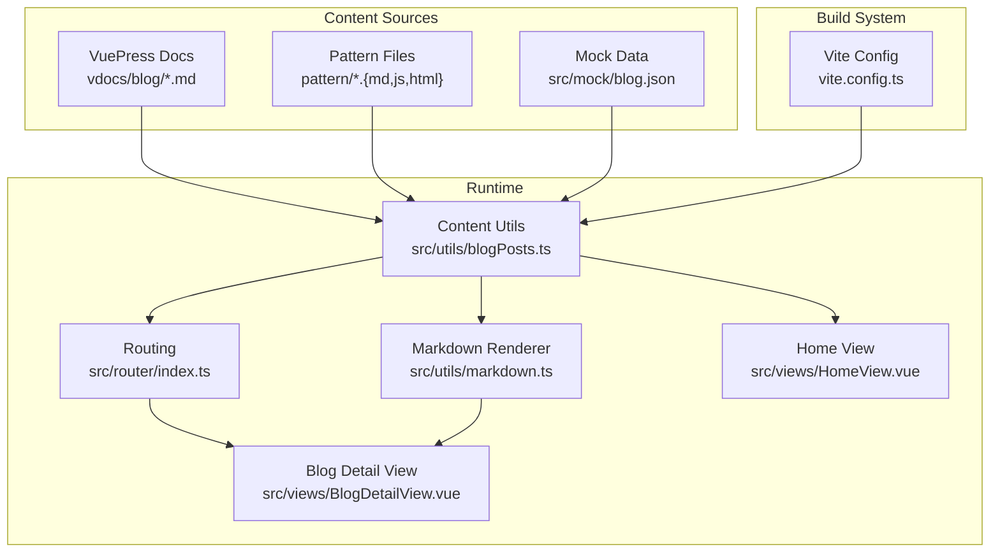
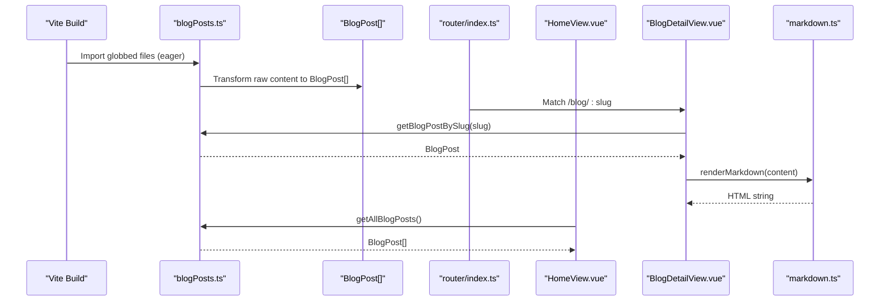
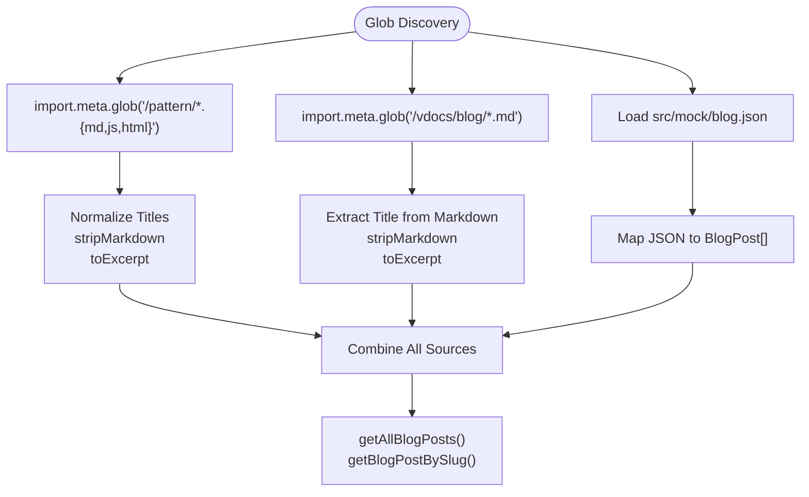
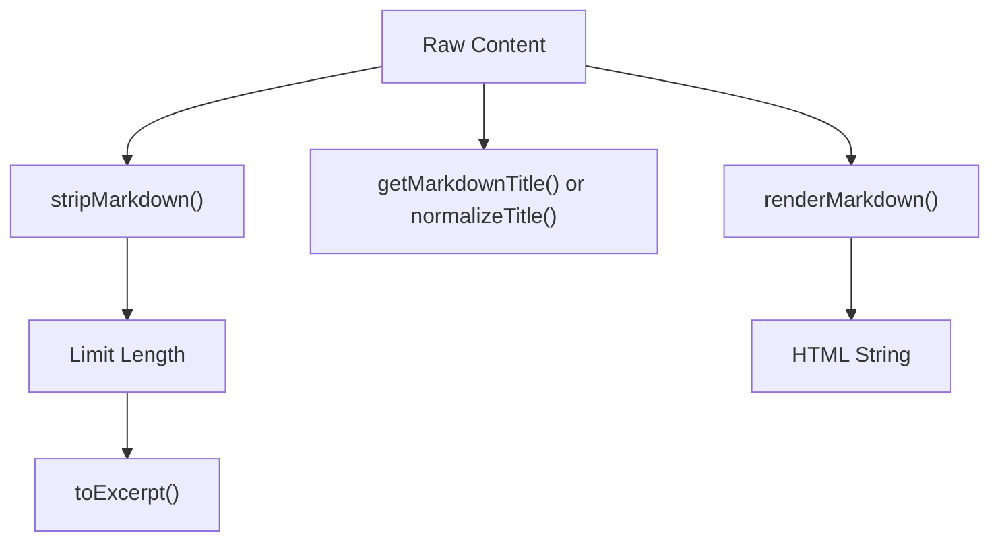
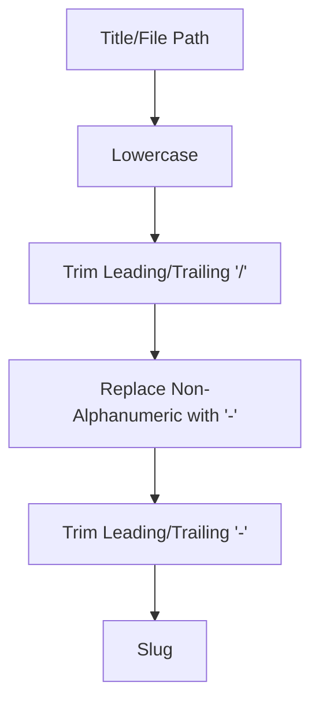
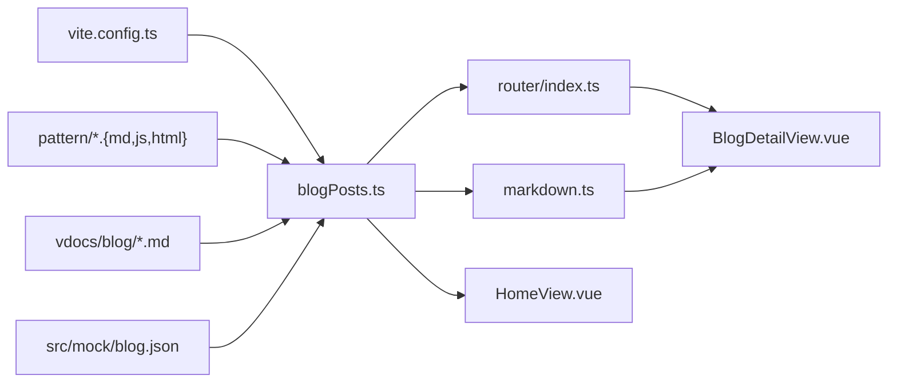

# Blog Content Management

<cite>
**Referenced Files in This Document**
- [blogPosts.ts](file://src/utils/blogPosts.ts)
- [markdown.ts](file://src/utils/markdown.ts)
- [BlogDetailView.vue](file://src/views/BlogDetailView.vue)
- [HomeView.vue](file://src/views/HomeView.vue)
- [router/index.ts](file://src/router/index.ts)
- [vite.config.ts](file://vite.config.ts)
- [blog.json](file://src/mock/blog.json)
- [Mediator.md](file://pattern/Mediator.md)
- [publish-subscribe.md](file://vdocs/blog/publish-subscribe.md)
- [README.md](file://vdocs/blog/README.md)
- [blog.vue](file://src/apps/legacy/module/blog.vue)
</cite>

## Table of Contents
1. [Introduction](#introduction)
2. [Project Structure](#project-structure)
3. [Core Components](#core-components)
4. [Architecture Overview](#architecture-overview)
5. [Detailed Component Analysis](#detailed-component-analysis)
6. [Dependency Analysis](#dependency-analysis)
7. [Performance Considerations](#performance-considerations)
8. [Troubleshooting Guide](#troubleshooting-guide)
9. [Conclusion](#conclusion)
10. [Appendices](#appendices)

## Introduction
This document describes the blog content management system that dynamically aggregates content from multiple sources using Vite's glob imports and integrates with Vue.js for rendering. It covers the content processing pipeline from raw markdown files to rendered blog posts, categorization and tagging systems, reading statistics, slug generation and URL routing, content validation, error handling, and fallback mechanisms. It also explains how mock data relates to production content sources and provides guidance for extending the system with new content types and customizing presentation.

## Project Structure
The blog system spans several areas:
- Content sources: VuePress documentation site (`vdocs/blog/*.md`), design pattern examples (`pattern/*.{md,js,html}`), and a mock JSON dataset (`src/mock/blog.json`)
- Build system: Vite configuration that enables Vue 2, JSX, and legacy browser support while building static assets to the `docs` directory
- Runtime: Vue components and utilities that load, process, and render content, with routing for individual blog posts

**Diagram sources**
- [vite.config.ts:1-27](file://vite.config.ts#L1-L27)
- [blogPosts.ts:1-110](file://src/utils/blogPosts.ts#L1-L110)
- [markdown.ts:1-188](file://src/utils/markdown.ts#L1-L188)
- [router/index.ts:1-65](file://src/router/index.ts#L1-L65)
- [HomeView.vue:1-648](file://src/views/HomeView.vue#L1-L648)
- [BlogDetailView.vue:1-530](file://src/views/BlogDetailView.vue#L1-L530)

**Section sources**
- [vite.config.ts:1-27](file://vite.config.ts#L1-L27)
- [blogPosts.ts:1-110](file://src/utils/blogPosts.ts#L1-L110)

## Core Components
- Dynamic content aggregation: Uses Vite's `import.meta.glob` to eagerly load markdown and pattern files, converting them into structured blog posts
- Content processing pipeline: Extracts metadata, generates excerpts, normalizes titles, and renders markdown to HTML
- Post categorization and tagging: Assigns categories based on source and file type; adds source tags for provenance
- Slug generation and routing: Creates SEO-friendly URLs from titles and file paths; routes handled by Vue Router
- Presentation: Home page lists all posts with excerpts; detail view renders full content with reading time estimation

**Section sources**
- [blogPosts.ts:13-110](file://src/utils/blogPosts.ts#L13-L110)
- [markdown.ts:17-188](file://src/utils/markdown.ts#L17-L188)
- [router/index.ts:33-36](file://src/router/index.ts#L33-L36)
- [HomeView.vue:5-8](file://src/views/HomeView.vue#L5-L8)
- [BlogDetailView.vue:9-32](file://src/views/BlogDetailView.vue#L9-L32)

## Architecture Overview
The system follows a pipeline:
1. Build-time discovery: Vite globs content files and injects them into the bundle
2. Runtime assembly: Content utilities assemble posts from multiple sources
3. Rendering: Markdown is transformed to HTML; Vue components present posts and detail pages
4. Routing: Vue Router maps `/blog/:slug` to detail views

**Diagram sources**
- [blogPosts.ts:13-110](file://src/utils/blogPosts.ts#L13-L110)
- [router/index.ts:33-36](file://src/router/index.ts#L33-L36)
- [HomeView.vue:5-8](file://src/views/HomeView.vue#L5-L8)
- [BlogDetailView.vue:9-32](file://src/views/BlogDetailView.vue#L9-L32)
- [markdown.ts:17-188](file://src/utils/markdown.ts#L17-L188)

## Detailed Component Analysis

### Dynamic Content Aggregation with Vite Glob Imports
- Pattern files: Eagerly loaded from `pattern/*.{md,js,html}`, treated as individual posts with categories derived from file type
- VuePress docs: Eagerly loaded from `vdocs/blog/*.md`, excluding the root README, with titles extracted from markdown frontmatter
- Seed data: Loaded from mock JSON, converted into posts with a fixed category
- Assembly: All sources combined into a unified array for downstream consumption

**Diagram sources**
- [blogPosts.ts:13-110](file://src/utils/blogPosts.ts#L13-L110)

**Section sources**
- [blogPosts.ts:13-110](file://src/utils/blogPosts.ts#L13-L110)

### Content Processing Pipeline
- Title normalization: Removes file extensions and cleans filenames
- Excerpt generation: Strips markdown formatting, limits length, and appends ellipsis
- Frontmatter extraction: Reads first-level headings as titles when available
- Markdown rendering: Converts markdown to HTML with code block preservation, inline formatting, lists, tables, images, and blockquotes

**Diagram sources**
- [blogPosts.ts:23-46](file://src/utils/blogPosts.ts#L23-L46)
- [markdown.ts:17-188](file://src/utils/markdown.ts#L17-L188)

**Section sources**
- [blogPosts.ts:23-46](file://src/utils/blogPosts.ts#L23-L46)
- [markdown.ts:17-188](file://src/utils/markdown.ts#L17-L188)

### Post Categorization and Tagging
- Categories:
  - Pattern posts: Derived from file extension (e.g., `pattern/md`, `pattern/js`, `pattern/html`)
  - VuePress posts: Fixed category `vdocs/blog`
  - Seed posts: Fixed category `notes`
- Tags:
  - Source tags are added to the detail view for provenance (e.g., `#vdocs`, `#pattern`, `#seed`)

**Section sources**
- [blogPosts.ts:55-90](file://src/utils/blogPosts.ts#L55-L90)
- [BlogDetailView.vue:55-57](file://src/views/BlogDetailView.vue#L55-L57)

### Slug Generation and URL Routing
- Slug generation algorithm:
  - Lowercase and trim leading/trailing slashes
  - Replace non-alphanumeric Unicode characters with hyphens
  - Trim leading/trailing hyphens
- Routing:
  - Route pattern `/blog/:slug` resolves to the detail view
  - Detail view computes reading time based on word count

**Diagram sources**
- [blogPosts.ts:48-54](file://src/utils/blogPosts.ts#L48-L54)

**Section sources**
- [blogPosts.ts:48-54](file://src/utils/blogPosts.ts#L48-L54)
- [router/index.ts:33-36](file://src/router/index.ts#L33-L36)
- [BlogDetailView.vue:25-30](file://src/views/BlogDetailView.vue#L25-L30)

### Reading Statistics Implementation
- Stats computed from aggregated posts:
  - Total posts
  - Counts per source (VuePress, Pattern, Seed)
- Displayed on the home page for quick visibility

**Section sources**
- [blogPosts.ts:102-109](file://src/utils/blogPosts.ts#L102-L109)
- [HomeView.vue:30-45](file://src/views/HomeView.vue#L30-L45)

### Content Validation, Error Handling, and Fallbacks
- Validation:
  - Excerpt generation strips markdown formatting to ensure readable summaries
  - Frontmatter extraction falls back to filename normalization when no title is found
- Error handling:
  - Detail view displays an empty state with a back link when a slug does not match any post
  - Related posts are filtered to avoid self-reference and limited to a fixed count
- Fallbacks:
  - Missing titles use normalized filenames
  - Empty content renders as empty HTML safely

**Section sources**
- [blogPosts.ts:42-46](file://src/utils/blogPosts.ts#L42-L46)
- [BlogDetailView.vue:61-66](file://src/views/BlogDetailView.vue#L61-L66)
- [BlogDetailView.vue:13-19](file://src/views/BlogDetailView.vue#L13-L19)

### Relationship Between Mock Data and Production Content Sources
- Mock data (`src/mock/blog.json`) provides a lightweight seed dataset for development and testing
- Production content primarily comes from:
  - VuePress documentation site (`vdocs/blog/*.md`)
  - Pattern examples (`pattern/*.{md,js,html}`)
- The mock data is integrated alongside other sources during aggregation, enabling local development without external documentation builds

**Section sources**
- [blog.json:1-14](file://src/mock/blog.json#L1-L14)
- [blogPosts.ts:80-90](file://src/utils/blogPosts.ts#L80-L90)

### Adding New Content Types and Customizing Presentation
- Adding a new content type:
  - Define a new glob pattern in the content utilities to include the desired files
  - Map the resulting raw content to the `BlogPost` interface
  - Assign a category and customize excerpt/title extraction as needed
- Customizing presentation:
  - Modify the home view to change layout, filtering, or sorting
  - Extend the detail view to add analytics, social sharing, or additional metadata
  - Adjust markdown rendering rules in the renderer utility to support new syntax

**Section sources**
- [blogPosts.ts:13-21](file://src/utils/blogPosts.ts#L13-L21)
- [HomeView.vue:54-137](file://src/views/HomeView.vue#L54-L137)
- [BlogDetailView.vue:35-88](file://src/views/BlogDetailView.vue#L35-L88)
- [markdown.ts:17-188](file://src/utils/markdown.ts#L17-L188)

## Dependency Analysis
The system exhibits clear separation of concerns:
- Build-time: Vite globs content files and injects them into the runtime
- Runtime: Utilities assemble posts, render markdown, and expose getters
- Presentation: Views consume the assembled data and render UI
- Routing: Router binds slugs to detail views

**Diagram sources**
- [vite.config.ts:1-27](file://vite.config.ts#L1-L27)
- [blogPosts.ts:13-110](file://src/utils/blogPosts.ts#L13-L110)
- [markdown.ts:17-188](file://src/utils/markdown.ts#L17-L188)
- [router/index.ts:1-65](file://src/router/index.ts#L1-L65)
- [HomeView.vue:1-648](file://src/views/HomeView.vue#L1-L648)
- [BlogDetailView.vue:1-530](file://src/views/BlogDetailView.vue#L1-L530)

**Section sources**
- [vite.config.ts:1-27](file://vite.config.ts#L1-L27)
- [blogPosts.ts:13-110](file://src/utils/blogPosts.ts#L13-L110)
- [router/index.ts:1-65](file://src/router/index.ts#L1-L65)

## Performance Considerations
- Eager loading: Vite globs are configured as eager, which bundles content at build time for immediate runtime access
- Rendering cost: Markdown processing occurs per post; consider caching rendered HTML if performance becomes a concern
- Memory footprint: All posts are kept in memory; pagination or virtualization could reduce memory usage for large content sets
- Build output: Static assets are emitted to the `docs` directory, suitable for hosting on static CDNs

[No sources needed since this section provides general guidance]

## Troubleshooting Guide
- Missing or incorrect titles:
  - Verify frontmatter extraction logic and fallback normalization
- Incorrect excerpts:
  - Confirm markdown stripping and truncation logic
- Slug collisions:
  - Ensure unique slugs by incorporating source identifiers or indices
- Routing failures:
  - Confirm route pattern and parameter binding
- Empty detail view:
  - Check slug existence and fallback UI behavior

**Section sources**
- [blogPosts.ts:42-54](file://src/utils/blogPosts.ts#L42-L54)
- [BlogDetailView.vue:61-66](file://src/views/BlogDetailView.vue#L61-L66)
- [router/index.ts:33-36](file://src/router/index.ts#L33-L36)

## Conclusion
The blog content management system leverages Vite's glob imports to unify diverse content sources into a cohesive, searchable, and renderable collection. Its modular design separates content ingestion, processing, and presentation, enabling straightforward extensibility and customization. The slug-based routing and reading statistics provide a solid foundation for discoverability and user engagement.

[No sources needed since this section summarizes without analyzing specific files]

## Appendices

### Example Content Sources
- VuePress documentation: See the VuePress blog directory and its README for article links and structure
- Pattern examples: Markdown and JavaScript/HTML files under the pattern directory
- Mock data: JSON entries used for development and testing

**Section sources**
- [README.md:7-14](file://vdocs/blog/README.md#L7-L14)
- [Mediator.md:1-93](file://pattern/Mediator.md#L1-L93)
- [publish-subscribe.md:1-50](file://vdocs/blog/publish-subscribe.md#L1-L50)
- [blog.json:1-14](file://src/mock/blog.json#L1-L14)

### Legacy Integration
- Legacy blog component demonstrates a simpler approach using mock data and basic click handlers
- Modern implementation replaces mock data with Vite globs and Vue Router for navigation

**Section sources**
- [blog.vue:18-32](file://src/apps/legacy/module/blog.vue#L18-L32)
- [blogPosts.ts:1-110](file://src/utils/blogPosts.ts#L1-L110)