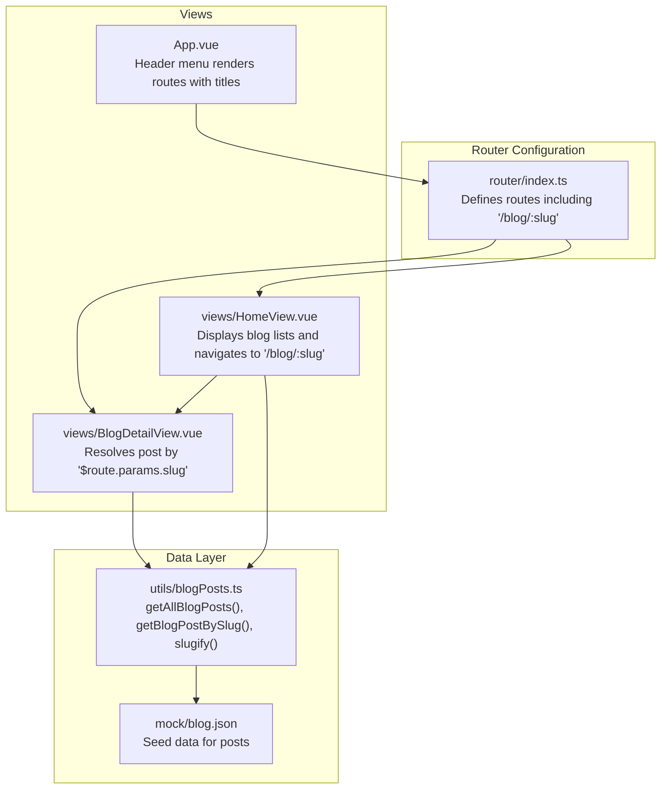
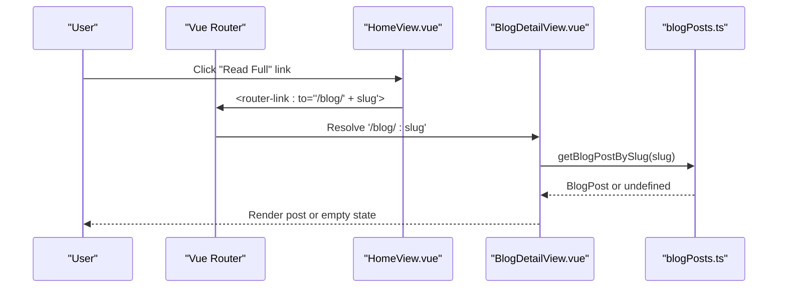
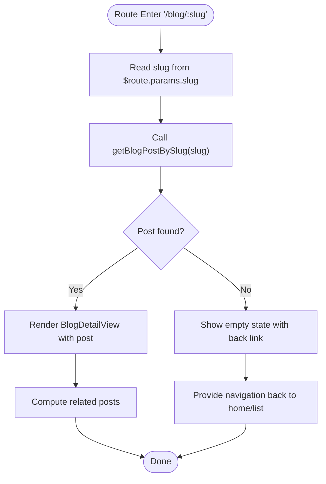
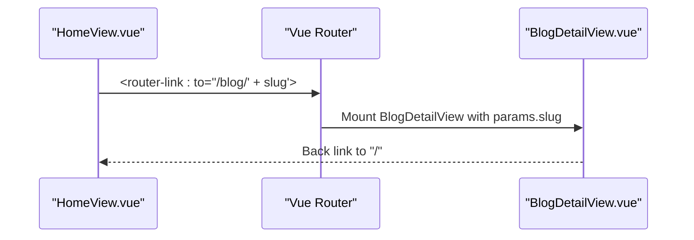
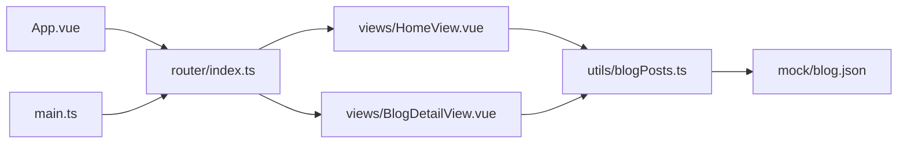

# Blog Navigation and Routing

<cite>
**Referenced Files in This Document**
- [router/index.ts](file://src/router/index.ts)
- [views/HomeView.vue](file://src/views/HomeView.vue)
- [views/BlogDetailView.vue](file://src/views/BlogDetailView.vue)
- [utils/blogPosts.ts](file://src/utils/blogPosts.ts)
- [mock/blog.json](file://src/mock/blog.json)
- [apps/legacy/routes.js](file://src/apps/legacy/routes.js)
- [apps/legacy/module/blog.vue](file://src/apps/legacy/module/blog.vue)
- [App.vue](file://src/App.vue)
- [main.ts](file://src/main.ts)
</cite>

## Table of Contents
1. [Introduction](#introduction)
2. [Project Structure](#project-structure)
3. [Core Components](#core-components)
4. [Architecture Overview](#architecture-overview)
5. [Detailed Component Analysis](#detailed-component-analysis)
6. [Dependency Analysis](#dependency-analysis)
7. [Performance Considerations](#performance-considerations)
8. [Troubleshooting Guide](#troubleshooting-guide)
9. [SEO and Social Media Integration](#seo-and-social-media-integration)
10. [Conclusion](#conclusion)

## Introduction
This document explains the blog navigation and routing system built with Vue Router. It covers the slug-based URL structure, route parameter handling, navigation between blog listings and individual posts, and the relationships among the home view, blog detail view, and router configuration. It also documents navigation patterns, deep linking capabilities, programmatic navigation, route guards, handling missing or invalid slugs, and SEO considerations.

## Project Structure
The routing system centers around a single router configuration that defines static routes plus a dynamic blog detail route using a slug parameter. Views consume route parameters via computed properties and navigate programmatically using router links. Content is generated from multiple sources (VuePress docs, pattern files, and seeded data) and normalized into a unified blog post model with deterministic slugs.



**Diagram sources**
- [router/index.ts:1-65](file://src/router/index.ts#L1-L65)
- [views/HomeView.vue:1-648](file://src/views/HomeView.vue#L1-L648)
- [views/BlogDetailView.vue:1-530](file://src/views/BlogDetailView.vue#L1-L530)
- [utils/blogPosts.ts:1-110](file://src/utils/blogPosts.ts#L1-L110)
- [mock/blog.json:1-14](file://src/mock/blog.json#L1-L14)
- [App.vue:1-110](file://src/App.vue#L1-L110)

**Section sources**
- [router/index.ts:1-65](file://src/router/index.ts#L1-L65)
- [views/HomeView.vue:1-648](file://src/views/HomeView.vue#L1-L648)
- [views/BlogDetailView.vue:1-530](file://src/views/BlogDetailView.vue#L1-L530)
- [utils/blogPosts.ts:1-110](file://src/utils/blogPosts.ts#L1-L110)
- [mock/blog.json:1-14](file://src/mock/blog.json#L1-L14)
- [App.vue:1-110](file://src/App.vue#L1-L110)

## Core Components
- Router configuration: Defines the `/blog/:slug` route and other application routes. Uses history mode and lazy-loads views for performance.
- Home view: Lists all blog posts, computes excerpts, and navigates to individual posts using `/blog/:slug`.
- Blog detail view: Resolves a single post by the slug parameter and displays related content.
- Blog utility: Provides functions to fetch all posts, resolve by slug, compute statistics, and generate slugs from titles and file paths.
- Legacy routes: Demonstrates an older routing approach for comparison.

**Section sources**
- [router/index.ts:1-65](file://src/router/index.ts#L1-L65)
- [views/HomeView.vue:1-648](file://src/views/HomeView.vue#L1-L648)
- [views/BlogDetailView.vue:1-530](file://src/views/BlogDetailView.vue#L1-L530)
- [utils/blogPosts.ts:1-110](file://src/utils/blogPosts.ts#L1-L110)
- [apps/legacy/routes.js:1-21](file://src/apps/legacy/routes.js#L1-L21)

## Architecture Overview
The routing architecture follows a clean separation of concerns:
- Router defines URLs and lazy-loads views.
- Views depend on the router for navigation and on the data utility for content resolution.
- The data utility aggregates content from multiple sources and normalizes it into a consistent model with deterministic slugs.



**Diagram sources**
- [views/HomeView.vue:67-70](file://src/views/HomeView.vue#L67-L70)
- [router/index.ts:32-36](file://src/router/index.ts#L32-L36)
- [views/BlogDetailView.vue:10-12](file://src/views/BlogDetailView.vue#L10-L12)
- [utils/blogPosts.ts:98-100](file://src/utils/blogPosts.ts#L98-L100)

**Section sources**
- [router/index.ts:1-65](file://src/router/index.ts#L1-L65)
- [views/HomeView.vue:1-648](file://src/views/HomeView.vue#L1-L648)
- [views/BlogDetailView.vue:1-530](file://src/views/BlogDetailView.vue#L1-L530)
- [utils/blogPosts.ts:1-110](file://src/utils/blogPosts.ts#L1-L110)

## Detailed Component Analysis

### Slug-Based URL Structure and Route Parameter Handling
- Dynamic route: `/blog/:slug` captures the post identifier from the URL path.
- Parameter access: The blog detail view reads `$route.params.slug` to resolve the post.
- Slug generation: Slugs are derived deterministically from titles and file paths using a normalization and slugification process, ensuring stable URLs across builds.



**Diagram sources**
- [router/index.ts:32-36](file://src/router/index.ts#L32-L36)
- [views/BlogDetailView.vue:10-12](file://src/views/BlogDetailView.vue#L10-L12)
- [utils/blogPosts.ts:98-100](file://src/utils/blogPosts.ts#L98-L100)

**Section sources**
- [router/index.ts:32-36](file://src/router/index.ts#L32-L36)
- [views/BlogDetailView.vue:1-530](file://src/views/BlogDetailView.vue#L1-L530)
- [utils/blogPosts.ts:48-54](file://src/utils/blogPosts.ts#L48-L54)

### Navigation Between Blog Listings and Individual Posts
- From home view: Each post card links to `/blog/${post.slug}` using a router link.
- From detail view: Back links return to the home page or list page, and related posts link to their respective slug-based URLs.
- Programmatic navigation: While the current implementation uses declarative router links, programmatic navigation can be achieved via the router instance in components.



**Diagram sources**
- [views/HomeView.vue:67-70](file://src/views/HomeView.vue#L67-L70)
- [views/BlogDetailView.vue:38-40](file://src/views/BlogDetailView.vue#L38-L40)
- [router/index.ts:32-36](file://src/router/index.ts#L32-L36)

**Section sources**
- [views/HomeView.vue:1-648](file://src/views/HomeView.vue#L1-L648)
- [views/BlogDetailView.vue:1-530](file://src/views/BlogDetailView.vue#L1-L530)
- [router/index.ts:1-65](file://src/router/index.ts#L1-L65)

### Relationship Between Home View, Blog Detail View, and Router Configuration
- Home view: Renders a hero section, featured posts, and a full list of posts. Each post navigates to the detail view using its slug.
- Router configuration: Declares the `/blog/:slug` route and lazy-loads the detail view.
- Detail view: Consumes the slug parameter to resolve and render the matching post.

```mermaid
classDiagram
class RouterConfig {
+routes
+mode : "history"
}
class HomeView {
+renders post cards
+links to "/blog/ : slug"
}
class BlogDetailView {
+reads $route.params.slug
+renders post content
}
class BlogPostsUtil {
+getAllBlogPosts()
+getBlogPostBySlug(slug)
+slugify(raw)
}
RouterConfig --> HomeView : "maps '/'"
RouterConfig --> BlogDetailView : "maps '/blog/ : slug'"
HomeView --> BlogDetailView : "navigation"
BlogDetailView --> BlogPostsUtil : "resolves post"
```

**Diagram sources**
- [router/index.ts:1-65](file://src/router/index.ts#L1-L65)
- [views/HomeView.vue:1-648](file://src/views/HomeView.vue#L1-L648)
- [views/BlogDetailView.vue:1-530](file://src/views/BlogDetailView.vue#L1-L530)
- [utils/blogPosts.ts:1-110](file://src/utils/blogPosts.ts#L1-L110)

**Section sources**
- [router/index.ts:1-65](file://src/router/index.ts#L1-L65)
- [views/HomeView.vue:1-648](file://src/views/HomeView.vue#L1-L648)
- [views/BlogDetailView.vue:1-530](file://src/views/BlogDetailView.vue#L1-L530)
- [utils/blogPosts.ts:1-110](file://src/utils/blogPosts.ts#L1-L110)

### Navigation Patterns and Deep Linking
- Deep linking: The `/blog/:slug` route enables direct access to any post via its slug, enabling bookmarks and shareable URLs.
- Internal navigation: Router links are used throughout the application for seamless transitions without full page reloads.
- Menu navigation: The header menu dynamically renders routes that include titles, supporting consistent navigation across pages.

**Section sources**
- [router/index.ts:1-65](file://src/router/index.ts#L1-L65)
- [App.vue:17-26](file://src/App.vue#L17-L26)

### Route Guards and Programmatic Navigation
- Current implementation: No explicit route guards are present in the router configuration or views.
- Programmatic navigation: Can be implemented using the router instance in components. For example, navigating after form submission or conditional redirects.
- Guard patterns: Typical guard scenarios include authentication checks, canonical URL redirection, or slug validation before rendering.

[No sources needed since this section provides general guidance]

### Handling Missing or Invalid Slugs
- Behavior: When a slug does not match any post, the detail view renders an empty state with a back link to the home page or list.
- Prevention: Ensure slugs are generated consistently from titles and file paths to avoid mismatches.

**Section sources**
- [views/BlogDetailView.vue:61-66](file://src/views/BlogDetailView.vue#L61-L66)
- [utils/blogPosts.ts:98-100](file://src/utils/blogPosts.ts#L98-L100)

### Legacy Routes Comparison
- Legacy routing: An older routing scheme exists under the legacy app, demonstrating a simpler static route mapping approach.
- Migration: The modern implementation centralizes routing in a single configuration and leverages dynamic parameters for content resolution.

**Section sources**
- [apps/legacy/routes.js:1-21](file://src/apps/legacy/routes.js#L1-L21)
- [apps/legacy/module/blog.vue:1-62](file://src/apps/legacy/module/blog.vue#L1-L62)

## Dependency Analysis
The routing system exhibits low coupling and high cohesion:
- Router depends on views and metadata for titles.
- Views depend on router links for navigation and on the data utility for content.
- Data utility depends on seed data and glob imports for content aggregation.



**Diagram sources**
- [router/index.ts:1-65](file://src/router/index.ts#L1-L65)
- [views/HomeView.vue:1-648](file://src/views/HomeView.vue#L1-L648)
- [views/BlogDetailView.vue:1-530](file://src/views/BlogDetailView.vue#L1-L530)
- [utils/blogPosts.ts:1-110](file://src/utils/blogPosts.ts#L1-L110)
- [mock/blog.json:1-14](file://src/mock/blog.json#L1-L14)
- [App.vue:1-110](file://src/App.vue#L1-L110)
- [main.ts:1-16](file://src/main.ts#L1-L16)

**Section sources**
- [router/index.ts:1-65](file://src/router/index.ts#L1-L65)
- [views/HomeView.vue:1-648](file://src/views/HomeView.vue#L1-L648)
- [views/BlogDetailView.vue:1-530](file://src/views/BlogDetailView.vue#L1-L530)
- [utils/blogPosts.ts:1-110](file://src/utils/blogPosts.ts#L1-L110)
- [mock/blog.json:1-14](file://src/mock/blog.json#L1-L14)
- [App.vue:1-110](file://src/App.vue#L1-L110)
- [main.ts:1-16](file://src/main.ts#L1-L16)

## Performance Considerations
- Lazy loading: Routes for non-critical views are lazy-loaded to reduce initial bundle size.
- Computed caching: Views compute derived data (rendered content, reading time, related posts) via computed properties to minimize recomputation.
- Minimal reactivity: The slug lookup is O(n) per view mount; consider memoization if performance becomes a concern with very large post sets.

[No sources needed since this section provides general guidance]

## Troubleshooting Guide
- Invalid slug: When the slug does not correspond to any post, the detail view shows an empty state with a back link. Verify the slug matches a post in the aggregated dataset.
- Missing content: Ensure all content sources (VuePress docs, pattern files, seed data) are present and glob patterns are correct.
- Navigation issues: Confirm router links use the correct `/blog/:slug` format and that the router instance is properly installed in the application.

**Section sources**
- [views/BlogDetailView.vue:61-66](file://src/views/BlogDetailView.vue#L61-L66)
- [utils/blogPosts.ts:13-21](file://src/utils/blogPosts.ts#L13-L21)
- [main.ts:1-16](file://src/main.ts#L1-L16)

## SEO and Social Media Integration
- Canonical URLs: The slug-based structure produces stable, shareable URLs suitable for indexing and social sharing.
- Meta information: Titles and excerpts are available for use in page metadata and social previews.
- Open Graph/Twitter Cards: Integrate structured metadata in templates or head configuration to enhance social media sharing.
- Sitemap generation: Consider generating sitemaps for all `/blog/:slug` entries to improve crawlability.

[No sources needed since this section provides general guidance]

## Conclusion
The blog navigation and routing system uses a clean, slug-based URL structure with a dynamic route parameter for content resolution. The router configuration, views, and data utility work together to enable seamless navigation, deep linking, and maintainable content management. Extending the system with route guards, SEO metadata, and social sharing integration would further enhance user experience and discoverability.