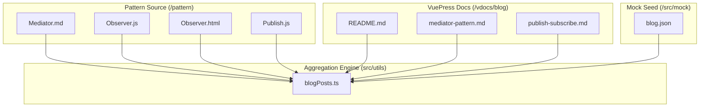
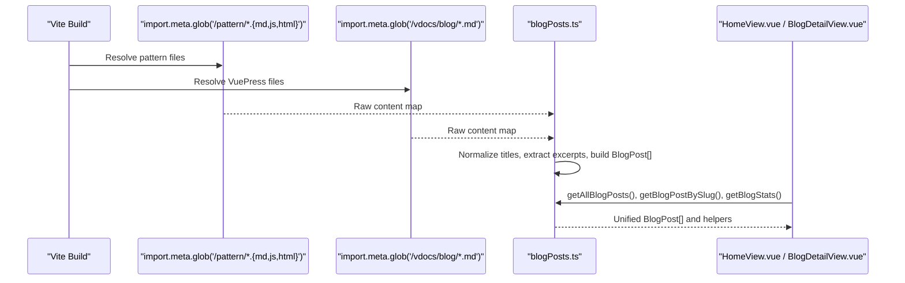
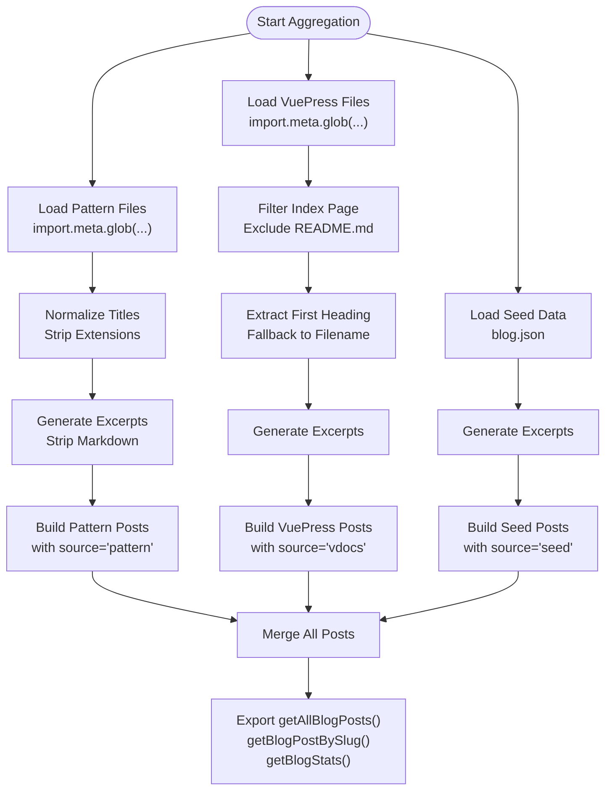
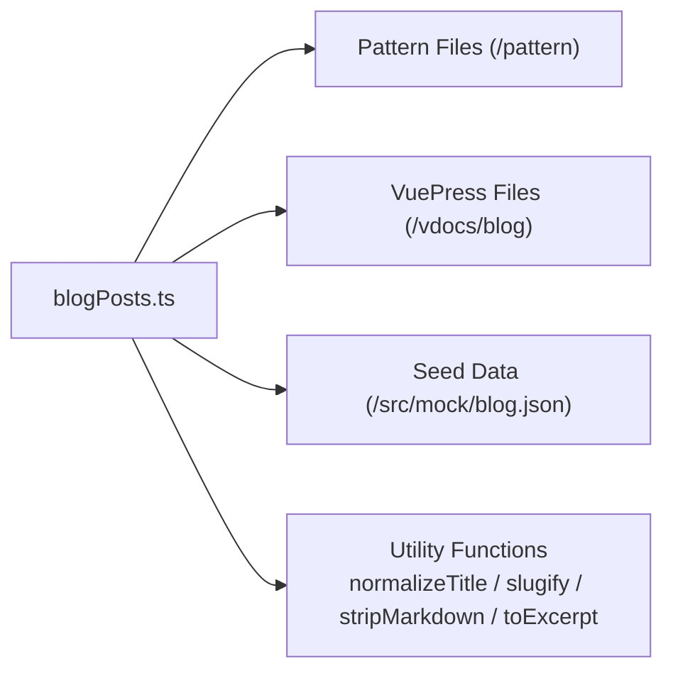

# Content Aggregation System

<cite>
**Referenced Files in This Document**
- [blogPosts.ts](file://src/utils/blogPosts.ts)
- [blog.json](file://src/mock/blog.json)
- [vite.config.ts](file://vite.config.ts)
- [config.ts](file://vdocs/.vuepress/config.ts)
- [README.md](file://vdocs/blog/README.md)
- [mediator-pattern.md](file://vdocs/blog/mediator-pattern.md)
- [publish-subscribe.md](file://vdocs/blog/publish-subscribe.md)
- [Mediator.md](file://pattern/Mediator.md)
- [Observer.js](file://pattern/Observer.js)
- [Observer.html](file://pattern/Observer.html)
- [Publish.js](file://pattern/Publish.js)
- [HomeView.vue](file://src/views/HomeView.vue)
- [BlogDetailView.vue](file://src/views/BlogDetailView.vue)
</cite>

## Table of Contents
1. [Introduction](#introduction)
2. [Project Structure](#project-structure)
3. [Core Components](#core-components)
4. [Architecture Overview](#architecture-overview)
5. [Detailed Component Analysis](#detailed-component-analysis)
6. [Dependency Analysis](#dependency-analysis)
7. [Performance Considerations](#performance-considerations)
8. [Troubleshooting Guide](#troubleshooting-guide)
9. [Conclusion](#conclusion)

## Introduction
This document explains the content aggregation system that dynamically collects, processes, and unifies blog posts from multiple sources. It focuses on:
- Vite's glob import mechanism for discovering pattern files (MD/JS/HTML) and VuePress documentation files
- Seed data integration from mock JSON
- Unified data structure creation and retrieval APIs
- Examples for extending the system with new content sources and configuring glob patterns

The system consolidates content from three distinct sources into a single BlogPost interface, enabling consistent rendering and navigation across the application.

## Project Structure
The content aggregation system spans three primary areas:
- Pattern directory: MD/JS/HTML files under `/pattern`
- VuePress documentation: MD files under `/vdocs/blog`
- Mock seed data: JSON array under `/src/mock/blog.json`

**Diagram sources**
- [blogPosts.ts](file://src/utils/blogPosts.ts)
- [Mediator.md](file://pattern/Mediator.md)
- [Observer.js](file://pattern/Observer.js)
- [Observer.html](file://pattern/Observer.html)
- [Publish.js](file://pattern/Publish.js)
- [README.md](file://vdocs/blog/README.md)
- [mediator-pattern.md](file://vdocs/blog/mediator-pattern.md)
- [publish-subscribe.md](file://vdocs/blog/publish-subscribe.md)
- [blog.json](file://src/mock/blog.json)

**Section sources**
- [blogPosts.ts](file://src/utils/blogPosts.ts)
- [vite.config.ts](file://vite.config.ts)
- [config.ts](file://vdocs/.vuepress/config.ts)

## Core Components
The aggregation engine is implemented in a single TypeScript module that:
- Discovers files via Vite's import.meta.glob
- Normalizes filenames and extracts metadata
- Strips markdown formatting for excerpts
- Builds a unified BlogPost array with source tagging

Key exports:
- getAllBlogPosts(): Returns the aggregated list
- getBlogPostBySlug(slug): Retrieves a post by its slug
- getBlogStats(): Provides counts per source

Processing pipeline highlights:
- Pattern files: Raw content ingestion with category derived from file extension
- VuePress files: Markdown title extraction, filtering of index page
- Seed data: Iterative mapping with generated slugs

**Section sources**
- [blogPosts.ts](file://src/utils/blogPosts.ts)

## Architecture Overview
The system uses Vite's compile-time glob imports to statically bundle content, ensuring fast runtime access and predictable builds.

**Diagram sources**
- [blogPosts.ts](file://src/utils/blogPosts.ts)
- [HomeView.vue](file://src/views/HomeView.vue)
- [BlogDetailView.vue](file://src/views/BlogDetailView.vue)

## Detailed Component Analysis

### Vite Glob Import Mechanism
- Pattern files: import.meta.glob('/pattern/*.{md,js,html}', { as: 'raw', eager: true })
- VuePress files: import.meta.glob('/vdocs/blog/*.md', { as: 'raw', eager: true })
- Behavior: Eager loading bundles content at build time; raw strings are returned for direct consumption

Configuration context:
- Vite resolves aliases and outputs to the docs directory for static hosting

**Section sources**
- [blogPosts.ts](file://src/utils/blogPosts.ts)
- [vite.config.ts](file://vite.config.ts)

### Pattern Directory Files (MD/JS/HTML)
- Discovery: All files matching the pattern are collected
- Normalization: Titles derived from filenames; categories reflect file extensions
- Excerpts: Generated by stripping markdown formatting and truncating to a fixed length
- Content: Raw file content preserved for downstream rendering

Representative files:
- Design pattern explanations and examples in MD
- JavaScript implementations in JS
- HTML demonstrations in HTML

**Section sources**
- [blogPosts.ts](file://src/utils/blogPosts.ts)
- [Mediator.md](file://pattern/Mediator.md)
- [Observer.js](file://pattern/Observer.js)
- [Observer.html](file://pattern/Observer.html)
- [Publish.js](file://pattern/Publish.js)

### VuePress Blog Markdown Files
- Discovery: All MD files under the blog directory
- Filtering: README.md excluded from the feed to avoid duplication with the index
- Title extraction: Uses the first markdown heading when present; falls back to filename normalization
- Category: Standardized to a fixed category for blog entries
- Content: Full markdown content for rendering

**Section sources**
- [blogPosts.ts](file://src/utils/blogPosts.ts)
- [README.md](file://vdocs/blog/README.md)
- [mediator-pattern.md](file://vdocs/blog/mediator-pattern.md)
- [publish-subscribe.md](file://vdocs/blog/publish-subscribe.md)
- [config.ts](file://vdocs/.vuepress/config.ts)

### Mock Seed Data
- Source: JSON array with title/content pairs
- Processing: Iterative mapping to BlogPost with generated slugs and a fixed category
- Purpose: Enables quick prototyping and testing without external sources

**Section sources**
- [blogPosts.ts](file://src/utils/blogPosts.ts)
- [blog.json](file://src/mock/blog.json)

### Unified Data Structure Creation
The system creates a normalized BlogPost interface with:
- id: Unique identifier combining source and path/index
- slug: URL-friendly identifier derived from title/path
- title: Extracted from markdown headers or filename
- category: Source-specific taxonomy
- excerpt: Cleaned plaintext preview
- content: Raw content for rendering
- source: One of 'vdocs', 'pattern', or 'seed'

**Diagram sources**
- [blogPosts.ts](file://src/utils/blogPosts.ts)

**Section sources**
- [blogPosts.ts](file://src/utils/blogPosts.ts)

### Runtime Usage in Views
- HomeView.vue: Displays featured posts, full list, and statistics
- BlogDetailView.vue: Renders selected post content and related articles

**Section sources**
- [HomeView.vue](file://src/views/HomeView.vue)
- [BlogDetailView.vue](file://src/views/BlogDetailView.vue)

## Dependency Analysis
The aggregation module depends on:
- Pattern files and VuePress files discovered via Vite globs
- Mock seed data imported as JSON
- Utility functions for markdown cleaning and slug generation

**Diagram sources**
- [blogPosts.ts](file://src/utils/blogPosts.ts)

**Section sources**
- [blogPosts.ts](file://src/utils/blogPosts.ts)

## Performance Considerations
- Eager glob loading: Ensures zero runtime fetch overhead; content is bundled at build time
- Raw string handling: Reduces parsing cost during runtime
- Efficient excerpt generation: Single pass cleaning with regex replacements
- Slug generation: Lightweight normalization suitable for large catalogs

## Troubleshooting Guide
Common issues and resolutions:
- Missing content after adding files:
  - Verify glob patterns match new files and are placed under the expected directories
  - Confirm eager loading does not cause bundling errors
- Incorrect titles or excerpts:
  - For VuePress files, ensure the first heading exists or rely on filename fallback
  - For pattern files, confirm filenames are descriptive and free of special characters
- Slug conflicts:
  - Review slug generation rules and adjust titles to avoid duplicates
- Build failures:
  - Check Vite configuration for alias correctness and output directory alignment

**Section sources**
- [blogPosts.ts](file://src/utils/blogPosts.ts)
- [vite.config.ts](file://vite.config.ts)

## Conclusion
The content aggregation system leverages Vite's glob imports to unify diverse content sources into a cohesive BlogPost model. By normalizing titles, generating excerpts, and tagging sources, it enables consistent presentation and navigation. Extending the system involves adding new glob patterns and ensuring content conforms to the unified structure.