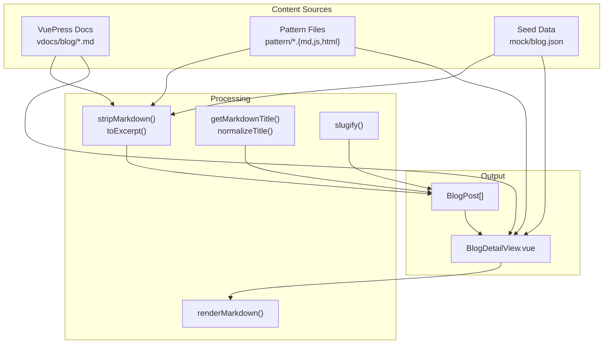
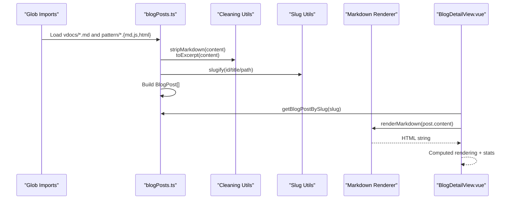
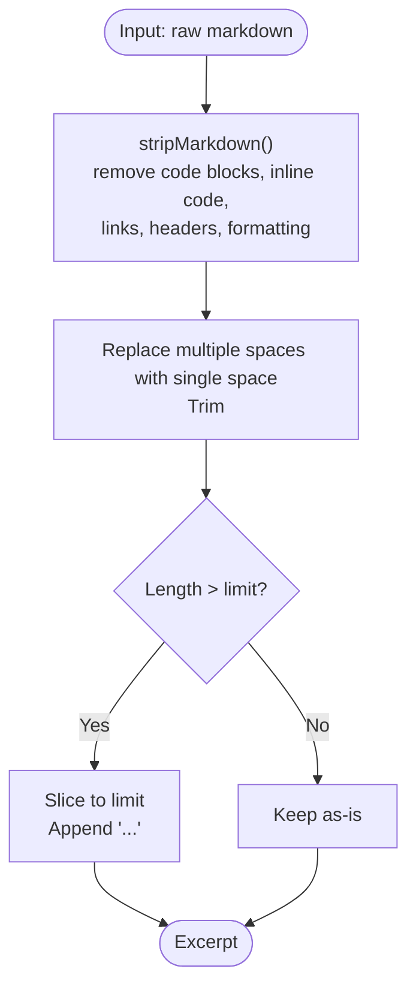
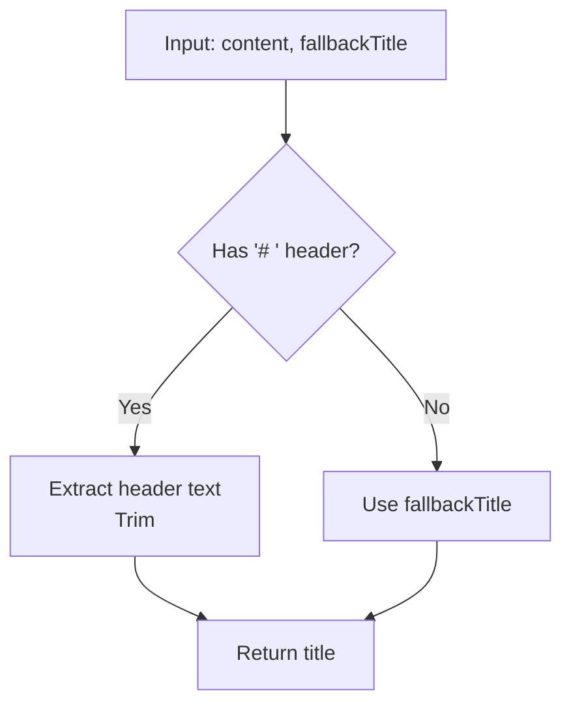
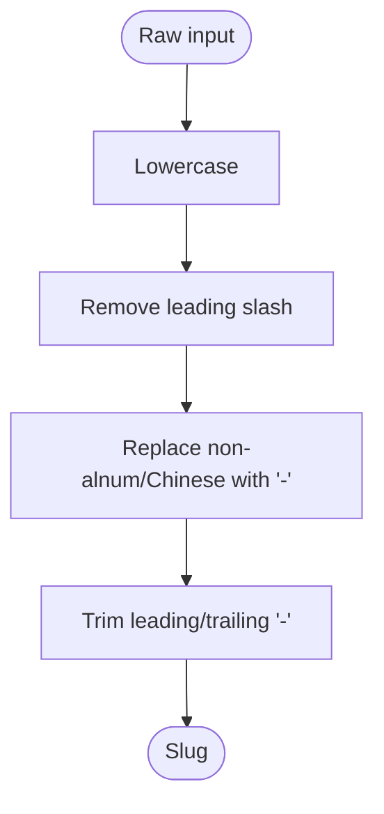
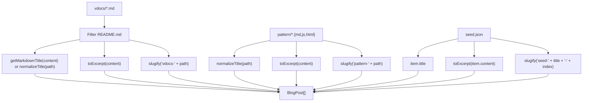
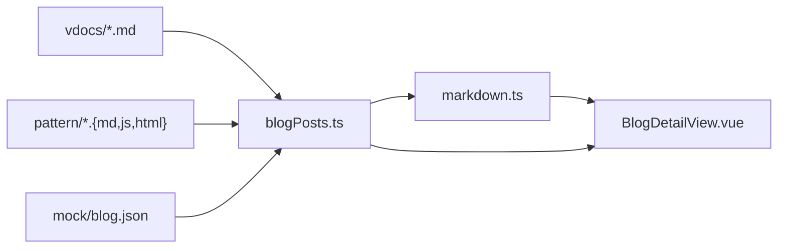

# Content Processing Pipeline

<cite>
**Referenced Files in This Document**
- [blogPosts.ts](file://src/utils/blogPosts.ts)
- [markdown.ts](file://src/utils/markdown.ts)
- [BlogDetailView.vue](file://src/views/BlogDetailView.vue)
- [blog.json](file://src/mock/blog.json)
- [config.ts](file://vdocs/.vuepress/config.ts)
- [README.md](file://vdocs/blog/README.md)
- [Observer.js](file://pattern/Observer.js)
- [mediator.js](file://pattern/mediator.js)
</cite>

## Table of Contents
1. [Introduction](#introduction)
2. [Project Structure](#project-structure)
3. [Core Components](#core-components)
4. [Architecture Overview](#architecture-overview)
5. [Detailed Component Analysis](#detailed-component-analysis)
6. [Dependency Analysis](#dependency-analysis)
7. [Performance Considerations](#performance-considerations)
8. [Troubleshooting Guide](#troubleshooting-guide)
9. [Conclusion](#conclusion)

## Introduction
This document describes the content processing pipeline that transforms raw content into structured blog posts. It covers:
- Markdown cleaning algorithms for extracting excerpts and preparing readable text
- Excerpt generation with configurable limits
- Slug creation from various input formats
- Regex-based content sanitization and markdown stripping techniques
- Text processing workflows for titles, excerpts, and slugs
- Examples of processing different content types (VuePress docs, pattern files, seed data)
- Guidance on customizing cleaning algorithms

The pipeline integrates three content sources:
- VuePress documentation site (vdocs)
- Pattern example files (JS/HTML/MD)
- Seed data (mock JSON)

Rendered HTML is produced from markdown for display in the blog detail view.

## Project Structure
The pipeline spans several modules:
- Content ingestion via glob imports for vdocs and pattern files
- Cleaning and excerpt generation utilities
- Slug generation and title extraction helpers
- Markdown rendering for HTML output
- Mock seed data for testing and demonstration
- Vue component that renders processed content



**Diagram sources**
- [blogPosts.ts:13-21](file://src/utils/blogPosts.ts#L13-L21)
- [blogPosts.ts:28-46](file://src/utils/blogPosts.ts#L28-L46)
- [blogPosts.ts:48-54](file://src/utils/blogPosts.ts#L48-L54)
- [markdown.ts:17-187](file://src/utils/markdown.ts#L17-L187)
- [BlogDetailView.vue:10-31](file://src/views/BlogDetailView.vue#L10-L31)

**Section sources**
- [blogPosts.ts:13-21](file://src/utils/blogPosts.ts#L13-L21)
- [blogPosts.ts:55-92](file://src/utils/blogPosts.ts#L55-L92)
- [markdown.ts:17-187](file://src/utils/markdown.ts#L17-L187)
- [BlogDetailView.vue:10-31](file://src/views/BlogDetailView.vue#L10-L31)

## Core Components
- Content ingestion and normalization
  - Glob imports load raw content from vdocs and pattern directories
  - Title normalization strips file extensions
- Markdown cleaning and excerpt generation
  - stripMarkdown removes code blocks, inline code, links, headers, and formatting markers
  - toExcerpt cleans text, normalizes whitespace, and truncates to a limit with ellipsis
- Title extraction
  - getMarkdownTitle reads the first markdown header as the title; falls back to normalized filename
- Slug generation
  - slugify converts to lowercase, replaces non-alphanumeric/Chinese characters with hyphens, trims leading/trailing hyphens
- Markdown rendering
  - renderMarkdown converts markdown to HTML with headings, lists, tables, quotes, images, horizontal rules, and code blocks

**Section sources**
- [blogPosts.ts:23-26](file://src/utils/blogPosts.ts#L23-L26)
- [blogPosts.ts:28-40](file://src/utils/blogPosts.ts#L28-L40)
- [blogPosts.ts:42-46](file://src/utils/blogPosts.ts#L42-L46)
- [blogPosts.ts:48-54](file://src/utils/blogPosts.ts#L48-L54)
- [markdown.ts:17-187](file://src/utils/markdown.ts#L17-L187)

## Architecture Overview
The pipeline orchestrates ingestion, cleaning, metadata extraction, and rendering:



**Diagram sources**
- [blogPosts.ts:13-21](file://src/utils/blogPosts.ts#L13-L21)
- [blogPosts.ts:28-40](file://src/utils/blogPosts.ts#L28-L40)
- [blogPosts.ts:48-54](file://src/utils/blogPosts.ts#L48-L54)
- [markdown.ts:17-187](file://src/utils/markdown.ts#L17-L187)
- [BlogDetailView.vue:10-31](file://src/views/BlogDetailView.vue#L10-L31)

## Detailed Component Analysis

### Markdown Cleaning and Excerpt Generation
The cleaning process removes markdown artifacts to produce plain text suitable for excerpts:
- Removes fenced code blocks and inline code
- Strips link syntax, leaving link text
- Removes markdown headers
- Replaces formatting markers (*, _, >, ~, -) and pipes with spaces
- Normalizes whitespace and trims

Excerpt generation:
- Applies cleaning, collapses whitespace, trims
- Enforces a character limit (default 180)
- Adds ellipsis when truncated



**Diagram sources**
- [blogPosts.ts:28-40](file://src/utils/blogPosts.ts#L28-L40)

**Section sources**
- [blogPosts.ts:28-40](file://src/utils/blogPosts.ts#L28-L40)

### Title Extraction from Markdown Headers
The pipeline attempts to extract the title from the first markdown header. If absent, it falls back to the normalized filename.



**Diagram sources**
- [blogPosts.ts:42-46](file://src/utils/blogPosts.ts#L42-L46)
- [blogPosts.ts:23-26](file://src/utils/blogPosts.ts#L23-L26)

**Section sources**
- [blogPosts.ts:42-46](file://src/utils/blogPosts.ts#L42-L46)
- [blogPosts.ts:23-26](file://src/utils/blogPosts.ts#L23-L26)

### Slug Creation from Various Inputs
Slugs are generated consistently across sources:
- Lowercase conversion
- Leading/trailing slashes removed
- Non-alphanumeric and non-Chinese characters replaced with hyphens
- Leading/trailing hyphens stripped



**Diagram sources**
- [blogPosts.ts:48-54](file://src/utils/blogPosts.ts#L48-L54)

**Section sources**
- [blogPosts.ts:48-54](file://src/utils/blogPosts.ts#L48-L54)

### Markdown Rendering Workflow
The renderer converts markdown to HTML while preserving semantic structure:
- Normalizes line endings
- Safely escapes HTML in code blocks
- Preserves language identifiers for code blocks
- Handles headings, paragraphs, lists (ordered/unordered/task), blockquotes, tables, images, horizontal rules
- Inline formatting: code, bold, italic, links, strikethrough

```mermaid
sequenceDiagram
participant MD as "Markdown String"
participant ESC as "escapeHtml()"
participant CB as "Code Block Handler"
participant PAR as "Paragraph/List/Table Flush"
participant OUT as "HTML Output"
MD->>CB : Replace fenced code blocks<br/>with placeholders
CB->>ESC : Escape inner code
ESC-->>CB : Safe code HTML
CB-->>MD : Placeholders
MD->>PAR : Split into lines and parse
PAR-->>OUT : Emit headings, lists, tables, images, HR
OUT-->>MD : Join with placeholders
MD-->>OUT : Restore code blocks
```

**Diagram sources**
- [markdown.ts:1-8](file://src/utils/markdown.ts#L1-L8)
- [markdown.ts:22-27](file://src/utils/markdown.ts#L22-L27)
- [markdown.ts:60-178](file://src/utils/markdown.ts#L60-L178)

**Section sources**
- [markdown.ts:1-8](file://src/utils/markdown.ts#L1-L8)
- [markdown.ts:17-187](file://src/utils/markdown.ts#L17-L187)

### Content Ingestion and Post Construction
The pipeline ingests content from multiple sources and constructs BlogPost objects:
- vdocs: filters out index files, extracts title from markdown header or filename, generates excerpt, assigns category
- pattern: uses file type as category, title from filename, excerpt from content
- seed: uses provided title/content, generates excerpt, assigns category



**Diagram sources**
- [blogPosts.ts:68-78](file://src/utils/blogPosts.ts#L68-L78)
- [blogPosts.ts:55-66](file://src/utils/blogPosts.ts#L55-L66)
- [blogPosts.ts:80-90](file://src/utils/blogPosts.ts#L80-L90)

**Section sources**
- [blogPosts.ts:68-78](file://src/utils/blogPosts.ts#L68-L78)
- [blogPosts.ts:55-66](file://src/utils/blogPosts.ts#L55-L66)
- [blogPosts.ts:80-90](file://src/utils/blogPosts.ts#L80-L90)

### Example Processing Scenarios
- VuePress documentation posts
  - Source: vdocs/blog/*.md
  - Behavior: Uses first markdown header as title; otherwise filename; excludes README.md; generates excerpts and slugs
  - Reference: [config.ts:20-35](file://vdocs/.vuepress/config.ts#L20-L35), [README.md:7-14](file://vdocs/blog/README.md#L7-L14)
- Pattern example posts
  - Source: pattern/*.{md,js,html}
  - Behavior: Title from filename; category derived from file extension; excerpt and slug generated
  - Reference: [Observer.js:1-58](file://pattern/Observer.js#L1-L58), [mediator.js:1-37](file://pattern/mediator.js#L1-L37)
- Seed posts
  - Source: mock data
  - Behavior: Title and content from JSON; excerpt and slug derived from fields
  - Reference: [blog.json:1-14](file://src/mock/blog.json#L1-L14)

**Section sources**
- [config.ts:20-35](file://vdocs/.vuepress/config.ts#L20-L35)
- [README.md:7-14](file://vdocs/blog/README.md#L7-L14)
- [Observer.js:1-58](file://pattern/Observer.js#L1-L58)
- [mediator.js:1-37](file://pattern/mediator.js#L1-L37)
- [blog.json:1-14](file://src/mock/blog.json#L1-L14)

### Customization Guidelines
- Adjust excerpt length
  - Modify the default limit in toExcerpt to change the excerpt length
  - Reference: [blogPosts.ts:37-40](file://src/utils/blogPosts.ts#L37-L40)
- Customize cleaning rules
  - Extend stripMarkdown to remove or retain additional markdown elements
  - Reference: [blogPosts.ts:28-35](file://src/utils/blogPosts.ts#L28-L35)
- Change slug generation
  - Modify slugify to handle special characters or preserve segments differently
  - Reference: [blogPosts.ts:48-54](file://src/utils/blogPosts.ts#L48-L54)
- Enhance title extraction
  - Update getMarkdownTitle to support frontmatter or additional heuristics
  - Reference: [blogPosts.ts:42-46](file://src/utils/blogPosts.ts#L42-L46)

**Section sources**
- [blogPosts.ts:37-40](file://src/utils/blogPosts.ts#L37-L40)
- [blogPosts.ts:28-35](file://src/utils/blogPosts.ts#L28-L35)
- [blogPosts.ts:48-54](file://src/utils/blogPosts.ts#L48-L54)
- [blogPosts.ts:42-46](file://src/utils/blogPosts.ts#L42-L46)

## Dependency Analysis
The pipeline exhibits clear separation of concerns:
- blogPosts.ts depends on:
  - stripMarkdown and toExcerpt for text processing
  - getMarkdownTitle and normalizeTitle for metadata
  - slugify for URL-friendly identifiers
- BlogDetailView.vue depends on:
  - blogPosts.ts for post retrieval and statistics
  - markdown.ts for HTML rendering



**Diagram sources**
- [blogPosts.ts:13-21](file://src/utils/blogPosts.ts#L13-L21)
- [markdown.ts:17-187](file://src/utils/markdown.ts#L17-L187)
- [BlogDetailView.vue:4-5](file://src/views/BlogDetailView.vue#L4-L5)

**Section sources**
- [blogPosts.ts:13-21](file://src/utils/blogPosts.ts#L13-L21)
- [markdown.ts:17-187](file://src/utils/markdown.ts#L17-L187)
- [BlogDetailView.vue:4-5](file://src/views/BlogDetailView.vue#L4-L5)

## Performance Considerations
- Regex-driven cleaning and excerpt generation are efficient for typical blog post sizes but can be optimized by:
  - Pre-compiling frequently used regex patterns
  - Avoiding repeated trimming and whitespace normalization when unnecessary
  - Using streaming or chunked processing for very large documents
- Slug generation is linear in input length; keep character replacement minimal
- Markdown rendering iterates over lines; consider batching or memoization for repeated renders
- Caching rendered HTML per post can reduce CPU usage during repeated view loads

## Troubleshooting Guide
Common issues and resolutions:
- Empty or missing excerpts
  - Verify stripMarkdown removes expected elements and whitespace normalization is applied
  - Confirm toExcerpt limit is sufficient for content length
  - References: [blogPosts.ts:28-40](file://src/utils/blogPosts.ts#L28-L40)
- Incorrect titles
  - Ensure the first markdown header exists or rely on normalized filenames
  - Confirm getMarkdownTitle fallback logic
  - References: [blogPosts.ts:42-46](file://src/utils/blogPosts.ts#L42-L46), [blogPosts.ts:23-26](file://src/utils/blogPosts.ts#L23-L26)
- Broken slugs
  - Check slugify rules for unexpected characters or leading/trailing hyphens
  - References: [blogPosts.ts:48-54](file://src/utils/blogPosts.ts#L48-L54)
- Unsafe HTML in code blocks
  - Ensure escapeHtml is applied before embedding code into HTML
  - References: [markdown.ts:1-8](file://src/utils/markdown.ts#L1-L8), [markdown.ts:22-27](file://src/utils/markdown.ts#L22-L27)
- Rendering anomalies
  - Validate markdown structure (headings, lists, tables, quotes, images, horizontal rules)
  - References: [markdown.ts:60-178](file://src/utils/markdown.ts#L60-L178)

**Section sources**
- [blogPosts.ts:28-40](file://src/utils/blogPosts.ts#L28-L40)
- [blogPosts.ts:42-46](file://src/utils/blogPosts.ts#L42-L46)
- [blogPosts.ts:48-54](file://src/utils/blogPosts.ts#L48-L54)
- [markdown.ts:1-8](file://src/utils/markdown.ts#L1-L8)
- [markdown.ts:22-27](file://src/utils/markdown.ts#L22-L27)
- [markdown.ts:60-178](file://src/utils/markdown.ts#L60-L178)

## Conclusion
The content processing pipeline provides a robust foundation for transforming diverse content sources into structured blog posts. Its modular design enables straightforward customization of cleaning rules, excerpt length, and slug generation. The markdown renderer ensures safe and semantically accurate HTML output for display. By leveraging glob imports and consistent metadata extraction, the system supports scalable growth across multiple content domains.