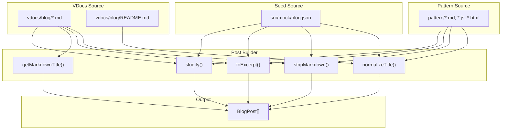
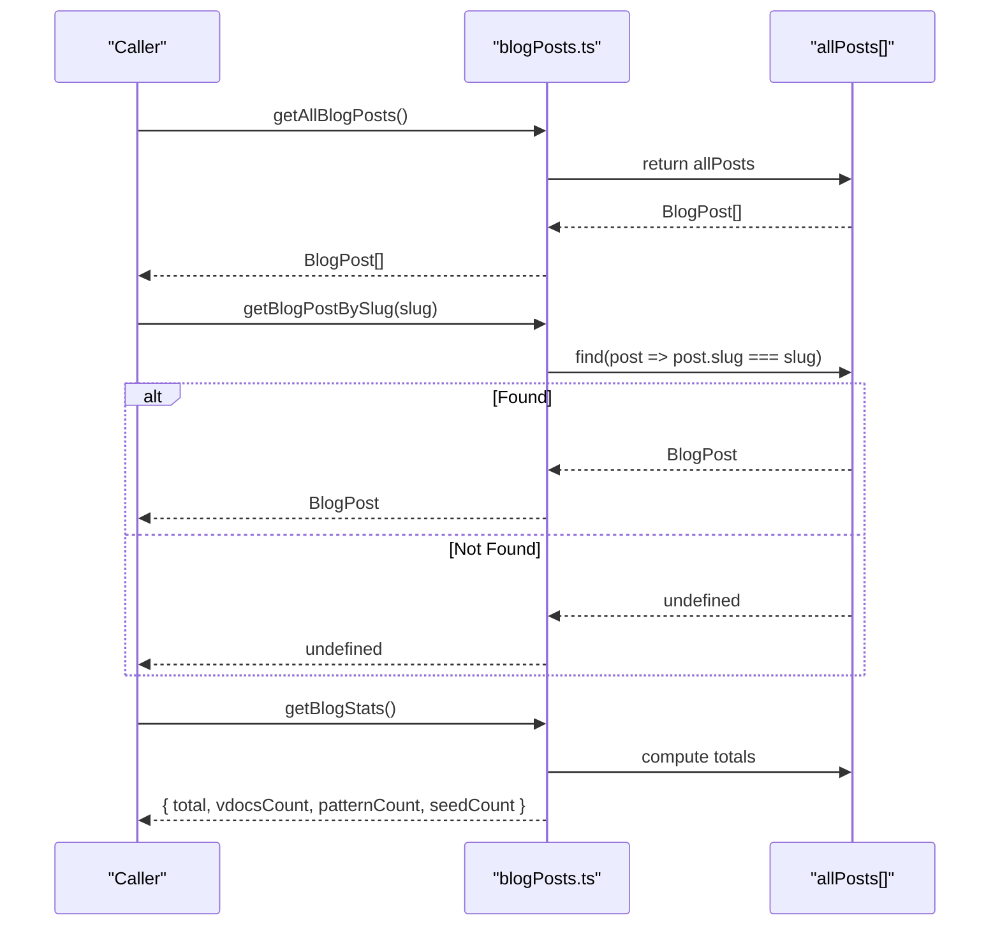
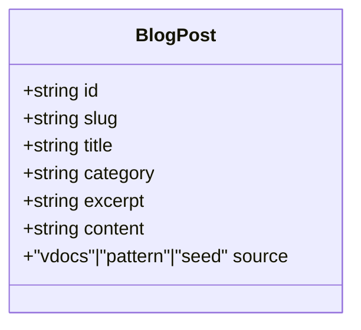
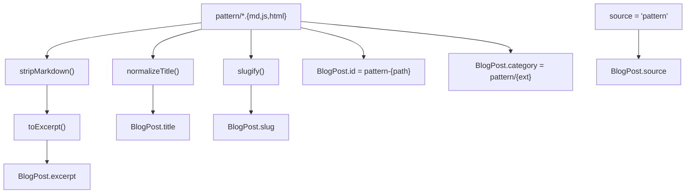
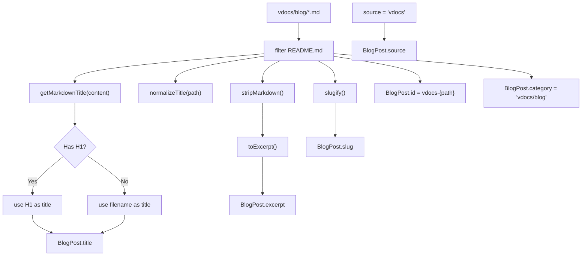
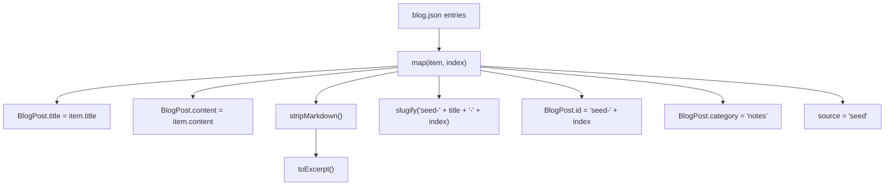
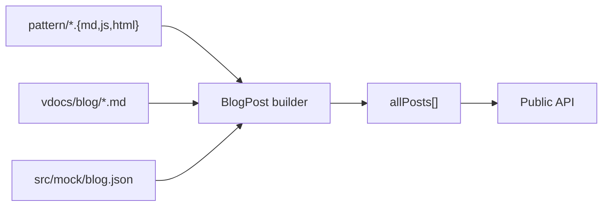

# Post Data Model and Storage

<cite>
**Referenced Files in This Document**
- [blogPosts.ts](file://src/utils/blogPosts.ts)
- [blog.json](file://src/mock/blog.json)
- [README.md](file://vdocs/blog/README.md)
- [publish-subscribe.md](file://vdocs/blog/publish-subscribe.md)
- [mediator-pattern.md](file://vdocs/blog/mediator-pattern.md)
- [code-lab.md](file://vdocs/blog/code-lab.md)
- [Mediator.md](file://pattern/Mediator.md)
- [Observer.js](file://pattern/Observer.js)
- [Publish.js](file://pattern/Publish.js)
- [mediator-senior.js](file://pattern/mediator-senior.js)
- [module.js](file://pattern/module.js)
- [singleton.js](file://pattern/singleton.js)
</cite>

## Table of Contents
1. [Introduction](#introduction)
2. [Project Structure](#project-structure)
3. [Core Components](#core-components)
4. [Architecture Overview](#architecture-overview)
5. [Detailed Component Analysis](#detailed-component-analysis)
6. [Dependency Analysis](#dependency-analysis)
7. [Performance Considerations](#performance-considerations)
8. [Troubleshooting Guide](#troubleshooting-guide)
9. [Conclusion](#conclusion)

## Introduction
This document describes the BlogPost data model and storage mechanisms used to unify three content sources:
- Pattern examples from the pattern/ directory
- VDocs articles from the vdocs/blog/ directory
- Seed content from a local JSON file

It covers the data model interface, ID generation, slug creation, title processing, category assignment, content fields, source attribution, retrieval functions, filtering/search capabilities, validation, type safety, and error handling.

## Project Structure
The post pipeline integrates three distinct content sources into a unified BlogPost array:
- Pattern source: static files globbed from pattern/
- VDocs source: Markdown files from vdocs/blog/ (excluding the root README)
- Seed source: structured items from src/mock/blog.json

**Diagram sources**
- [blogPosts.ts:13-21](file://src/utils/blogPosts.ts#L13-L21)
- [blogPosts.ts:23-46](file://src/utils/blogPosts.ts#L23-L46)
- [blogPosts.ts:55-92](file://src/utils/blogPosts.ts#L55-L92)

**Section sources**
- [blogPosts.ts:1-110](file://src/utils/blogPosts.ts#L1-L110)
- [blog.json:1-14](file://src/mock/blog.json#L1-L14)

## Core Components
The BlogPost interface defines the canonical shape of each article record. It includes:
- Identifier: id (string)
- URL-friendly slug: slug (string)
- Display title: title (string)
- Category taxonomy: category (string)
- Short summary: excerpt (string)
- Full content: content (string)
- Source origin: source ('vdocs' | 'pattern' | 'seed')

Storage and assembly:
- Pattern posts: built from pattern/ files, categorized per file type
- VDocs posts: built from vdocs/blog/ Markdown files, excluding the root README
- Seed posts: built from src/mock/blog.json entries
- Unified collection: allPosts concatenates vdocs, pattern, and seed arrays

Retrieval APIs:
- getAllBlogPosts(): returns the entire collection
- getBlogPostBySlug(slug): returns the first matching post by slug
- getBlogStats(): returns counts for total and per-source

Validation and type safety:
- Strict union literal for source ensures only valid origins
- TypeScript interface constrains field shapes
- Slug normalization prevents invalid characters and leading/trailing separators

Error handling:
- getBlogPostBySlug returns undefined when no match is found (caller responsibility to handle)
- Filtering excludes the VDocs root README to avoid duplicates

**Section sources**
- [blogPosts.ts:3-11](file://src/utils/blogPosts.ts#L3-L11)
- [blogPosts.ts:55-92](file://src/utils/blogPosts.ts#L55-L92)
- [blogPosts.ts:94-110](file://src/utils/blogPosts.ts#L94-L110)

## Architecture Overview
The pipeline transforms raw content into normalized BlogPost records and exposes simple lookup functions.

**Diagram sources**
- [blogPosts.ts:94-110](file://src/utils/blogPosts.ts#L94-L110)

## Detailed Component Analysis

### Data Model Interface
The BlogPost interface enforces strict typing and field semantics across all sources.

**Diagram sources**
- [blogPosts.ts:3-11](file://src/utils/blogPosts.ts#L3-L11)

**Section sources**
- [blogPosts.ts:3-11](file://src/utils/blogPosts.ts#L3-L11)

### Content Sources and Normalization

#### Pattern Source
- Files globbed from pattern/ with extensions md, js, html
- ID: pattern-{path}
- Slug: slugify(pattern-{path})
- Title: derived from filename via normalizeTitle
- Category: pattern/{fileExtension}
- Excerpt: generated from raw content via stripMarkdown and toExcerpt
- Content: raw file content
- Source: 'pattern'

**Diagram sources**
- [blogPosts.ts:13-21](file://src/utils/blogPosts.ts#L13-L21)
- [blogPosts.ts:23-46](file://src/utils/blogPosts.ts#L23-L46)
- [blogPosts.ts:55-66](file://src/utils/blogPosts.ts#L55-L66)

**Section sources**
- [blogPosts.ts:13-21](file://src/utils/blogPosts.ts#L13-L21)
- [blogPosts.ts:23-46](file://src/utils/blogPosts.ts#L23-L46)
- [blogPosts.ts:55-66](file://src/utils/blogPosts.ts#L55-L66)

#### VDocs Source
- Files globbed from vdocs/blog/*.md
- Root README excluded to prevent duplication
- ID: vdocs-{path}
- Slug: slugify(vdocs-{path})
- Title: extracted from Markdown frontmatter via getMarkdownTitle; falls back to normalizeTitle if missing
- Category: fixed 'vdocs/blog'
- Excerpt: generated from Markdown content
- Content: raw Markdown content
- Source: 'vdocs'

**Diagram sources**
- [blogPosts.ts:18-21](file://src/utils/blogPosts.ts#L18-L21)
- [blogPosts.ts:68-78](file://src/utils/blogPosts.ts#L68-L78)
- [blogPosts.ts:42-46](file://src/utils/blogPosts.ts#L42-L46)
- [blogPosts.ts:28-40](file://src/utils/blogPosts.ts#L28-L40)

**Section sources**
- [blogPosts.ts:18-21](file://src/utils/blogPosts.ts#L18-L21)
- [blogPosts.ts:68-78](file://src/utils/blogPosts.ts#L68-L78)
- [blogPosts.ts:42-46](file://src/utils/blogPosts.ts#L42-L46)
- [blogPosts.ts:28-40](file://src/utils/blogPosts.ts#L28-L40)

#### Seed Source
- Loaded from src/mock/blog.json
- ID: seed-{index}
- Slug: slugify(seed-{title}-{index})
- Title: taken from JSON item
- Category: fixed 'notes'
- Excerpt: generated from raw content
- Content: taken from JSON item
- Source: 'seed'

**Diagram sources**
- [blogPosts.ts:80-90](file://src/utils/blogPosts.ts#L80-L90)
- [blog.json:1-14](file://src/mock/blog.json#L1-L14)

**Section sources**
- [blogPosts.ts:80-90](file://src/utils/blogPosts.ts#L80-L90)
- [blog.json:1-14](file://src/mock/blog.json#L1-L14)

### Retrieval Functions and Search Mechanisms
- getAllBlogPosts(): returns the in-memory allPosts array
- getBlogPostBySlug(slug): linear scan by slug equality
- getBlogStats(): aggregates counts across sources

Filtering and search:
- Built-in filtering excludes the VDocs root README
- No additional filters or search APIs are exposed; consumers can apply their own filtering on top of getAllBlogPosts()

**Section sources**
- [blogPosts.ts:94-110](file://src/utils/blogPosts.ts#L94-L110)

### Utility Functions
Normalization and processing:
- normalizeTitle(path): derives a clean title from a file path
- stripMarkdown(value): removes Markdown syntax to produce plain text
- toExcerpt(value, limit?): creates a short excerpt respecting a character limit
- getMarkdownTitle(value, fallback): extracts H1 as title if present
- slugify(raw): converts arbitrary text into URL-safe slugs

These utilities are shared across all sources to ensure consistent post metadata.

**Section sources**
- [blogPosts.ts:23-46](file://src/utils/blogPosts.ts#L23-L46)
- [blogPosts.ts:48-54](file://src/utils/blogPosts.ts#L48-L54)

### Examples

- Accessing a post by slug
  - Call getBlogPostBySlug(slug) and handle the undefined case
  - Example usage location: [blogPosts.ts:98-100](file://src/utils/blogPosts.ts#L98-L100)

- Listing all posts
  - Call getAllBlogPosts() to retrieve the full array
  - Example usage location: [blogPosts.ts:94-96](file://src/utils/blogPosts.ts#L94-L96)

- Implementing custom queries
  - Use the returned array to filter by category, title substring, or source
  - Example usage location: [blogPosts.ts:94-96](file://src/utils/blogPosts.ts#L94-L96)

Note: The current API does not expose a dedicated search function. Consumers can implement search on top of getAllBlogPosts().

**Section sources**
- [blogPosts.ts:94-100](file://src/utils/blogPosts.ts#L94-L100)

## Dependency Analysis
The pipeline depends on:
- File globs for pattern/ and vdocs/blog/
- Markdown parsing helpers for title extraction
- Plain text cleaning and excerpt generation
- Slug normalization for URL safety

**Diagram sources**
- [blogPosts.ts:13-21](file://src/utils/blogPosts.ts#L13-L21)
- [blogPosts.ts:80-92](file://src/utils/blogPosts.ts#L80-L92)

**Section sources**
- [blogPosts.ts:13-21](file://src/utils/blogPosts.ts#L13-L21)
- [blogPosts.ts:80-92](file://src/utils/blogPosts.ts#L80-L92)

## Performance Considerations
- Memory footprint: allPosts is constructed eagerly during module initialization and held in memory
- Retrieval cost: getBlogPostBySlug performs a linear scan; for large collections, consider adding an internal slug-to-index map
- Content processing: stripMarkdown and toExcerpt run per post during build; caching or lazy evaluation could reduce overhead if needed
- Build-time vs runtime: pattern and vdocs content are bundled at build time; seed content is loaded from JSON

[No sources needed since this section provides general guidance]

## Troubleshooting Guide
Common issues and resolutions:
- Empty or missing excerpts
  - Cause: Markdown-only content or very short content
  - Resolution: Ensure content contains sufficient text; adjust limit in toExcerpt if necessary

- Duplicate posts after migrating VDocs
  - Cause: Including the root README in vdocs/blog/
  - Resolution: The pipeline excludes README.md; confirm the exclusion is effective

- Slug collisions
  - Cause: Non-unique titles or mixed-language filenames
  - Resolution: Review slugify behavior and consider augmenting IDs with timestamps or UUIDs if collisions occur

- Source attribution mismatch
  - Cause: Incorrect categorization or missing source field
  - Resolution: Verify the source field is one of 'vdocs' | 'pattern' | 'seed'

- Retrieval returns undefined
  - Cause: Non-existent slug
  - Resolution: Validate the slug; ensure it matches the normalized form produced by slugify

**Section sources**
- [blogPosts.ts:68-78](file://src/utils/blogPosts.ts#L68-L78)
- [blogPosts.ts:98-100](file://src/utils/blogPosts.ts#L98-L100)

## Conclusion
The BlogPost data model unifies disparate content sources into a consistent interface with strong typing and safe slug generation. The pipeline normalizes titles, generates excerpts, assigns categories, and tracks origins. While retrieval is straightforward, advanced filtering and search require consumers to operate on the provided array. For larger datasets, consider indexing by slug and optimizing content processing.