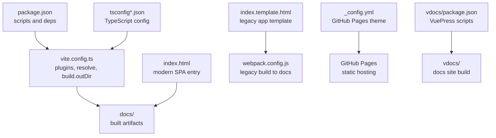
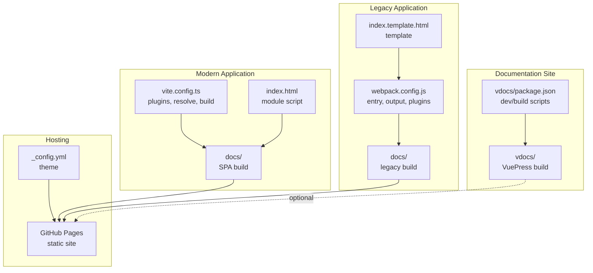
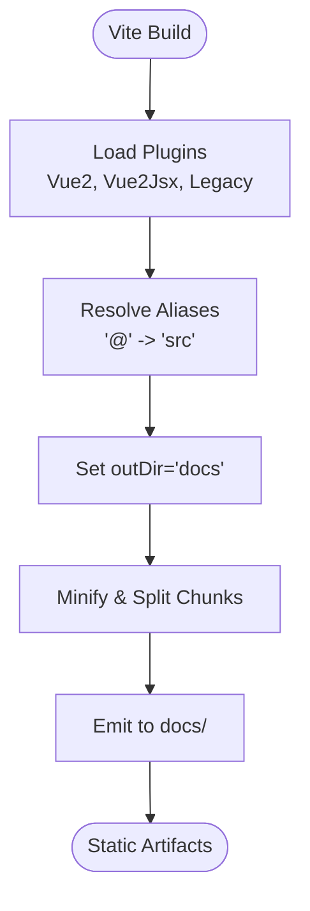
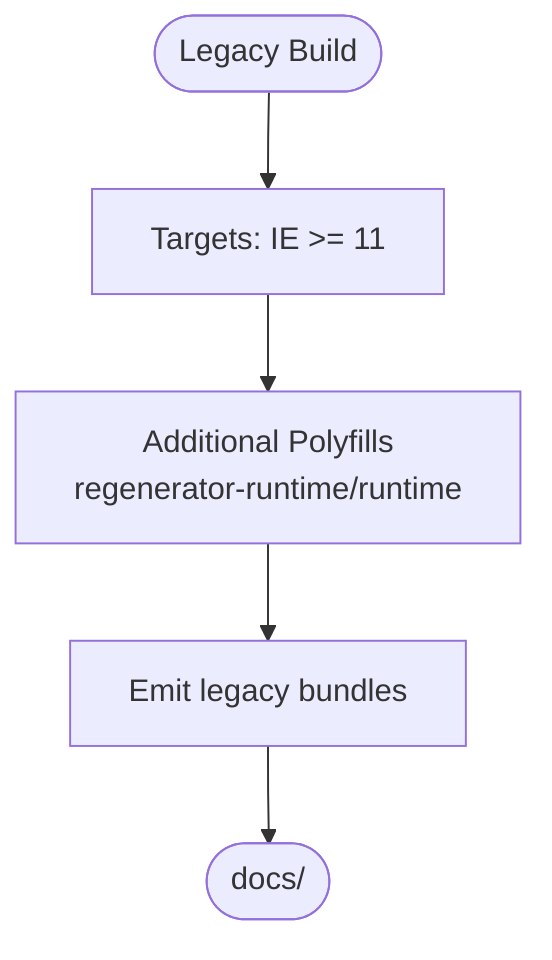
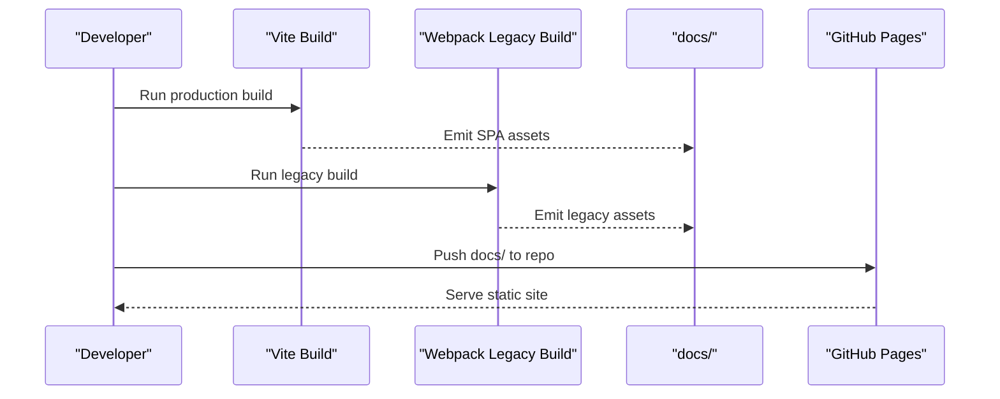
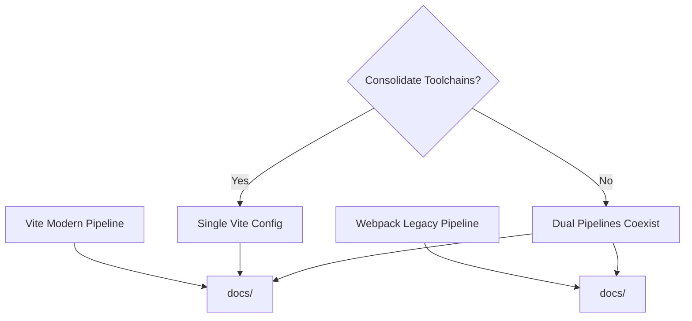
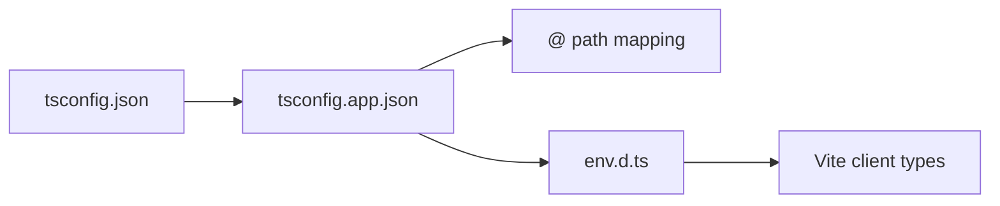
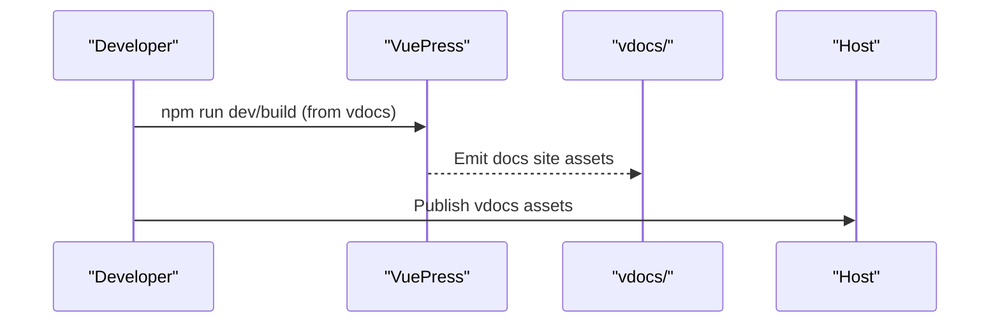
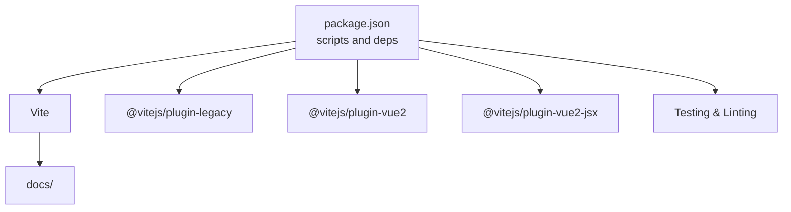

# Deployment and Build

<cite>
**Referenced Files in This Document**
- [vite.config.ts](file://vite.config.ts)
- [package.json](file://package.json)
- [webpack.config.js](file://webpack.config.js)
- [index.html](file://index.html)
- [index.template.html](file://index.template.html)
- [tsconfig.json](file://tsconfig.json)
- [tsconfig.app.json](file://tsconfig.app.json)
- [env.d.ts](file://env.d.ts)
- [_config.yml](file://_config.yml)
- [vdocs/package.json](file://vdocs/package.json)
</cite>

## Table of Contents
1. [Introduction](#introduction)
2. [Project Structure](#project-structure)
3. [Core Components](#core-components)
4. [Architecture Overview](#architecture-overview)
5. [Detailed Component Analysis](#detailed-component-analysis)
6. [Dependency Analysis](#dependency-analysis)
7. [Performance Considerations](#performance-considerations)
8. [Troubleshooting Guide](#troubleshooting-guide)
9. [Conclusion](#conclusion)
10. [Appendices](#appendices)

## Introduction
This document explains the deployment and build processes for the project, focusing on the current Vite-based production build, legacy browser support via the Vite legacy plugin, static site generation, and GitHub Pages integration. It also covers migration considerations from the previous Webpack-based setup, environment variable management, performance optimization strategies, and operational checklists for building, deploying, and monitoring.

## Project Structure
The project uses Vite for development and production builds, with output directed to the docs directory for static hosting. Legacy browser support is enabled via the Vite legacy plugin. A separate VuePress-based documentation site exists under vdocs and can be built independently. The primary HTML entry points differ depending on the target application (modern SPA vs legacy app).

**Diagram sources**
- [package.json:15-26](file://package.json#L15-L26)
- [vite.config.ts:9-26](file://vite.config.ts#L9-L26)
- [index.html:10-11](file://index.html#L10-L11)
- [index.template.html:8-10](file://index.template.html#L8-L10)
- [webpack.config.js:11-14](file://webpack.config.js#L11-L14)
- [tsconfig.app.json:3-10](file://tsconfig.app.json#L3-L10)
- [_config.yml:1](file://_config.yml#L1)
- [vdocs/package.json:4-6](file://vdocs/package.json#L4-L6)

**Section sources**
- [package.json:15-26](file://package.json#L15-L26)
- [vite.config.ts:9-26](file://vite.config.ts#L9-L26)
- [index.html:10-11](file://index.html#L10-L11)
- [index.template.html:8-10](file://index.template.html#L8-L10)
- [webpack.config.js:11-14](file://webpack.config.js#L11-L14)
- [tsconfig.app.json:3-10](file://tsconfig.app.json#L3-L10)
- [_config.yml:1](file://_config.yml#L1)
- [vdocs/package.json:4-6](file://vdocs/package.json#L4-L6)

## Core Components
- Vite build configuration defines modern and legacy builds, path aliases, and output directory.
- Package scripts orchestrate development, type checking, unit tests, E2E tests, and production builds.
- Legacy Webpack build targets the legacy application and outputs to docs for compatibility.
- TypeScript configuration enables path mapping and composite builds.
- Environment typing integrates Vite’s client types.
- Static site generator and GitHub Pages theme configuration enable publishing.

Key responsibilities:
- vite.config.ts: Configure plugins, resolve aliases, and set output directory.
- package.json: Define scripts for dev, build, preview, testing, and linting.
- webpack.config.js: Legacy build pipeline for the legacy app targeting docs.
- tsconfig*.json: TypeScript compilation settings and path mapping.
- env.d.ts: Vite client types integration.
- _config.yml: GitHub Pages theme selection.
- vdocs/package.json: Separate documentation site build and dev scripts.

**Section sources**
- [vite.config.ts:9-26](file://vite.config.ts#L9-L26)
- [package.json:15-26](file://package.json#L15-L26)
- [webpack.config.js:5-47](file://webpack.config.js#L5-L47)
- [tsconfig.json:1-15](file://tsconfig.json#L1-L15)
- [tsconfig.app.json:3-10](file://tsconfig.app.json#L3-L10)
- [env.d.ts:1](file://env.d.ts#L1)
- [_config.yml:1](file://_config.yml#L1)
- [vdocs/package.json:4-6](file://vdocs/package.json#L4-L6)

## Architecture Overview
The build and deployment architecture centers on Vite for the modern application and a legacy Webpack pipeline for backward compatibility. Both outputs are directed to the docs directory for static hosting. The VuePress site under vdocs is built separately and can be published independently.

**Diagram sources**
- [vite.config.ts:9-26](file://vite.config.ts#L9-L26)
- [index.html:10-11](file://index.html#L10-L11)
- [webpack.config.js:5-47](file://webpack.config.js#L5-L47)
- [index.template.html:8-10](file://index.template.html#L8-L10)
- [vdocs/package.json:4-6](file://vdocs/package.json#L4-L6)
- [_config.yml:1](file://_config.yml#L1)

## Detailed Component Analysis

### Vite Production Build Configuration
- Plugins:
  - Vue 2 plugin for SFC support.
  - Vue 2 JSX plugin for JSX transforms.
  - Legacy plugin configured for IE >= 11 with regenerator runtime polyfill.
- Aliasing:
  - @ resolves to src for ergonomic imports.
- Output:
  - outDir set to docs for static hosting.

Asset optimization and code splitting:
- Vite performs automatic code splitting for dynamic imports and shared chunks.
- Minification is enabled in production by default.
- No explicit manual chunking configuration is present; rely on Vite defaults.

Bundle analysis:
- Not configured in the current setup. Consider adding a rollup plugin for bundle visualization if needed.

Static site generation:
- Build output targets docs, suitable for static hosting.

**Diagram sources**
- [vite.config.ts:9-26](file://vite.config.ts#L9-L26)

**Section sources**
- [vite.config.ts:9-26](file://vite.config.ts#L9-L26)

### Legacy Browser Support and Polyfills
- Legacy plugin configured for IE >= 11.
- Additional polyfill for regenerator runtime is included.
- Ensure all legacy-specific code paths are covered by the polyfills.

**Diagram sources**
- [vite.config.ts:13-16](file://vite.config.ts#L13-L16)

**Section sources**
- [vite.config.ts:13-16](file://vite.config.ts#L13-L16)

### Static Site Generation and GitHub Pages Integration
- Modern build emits to docs.
- Legacy build also emits to docs.
- GitHub Pages theme configured via _config.yml.
- Publish docs directory to GitHub Pages for hosting.

**Diagram sources**
- [vite.config.ts:23-25](file://vite.config.ts#L23-L25)
- [webpack.config.js:11-14](file://webpack.config.js#L11-L14)
- [_config.yml:1](file://_config.yml#L1)

**Section sources**
- [vite.config.ts:23-25](file://vite.config.ts#L23-L25)
- [webpack.config.js:11-14](file://webpack.config.js#L11-L14)
- [_config.yml:1](file://_config.yml#L1)

### Migration from Webpack to Vite
- Current Webpack configuration targets the legacy app and outputs to docs.
- Vite replaces Webpack for modern builds; legacy remains on Webpack until migration.
- Migration steps:
  - Evaluate Vue 2 + JSX compatibility in Vite.
  - Replace legacy Webpack entry/template with Vite equivalents if feasible.
  - Consolidate build outputs to a single toolchain if desired.
  - Validate polyfills and legacy targets remain functional.

**Diagram sources**
- [webpack.config.js:5-47](file://webpack.config.js#L5-L47)
- [vite.config.ts:9-26](file://vite.config.ts#L9-L26)

**Section sources**
- [webpack.config.js:5-47](file://webpack.config.js#L5-L47)
- [vite.config.ts:9-26](file://vite.config.ts#L9-L26)

### TypeScript Configuration and Environment Types
- tsconfig.json orchestrates multiple tsconfig references.
- tsconfig.app.json extends web defaults, includes env.d.ts, and sets path mapping for @.
- env.d.ts references Vite’s client types for IDE support and type-awareness.

**Diagram sources**
- [tsconfig.json:1-15](file://tsconfig.json#L1-L15)
- [tsconfig.app.json:3-10](file://tsconfig.app.json#L3-L10)
- [env.d.ts:1](file://env.d.ts#L1)

**Section sources**
- [tsconfig.json:1-15](file://tsconfig.json#L1-L15)
- [tsconfig.app.json:3-10](file://tsconfig.app.json#L3-L10)
- [env.d.ts:1](file://env.d.ts#L1)

### VuePress Documentation Site
- vdocs uses VuePress 2 with Vite bundler.
- Scripts for dev and build are defined under vdocs/package.json.
- Can be built independently and hosted alongside the main site.

**Diagram sources**
- [vdocs/package.json:4-6](file://vdocs/package.json#L4-L6)

**Section sources**
- [vdocs/package.json:4-6](file://vdocs/package.json#L4-L6)

## Dependency Analysis
- Vite plugins:
  - @vitejs/plugin-vue2, @vitejs/plugin-vue2-jsx, @vitejs/plugin-legacy.
- Dependencies:
  - Vue 2.7.x, Vue Router 3.x, Pinia.
- DevDependencies:
  - Cypress, Vitest, ESLint, TypeScript tooling, Terser, VuePress, and related bundlers.

**Diagram sources**
- [package.json:28-59](file://package.json#L28-L59)
- [vite.config.ts:10-17](file://vite.config.ts#L10-L17)

**Section sources**
- [package.json:28-59](file://package.json#L28-L59)
- [vite.config.ts:10-17](file://vite.config.ts#L10-L17)

## Performance Considerations
- Asset optimization:
  - Vite minifies JavaScript/CSS in production by default.
  - Lazy-load routes and components to reduce initial payload.
- Code splitting:
  - Prefer dynamic imports for route-level splitting.
  - Avoid monolithic bundles; split vendor and application code.
- Legacy bundle:
  - Keep polyfills minimal; avoid unnecessary transpilation.
- Caching:
  - Use long-term caching for hashed assets; ensure cache-busting filenames.
  - Configure appropriate Cache-Control headers on hosting.
- CDN:
  - Serve static assets from a CDN to improve global latency.
- Monitoring:
  - Track bundle sizes and load metrics post-deployment.
  - Set up error tracking for legacy browsers if needed.

[No sources needed since this section provides general guidance]

## Troubleshooting Guide
Common build and deployment issues:
- Legacy polyfills missing:
  - Symptoms: Runtime errors in IE >= 11.
  - Resolution: Verify legacy plugin targets and additional polyfills are present.
- Incorrect output directory:
  - Symptoms: Empty or missing GitHub Pages site.
  - Resolution: Confirm outDir is docs and docs is pushed to the repository.
- Path alias not resolving:
  - Symptoms: Import errors in Vue components.
  - Resolution: Ensure @ alias maps to src and tsconfig path mapping is correct.
- TypeScript path mapping conflicts:
  - Symptoms: Editor errors or build failures.
  - Resolution: Align tsconfig.app.json include/exclude and path mapping.
- VuePress build differences:
  - Symptoms: Confusion between main site and docs site builds.
  - Resolution: Use separate scripts and directories for each site.

**Section sources**
- [vite.config.ts:13-16](file://vite.config.ts#L13-L16)
- [vite.config.ts:23-25](file://vite.config.ts#L23-L25)
- [tsconfig.app.json:3-10](file://tsconfig.app.json#L3-L10)
- [vdocs/package.json:4-6](file://vdocs/package.json#L4-L6)

## Conclusion
The project employs Vite for modern builds and a legacy Webpack pipeline for backward compatibility, with both outputs directed to docs for static hosting. The legacy plugin ensures IE >= 11 support with targeted polyfills. TypeScript configuration and environment typing integrate seamlessly with Vite. The VuePress documentation site is built separately. While no automated CI/CD pipeline is present in the repository, the documented scripts and outputs provide a clear blueprint for local and scripted deployments to GitHub Pages.

[No sources needed since this section summarizes without analyzing specific files]

## Appendices

### Deployment Checklist
- Local build verification:
  - Run the production build and preview locally.
  - Confirm docs directory contains expected assets.
- Legacy compatibility:
  - Test in IE >= 11 to validate polyfills and runtime behavior.
- GitHub Pages:
  - Push docs to the repository branch used for Pages.
  - Confirm theme and base path are correct.
- Monitoring:
  - Observe initial load times and error logs after deployment.

[No sources needed since this section provides general guidance]

### Environment Variable Management
- Vite supports environment variables prefixed for injection at build time.
- Keep secrets out of client-side code; use backend APIs for sensitive data.
- For static hosting, avoid embedding credentials in public assets.

[No sources needed since this section provides general guidance]

### Automated Deployment Pipeline and Rollback
- Pipeline outline:
  - Build: Run production build and VuePress build (if applicable).
  - Test: Run unit and E2E tests.
  - Deploy: Push docs to the Pages branch.
  - Monitor: Observe metrics and error reporting.
- Rollback procedure:
  - Revert to the last known good commit in the Pages branch.
  - Redeploy the previous working version.

[No sources needed since this section provides general guidance]