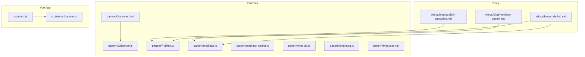
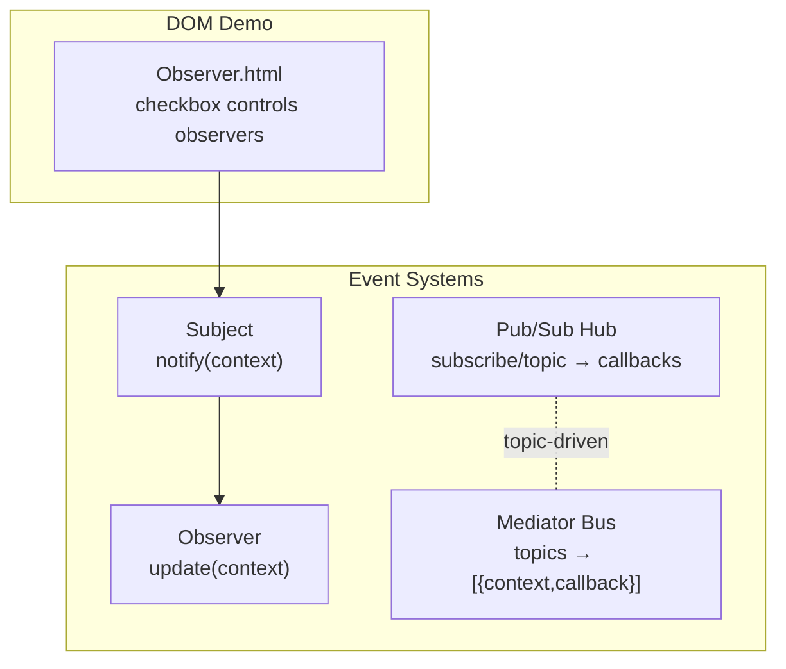
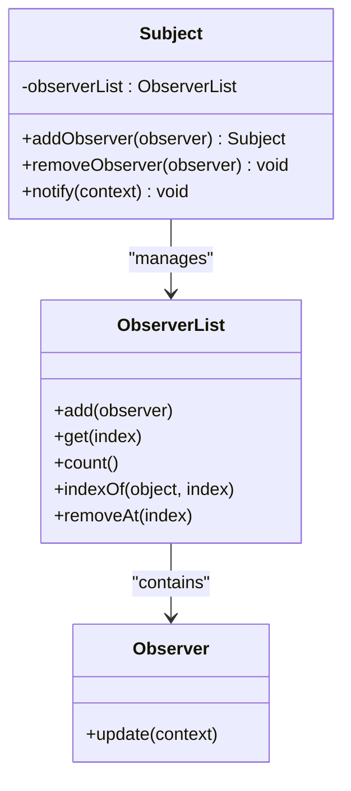
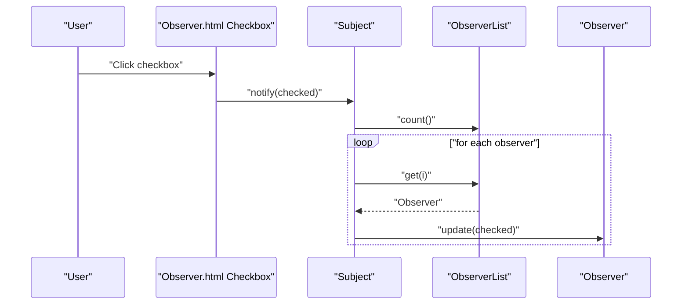
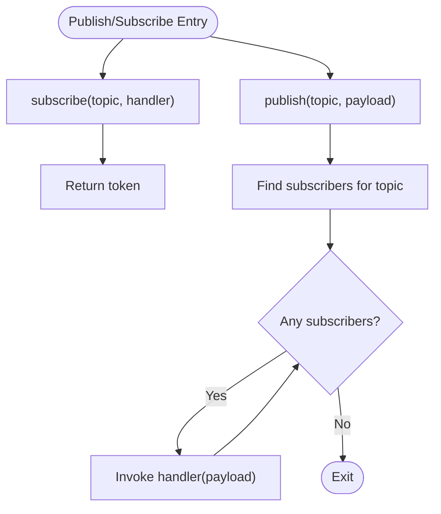
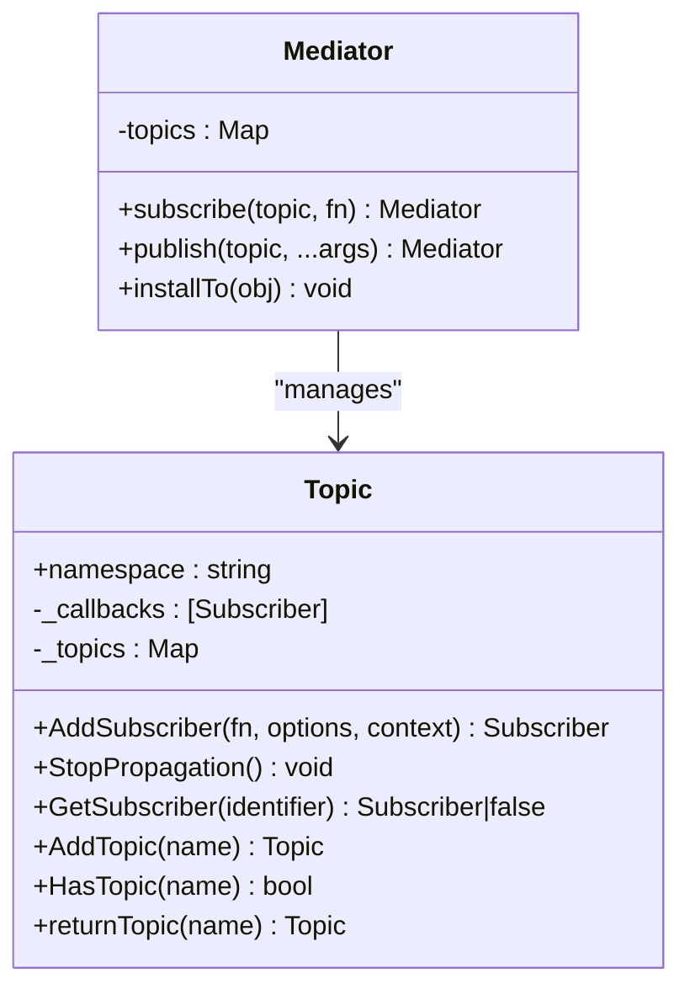
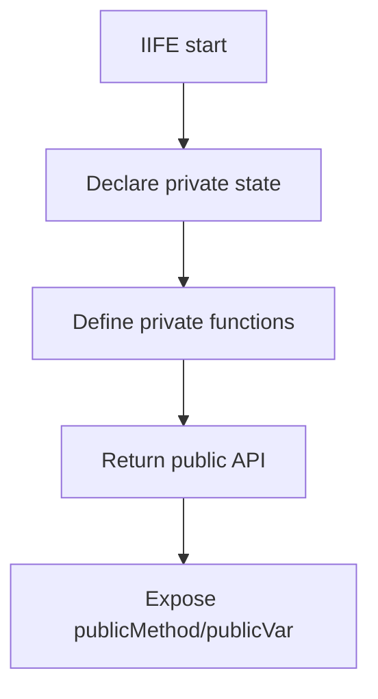
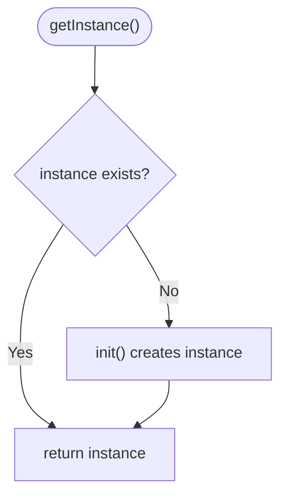
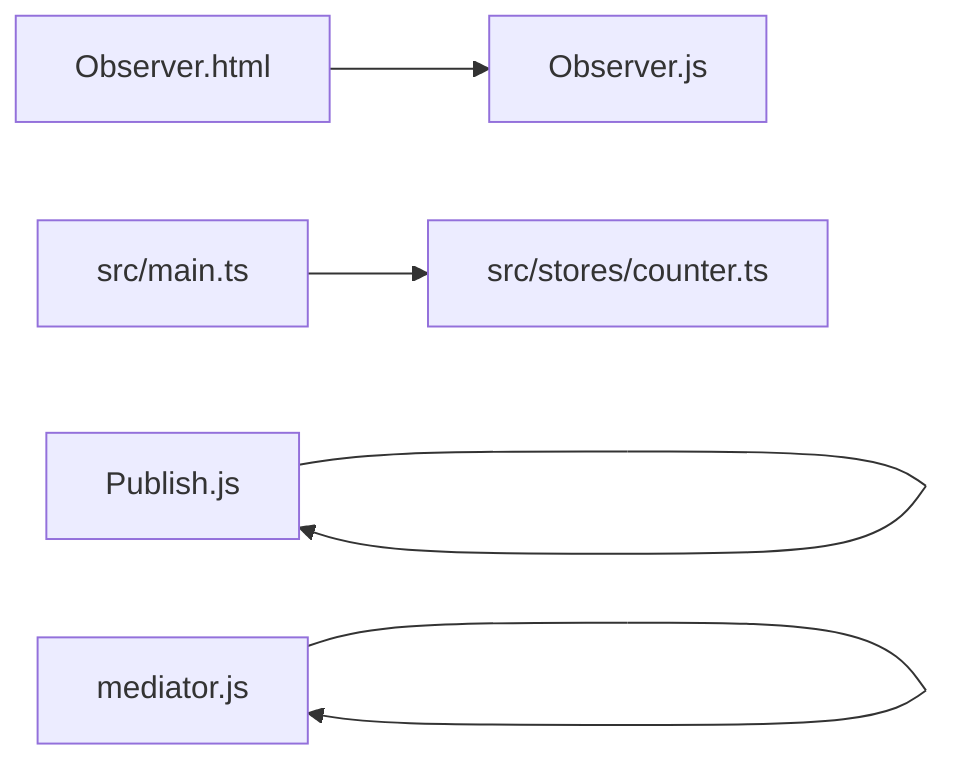

# Design Patterns Repository

<cite>
**Referenced Files in This Document**
- [Observer.js](file://pattern/Observer.js)
- [Observer.html](file://pattern/Observer.html)
- [Publish.js](file://pattern/Publish.js)
- [mediator.js](file://pattern/mediator.js)
- [mediator-senior.js](file://pattern/mediator-senior.js)
- [Mediator.md](file://pattern/Mediator.md)
- [module.js](file://pattern/module.js)
- [singleton.js](file://pattern/singleton.js)
- [publish-subscribe.md](file://vdocs/blog/publish-subscribe.md)
- [mediator-pattern.md](file://vdocs/blog/mediator-pattern.md)
- [code-lab.md](file://vdocs/blog/code-lab.md)
- [counter.ts](file://src/stores/counter.ts)
- [main.ts](file://src/main.ts)
</cite>

## Table of Contents
1. [Introduction](#introduction)
2. [Project Structure](#project-structure)
3. [Core Components](#core-components)
4. [Architecture Overview](#architecture-overview)
5. [Detailed Component Analysis](#detailed-component-analysis)
6. [Dependency Analysis](#dependency-analysis)
7. [Performance Considerations](#performance-considerations)
8. [Troubleshooting Guide](#troubleshooting-guide)
9. [Conclusion](#conclusion)
10. [Appendices](#appendices)

## Introduction
This document presents a focused guide to the design patterns repository, emphasizing practical implementations of the observer pattern for event-driven communication, the mediator pattern for component coordination, and the singleton and module patterns for encapsulation and global state. It also documents the publish–subscribe pattern and demonstrates how these patterns relate to modern frontend development and Vue.js component architecture. The goal is to connect theory with concrete, runnable examples found in the repository and to provide guidance on when and how to apply these patterns in custom projects.

## Project Structure
The patterns are demonstrated as standalone JavaScript modules and HTML pages under the pattern directory. Companion documentation exists in the vdocs directory, offering conceptual explanations and comparisons between related patterns. The Vue.js application in the repository uses Pinia for state management and Vue 2 with the Options API.

**Diagram sources**
- [Observer.js](file://pattern/Observer.js)
- [Observer.html](file://pattern/Observer.html)
- [Publish.js](file://pattern/Publish.js)
- [mediator.js](file://pattern/mediator.js)
- [mediator-senior.js](file://pattern/mediator-senior.js)
- [Mediator.md](file://pattern/Mediator.md)
- [publish-subscribe.md](file://vdocs/blog/publish-subscribe.md)
- [mediator-pattern.md](file://vdocs/blog/mediator-pattern.md)
- [code-lab.md](file://vdocs/blog/code-lab.md)
- [main.ts](file://src/main.ts)
- [counter.ts](file://src/stores/counter.ts)

**Section sources**
- [Observer.js](file://pattern/Observer.js)
- [Observer.html](file://pattern/Observer.html)
- [Publish.js](file://pattern/Publish.js)
- [mediator.js](file://pattern/mediator.js)
- [mediator-senior.js](file://pattern/mediator-senior.js)
- [Mediator.md](file://pattern/Mediator.md)
- [publish-subscribe.md](file://vdocs/blog/publish-subscribe.md)
- [mediator-pattern.md](file://vdocs/blog/mediator-pattern.md)
- [code-lab.md](file://vdocs/blog/code-lab.md)
- [main.ts](file://src/main.ts)
- [counter.ts](file://src/stores/counter.ts)

## Core Components
- Observer pattern implementation: A minimal Subject–Observer pair with an observer list, plus a live HTML demo that attaches Subject behavior to a DOM checkbox and dynamically adds Observer checkboxes.
- Publish–subscribe pattern: A lightweight pub–sub hub with subscribe, unsubscribe, and publish methods keyed by topics.
- Mediator pattern: A compact event bus that centralizes subscriptions and dispatches messages to callbacks, with a more advanced hierarchical topic model in the senior variant.
- Module pattern: A revealing module exposing public members while keeping internals private.
- Singleton pattern: A lazy-initialized singleton factory returning a shared instance.

These components are intended as learning aids and are not integrated into the Vue application.

**Section sources**
- [Observer.js](file://pattern/Observer.js)
- [Observer.html](file://pattern/Observer.html)
- [Publish.js](file://pattern/Publish.js)
- [mediator.js](file://pattern/mediator.js)
- [mediator-senior.js](file://pattern/mediator-senior.js)
- [module.js](file://pattern/module.js)
- [singleton.js](file://pattern/singleton.js)

## Architecture Overview
The patterns are implemented as independent modules. The publish–subscribe and mediator patterns share a similar event-channel structure but differ in intent: observer emphasizes direct subject–observer notification, whereas publish–subscribe decouples publishers and subscribers via a broker. The Vue application uses Pinia for centralized state and Vue 2’s Options API.

**Diagram sources**
- [Observer.js](file://pattern/Observer.js)
- [Observer.html](file://pattern/Observer.html)
- [Publish.js](file://pattern/Publish.js)
- [mediator.js](file://pattern/mediator.js)

## Detailed Component Analysis

### Observer Pattern: Event-Driven Communication
The observer pattern enables loose coupling between a subject and multiple observers. The Subject maintains an observer list and notifies all observers upon state changes. The HTML demo extends a DOM checkbox with Subject behavior and dynamically appends new Observer checkboxes that mirror the subject’s state.

Key elements:
- Subject with addObserver, removeObserver, and notify methods.
- Observer with a minimal update interface.
- Live demo wiring Subject to DOM events and dynamically adding observers.

**Diagram sources**
- [Observer.js](file://pattern/Observer.js)

**Diagram sources**
- [Observer.js](file://pattern/Observer.js)
- [Observer.html](file://pattern/Observer.html)

Educational value:
- Demonstrates decoupled event propagation and dynamic subscription management.
- Practical for UI components reacting to state changes without tight coupling.

Vue.js application relevance:
- Similar to reactive updates in Vue components; however, Vue’s reactivity differs from manual notify loops. Pinia stores can complement these patterns for global state.

**Section sources**
- [Observer.js](file://pattern/Observer.js)
- [Observer.html](file://pattern/Observer.html)
- [publish-subscribe.md](file://vdocs/blog/publish-subscribe.md)

### Publish–Subscribe Pattern: Decoupled Event Channels
The publish–subscribe pattern decouples publishers and subscribers through a central hub. Subscribers register interest in topics and receive notifications when those topics are published. The implementation supports subscribing with tokens and publishing to all subscribers of a given topic.

Highlights:
- subscribe(topic, handler) returns a token for later unsubscribe.
- publish(topic, payload) invokes all handlers for that topic.
- unsubscribe(token) removes a specific subscription.

**Diagram sources**
- [Publish.js](file://pattern/Publish.js)

Educational value:
- Highlights loose coupling and scalability for multi-cast event delivery.
- Useful for cross-cutting concerns like analytics, logging, and UI synchronization.

Vue.js application relevance:
- Can replace ad-hoc event emitters for cross-component communication.
- Complements Pinia for non-state-specific event broadcasting.

**Section sources**
- [Publish.js](file://pattern/Publish.js)
- [publish-subscribe.md](file://vdocs/blog/publish-subscribe.md)
- [code-lab.md](file://vdocs/blog/code-lab.md)

### Mediator Pattern: Component Coordination
The mediator pattern centralizes complex communications among multiple components. The simple mediator exposes subscribe and publish methods keyed by topics, while the senior variant introduces hierarchical topics and subscriber identity for advanced control.

Highlights:
- Simple mediator: topics registry and dispatch to callbacks with preserved context.
- Senior mediator: subscriber objects with identifiers, nested topics, and propagation control.

**Diagram sources**
- [mediator.js](file://pattern/mediator.js)
- [mediator-senior.js](file://pattern/mediator-senior.js)

Educational value:
- Encourages centralized workflow orchestration and reduces direct inter-object dependencies.
- Helps manage multi-step processes and conditional branching across components.

Vue.js application relevance:
- Aligns with coordinating multiple components during a workflow (e.g., form wizard steps).
- Distinguishes itself from event aggregation by focusing on process orchestration rather than passive event distribution.

**Section sources**
- [mediator.js](file://pattern/mediator.js)
- [mediator-senior.js](file://pattern/mediator-senior.js)
- [Mediator.md](file://pattern/Mediator.md)
- [mediator-pattern.md](file://vdocs/blog/mediator-pattern.md)

### Module Pattern: Encapsulation and Privacy
The module pattern uses an IIFE to create private scope and selectively expose public members. It is useful for organizing internal helpers and constants while keeping them hidden from consumers.

Highlights:
- Private variables and functions remain inaccessible outside the closure.
- Public API is returned, enabling controlled access.

**Diagram sources**
- [module.js](file://pattern/module.js)

Educational value:
- Teaches encapsulation and clean public interfaces.
- Practical for small libraries and internal utilities.

**Section sources**
- [module.js](file://pattern/module.js)

### Singleton Pattern: Global State Management
The singleton pattern ensures a single shared instance of a resource. The implementation lazily initializes the instance and exposes a getter to retrieve it.

Highlights:
- getInstance guards against multiple instantiations.
- Suitable for global configuration or lightweight shared services.

**Diagram sources**
- [singleton.js](file://pattern/singleton.js)

Educational value:
- Demonstrates controlled instantiation and global access.
- Contrast with Vue’s Pinia for scalable state management.

**Section sources**
- [singleton.js](file://pattern/singleton.js)

## Dependency Analysis
- The observer demo depends on Observer.js for Subject and Observer constructs and augments DOM elements at runtime.
- The publish–subscribe and mediator implementations are self-contained and can be used independently.
- The Vue application integrates Pinia globally and defines a simple counter store, contrasting with the singleton and module patterns shown here.

**Diagram sources**
- [Observer.html](file://pattern/Observer.html)
- [Observer.js](file://pattern/Observer.js)
- [Publish.js](file://pattern/Publish.js)
- [mediator.js](file://pattern/mediator.js)
- [main.ts](file://src/main.ts)
- [counter.ts](file://src/stores/counter.ts)

**Section sources**
- [Observer.html](file://pattern/Observer.html)
- [Observer.js](file://pattern/Observer.js)
- [Publish.js](file://pattern/Publish.js)
- [mediator.js](file://pattern/mediator.js)
- [main.ts](file://src/main.ts)
- [counter.ts](file://src/stores/counter.ts)

## Performance Considerations
- Observer pattern: Manual loops over observers can become costly with many observers; consider batching or throttling notifications in hot paths.
- Publish–subscribe: Topic lookup and iteration are O(n) per subscriber; avoid excessive topic fan-out and ensure efficient handler logic.
- Mediator: Centralized dispatch can become a bottleneck if abused; keep topics granular and limit heavy work inside callbacks.
- Module/singleton: Minimal overhead; ensure singletons do not accumulate global state unnecessarily.

## Troubleshooting Guide
Common pitfalls and remedies:
- Observer
  - Symptom: Observers not receiving updates.
  - Action: Verify notify is called after addObserver and that update signatures match expectations.
  - Reference: [Observer.js](file://pattern/Observer.js)
- Publish–subscribe
  - Symptom: Handlers not invoked or memory leaks.
  - Action: Track tokens from subscribe and call unsubscribe with the correct token; avoid closures capturing large scopes.
  - Reference: [Publish.js](file://pattern/Publish.js)
- Mediator
  - Symptom: Callbacks not firing or wrong context.
  - Action: Ensure publish receives the correct topic and that callbacks are bound to the intended context.
  - Reference: [mediator.js](file://pattern/mediator.js)
- Module/singleton
  - Symptom: Unexpected mutation of private state.
  - Action: Keep all mutable state inside the IIFE and only expose immutable or controlled methods.
  - Reference: [module.js](file://pattern/module.js), [singleton.js](file://pattern/singleton.js)

**Section sources**
- [Observer.js](file://pattern/Observer.js)
- [Publish.js](file://pattern/Publish.js)
- [mediator.js](file://pattern/mediator.js)
- [module.js](file://pattern/module.js)
- [singleton.js](file://pattern/singleton.js)

## Conclusion
These patterns demonstrate foundational techniques for event-driven communication, coordinated workflows, and encapsulated state. While the Vue application relies on Pinia for state management, understanding observer, publish–subscribe, mediator, module, and singleton patterns enriches your ability to design modular, maintainable frontend architectures. Apply these patterns thoughtfully, considering trade-offs in coupling, clarity, and performance.

## Appendices
- Practical usage guidance
  - Use observer for direct subject–observer updates (e.g., toggling UI elements).
  - Use publish–subscribe for cross-cutting concerns and multi-cast notifications.
  - Use mediator to orchestrate multi-step workflows and reduce inter-component coupling.
  - Use module for privacy and controlled exposure of internal helpers.
  - Use singleton sparingly for truly global resources; prefer Pinia for application state.

- Relationship to Vue.js
  - Observer and publish–subscribe align with reactive updates and event-driven UI.
  - Mediator complements Vue’s component lifecycle and prop/event patterns for complex flows.
  - Pinia provides a structured alternative to singleton/global state for scalable state management.

**Section sources**
- [publish-subscribe.md](file://vdocs/blog/publish-subscribe.md)
- [mediator-pattern.md](file://vdocs/blog/mediator-pattern.md)
- [code-lab.md](file://vdocs/blog/code-lab.md)
- [counter.ts](file://src/stores/counter.ts)
- [main.ts](file://src/main.ts)