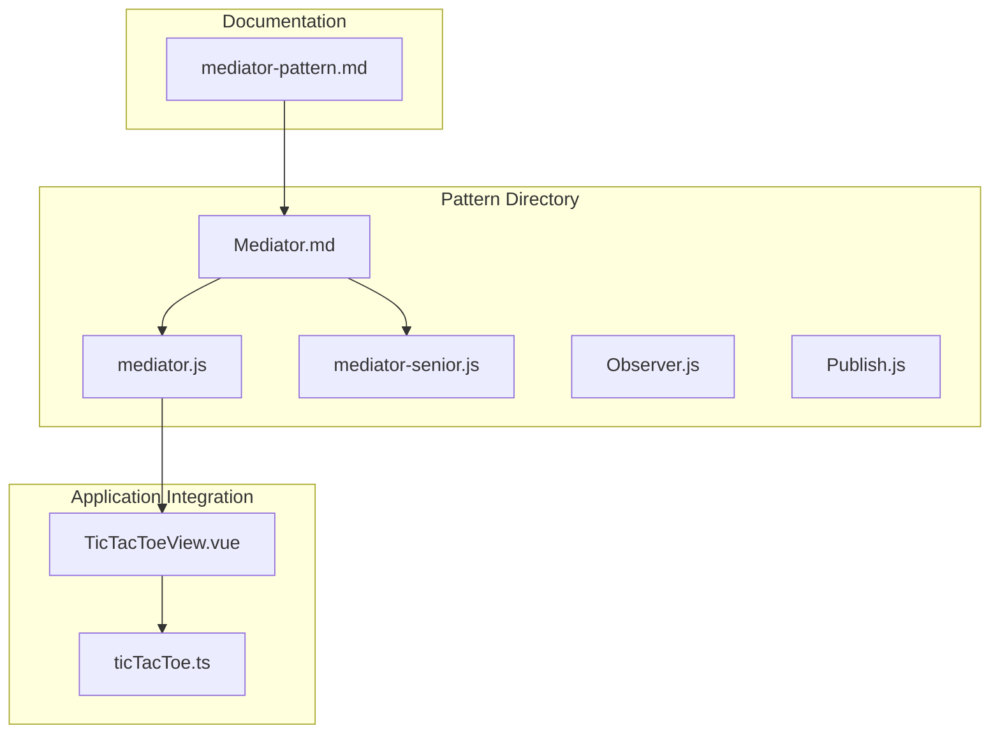
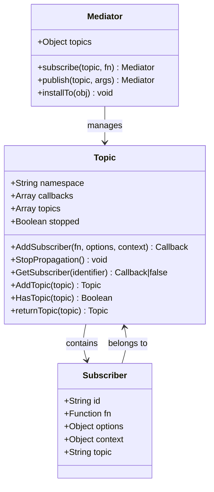
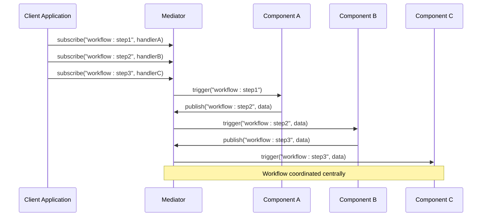
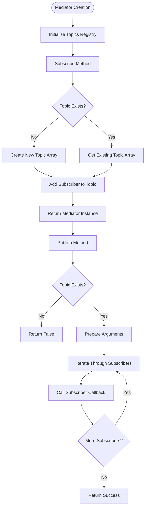
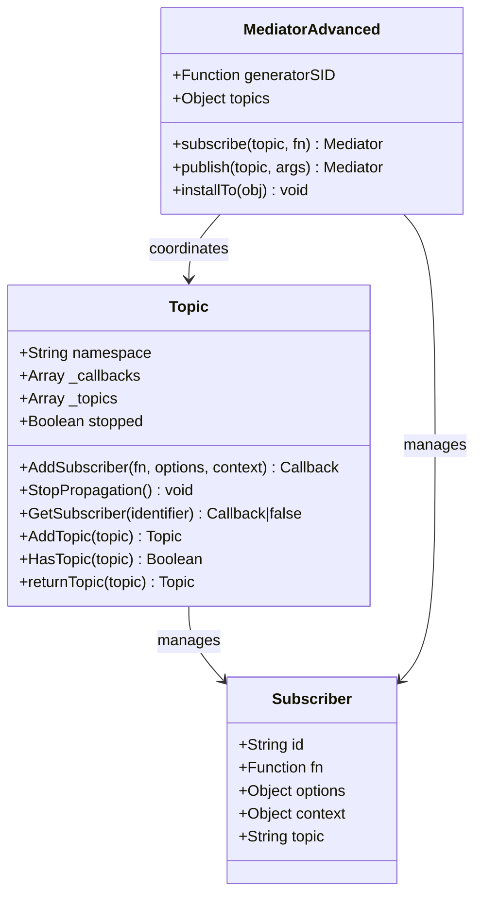
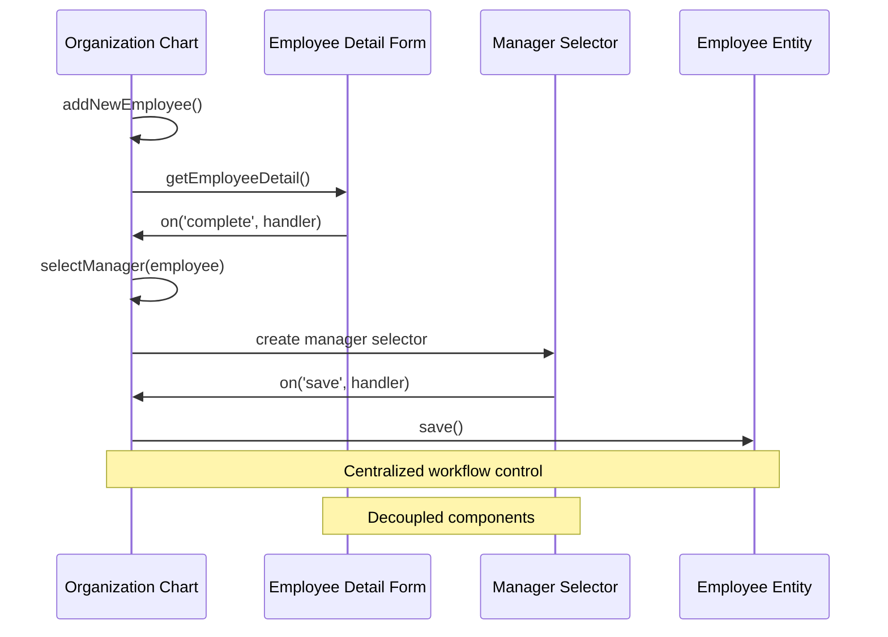
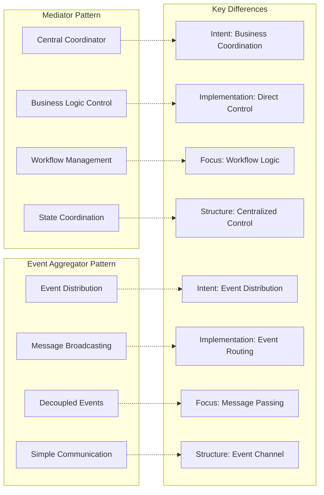
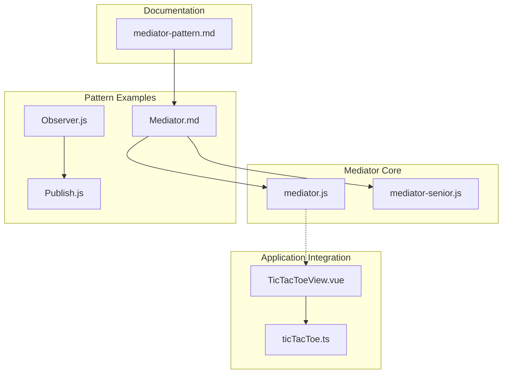

# Mediator Pattern Implementation

<cite>
**Referenced Files in This Document**
- [Mediator.md](file://pattern/Mediator.md)
- [mediator.js](file://pattern/mediator.js)
- [mediator-senior.js](file://pattern/mediator-senior.js)
- [Observer.js](file://pattern/Observer.js)
- [Publish.js](file://pattern/Publish.js)
- [mediator-pattern.md](file://vdocs/blog/mediator-pattern.md)
- [TicTacToeView.vue](file://src/views/TicTacToeView.vue)
- [ticTacToe.ts](file://src/utils/ticTacToe.ts)
</cite>

## Table of Contents
1. [Introduction](#introduction)
2. [Project Structure](#project-structure)
3. [Core Components](#core-components)
4. [Architecture Overview](#architecture-overview)
5. [Detailed Component Analysis](#detailed-component-analysis)
6. [Dependency Analysis](#dependency-analysis)
7. [Performance Considerations](#performance-considerations)
8. [Troubleshooting Guide](#troubleshooting-guide)
9. [Conclusion](#conclusion)

## Introduction

The Mediator pattern is a behavioral design pattern that promotes loose coupling by encapsulating how a set of objects interact. Instead of objects communicating directly with each other, they communicate through a central coordinator object called a mediator. This pattern is particularly valuable in complex systems where multiple objects need to coordinate their actions while maintaining independence.

In this codebase, the Mediator pattern is demonstrated through several implementations and examples. The pattern is implemented in JavaScript as a lightweight event-driven coordination mechanism, and it's contrasted with the Event Aggregator pattern to highlight their different intents and use cases.

## Project Structure

The Mediator pattern implementation is organized across multiple files in the pattern directory and integrated with the main application:



**Diagram sources**
- [Mediator.md:1-93](file://pattern/Mediator.md#L1-L93)
- [mediator.js:1-37](file://pattern/mediator.js#L1-L37)
- [mediator-senior.js:1-82](file://pattern/mediator-senior.js#L1-L82)
- [mediator-pattern.md:1-47](file://vdocs/blog/mediator-pattern.md#L1-L47)

**Section sources**
- [Mediator.md:1-93](file://pattern/Mediator.md#L1-L93)
- [mediator.js:1-37](file://pattern/mediator.js#L1-L37)
- [mediator-senior.js:1-82](file://pattern/mediator-senior.js#L1-L82)
- [mediator-pattern.md:1-47](file://vdocs/blog/mediator-pattern.md#L1-L47)

## Core Components

The Mediator pattern implementation consists of several key components that demonstrate different levels of sophistication:

### Basic Mediator Implementation

The simplest mediator implementation provides a clean interface for event subscription and publishing:



**Diagram sources**
- [mediator.js:4-37](file://pattern/mediator.js#L4-L37)
- [mediator-senior.js:10-22](file://pattern/mediator-senior.js#L10-L22)
- [mediator-senior.js:25-82](file://pattern/mediator-senior.js#L25-L82)

### Event-Driven Coordination

The pattern demonstrates event-driven coordination between different components:



**Diagram sources**
- [mediator.js:7-27](file://pattern/mediator.js#L7-L27)
- [Mediator.md:47-69](file://pattern/Mediator.md#L47-L69)

**Section sources**
- [mediator.js:1-37](file://pattern/mediator.js#L1-L37)
- [mediator-senior.js:1-82](file://pattern/mediator-senior.js#L1-L82)
- [Mediator.md:32-76](file://pattern/Mediator.md#L32-L76)

## Architecture Overview

The Mediator pattern creates a centralized coordination layer that manages interactions between multiple collaborating objects:

```mermaid
graph TB
subgraph "Central Coordinator Layer"
M[Mediator Object]
T[Topic Registry]
end
subgraph "Collaborating Objects"
OA[Organizational Chart]
ED[Employee Detail]
MS[Manager Selector]
EMP[Employee Entity]
end
subgraph "Communication Flow"
C1[Complete Event]
C2[Save Event]
end
OA --> M
ED --> M
MS --> M
EMP --> M
M --> T
T --> OA
T --> ED
T --> MS
T --> EMP
ED -.->|"on('complete')"|.->OA
OA -.->|"selectManager()"|.->MS
MS -.->|"on('save')"|.->EMP
EMP -.->|"save()"|.->OA
note1["Workflow Coordination<br/>Centralized Control<br/>Reduced Coupling"]
M -.-> note1
```

**Diagram sources**
- [Mediator.md:47-69](file://pattern/Mediator.md#L47-L69)
- [mediator.js:5-27](file://pattern/mediator.js#L5-L27)

The architecture demonstrates how the mediator acts as a central coordinator that:

1. **Reduces Direct Dependencies**: Objects communicate through the mediator rather than directly
2. **Manages Workflow Execution**: Coordinates the sequence of operations across multiple components
3. **Handles State Transitions**: Manages state changes and triggers appropriate actions
4. **Provides Centralized Control**: Ensures consistent behavior across the workflow

## Detailed Component Analysis

### Simple Mediator Implementation

The basic mediator implementation provides essential functionality for event-driven coordination:



**Diagram sources**
- [mediator.js:7-27](file://pattern/mediator.js#L7-L27)

**Section sources**
- [mediator.js:4-37](file://pattern/mediator.js#L4-L37)

### Advanced Mediator Implementation

The senior implementation adds sophisticated features for complex coordination scenarios:



**Diagram sources**
- [mediator-senior.js:10-22](file://pattern/mediator-senior.js#L10-L22)
- [mediator-senior.js:25-82](file://pattern/mediator-senior.js#L25-L82)

**Section sources**
- [mediator-senior.js:1-82](file://pattern/mediator-senior.js#L1-L82)

### Practical Example: Employee Workflow Coordination

The documentation provides a concrete example of workflow coordination:



**Diagram sources**
- [Mediator.md:47-69](file://pattern/Mediator.md#L47-L69)
- [mediator-pattern.md:21-34](file://vdocs/blog/mediator-pattern.md#L21-L34)

**Section sources**
- [Mediator.md:47-69](file://pattern/Mediator.md#L47-L69)
- [mediator-pattern.md:19-40](file://vdocs/blog/mediator-pattern.md#L19-L40)

### Comparison with Event Aggregator Pattern

The pattern documentation clearly distinguishes between Mediator and Event Aggregator patterns:



**Diagram sources**
- [Mediator.md:77-91](file://pattern/Mediator.md#L77-L91)
- [mediator-pattern.md:41-46](file://vdocs/blog/mediator-pattern.md#L41-L46)

**Section sources**
- [Mediator.md:77-91](file://pattern/Mediator.md#L77-L91)
- [mediator-pattern.md:41-46](file://vdocs/blog/mediator-pattern.md#L41-L46)

## Dependency Analysis

The Mediator pattern implementation has minimal external dependencies and maintains clean separation of concerns:



**Diagram sources**
- [mediator.js:1-37](file://pattern/mediator.js#L1-L37)
- [mediator-senior.js:1-82](file://pattern/mediator-senior.js#L1-L82)
- [Mediator.md:1-93](file://pattern/Mediator.md#L1-L93)
- [Observer.js:1-58](file://pattern/Observer.js#L1-L58)
- [Publish.js:1-48](file://pattern/Publish.js#L1-L48)
- [TicTacToeView.vue:1-181](file://src/views/TicTacToeView.vue#L1-L181)

The dependency analysis reveals:

1. **Clean Separation**: Pattern implementations are isolated from the main application
2. **Minimal Dependencies**: Core mediator implementation has no external dependencies
3. **Documentation Integration**: Pattern examples are documented and referenced
4. **Testable Components**: Individual pattern implementations can be tested independently

**Section sources**
- [mediator.js:1-37](file://pattern/mediator.js#L1-L37)
- [mediator-senior.js:1-82](file://pattern/mediator-senior.js#L1-L82)
- [Mediator.md:1-93](file://pattern/Mediator.md#L1-L93)
- [Observer.js:1-58](file://pattern/Observer.js#L1-L58)
- [Publish.js:1-48](file://pattern/Publish.js#L1-L48)

## Performance Considerations

The Mediator pattern implementation demonstrates several performance characteristics:

### Memory Efficiency
- **Topic Storage**: Topics are stored in memory as arrays, allowing O(n) subscription and publication
- **Callback Management**: Subscribers are stored as objects with context and callback references
- **Event Propagation**: Events are propagated synchronously to all subscribers

### Scalability Factors
- **Linear Complexity**: Subscription and publication operations scale linearly with the number of subscribers
- **Memory Overhead**: Each subscriber adds memory overhead for context and callback storage
- **CPU Usage**: Event propagation requires iterating through all subscribers for each event

### Optimization Opportunities
- **Weak References**: Using weak references for subscribers could prevent memory leaks
- **Batch Processing**: Grouping events could reduce callback invocation overhead
- **Selective Propagation**: Implementing topic hierarchies could optimize event routing

## Troubleshooting Guide

Common issues and solutions when working with the Mediator pattern implementation:

### Subscription Issues
- **Problem**: Subscribers not receiving events
- **Solution**: Verify topic existence and ensure proper subscription registration
- **Debug**: Check if topics array contains the expected topic

### Event Propagation Problems
- **Problem**: Events not reaching all subscribers
- **Solution**: Verify callback execution order and argument passing
- **Debug**: Check for exceptions in subscriber callbacks

### Memory Leaks
- **Problem**: Accumulation of unused subscribers
- **Solution**: Implement proper cleanup mechanisms for subscriber removal
- **Debug**: Monitor subscriber count over time

### Performance Degradation
- **Problem**: Slow event processing with many subscribers
- **Solution**: Consider implementing selective propagation or batching
- **Debug**: Profile callback execution times

**Section sources**
- [mediator.js:16-27](file://pattern/mediator.js#L16-L27)
- [mediator-senior.js:37-68](file://pattern/mediator-senior.js#L37-L68)

## Conclusion

The Mediator pattern implementation in this codebase provides a comprehensive demonstration of centralized coordination for complex object interactions. The implementation successfully showcases:

1. **Centralized Control**: The mediator serves as a single point of coordination for multiple collaborating objects
2. **Reduced Coupling**: Objects communicate through the mediator rather than directly, improving modularity
3. **Flexible Workflow Management**: The pattern enables complex workflows with state transitions and conditional logic
4. **Clear Separation of Concerns**: Business logic is separated from event handling infrastructure

The comparison with the Event Aggregator pattern highlights the fundamental difference in intent: while both use events for communication, the Mediator focuses on business workflow coordination, whereas the Event Aggregator emphasizes event distribution channels.

The practical examples, particularly the employee workflow coordination scenario, demonstrate real-world applicability of the pattern in managing complex multi-object interactions. The implementation remains lightweight and maintainable, making it suitable for various application scenarios where centralized coordination is beneficial.

For applications requiring sophisticated workflow management with clear state transitions and business logic coordination, the Mediator pattern provides an excellent solution that improves system maintainability and reduces complexity compared to direct object communication approaches.