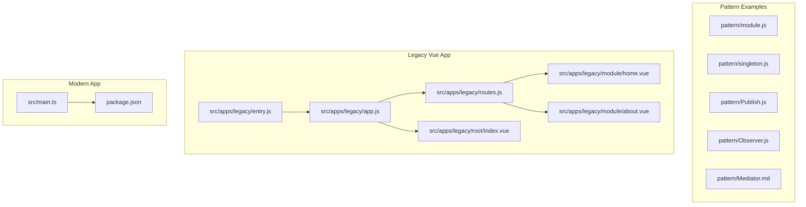
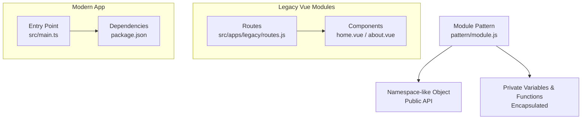
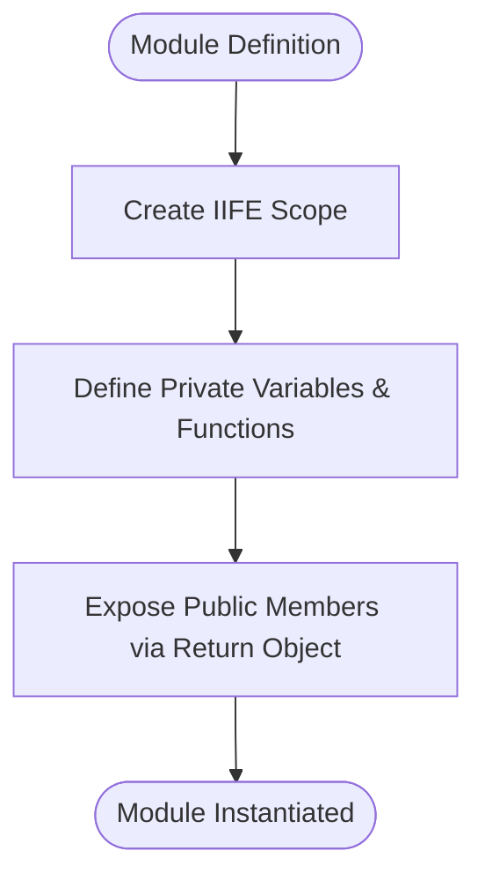
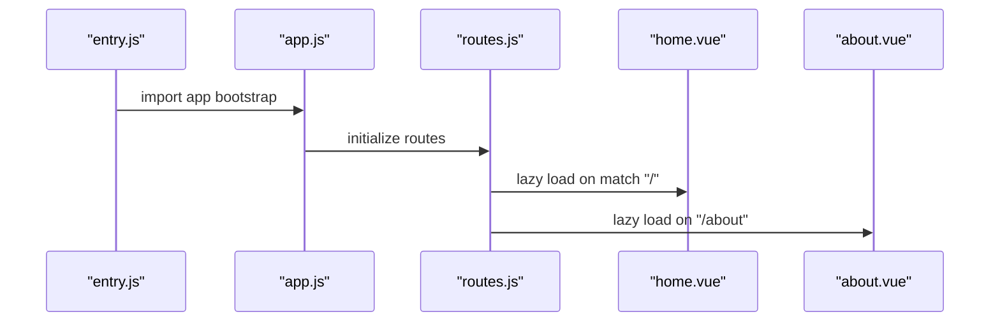
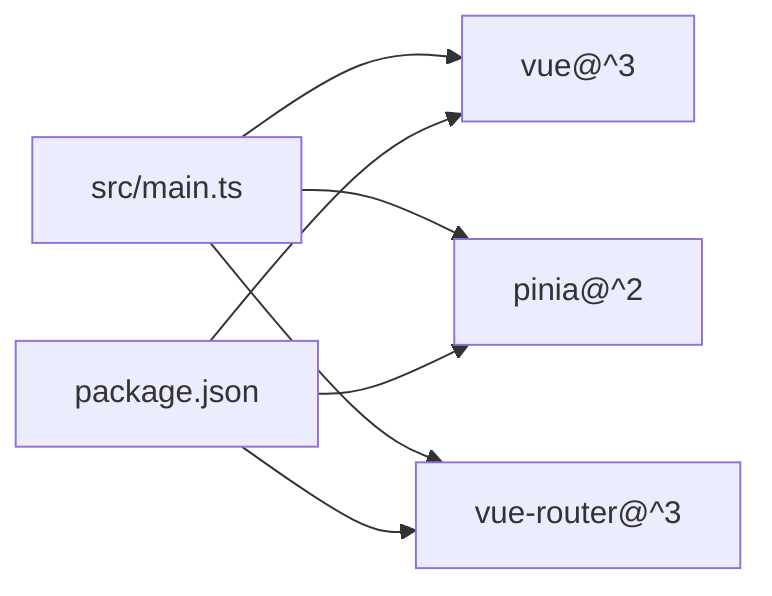
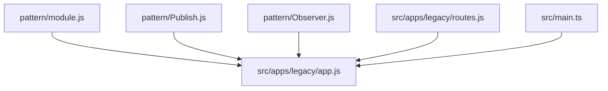

# Module Pattern Implementation

<cite>
**Referenced Files in This Document**
- [module.js](file://pattern/module.js)
- [singleton.js](file://pattern/singleton.js)
- [Publish.js](file://pattern/Publish.js)
- [Observer.js](file://pattern/Observer.js)
- [Mediator.md](file://pattern/Mediator.md)
- [app.js](file://src/apps/legacy/app.js)
- [entry.js](file://src/apps/legacy/entry.js)
- [routes.js](file://src/apps/legacy/routes.js)
- [home.vue](file://src/apps/legacy/module/home.vue)
- [about.vue](file://src/apps/legacy/module/about.vue)
- [index.vue](file://src/apps/legacy/root/index.vue)
- [main.ts](file://src/main.ts)
- [package.json](file://package.json)
</cite>

## Table of Contents
1. [Introduction](#introduction)
2. [Project Structure](#project-structure)
3. [Core Components](#core-components)
4. [Architecture Overview](#architecture-overview)
5. [Detailed Component Analysis](#detailed-component-analysis)
6. [Dependency Analysis](#dependency-analysis)
7. [Performance Considerations](#performance-considerations)
8. [Troubleshooting Guide](#troubleshooting-guide)
9. [Conclusion](#conclusion)
10. [Appendices](#appendices)

## Introduction
This document explains the Module pattern as a foundational JavaScript design pattern for encapsulating private and public functionality within a single unit. It documents the practical implementation shown in the repository’s module.js, focusing on namespace creation and separation of private/public members. It also compares the Module pattern with ES6 modules and other modern module systems, highlights contemporary relevance in legacy and Vue.js contexts, and provides guidance on organizing code to avoid namespace pollution and global variable conflicts.

## Project Structure
The repository includes a dedicated pattern directory containing classic JavaScript patterns, alongside a Vue 2 application that demonstrates modular composition via Single File Components (SFCs) and routing. The Module pattern example is located under pattern/module.js, while Vue components illustrate modern module usage in a SPA.



**Diagram sources**
- [module.js:1-16](file://pattern/module.js#L1-L16)
- [singleton.js:1-17](file://pattern/singleton.js#L1-L17)
- [Publish.js:1-48](file://pattern/Publish.js#L1-L48)
- [Observer.js:1-58](file://pattern/Observer.js#L1-L58)
- [Mediator.md:1-93](file://pattern/Mediator.md#L1-L93)
- [entry.js:1-2](file://src/apps/legacy/entry.js#L1-L2)
- [app.js:1-13](file://src/apps/legacy/app.js#L1-L13)
- [routes.js:1-21](file://src/apps/legacy/routes.js#L1-L21)
- [home.vue:1-32](file://src/apps/legacy/module/home.vue#L1-L32)
- [about.vue:1-102](file://src/apps/legacy/module/about.vue#L1-L102)
- [index.vue:1-55](file://src/apps/legacy/root/index.vue#L1-L55)
- [main.ts:1-16](file://src/main.ts#L1-L16)
- [package.json:1-61](file://package.json#L1-L61)

**Section sources**
- [module.js:1-16](file://pattern/module.js#L1-L16)
- [entry.js:1-2](file://src/apps/legacy/entry.js#L1-L2)
- [app.js:1-13](file://src/apps/legacy/app.js#L1-L13)
- [routes.js:1-21](file://src/apps/legacy/routes.js#L1-L21)
- [home.vue:1-32](file://src/apps/legacy/module/home.vue#L1-L32)
- [about.vue:1-102](file://src/apps/legacy/module/about.vue#L1-L102)
- [index.vue:1-55](file://src/apps/legacy/root/index.vue#L1-L55)
- [main.ts:1-16](file://src/main.ts#L1-L16)
- [package.json:1-61](file://package.json#L1-L61)

## Core Components
- Module pattern example (reveal module): Demonstrates encapsulation by returning an object that exposes only selected members while keeping internal state and functions private. See [module.js:1-16](file://pattern/module.js#L1-L16).
- Singleton companion: Shows a related pattern that ensures a single shared instance. See [singleton.js:1-17](file://pattern/singleton.js#L1-L17).
- Pub/Sub utilities: Provide event-driven communication patterns that complement module boundaries. See [Publish.js:1-48](file://pattern/Publish.js#L1-L48).
- Observer utilities: Offer observable subject/observer mechanics useful inside modules. See [Observer.js:1-58](file://pattern/Observer.js#L1-L58).
- Legacy Vue app wiring: Shows how modules are composed in a Vue 2 application using entry, router, and route-based lazy loading. See [entry.js:1-2](file://src/apps/legacy/entry.js#L1-L2), [app.js:1-13](file://src/apps/legacy/app.js#L1-L13), [routes.js:1-21](file://src/apps/legacy/routes.js#L1-L21).
- Modern Vue 3 + TypeScript entry: Demonstrates modern module usage with Vue 3, Pinia, and TypeScript. See [main.ts:1-16](file://src/main.ts#L1-L16).

**Section sources**
- [module.js:1-16](file://pattern/module.js#L1-L16)
- [singleton.js:1-17](file://pattern/singleton.js#L1-L17)
- [Publish.js:1-48](file://pattern/Publish.js#L1-L48)
- [Observer.js:1-58](file://pattern/Observer.js#L1-L58)
- [entry.js:1-2](file://src/apps/legacy/entry.js#L1-L2)
- [app.js:1-13](file://src/apps/legacy/app.js#L1-L13)
- [routes.js:1-21](file://src/apps/legacy/routes.js#L1-L21)
- [main.ts:1-16](file://src/main.ts#L1-L16)

## Architecture Overview
The Module pattern creates a self-contained unit with controlled exposure. In the repository, the module example returns a public interface while preserving private state. The legacy Vue app composes modules via routing and lazy-loaded components. The modern app uses ES modules and Vue 3 composition.



**Diagram sources**
- [module.js:1-16](file://pattern/module.js#L1-L16)
- [routes.js:1-21](file://src/apps/legacy/routes.js#L1-L21)
- [home.vue:1-32](file://src/apps/legacy/module/home.vue#L1-L32)
- [about.vue:1-102](file://src/apps/legacy/module/about.vue#L1-L102)
- [main.ts:1-16](file://src/main.ts#L1-L16)
- [package.json:1-61](file://package.json#L1-L61)

## Detailed Component Analysis

### Module Pattern Example (pattern/module.js)
- Purpose: Encapsulate private state and functions behind a returned public interface.
- Key elements:
  - IIFE (Immediately Invoked Function Expression) establishes scope isolation.
  - Private members remain inaccessible from outside the closure.
  - Public members are explicitly exposed on the returned object.
- Practical usage:
  - Prevents namespace pollution by avoiding globals.
  - Enables controlled access to internal logic.
  - Supports maintainability by centralizing concerns within a single unit.
- Notes on maintenance: The “reveal” style makes the public API explicit but can become unwieldy as complexity grows.



**Diagram sources**
- [module.js:1-16](file://pattern/module.js#L1-L16)

**Section sources**
- [module.js:1-16](file://pattern/module.js#L1-L16)

### Related Patterns in the Repository
- Singleton pattern: Ensures a single shared instance and can be combined with module boundaries. See [singleton.js:1-17](file://pattern/singleton.js#L1-L17).
- Pub/Sub utilities: Provide decoupled communication suitable for module boundaries. See [Publish.js:1-48](file://pattern/Publish.js#L1-L48).
- Observer utilities: Demonstrate observable mechanics often used within modules. See [Observer.js:1-58](file://pattern/Observer.js#L1-L58).
- Mediator concept: While not implemented here, the repository includes a detailed explanation of mediator vs. event aggregator semantics. See [Mediator.md:1-93](file://pattern/Mediator.md#L1-L93).

```mermaid
classDiagram
class ModuleExample {
"+publicMethod()"
"+publicVar"
}
class SingletonExample {
"+getInstance()"
}
class PubSubExample {
"+subscribe(topic, func)"
"+publish(topic, payload)"
}
class ObserverExample {
"+addObserver(observer)"
"+removeObserver(observer)"
"+notify(context)"
}
ModuleExample ..> SingletonExample : "can be paired"
ModuleExample ..> PubSubExample : "communicates via"
ModuleExample ..> ObserverExample : "uses internally"
```

**Diagram sources**
- [module.js:1-16](file://pattern/module.js#L1-L16)
- [singleton.js:1-17](file://pattern/singleton.js#L1-L17)
- [Publish.js:1-48](file://pattern/Publish.js#L1-L48)
- [Observer.js:1-58](file://pattern/Observer.js#L1-L58)

**Section sources**
- [singleton.js:1-17](file://pattern/singleton.js#L1-L17)
- [Publish.js:1-48](file://pattern/Publish.js#L1-L48)
- [Observer.js:1-58](file://pattern/Observer.js#L1-L58)
- [Mediator.md:1-93](file://pattern/Mediator.md#L1-L93)

### Legacy Vue App Composition (Routing and Lazy Loading)
- Entry point wires the Vue app and router. See [entry.js:1-2](file://src/apps/legacy/entry.js#L1-L2), [app.js:1-13](file://src/apps/legacy/app.js#L1-L13).
- Routes define lazy-loaded component modules. See [routes.js:1-21](file://src/apps/legacy/routes.js#L1-L21).
- Components demonstrate modular UI units. See [home.vue:1-32](file://src/apps/legacy/module/home.vue#L1-L32), [about.vue:1-102](file://src/apps/legacy/module/about.vue#L1-L102).
- Root layout composes child components. See [index.vue:1-55](file://src/apps/legacy/root/index.vue#L1-L55).



**Diagram sources**
- [entry.js:1-2](file://src/apps/legacy/entry.js#L1-L2)
- [app.js:1-13](file://src/apps/legacy/app.js#L1-L13)
- [routes.js:1-21](file://src/apps/legacy/routes.js#L1-L21)
- [home.vue:1-32](file://src/apps/legacy/module/home.vue#L1-L32)
- [about.vue:1-102](file://src/apps/legacy/module/about.vue#L1-L102)

**Section sources**
- [entry.js:1-2](file://src/apps/legacy/entry.js#L1-L2)
- [app.js:1-13](file://src/apps/legacy/app.js#L1-L13)
- [routes.js:1-21](file://src/apps/legacy/routes.js#L1-L21)
- [home.vue:1-32](file://src/apps/legacy/module/home.vue#L1-L32)
- [about.vue:1-102](file://src/apps/legacy/module/about.vue#L1-L102)
- [index.vue:1-55](file://src/apps/legacy/root/index.vue#L1-L55)

### Modern Vue 3 + TypeScript Entry (ES Modules)
- The modern entry uses Vue 3, Pinia, and TypeScript with ES modules. See [main.ts:1-16](file://src/main.ts#L1-L16).
- Dependencies and scripts are declared in package.json. See [package.json:1-61](file://package.json#L1-L61).



**Diagram sources**
- [main.ts:1-16](file://src/main.ts#L1-L16)
- [package.json:1-61](file://package.json#L1-L61)

**Section sources**
- [main.ts:1-16](file://src/main.ts#L1-L16)
- [package.json:1-61](file://package.json#L1-L61)

## Dependency Analysis
- Internal dependencies:
  - The module example depends on its own IIFE scope to enforce privacy. See [module.js:1-16](file://pattern/module.js#L1-L16).
  - Pub/Sub utilities depend on an internal topics registry. See [Publish.js:1-48](file://pattern/Publish.js#L1-L48).
  - Observer utilities depend on an internal observer list. See [Observer.js:1-58](file://pattern/Observer.js#L1-L58).
- Application dependencies:
  - Legacy app depends on Vue 2 and vue-router. See [package.json:28-32](file://package.json#L28-L32).
  - Modern app depends on Vue 3, Pinia, and vue-router. See [main.ts:1-16](file://src/main.ts#L1-L16), [package.json:28-32](file://package.json#L28-L32).



**Diagram sources**
- [module.js:1-16](file://pattern/module.js#L1-L16)
- [Publish.js:1-48](file://pattern/Publish.js#L1-L48)
- [Observer.js:1-58](file://pattern/Observer.js#L1-L58)
- [app.js:1-13](file://src/apps/legacy/app.js#L1-L13)
- [routes.js:1-21](file://src/apps/legacy/routes.js#L1-L21)
- [main.ts:1-16](file://src/main.ts#L1-L16)

**Section sources**
- [module.js:1-16](file://pattern/module.js#L1-L16)
- [Publish.js:1-48](file://pattern/Publish.js#L1-L48)
- [Observer.js:1-58](file://pattern/Observer.js#L1-L58)
- [app.js:1-13](file://src/apps/legacy/app.js#L1-L13)
- [routes.js:1-21](file://src/apps/legacy/routes.js#L1-L21)
- [main.ts:1-16](file://src/main.ts#L1-L16)
- [package.json:28-32](file://package.json#L28-L32)

## Performance Considerations
- Module pattern:
  - Pros: Clear boundary between private and public, reduced global footprint.
  - Cons: Can become unwieldy as logic scales; careful refactoring helps maintain performance and readability.
- Modern module systems (ES modules):
  - Advantages: Tree-shaking, static analysis, native bundler support, and standardized semantics.
  - Considerations: Ensure proper bundling and minification to optimize bundle size.

[No sources needed since this section provides general guidance]

## Troubleshooting Guide
- Namespace pollution symptoms:
  - Unexpected global variables or collisions indicate missing encapsulation. Apply the Module pattern to isolate private state and expose only necessary APIs. See [module.js:1-16](file://pattern/module.js#L1-L16).
- Event-driven communication:
  - Use pub/sub utilities to decouple modules and reduce tight coupling. See [Publish.js:1-48](file://pattern/Publish.js#L1-L48).
- Observable patterns:
  - Leverage observer mechanics to manage updates within modules. See [Observer.js:1-58](file://pattern/Observer.js#L1-L58).
- Legacy Vue app:
  - Verify route lazy-loading and component imports. See [routes.js:1-21](file://src/apps/legacy/routes.js#L1-L21).
- Modern app:
  - Confirm dependencies and entry point configuration. See [main.ts:1-16](file://src/main.ts#L1-L16), [package.json:1-61](file://package.json#L1-L61).

**Section sources**
- [module.js:1-16](file://pattern/module.js#L1-L16)
- [Publish.js:1-48](file://pattern/Publish.js#L1-L48)
- [Observer.js:1-58](file://pattern/Observer.js#L1-L58)
- [routes.js:1-21](file://src/apps/legacy/routes.js#L1-L21)
- [main.ts:1-16](file://src/main.ts#L1-L16)
- [package.json:1-61](file://package.json#L1-L61)

## Conclusion
The Module pattern remains a powerful technique for encapsulation and controlled exposure of functionality, especially in environments where ES modules are not available or when legacy systems require structured boundaries. In modern Vue.js applications, the pattern complements ES modules and component composition, enabling clean separation of concerns, reduced global pollution, and improved maintainability. For large-scale codebases, combining the Module pattern with modern module systems and component architectures yields robust, scalable solutions.

[No sources needed since this section summarizes without analyzing specific files]

## Appendices
- Use cases for the Module pattern today:
  - Legacy environments without ES module support.
  - Small libraries or utilities requiring strict privacy.
  - Legacy Vue 2 apps where modules are composed via route-based lazy loading and SFCs.
- Comparison with ES6 modules and modern systems:
  - ES modules offer superior tooling, tree-shaking, and static analysis.
  - The Module pattern excels in explicit privacy and controlled API exposure.
  - In Vue.js, SFCs and ES modules provide structured composition; the Module pattern can still encapsulate internal logic within components or plugins.

[No sources needed since this section provides general guidance]