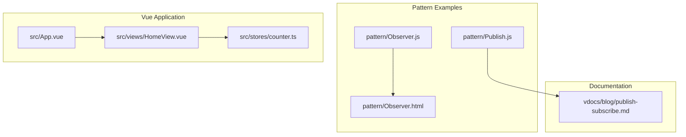
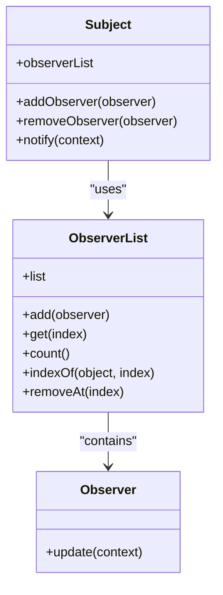
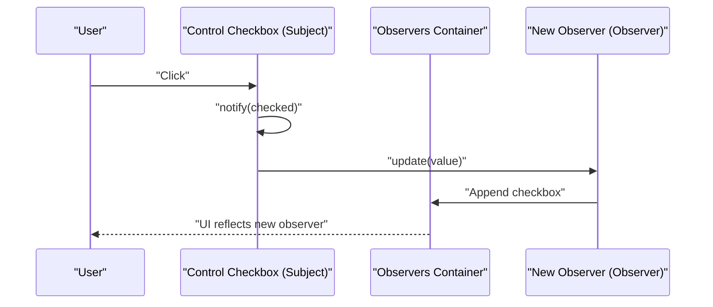
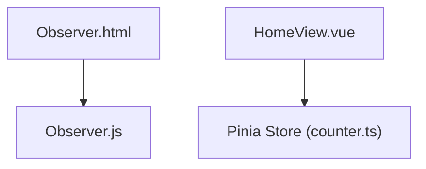

# Observer Pattern Implementation

<cite>
**Referenced Files in This Document**
- [Observer.js](file://pattern/Observer.js)
- [Observer.html](file://pattern/Observer.html)
- [Publish.js](file://pattern/Publish.js)
- [publish-subscribe.md](file://vdocs/blog/publish-subscribe.md)
- [counter.ts](file://src/stores/counter.ts)
- [HomeView.vue](file://src/views/HomeView.vue)
- [App.vue](file://src/App.vue)
- [README.md](file://README.md)
</cite>

## Table of Contents
1. [Introduction](#introduction)
2. [Project Structure](#project-structure)
3. [Core Components](#core-components)
4. [Architecture Overview](#architecture-overview)
5. [Detailed Component Analysis](#detailed-component-analysis)
6. [Dependency Analysis](#dependency-analysis)
7. [Performance Considerations](#performance-considerations)
8. [Troubleshooting Guide](#troubleshooting-guide)
9. [Conclusion](#conclusion)
10. [Appendices](#appendices)

## Introduction
This document explains the Observer pattern as a behavioral design pattern that establishes a subscription mechanism between objects. It demonstrates how event-driven communication works in this codebase, focusing on the practical implementation shown in Observer.js and its HTML demonstration. The document also compares the Observer pattern with the Publish/Subscribe pattern, provides guidance for implementing observer-like patterns in Vue.js applications, and outlines when to use the Observer pattern versus alternatives.

## Project Structure
The repository is a Vue 3 application scaffolded with Vite. The Observer pattern implementation resides under the pattern directory, alongside a Publish/Subscribe implementation. Documentation and examples are integrated into the Vue application’s views and documentation site.

**Diagram sources**
- [Observer.js:1-58](file://pattern/Observer.js#L1-L58)
- [Observer.html:1-69](file://pattern/Observer.html#L1-L69)
- [Publish.js:1-48](file://pattern/Publish.js#L1-L48)
- [publish-subscribe.md:1-50](file://vdocs/blog/publish-subscribe.md#L1-L50)
- [counter.ts:1-17](file://src/stores/counter.ts#L1-L17)
- [HomeView.vue:1-648](file://src/views/HomeView.vue#L1-L648)
- [App.vue:1-110](file://src/App.vue#L1-L110)

**Section sources**
- [README.md:1-60](file://README.md#L1-L60)

## Core Components
This section documents the Observer pattern implementation and its supporting components.

- ObserverList: Manages a collection of observers with operations to add, get, count, find index, and remove by index.
- Observer: Defines the update interface that concrete observers implement to react to notifications.
- Subject: Maintains an ObserverList and exposes methods to add/remove observers and notify them with a context.

These components form the foundation of a classic Observer pattern where subjects track observers and push updates directly to them.

**Section sources**
- [Observer.js:1-58](file://pattern/Observer.js#L1-L58)

## Architecture Overview
The Observer pattern implementation consists of three collaborating parts:
- Subject maintains a list of observers and notifies them upon state changes.
- Observer defines the contract for receiving updates.
- ObserverList encapsulates the observer collection and provides indexing and removal capabilities.

**Diagram sources**
- [Observer.js:1-58](file://pattern/Observer.js#L1-L58)

## Detailed Component Analysis

### ObserverList
ObserverList manages a simple array of observers. It supports adding observers, retrieving them by index, counting them, finding an observer’s index, and removing an observer at a given index. The implementation includes a bug fix in the indexOf method where the loop variable was not initialized correctly in the original code.

Key operations:
- add: Appends an observer to the internal list.
- get: Retrieves an observer by index.
- count: Returns the number of observers.
- indexOf: Searches for an observer and returns its index or -1 if not found.
- removeAt: Removes an observer at the specified index.

Complexity:
- add/get/count are O(1).
- indexOf is O(n) due to linear scan.
- removeAt is O(n) due to splice operation.

**Section sources**
- [Observer.js:1-26](file://pattern/Observer.js#L1-L26)

### Observer
Observer defines a minimal interface with an update method. Concrete observers override this method to implement their own behavior when notified.

Typical usage:
- Implement custom update logic to synchronize UI or state with the subject’s context.

**Section sources**
- [Observer.js:30-34](file://pattern/Observer.js#L30-L34)

### Subject
Subject holds an ObserverList and coordinates observer subscriptions and notifications. It provides:
- addObserver: Adds an observer to the list.
- removeObserver: Removes an observer by locating its index and splicing it out.
- notify: Iterates through all observers and invokes their update method with a context argument.

Notification flow:
- The subject iterates through the observer list and calls update on each observer.
- Observers receive the context passed by the subject, enabling them to react accordingly.

**Section sources**
- [Observer.js:38-56](file://pattern/Observer.js#L38-L56)

### Observer.html Demonstration
The HTML example demonstrates dynamic creation of observers and their subscription to a subject. It shows:
- Extending a DOM element (checkbox) with Subject behavior.
- Creating new observers dynamically and extending them with Observer behavior.
- Overriding the update method to synchronize the observer’s state with the subject’s state.
- Adding observers to the subject and appending them to the DOM.

Event emission and handling:
- Clicking the main checkbox triggers notify with the current checked state.
- Each observer’s update method receives the context and updates its state accordingly.

**Diagram sources**
- [Observer.html:14-66](file://pattern/Observer.html#L14-L66)
- [Observer.js:38-56](file://pattern/Observer.js#L38-L56)

**Section sources**
- [Observer.html:1-69](file://pattern/Observer.html#L1-L69)

### Publish/Subscribe Comparison
The repository also includes a Publish/Subscribe implementation and documentation contrasting it with the Observer pattern:
- Observer: Observers subscribe directly to a subject; the subject actively notifies them.
- Publish/Subscribe: Publishers and subscribers communicate through a central event channel, decoupling them.

Benefits and trade-offs:
- Lower coupling and easier extension for multiple handlers.
- Longer call chains and potential difficulty in tracking handler outcomes.

**Section sources**
- [Publish.js:1-48](file://pattern/Publish.js#L1-L48)
- [publish-subscribe.md:1-50](file://vdocs/blog/publish-subscribe.md#L1-L50)

## Dependency Analysis
The Observer pattern implementation is self-contained within Observer.js. The HTML example depends on Observer.js for runtime behavior. The Vue application integrates with Pinia stores, which provide reactive state management. While not a direct Observer pattern, Pinia stores demonstrate reactive updates that complement the Observer pattern’s goals.

**Diagram sources**
- [Observer.js:1-58](file://pattern/Observer.js#L1-L58)
- [Observer.html:1-69](file://pattern/Observer.html#L1-L69)
- [counter.ts:1-17](file://src/stores/counter.ts#L1-L17)
- [HomeView.vue:1-648](file://src/views/HomeView.vue#L1-L648)

**Section sources**
- [counter.ts:1-17](file://src/stores/counter.ts#L1-L17)
- [HomeView.vue:1-648](file://src/views/HomeView.vue#L1-L648)

## Performance Considerations
- ObserverList operations:
  - Adding and retrieving observers are O(1).
  - Index lookup and removal are O(n) due to array operations.
- Notification cost scales linearly with the number of observers.
- For large observer lists, consider batching updates or using a publish/subscribe channel to reduce coupling and improve scalability.

[No sources needed since this section provides general guidance]

## Troubleshooting Guide
Common issues and resolutions:
- Incorrect observer removal:
  - Ensure removeObserver uses indexOf to locate the observer before splicing it out.
  - Verify the observer instance equality to avoid accidental removal of unintended observers.
- ObserverList.indexOf bug:
  - Confirm the loop variable initialization and comparison logic.
- HTML example pitfalls:
  - Ensure observers override update to reflect the subject’s context.
  - Validate that observers are appended to the DOM container after subscription.

**Section sources**
- [Observer.js:13-26](file://pattern/Observer.js#L13-L26)
- [Observer.html:46-66](file://pattern/Observer.html#L46-L66)

## Conclusion
The Observer pattern in this codebase provides a straightforward mechanism for event-driven communication between subjects and observers. The implementation in Observer.js demonstrates the essential components and lifecycle of subscriptions and notifications. The HTML example illustrates dynamic observer creation and synchronization. For Vue.js applications, reactive state management via Pinia complements the Observer pattern’s goals by enabling automatic UI updates. Choose the Observer pattern when direct, tight-coupled notifications are desired, and consider Publish/Subscribe for decoupled, scalable event systems.

[No sources needed since this section summarizes without analyzing specific files]

## Appendices

### Implementing Observer Patterns in Vue.js Applications
While Vue’s reactivity and Pinia stores offer reactive updates, you can still leverage the Observer pattern for:
- Cross-component communication without shared parent props.
- Integrating third-party libraries that emit events.
- Coordinating multiple UI reactions to a single state change.

Guidance:
- Define a Subject-like service that emits events when state changes.
- Create observers as Vue components or composables that subscribe to the service.
- Use lifecycle hooks to add/remove observers during component mount/unmount.

[No sources needed since this section provides general guidance]