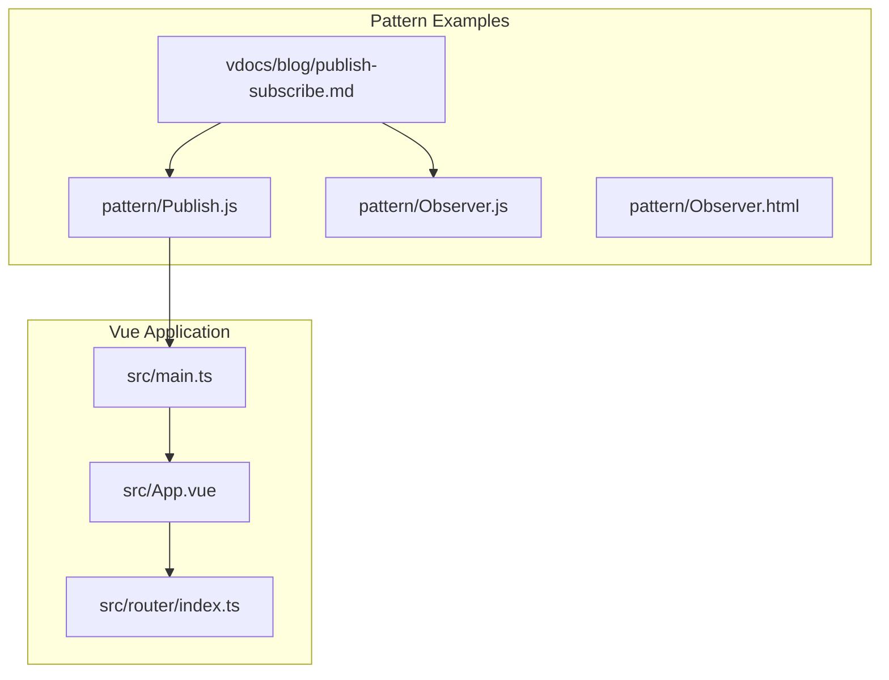
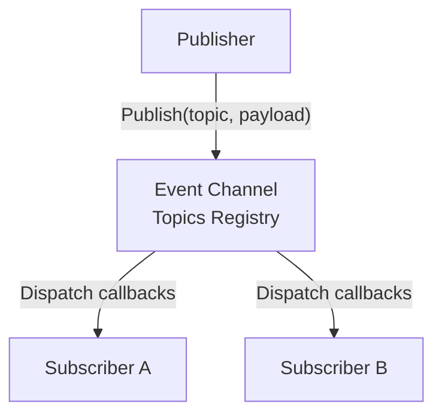
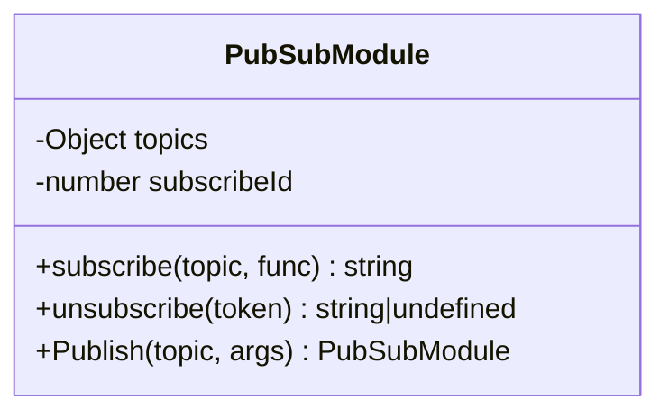
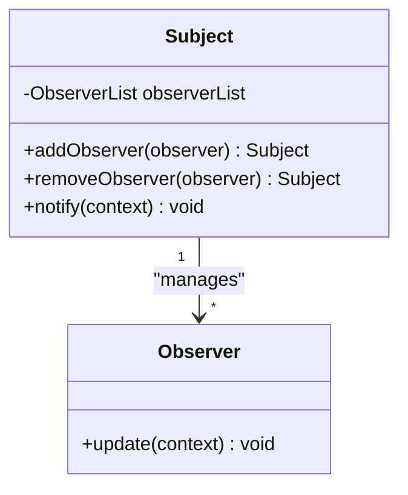
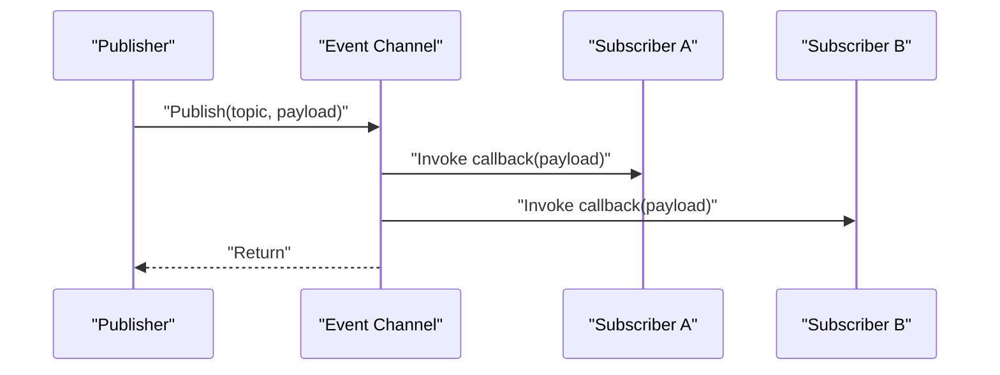
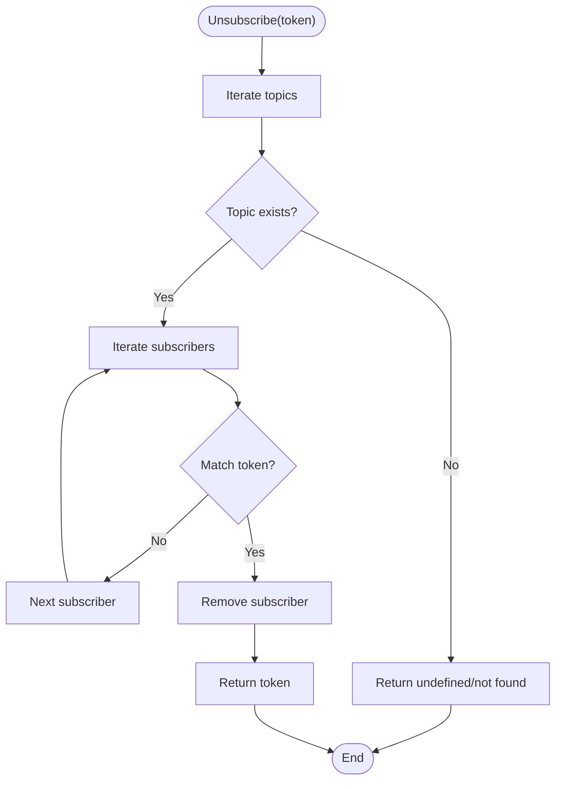
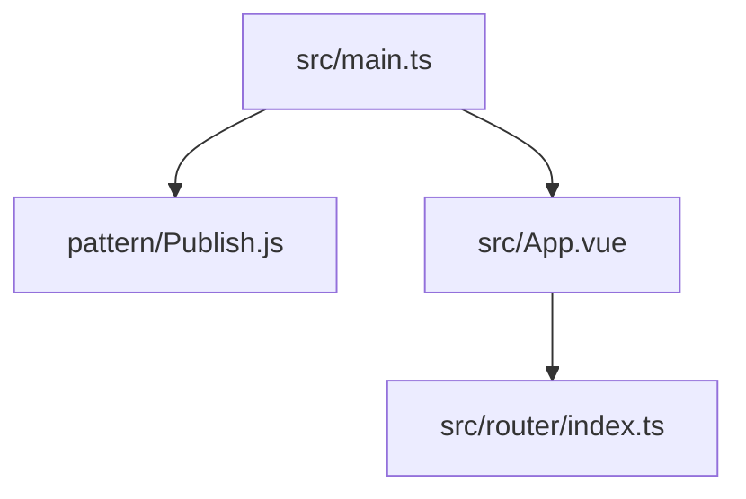

# Publish-Subscribe Pattern Implementation

<cite>
**Referenced Files in This Document**
- [Publish.js](file://pattern/Publish.js)
- [Observer.js](file://pattern/Observer.js)
- [Observer.html](file://pattern/Observer.html)
- [publish-subscribe.md](file://vdocs/blog/publish-subscribe.md)
- [index.ts](file://src/router/index.ts)
- [main.ts](file://src/main.ts)
- [App.vue](file://src/App.vue)
</cite>

## Table of Contents
1. [Introduction](#introduction)
2. [Project Structure](#project-structure)
3. [Core Components](#core-components)
4. [Architecture Overview](#architecture-overview)
5. [Detailed Component Analysis](#detailed-component-analysis)
6. [Dependency Analysis](#dependency-analysis)
7. [Performance Considerations](#performance-considerations)
8. [Troubleshooting Guide](#troubleshooting-guide)
9. [Conclusion](#conclusion)
10. [Appendices](#appendices)

## Introduction
This document explains the Publish-Subscribe (Pub/Sub) pattern as a behavioral design pattern that enables loose coupling between publishers and subscribers through a central event channel. It documents the practical implementation in the provided Pub/Sub module and contrasts it with the Observer pattern. The guide also covers use cases where Pub/Sub excels, such as decoupled system architectures and event-driven programming, and provides guidance for building efficient pub-sub systems in Vue.js applications.

## Project Structure
The repository includes a dedicated pattern folder containing the Pub/Sub implementation and a comparison with the Observer pattern. The Vue.js application demonstrates a modern front-end stack with Vue 2, Vue Router, and Pinia, but does not currently integrate the Pub/Sub module. The documentation site under vdocs/blog provides conceptual explanations and comparisons.

**Diagram sources**
- [Publish.js:1-48](file://pattern/Publish.js#L1-L48)
- [Observer.js:1-58](file://pattern/Observer.js#L1-L58)
- [Observer.html:1-69](file://pattern/Observer.html#L1-L69)
- [publish-subscribe.md:1-50](file://vdocs/blog/publish-subscribe.md#L1-L50)
- [main.ts:1-16](file://src/main.ts#L1-L16)
- [App.vue:1-110](file://src/App.vue#L1-L110)
- [index.ts:1-65](file://src/router/index.ts#L1-L65)

**Section sources**
- [Publish.js:1-48](file://pattern/Publish.js#L1-L48)
- [Observer.js:1-58](file://pattern/Observer.js#L1-L58)
- [Observer.html:1-69](file://pattern/Observer.html#L1-L69)
- [publish-subscribe.md:1-50](file://vdocs/blog/publish-subscribe.md#L1-L50)
- [main.ts:1-16](file://src/main.ts#L1-L16)
- [App.vue:1-110](file://src/App.vue#L1-L110)
- [index.ts:1-65](file://src/router/index.ts#L1-L65)

## Core Components
- Pub/Sub Module: Provides subscribe, publish, and unsubscribe capabilities via a central topics registry.
- Observer Pattern Example: Demonstrates direct subject-observer communication without an intermediary channel.
- Vue Router and Application Bootstrap: Establishes the runtime environment for integrating Pub/Sub concepts.

Key responsibilities:
- Centralized event routing and dispatch
- Token-based subscription management
- Loose coupling between publishers and subscribers

**Section sources**
- [Publish.js:10-22](file://pattern/Publish.js#L10-L22)
- [Publish.js:25-36](file://pattern/Publish.js#L25-L36)
- [Publish.js:38-46](file://pattern/Publish.js#L38-L46)
- [Observer.js:38-56](file://pattern/Observer.js#L38-L56)
- [main.ts:9-15](file://src/main.ts#L9-L15)

## Architecture Overview
The Pub/Sub architecture separates publishers and subscribers through a channel abstraction. Publishers emit events to topics, and the channel delivers them to all registered subscribers without either party needing to know about the other.

**Diagram sources**
- [Publish.js:38-46](file://pattern/Publish.js#L38-L46)
- [Publish.js:10-22](file://pattern/Publish.js#L10-L22)

## Detailed Component Analysis

### Pub/Sub Module Implementation
The Pub/Sub module encapsulates:
- Topics registry: a dictionary mapping topic names to arrays of subscriber entries
- Subscription tokens: unique identifiers returned upon subscription for later unsubscription
- Publish method: iterates subscribers for a given topic and invokes their callbacks
- Subscribe method: registers a callback for a topic and returns a token
- Unsubscribe method: removes a subscriber by token

**Diagram sources**
- [Publish.js:7-8](file://pattern/Publish.js#L7-L8)
- [Publish.js:10-22](file://pattern/Publish.js#L10-L22)
- [Publish.js:25-36](file://pattern/Publish.js#L25-L36)
- [Publish.js:38-46](file://pattern/Publish.js#L38-L46)

Implementation highlights:
- Topics storage: ensures a topic exists before adding subscribers
- Token generation: increments a counter to produce unique identifiers
- Dispatch loop: invokes all subscribed callbacks for a topic
- Unsubscribe traversal: scans topics to remove a subscriber by token

Common pitfalls and mitigations:
- Memory leaks: ensure unsubscribe is called when components are destroyed
- Token mismatches: always track tokens returned by subscribe
- Topic misspelling: normalize topic names to avoid orphaned subscriptions

**Section sources**
- [Publish.js:10-22](file://pattern/Publish.js#L10-L22)
- [Publish.js:25-36](file://pattern/Publish.js#L25-L36)
- [Publish.js:38-46](file://pattern/Publish.js#L38-L46)

### Observer Pattern Comparison
The Observer pattern differs by having subjects maintain explicit lists of observers and notifying them directly. In contrast, Pub/Sub introduces an event channel that decouples publishers and subscribers.

**Diagram sources**
- [Observer.js:38-56](file://pattern/Observer.js#L38-L56)
- [Observer.js:30-34](file://pattern/Observer.js#L30-L34)

Practical implications:
- Observer: tight coupling between subject and observers
- Pub/Sub: loose coupling via a shared channel

**Section sources**
- [Observer.js:38-56](file://pattern/Observer.js#L38-L56)
- [Observer.html:32-66](file://pattern/Observer.html#L32-L66)
- [publish-subscribe.md:5-8](file://vdocs/blog/publish-subscribe.md#L5-L8)

### Event-Driven Workflow Sequence
This sequence illustrates how a publisher emits an event and subscribers receive it through the channel.

**Diagram sources**
- [Publish.js:38-46](file://pattern/Publish.js#L38-L46)

**Section sources**
- [Publish.js:38-46](file://pattern/Publish.js#L38-L46)

### Unsubscribe Flow
Unsubscribing requires locating the subscriber by token and removing it from the topic’s subscriber list.

**Diagram sources**
- [Publish.js:25-36](file://pattern/Publish.js#L25-L36)

**Section sources**
- [Publish.js:25-36](file://pattern/Publish.js#L25-L36)

## Dependency Analysis
The Pub/Sub module is self-contained and depends only on its internal topics registry. The Vue application initializes Pinia and Vue Router, but does not currently depend on the Pub/Sub module. The documentation site provides conceptual context for Pub/Sub versus Observer.

**Diagram sources**
- [Publish.js:1-48](file://pattern/Publish.js#L1-L48)
- [main.ts:9-15](file://src/main.ts#L9-L15)
- [index.ts:1-65](file://src/router/index.ts#L1-L65)
- [App.vue:1-110](file://src/App.vue#L1-L110)

**Section sources**
- [Publish.js:1-48](file://pattern/Publish.js#L1-L48)
- [main.ts:9-15](file://src/main.ts#L9-L15)
- [index.ts:1-65](file://src/router/index.ts#L1-L65)
- [App.vue:1-110](file://src/App.vue#L1-L110)

## Performance Considerations
- Subscription cost: O(1) per subscription; memory grows with number of subscriptions
- Dispatch cost: O(n) per publish, where n is the number of subscribers to the topic
- Unsubscribe cost: O(m*n) in worst case due to scanning topics and subscribers
- Recommendations:
  - Prefer topic scoping to limit dispatch fan-out
  - Batch or debounce frequent events to reduce dispatch frequency
  - Use unsubscribe in lifecycle hooks to prevent memory leaks
  - Consider prioritizing critical subscribers or deferring non-critical ones

[No sources needed since this section provides general guidance]

## Troubleshooting Guide
Common issues and resolutions:
- Subscribers not receiving events:
  - Verify the topic name matches during subscribe and publish
  - Confirm the publish occurs after subscribe
- Stale subscriptions causing memory leaks:
  - Track tokens returned by subscribe and call unsubscribe appropriately
- Unsubscribe not working:
  - Ensure the exact token is passed to unsubscribe
  - Check for typos in token values

**Section sources**
- [Publish.js:10-22](file://pattern/Publish.js#L10-L22)
- [Publish.js:25-36](file://pattern/Publish.js#L25-L36)
- [Publish.js:38-46](file://pattern/Publish.js#L38-L46)

## Conclusion
The Pub/Sub pattern enables decoupled, extensible event-driven architectures by introducing an event channel that mediates between publishers and subscribers. Compared to the Observer pattern, Pub/Sub reduces direct dependencies and supports flexible, scalable messaging. While the current Vue application does not integrate the Pub/Sub module, the concepts outlined here provide a foundation for building efficient pub-sub systems in Vue.js applications.

[No sources needed since this section summarizes without analyzing specific files]

## Appendices

### Practical Use Cases for Pub/Sub
- Cross-component communication without direct references
- Feature toggles and configuration updates
- Analytics and logging pipelines
- Real-time dashboards and notifications

[No sources needed since this section provides general guidance]

### Integrating Pub/Sub in Vue.js Applications
- Create a global event bus or channel instance
- Register subscribers in component mounted hooks
- Emit events from actions, watchers, or lifecycle methods
- Unregister subscribers in beforeDestroy or equivalent cleanup hooks
- Consider Pinia stores for stateful event coordination

[No sources needed since this section provides general guidance]