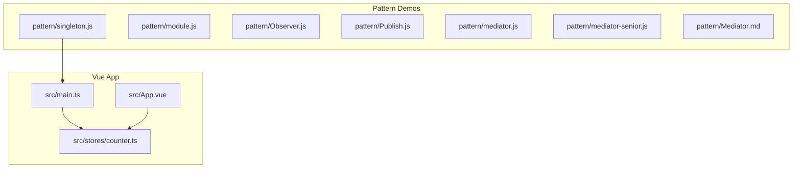
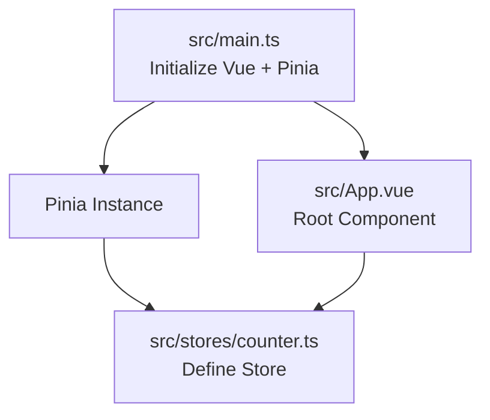
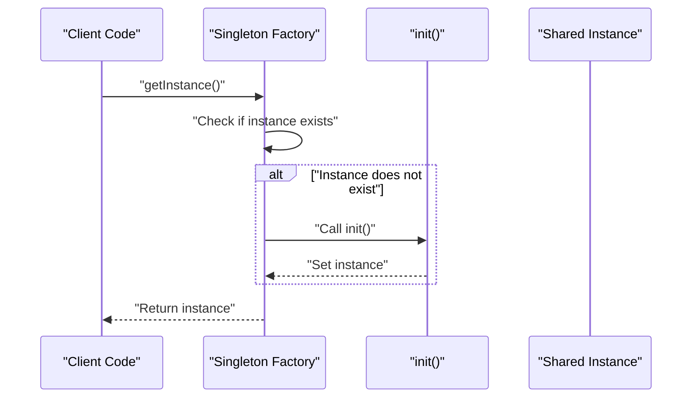
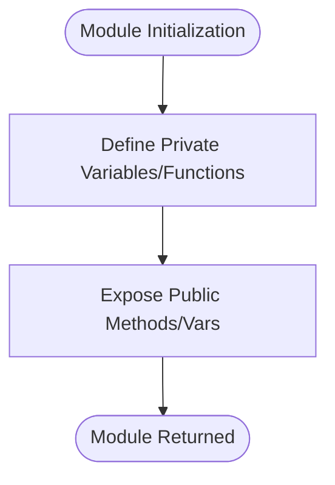
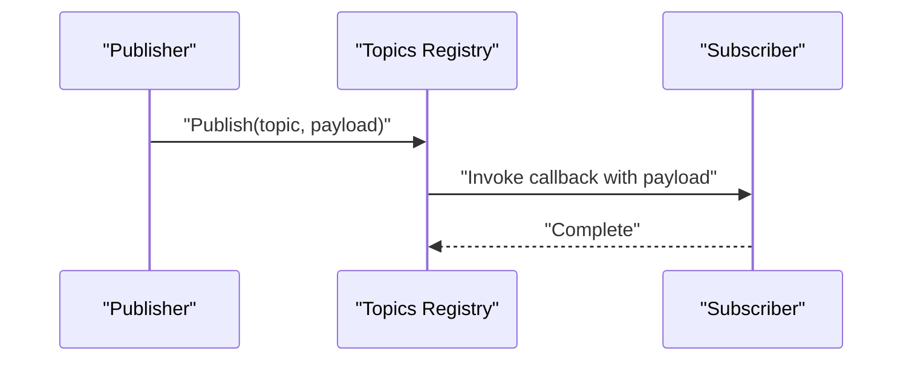
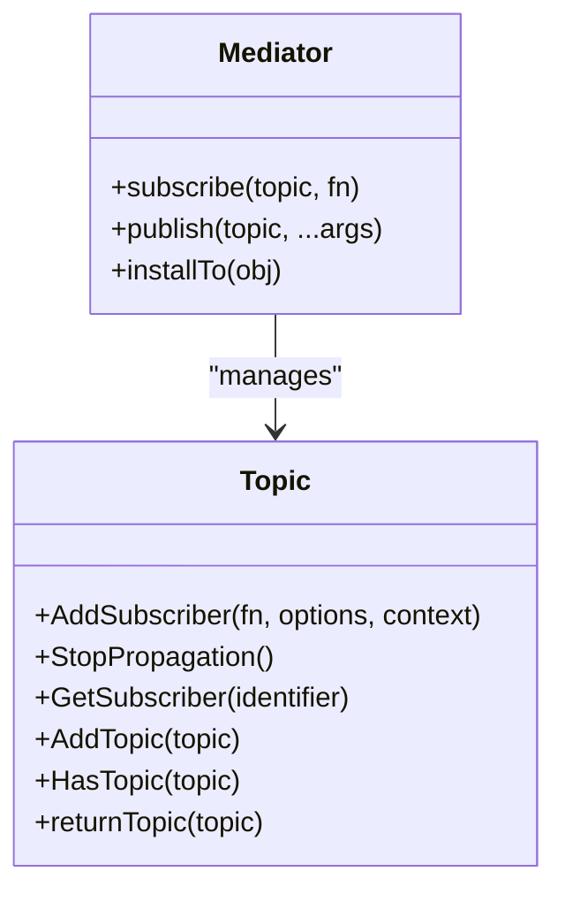
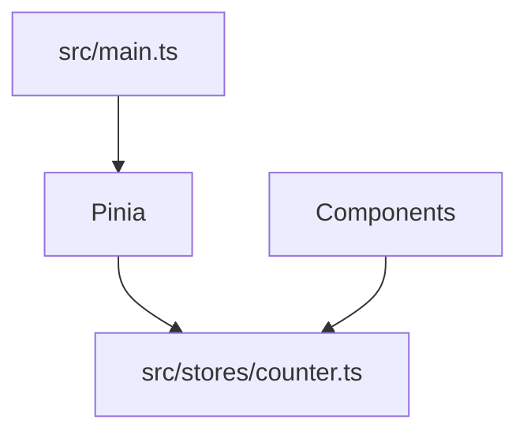

# Singleton Pattern Implementation

<cite>
**Referenced Files in This Document**
- [singleton.js](file://pattern/singleton.js)
- [module.js](file://pattern/module.js)
- [Mediator.md](file://pattern/Mediator.md)
- [Observer.js](file://pattern/Observer.js)
- [Publish.js](file://pattern/Publish.js)
- [mediator.js](file://pattern/mediator.js)
- [mediator-senior.js](file://pattern/mediator-senior.js)
- [main.ts](file://src/main.ts)
- [counter.ts](file://src/stores/counter.ts)
- [App.vue](file://src/App.vue)
- [CLAUDE.md](file://CLAUDE.md)
</cite>

## Table of Contents
1. [Introduction](#introduction)
2. [Project Structure](#project-structure)
3. [Core Components](#core-components)
4. [Architecture Overview](#architecture-overview)
5. [Detailed Component Analysis](#detailed-component-analysis)
6. [Dependency Analysis](#dependency-analysis)
7. [Performance Considerations](#performance-considerations)
8. [Troubleshooting Guide](#troubleshooting-guide)
9. [Conclusion](#conclusion)
10. [Appendices](#appendices)

## Introduction
This document explains the Singleton pattern as a creational design pattern that restricts instantiation to a single object. It focuses on the practical implementation shown in the repository's singleton demonstration and contrasts it with related patterns such as the Module pattern and event-driven patterns. It also provides guidance on when to use the Singleton pattern in Vue.js applications, especially given the project's use of Vue 2 with Pinia for state management.

## Project Structure
The repository includes a dedicated folder for design pattern demonstrations. The Singleton implementation resides in a standalone JavaScript file, while other patterns (Observer, Publish/Subscribe, Mediator) are provided for comparison. The Vue.js application demonstrates modern state management via Pinia, which offers a practical alternative to manual singletons for managing shared application state.

**Diagram sources**
- [singleton.js:1-17](file://pattern/singleton.js#L1-L17)
- [module.js:1-16](file://pattern/module.js#L1-L16)
- [Observer.js:1-58](file://pattern/Observer.js#L1-L58)
- [Publish.js:1-48](file://pattern/Publish.js#L1-L48)
- [mediator.js:1-37](file://pattern/mediator.js#L1-L37)
- [mediator-senior.js:1-82](file://pattern/mediator-senior.js#L1-L82)
- [Mediator.md:1-93](file://pattern/Mediator.md#L1-L93)
- [main.ts:1-16](file://src/main.ts#L1-L16)
- [counter.ts:1-17](file://src/stores/counter.ts#L1-L17)
- [App.vue:1-110](file://src/App.vue#L1-L110)

**Section sources**
- [CLAUDE.md:52-53](file://CLAUDE.md#L52-L53)
- [CLAUDE.md:22-38](file://CLAUDE.md#L22-L38)

## Core Components
- Singleton implementation in singleton.js: Demonstrates lazy initialization and a factory method to ensure only one instance exists during the application lifecycle.
- Module pattern in module.js: Provides controlled exposure of functionality and encapsulation, contrasting with Singleton’s single-instance requirement.
- Observer and Publish/Subscribe patterns: Offer decoupled communication and state distribution without requiring a single shared instance.
- Mediator patterns: Centralize coordination among components, often replacing direct inter-object communication.

These components collectively illustrate design alternatives to the Singleton pattern, emphasizing when a single shared instance is truly necessary versus when other patterns can achieve the same goals with better modularity and testability.

**Section sources**
- [singleton.js:1-17](file://pattern/singleton.js#L1-L17)
- [module.js:1-16](file://pattern/module.js#L1-L16)
- [Observer.js:1-58](file://pattern/Observer.js#L1-L58)
- [Publish.js:1-48](file://pattern/Publish.js#L1-L48)
- [mediator.js:1-37](file://pattern/mediator.js#L1-L37)
- [mediator-senior.js:1-82](file://pattern/mediator-senior.js#L1-L82)
- [Mediator.md:1-93](file://pattern/Mediator.md#L1-L93)

## Architecture Overview
The Vue.js application initializes Pinia for state management and mounts the root component. While the Singleton pattern is demonstrated in isolation, the application uses Pinia stores to manage reactive state across components. This illustrates a modern, framework-native approach to shared state that often supersedes manual singletons.

**Diagram sources**
- [main.ts:1-16](file://src/main.ts#L1-L16)
- [counter.ts:1-17](file://src/stores/counter.ts#L1-L17)
- [App.vue:1-110](file://src/App.vue#L1-L110)

**Section sources**
- [main.ts:1-16](file://src/main.ts#L1-L16)
- [counter.ts:1-17](file://src/stores/counter.ts#L1-L17)
- [CLAUDE.md:22-38](file://CLAUDE.md#L22-L38)

## Detailed Component Analysis

### Singleton Pattern Implementation
The Singleton implementation ensures a single instance is created and reused throughout the application lifecycle. It uses an immediately invoked function expression (IIFE) to encapsulate the instance variable and initialization logic, exposing a factory method to retrieve the instance.

Key characteristics:
- Lazy initialization: The instance is created only when first requested.
- Private instance storage: The instance variable is hidden from external access.
- Controlled access: A public method provides access to the single instance.

**Diagram sources**
- [singleton.js:1-17](file://pattern/singleton.js#L1-L17)

Practical implementation notes:
- The implementation uses closure to hide the instance variable and initialization logic.
- The getInstance method enforces single-instance semantics by checking for an existing instance before creating one.
- This pattern is suitable for scenarios where a single shared resource is required, such as logging services, configuration managers, or connection pools.

Anti-patterns to avoid:
- Creating multiple instances by bypassing the factory method.
- Exposing the internal instance variable or allowing direct instantiation.
- Not handling lazy initialization correctly, leading to multiple instances under race conditions.

**Section sources**
- [singleton.js:1-17](file://pattern/singleton.js#L1-L17)

### Module Pattern Comparison
The Module pattern provides controlled exposure of functionality and encapsulation, enabling private state while revealing only necessary methods. Unlike Singleton, it does not enforce a single instance but rather a single module interface.

Key characteristics:
- Encapsulation: Private variables and functions are kept inside the module.
- Controlled exposure: Public methods and variables are explicitly returned.
- Simplicity: Often easier to reason about than singletons.

**Diagram sources**
- [module.js:1-16](file://pattern/module.js#L1-L16)

Comparison with Singleton:
- Scope: Module pattern controls access to a module’s internals; Singleton ensures a single instance of a class-like object.
- Use cases: Modules are ideal for organizing code and exposing APIs; Singletons are ideal for shared resources.

**Section sources**
- [module.js:1-16](file://pattern/module.js#L1-L16)

### Observer and Publish/Subscribe Patterns
These patterns promote loose coupling by allowing objects to communicate without direct references. They are useful for distributing state updates and coordinating behavior across components.

**Diagram sources**
- [Publish.js:1-48](file://pattern/Publish.js#L1-L48)

Observer pattern highlights:
- Subject maintains a list of observers and notifies them of state changes.
- Observers react independently, reducing tight coupling.

**Section sources**
- [Observer.js:1-58](file://pattern/Observer.js#L1-L58)
- [Publish.js:1-48](file://pattern/Publish.js#L1-L48)

### Mediator Pattern
The Mediator centralizes communication between components, reducing direct dependencies. It is particularly useful when components need to coordinate complex interactions.

**Diagram sources**
- [mediator.js:1-37](file://pattern/mediator.js#L1-L37)
- [mediator-senior.js:1-82](file://pattern/mediator-senior.js#L1-L82)
- [Mediator.md:1-93](file://pattern/Mediator.md#L1-L93)

**Section sources**
- [mediator.js:1-37](file://pattern/mediator.js#L1-L37)
- [mediator-senior.js:1-82](file://pattern/mediator-senior.js#L1-L82)
- [Mediator.md:1-93](file://pattern/Mediator.md#L1-L93)

## Dependency Analysis
The Vue application integrates Pinia for state management, which provides a centralized store that components can consume. This reduces the need for manual singletons in many cases.

**Diagram sources**
- [main.ts:1-16](file://src/main.ts#L1-L16)
- [counter.ts:1-17](file://src/stores/counter.ts#L1-L17)

**Section sources**
- [main.ts:1-16](file://src/main.ts#L1-L16)
- [counter.ts:1-17](file://src/stores/counter.ts#L1-L17)
- [CLAUDE.md:32-38](file://CLAUDE.md#L32-L38)

## Performance Considerations
- Lazy initialization: Ensures resources are only allocated when needed, reducing startup overhead.
- Memory footprint: Singletons persist for the application lifetime; ensure they do not retain unnecessary references to prevent memory leaks.
- Thread safety: In JavaScript environments, singletons are generally safe from concurrency issues because of the single-threaded nature of the event loop. However, in multi-threaded contexts (e.g., Web Workers), additional synchronization mechanisms may be required.

[No sources needed since this section provides general guidance]

## Troubleshooting Guide
Common issues and remedies:
- Multiple instances: Verify that the factory method is used consistently and that the internal instance variable is not exposed or overwritten.
- Global state pollution: Prefer framework-native state management (e.g., Pinia) for predictable updates and easier testing.
- Testing challenges: Singletons can complicate unit tests due to global state. Consider dependency injection or modular state management to improve testability.

**Section sources**
- [singleton.js:1-17](file://pattern/singleton.js#L1-L17)
- [counter.ts:1-17](file://src/stores/counter.ts#L1-L17)

## Conclusion
The Singleton pattern is a powerful tool for ensuring a single shared instance, but it should be used judiciously. In Vue.js applications leveraging Pinia, centralized state management often provides a more maintainable and testable alternative. Reserve singletons for scenarios where a truly unique shared resource is essential, and avoid them when simpler patterns like modules, observers, or mediators can achieve the same goals with better modularity.

[No sources needed since this section summarizes without analyzing specific files]

## Appendices

### When to Use Singleton in Vue.js Applications
- Use cases:
  - Shared services that require a single instance (e.g., logging, analytics, or configuration providers).
  - Legacy integrations where a single resource must be managed globally.
- Alternatives:
  - Pinia stores for reactive state management.
  - Event-driven patterns (Observer/Publish-Subscribe) for decoupled communication.
  - Module pattern for encapsulated functionality without enforcing a single instance.

**Section sources**
- [main.ts:1-16](file://src/main.ts#L1-L16)
- [counter.ts:1-17](file://src/stores/counter.ts#L1-L17)
- [singleton.js:1-17](file://pattern/singleton.js#L1-L17)
- [module.js:1-16](file://pattern/module.js#L1-L16)
- [Observer.js:1-58](file://pattern/Observer.js#L1-L58)
- [Publish.js:1-48](file://pattern/Publish.js#L1-L48)
- [mediator.js:1-37](file://pattern/mediator.js#L1-L37)
- [mediator-senior.js:1-82](file://pattern/mediator-senior.js#L1-L82)
- [Mediator.md:1-93](file://pattern/Mediator.md#L1-L93)