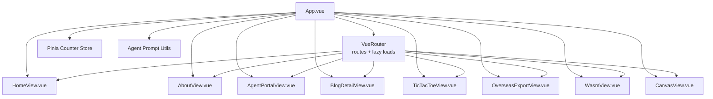
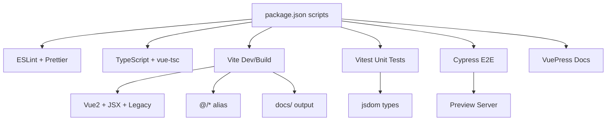

# Development Guidelines

<cite>
**Referenced Files in This Document**
- [AGENTS.md](file://AGENTS.md)
- [.eslintrc.cjs](file://.eslintrc.cjs)
- [package.json](file://package.json)
- [tsconfig.json](file://tsconfig.json)
- [tsconfig.app.json](file://tsconfig.app.json)
- [tsconfig.config.json](file://tsconfig.config.json)
- [tsconfig.vitest.json](file://tsconfig.vitest.json)
- [vite.config.ts](file://vite.config.ts)
- [src/App.vue](file://src/App.vue)
- [src/router/index.ts](file://src/router/index.ts)
- [src/stores/counter.ts](file://src/stores/counter.ts)
- [src/utils/agent.ts](file://src/utils/agent.ts)
- [src/components/HelloWorld.vue](file://src/components/HelloWorld.vue)
- [src/components/__tests__/HelloWorld.spec.ts](file://src/components/__tests__/HelloWorld.spec.ts)
- [cypress/e2e/example.cy.ts](file://cypress/e2e/example.cy.ts)
</cite>

## Table of Contents
1. [Introduction](#introduction)
2. [Project Structure](#project-structure)
3. [Core Components](#core-components)
4. [Architecture Overview](#architecture-overview)
5. [Detailed Component Analysis](#detailed-component-analysis)
6. [Dependency Analysis](#dependency-analysis)
7. [Performance Considerations](#performance-considerations)
8. [Troubleshooting Guide](#troubleshooting-guide)
9. [Conclusion](#conclusion)
10. [Appendices](#appendices)

## Introduction
This document defines development standards, component conventions, and contribution workflows for the project. It consolidates ESLint configuration and TypeScript setup, outlines component naming and file organization, explains architectural decisions, and provides agent development and prompt engineering guidelines. It also covers version control workflows, pull request procedures, code review expectations, examples of well-structured components, common anti-patterns, development environment setup, debugging techniques, and performance profiling approaches.

## Project Structure
The repository is a Vue 2 + Vite application with integrated documentation and examples:
- Application source code resides under src/, including entry points, router, views, components, stores, styles, and mock data.
- Unit tests live under src/components/__tests__/ using Vitest.
- End-to-end tests and support are under cypress/.
- Static assets are served from public/.
- Documentation sources are under vdocs/ and build artifacts under docs/.
- Standalone design-pattern demonstrations are under pattern/.

Key development commands are defined in package.json scripts for local development, building, previewing, testing, linting, and docs development.

**Section sources**
- [AGENTS.md:3-11](file://AGENTS.md#L3-L11)
- [package.json:15-27](file://package.json#L15-L27)

## Core Components
- ESLint configuration extends recommended Vue, TypeScript, and Prettier configurations, with an override for Cypress tests.
- TypeScript monorepo-style configuration via project references for app, config, and vitest environments.
- Vite configuration enables Vue 2, JSX, and legacy browser support with path aliasing and build output targeting docs/.
- Router defines SPA routes with meta titles and lazy-loaded views.
- Pinia store demonstrates a minimal reactive store with state, getters, and actions.
- Example component showcases Vue SFC with TypeScript props and scoped styles.
- Agent utilities demonstrate prompt engineering patterns for task breakdown, role-based review, and execution prompts.
- Cypress example illustrates E2E test scaffolding.

**Section sources**
- [.eslintrc.cjs:4-22](file://.eslintrc.cjs#L4-L22)
- [tsconfig.json:1-15](file://tsconfig.json#L1-L15)
- [tsconfig.app.json:1-13](file://tsconfig.app.json#L1-L13)
- [tsconfig.config.json:1-9](file://tsconfig.config.json#L1-L9)
- [tsconfig.vitest.json:1-10](file://tsconfig.vitest.json#L1-L10)
- [vite.config.ts:1-27](file://vite.config.ts#L1-L27)
- [src/router/index.ts:1-65](file://src/router/index.ts#L1-L65)
- [src/stores/counter.ts:1-17](file://src/stores/counter.ts#L1-L17)
- [src/components/HelloWorld.vue:1-42](file://src/components/HelloWorld.vue#L1-L42)
- [src/utils/agent.ts:1-47](file://src/utils/agent.ts#L1-L47)
- [cypress/e2e/example.cy.ts:1-9](file://cypress/e2e/example.cy.ts#L1-L9)

## Architecture Overview
The project follows a layered architecture:
- Entry and shell: App.vue composes header navigation and router outlet.
- Routing: VueRouter manages SPA routes with meta-driven navigation and dynamic imports for code splitting.
- State: Pinia store encapsulates global reactive state and derived values.
- Components: Reusable Vue SFCs with TypeScript props and scoped styles.
- Utilities: Plain TS modules for cross-cutting concerns (e.g., agent prompts).
- Tooling: Vite for dev/build, ESLint/Prettier for code quality, Vitest for unit tests, Cypress for E2E.

**Diagram sources**
- [src/App.vue:1-110](file://src/App.vue#L1-L110)
- [src/router/index.ts:1-65](file://src/router/index.ts#L1-L65)
- [src/stores/counter.ts:1-17](file://src/stores/counter.ts#L1-L17)
- [src/utils/agent.ts:1-47](file://src/utils/agent.ts#L1-L47)

## Detailed Component Analysis

### ESLint and Code Quality
- Extends:
  - plugin:vue/essential
  - eslint:recommended
  - @vue/eslint-config-typescript/recommended
  - @vue/eslint-config-prettier
- Cypress override applies plugin:cypress/recommended for e2e files.
- Lint command supports autofix across Vue/TypeScript files and respects .gitignore.

Recommended usage:
- Run npm run lint locally before committing.
- Fix reported issues; if formatting conflicts arise, rely on Prettier integration via ESLint.

**Section sources**
- [.eslintrc.cjs:4-22](file://.eslintrc.cjs#L4-L22)
- [package.json:26](file://package.json#L26)

### TypeScript Configuration and Type Safety
- Root tsconfig.json aggregates three projects:
  - tsconfig.config.json: Node tooling (Vite/Vitest/Cypress configs).
  - tsconfig.app.json: Application sources with path aliases (@/*).
  - tsconfig.vitest.json: Vitest environment with jsdom and node types.
- Composite builds enabled for incremental type-checking.
- Path aliases configured in tsconfig.app.json to simplify imports.

Best practices:
- Keep composite builds enabled for faster type-checking during development.
- Use strict defaults inherited from @vue/tsconfig templates.
- Add new source files to appropriate include globs and avoid unintended exclusions.

**Section sources**
- [tsconfig.json:1-15](file://tsconfig.json#L1-L15)
- [tsconfig.app.json:1-13](file://tsconfig.app.json#L1-L13)
- [tsconfig.config.json:1-9](file://tsconfig.config.json#L1-L9)
- [tsconfig.vitest.json:1-10](file://tsconfig.vitest.json#L1-L10)

### Component Naming Conventions and File Organization
- Vue SFC filenames: PascalCase (e.g., HelloWorld.vue).
- Views and route-level pages: preserve existing naming styles in src/views and legacy module routes.
- Tests:
  - Unit tests: *.spec.ts under src/components/__tests__.
  - E2E tests: *.cy.ts under cypress/e2e.
- Indentation: 2 spaces for .ts/.js/.vue files.

Guidelines:
- Place component tests adjacent to component source.
- Group related utilities under src/utils/.
- Organize stores under src/stores/ with Pinia defineStore.

**Section sources**
- [AGENTS.md:25-31](file://AGENTS.md#L25-L31)
- [src/components/HelloWorld.vue:1-42](file://src/components/HelloWorld.vue#L1-L42)
- [src/components/__tests__/HelloWorld.spec.ts:1-12](file://src/components/__tests__/HelloWorld.spec.ts#L1-L12)

### Architectural Decision-Making Guidelines
- Vue 2 + Vue Router 3: Maintain compatibility with legacy browsers via Vite legacy plugin.
- Path aliasing: Use @/ for cleaner imports across the app.
- Build output: docs/ is the production artifact destination.
- Lazy loading: Use dynamic imports for route components to enable code splitting.
- Meta-driven navigation: Use route meta to drive header navigation rendering.

**Section sources**
- [vite.config.ts:18-26](file://vite.config.ts#L18-L26)
- [src/App.vue:17-28](file://src/App.vue#L17-L28)
- [src/router/index.ts:21-23](file://src/router/index.ts#L21-L23)
- [src/router/index.ts:39-41](file://src/router/index.ts#L39-L41)

### Agent Development Guidelines and Prompt Engineering Best Practices
- Define a clear input interface for prompts (goal, context, constraints).
- Normalize inputs by trimming and providing fallbacks for missing values.
- Structure prompts with explicit sections for roles, goals, context, constraints, and required outputs.
- Separate planning and execution steps in prompts for execution agents.
- Keep prompts concise but comprehensive; enumerate required outputs and validation steps.

Example patterns:
- Task breakdown prompts: define milestones, risks, rollback strategies, and acceptance criteria.
- Role-based reviewer prompts: enumerate high-risk items, actionable fixes, and minimal verification steps.
- Execution prompts: outline change plan, implementation, and test summary.

**Section sources**
- [src/utils/agent.ts:1-47](file://src/utils/agent.ts#L1-L47)

### Version Control Workflows, Pull Requests, and Code Reviews
- Preferred commit types: feat:, fix:, chore:, docs:.
- Write imperative, specific commit messages.
- Pull requests should include:
  - Purpose and scope
  - Key changes
  - Test evidence (commands and summaries)
  - Screenshots or GIFs for UI changes
  - Links to related issues
  - Notes on docs/deployment impact (vdocs/ or docs/)

Testing prerequisites before opening PRs:
- Run lint, unit tests, and relevant E2E tests (including headless E2E for CI-like checks).

**Section sources**
- [AGENTS.md:37-42](file://AGENTS.md#L37-L42)
- [package.json:21-26](file://package.json#L21-L26)

### Examples of Well-Structured Components
- HelloWorld.vue: Minimal SFC with typed props, template, and scoped styles.
- App.vue: Computed property filters routes by meta, renders header and router outlet.
- counter.ts: Pinia store with state, getter, and action.
- agent.ts: Utility module exporting typed interfaces and prompt builders.

Anti-patterns to avoid:
- Inline styles instead of scoped styles in SFCs.
- Global state mutations outside of Pinia stores.
- Unvalidated or untyped prompt inputs.
- Missing tests for new components or logic.
- Hardcoded absolute paths; prefer @/ alias.

**Section sources**
- [src/components/HelloWorld.vue:1-42](file://src/components/HelloWorld.vue#L1-L42)
- [src/App.vue:32-44](file://src/App.vue#L32-L44)
- [src/stores/counter.ts:1-17](file://src/stores/counter.ts#L1-L17)
- [src/utils/agent.ts:1-47](file://src/utils/agent.ts#L1-L47)

### Testing Patterns and Coverage
- Unit tests: Vitest with @vue/test-utils; mount component with propsData and assert rendered text/content.
- E2E tests: Cypress with interactive and headless modes; use preview server for E2E testing.
- Scripts:
  - test:unit: Vitest in jsdom.
  - test:e2e: interactive Cypress with preview server.
  - test:e2e:ci: headless Cypress.

**Section sources**
- [src/components/__tests__/HelloWorld.spec.ts:1-12](file://src/components/__tests__/HelloWorld.spec.ts#L1-L12)
- [cypress/e2e/example.cy.ts:1-9](file://cypress/e2e/example.cy.ts#L1-L9)
- [package.json:21-23](file://package.json#L21-L23)

## Dependency Analysis
The project’s toolchain and runtime dependencies are declared in package.json. Key categories:
- Runtime: vue, vue-router, pinia.
- Dev tooling: vite, typescript, vue-tsc, eslint, vitest, cypress, prettier, and Vue-specific plugins.
- Scripts orchestrate linting, type-checking, unit/E2E testing, and docs development.

**Diagram sources**
- [package.json:15-27](file://package.json#L15-L27)
- [vite.config.ts:10-26](file://vite.config.ts#L10-L26)
- [tsconfig.app.json:8-10](file://tsconfig.app.json#L8-L10)

**Section sources**
- [package.json:28-59](file://package.json#L28-L59)

## Performance Considerations
- Enable composite builds in tsconfig for faster incremental type-checking.
- Use dynamic imports for route components to reduce initial bundle size.
- Prefer scoped styles and avoid deep selectors to minimize style recalculation.
- Profile in development using browser devtools; leverage Vite’s fast refresh and hot updates.
- For E2E performance, run headless tests in CI and cache node_modules and build artifacts.

[No sources needed since this section provides general guidance]

## Troubleshooting Guide
Common issues and remedies:
- Lint errors: Run npm run lint to auto-fix where possible; review remaining issues per ESLint overrides and Vue/TypeScript rules.
- Type errors: Ensure files are included in the correct tsconfig project; verify path aliases and composite settings.
- Vite dev server issues: Clear node_modules/.vite cache if stale dependency warnings appear; confirm plugins are installed.
- Unit test failures: Verify mount usage and propsData alignment with component props; check jsdom types in vitest config.
- E2E flakiness: Increase timeouts, retry headless runs, and ensure preview server is reachable at expected port.

**Section sources**
- [.eslintrc.cjs:4-22](file://.eslintrc.cjs#L4-L22)
- [tsconfig.json:1-15](file://tsconfig.json#L1-L15)
- [vite.config.ts:10-26](file://vite.config.ts#L10-L26)
- [tsconfig.vitest.json:7](file://tsconfig.vitest.json#L7)
- [package.json:21-23](file://package.json#L21-L23)

## Conclusion
This guide consolidates the project’s development standards, tooling, and workflows. By adhering to ESLint and TypeScript configurations, following component conventions, and leveraging the documented testing and agent prompt patterns, contributors can maintain a consistent, high-quality codebase. Use the provided scripts and architectural patterns to streamline development, testing, and deployment.

[No sources needed since this section summarizes without analyzing specific files]

## Appendices

### Development Environment Setup
- Install dependencies using your preferred package manager.
- Start the dev server with npm run dev.
- Build for production with npm run build.
- Preview the production build with npm run preview.
- Run unit tests with npm run test:unit.
- Run E2E tests with npm run test:e2e (interactive) or npm run test:e2e:ci (headless).
- Lint with npm run lint.

**Section sources**
- [AGENTS.md:13-23](file://AGENTS.md#L13-L23)
- [package.json:15-27](file://package.json#L15-L27)

### Debugging Techniques
- Use Vue DevTools (when compatible) to inspect components, props, and state.
- Leverage browser devtools to profile rendering and network activity.
- For unit tests, log values inside tests and use assertions to narrow down failures.
- For E2E tests, add cy.screenshot() and cy.debug() strategically to capture state.

[No sources needed since this section provides general guidance]

### Performance Profiling Approaches
- Use Chrome DevTools Performance panel to record interactions and analyze long tasks.
- Measure bundle sizes with Vite’s built-in analyzer or external tools.
- Monitor runtime performance in both dev and preview builds.

[No sources needed since this section provides general guidance]