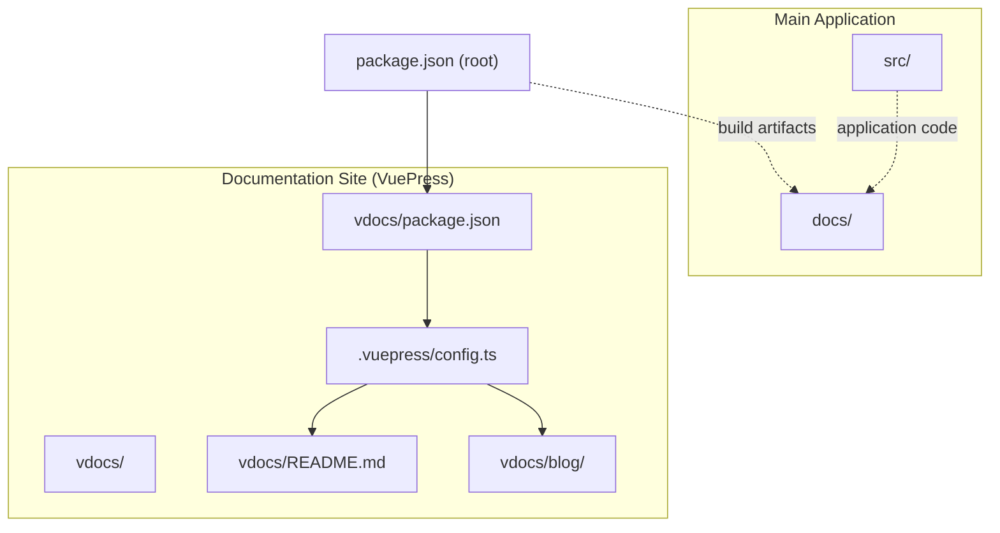
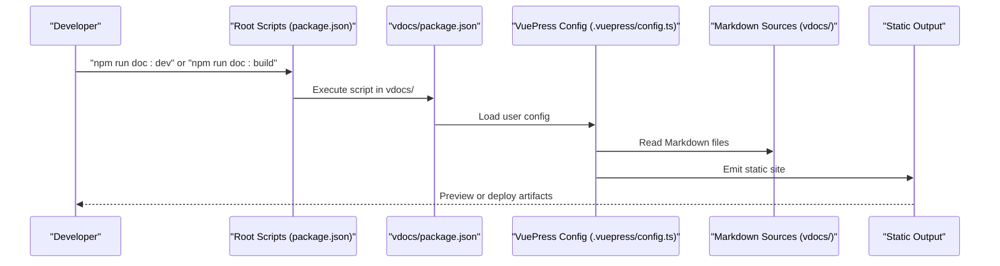
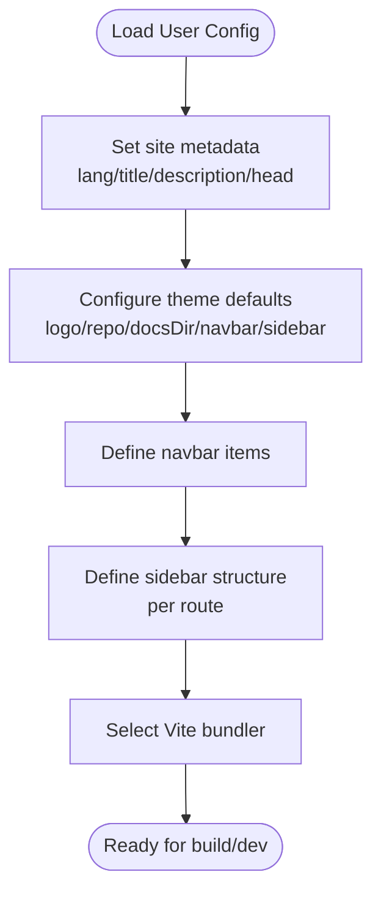
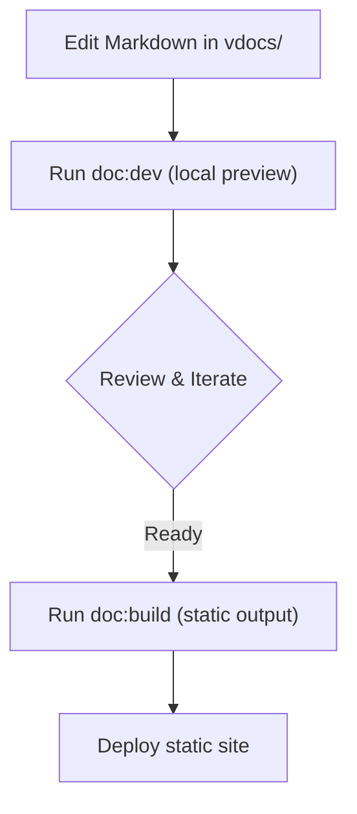
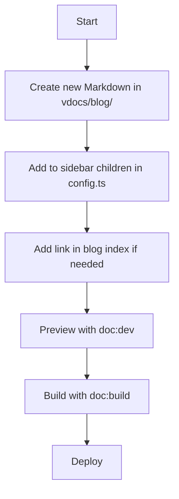
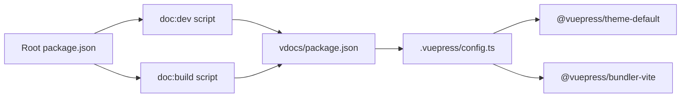

# Documentation System

<cite>
**Referenced Files in This Document**
- [vdocs/.vuepress/config.ts](file://vdocs/.vuepress/config.ts)
- [vdocs/package.json](file://vdocs/package.json)
- [vdocs/README.md](file://vdocs/README.md)
- [vdocs/blog/README.md](file://vdocs/blog/README.md)
- [vdocs/blog/mediator-pattern.md](file://vdocs/blog/mediator-pattern.md)
- [vdocs/blog/publish-subscribe.md](file://vdocs/blog/publish-subscribe.md)
- [package.json](file://package.json)
- [_config.yml](file://_config.yml)
- [pattern/Mediator.md](file://pattern/Mediator.md)
- [pattern/Observer.js](file://pattern/Observer.js)
</cite>

## Table of Contents
1. [Introduction](#introduction)
2. [Project Structure](#project-structure)
3. [Core Components](#core-components)
4. [Architecture Overview](#architecture-overview)
5. [Detailed Component Analysis](#detailed-component-analysis)
6. [Dependency Analysis](#dependency-analysis)
7. [Performance Considerations](#performance-considerations)
8. [Troubleshooting Guide](#troubleshooting-guide)
9. [Conclusion](#conclusion)
10. [Appendices](#appendices)

## Introduction
This document describes the VuePress-based documentation system integrated into the project. It explains how the documentation site is generated from Markdown sources, how it relates to the main application, and how content is organized and deployed. It covers the VuePress configuration, navigation and sidebar setup, build process, and the relationship between the vdocs/ and docs/ directories. Guidance is provided for adding new documentation pages, maintaining consistency with the main application, and understanding the current deployment strategy.

## Project Structure
The documentation system is primarily located under the vdocs/ directory and is powered by VuePress v2. The main application resides under src/ and produces static assets under docs/, while the documentation site is built separately via VuePress scripts invoked from the root package.json.

Key directories and files:
- vdocs/.vuepress/config.ts: VuePress user configuration (theme, navbar, sidebar, bundler)
- vdocs/package.json: Documentation site scripts (dev/build) and dependencies
- vdocs/README.md: Home page frontmatter and content
- vdocs/blog/: Markdown articles for the blog section
- package.json: Root scripts to run VuePress dev/build in vdocs/
- _config.yml: Jekyll theme configuration (present but not used by VuePress)
- pattern/: Original source material referenced by documentation

**Diagram sources**
- [vdocs/.vuepress/config.ts:1-43](file://vdocs/.vuepress/config.ts#L1-L43)
- [vdocs/package.json:1-17](file://vdocs/package.json#L1-L17)
- [vdocs/README.md:1-33](file://vdocs/README.md#L1-L33)
- [vdocs/blog/README.md:1-21](file://vdocs/blog/README.md#L1-L21)
- [package.json:15-27](file://package.json#L15-L27)

**Section sources**
- [vdocs/.vuepress/config.ts:1-43](file://vdocs/.vuepress/config.ts#L1-L43)
- [vdocs/package.json:1-17](file://vdocs/package.json#L1-L17)
- [vdocs/README.md:1-33](file://vdocs/README.md#L1-L33)
- [vdocs/blog/README.md:1-21](file://vdocs/blog/README.md#L1-L21)
- [package.json:15-27](file://package.json#L15-L27)

## Core Components
- VuePress configuration: Defines site metadata, theme, navbar, sidebar, and bundler selection.
- Documentation scripts: Dev and build commands executed via npm scripts in the root project.
- Content sources: Markdown files under vdocs/blog/ and frontmatter-driven home page.
- Build artifacts: Static site output produced by VuePress and intended for deployment.

Key responsibilities:
- vdocs/.vuepress/config.ts: Centralizes theme customization, navigation, and build settings.
- vdocs/package.json: Exposes dev/build commands for the documentation site.
- package.json: Bridges root scripts to the documentation site lifecycle.

**Section sources**
- [vdocs/.vuepress/config.ts:5-42](file://vdocs/.vuepress/config.ts#L5-L42)
- [vdocs/package.json:4-7](file://vdocs/package.json#L4-L7)
- [package.json:15-17](file://package.json#L15-L17)

## Architecture Overview
The documentation site is generated by VuePress from Markdown sources in vdocs/. The root project orchestrates the documentation lifecycle through npm scripts that delegate to vdocs/package.json. The resulting static site is intended for deployment to a hosting provider or GitHub Pages.

**Diagram sources**
- [package.json:15-17](file://package.json#L15-L17)
- [vdocs/package.json:4-7](file://vdocs/package.json#L4-L7)
- [vdocs/.vuepress/config.ts:5-42](file://vdocs/.vuepress/config.ts#L5-L42)

## Detailed Component Analysis

### VuePress Configuration and Theme Customization
The documentation site is configured via a user config that sets language, title, description, favicon, theme options, navbar, sidebar, and bundler. The theme is customized with repository metadata, docsDir, logo, navbar entries, and sidebar structure. The bundler is Vite-based.

Key configuration areas:
- Site metadata and head tags
- Theme options: logo, repository, docsDir, editLink, contributors, lastUpdated
- Navigation: navbar items for home and blog sections
- Sidebar: structured entries for the blog directory
- Bundler: Vite-based bundler selection

**Diagram sources**
- [vdocs/.vuepress/config.ts:5-42](file://vdocs/.vuepress/config.ts#L5-L42)

**Section sources**
- [vdocs/.vuepress/config.ts:5-42](file://vdocs/.vuepress/config.ts#L5-L42)

### Navigation and Sidebar Setup
Navigation is defined in navbar with links to home and the blog section. Sidebar is configured for the /blog/ route with a grouped list of child pages. This ensures predictable content discovery for documentation readers.

- Navbar items: Home and Blog
- Sidebar grouping: Blog directory with explicit children list

**Section sources**
- [vdocs/.vuepress/config.ts:14-36](file://vdocs/.vuepress/config.ts#L14-L36)

### Content Management Workflow
Content originates from Markdown sources under vdocs/ and is transformed into a static site during build. The workflow includes:
- Authoring/editing Markdown files in vdocs/
- Running documentation dev server for local preview
- Building the static site for deployment

**Diagram sources**
- [vdocs/package.json:4-7](file://vdocs/package.json#L4-L7)
- [package.json:15-17](file://package.json#L15-L17)

**Section sources**
- [vdocs/package.json:4-7](file://vdocs/package.json#L4-L7)
- [package.json:15-17](file://package.json#L15-L17)

### Relationship Between vdocs/ and docs/
- vdocs/: Contains VuePress documentation site sources and configuration. This is where authors write and manage documentation.
- docs/: Contains static assets and index.html generated by the main application. These are separate from the documentation site.
- The documentation site is built independently from vdocs/ and is not merged into docs/.

Implications:
- vdocs/ is the authoritative source for documentation content.
- docs/ remains the static output of the main application and is distinct from the documentation site.

**Section sources**
- [vdocs/README.md:1-33](file://vdocs/README.md#L1-L33)
- [vdocs/blog/README.md:1-21](file://vdocs/blog/README.md#L1-L21)

### Content Organization Patterns and Cross-Referencing
- Frontmatter-driven home page: vdocs/README.md uses frontmatter to configure homepage layout and actions.
- Blog index page: vdocs/blog/README.md lists article links and site positioning.
- Cross-references: Articles reference each other using internal links (e.g., linking from one article to another).
- Pattern alignment: Documentation references original pattern materials under pattern/ for deeper context.

**Section sources**
- [vdocs/README.md:1-33](file://vdocs/README.md#L1-L33)
- [vdocs/blog/README.md:1-21](file://vdocs/blog/README.md#L1-L21)
- [vdocs/blog/publish-subscribe.md:47-49](file://vdocs/blog/publish-subscribe.md#L47-L49)
- [pattern/Mediator.md:1-93](file://pattern/Mediator.md#L1-L93)

### Search Functionality
The VuePress configuration does not explicitly enable search in the provided snippet. If search is required, it can be added via theme options or plugins. For now, navigation and sidebar serve as the primary discovery mechanisms.

**Section sources**
- [vdocs/.vuepress/config.ts:10-42](file://vdocs/.vuepress/config.ts#L10-L42)

### Adding New Documentation Pages
To add a new documentation page:
- Create a new Markdown file under vdocs/blog/ (or appropriate directory).
- Add the new page to the sidebar children list in vdocs/.vuepress/config.ts under the relevant route group.
- Optionally add a link in vdocs/blog/README.md for discoverability.
- Verify the page renders correctly using the dev server.
- Rebuild and redeploy the documentation site.

**Diagram sources**
- [vdocs/.vuepress/config.ts:19-36](file://vdocs/.vuepress/config.ts#L19-L36)
- [vdocs/blog/README.md:5-14](file://vdocs/blog/README.md#L5-L14)
- [vdocs/package.json:4-7](file://vdocs/package.json#L4-L7)

**Section sources**
- [vdocs/.vuepress/config.ts:19-36](file://vdocs/.vuepress/config.ts#L19-L36)
- [vdocs/blog/README.md:5-14](file://vdocs/blog/README.md#L5-L14)
- [vdocs/package.json:4-7](file://vdocs/package.json#L4-L7)

### Maintaining Consistency with the Main Application
- Keep documentation content focused on design patterns and examples aligned with pattern/ materials.
- Use internal links to reference code examples and avoid duplicating logic.
- Ensure the documentation site’s navigation reflects the main application’s domain without mixing concerns.
- Treat docs/ as the main app’s static output and vdocs/ as the documentation site’s independent output.

**Section sources**
- [pattern/Mediator.md:1-93](file://pattern/Mediator.md#L1-L93)
- [pattern/Observer.js:1-58](file://pattern/Observer.js#L1-L58)
- [vdocs/blog/mediator-pattern.md:1-47](file://vdocs/blog/mediator-pattern.md#L1-L47)
- [vdocs/blog/publish-subscribe.md:1-50](file://vdocs/blog/publish-subscribe.md#L1-L50)

### Automated Build and Deployment Pipeline
Current state:
- Root scripts invoke VuePress dev/build within vdocs/.
- No GitHub Actions or CI/CD configuration detected in the repository.

Recommended approach:
- Integrate a CI pipeline that runs the documentation build on push to main.
- Publish the built static site to a hosting provider or GitHub Pages.
- Optionally automate redirects or routing if integrating with the main application domain.

Note: The repository does not include a CI configuration file. Deployment automation can be added by extending the existing scripts with CI tooling.

**Section sources**
- [package.json:15-17](file://package.json#L15-L17)
- [vdocs/package.json:4-7](file://vdocs/package.json#L4-L7)

## Dependency Analysis
The documentation site depends on VuePress v2 and Vite-based bundler. The root project provides scripts to run the documentation site locally and in builds.

**Diagram sources**
- [package.json:15-17](file://package.json#L15-L17)
- [vdocs/package.json:1-17](file://vdocs/package.json#L1-L17)
- [vdocs/.vuepress/config.ts:1-42](file://vdocs/.vuepress/config.ts#L1-L42)

**Section sources**
- [package.json:15-17](file://package.json#L15-L17)
- [vdocs/package.json:1-17](file://vdocs/package.json#L1-L17)
- [vdocs/.vuepress/config.ts:1-42](file://vdocs/.vuepress/config.ts#L1-L42)

## Performance Considerations
- Use the dev server for iterative development and the build command for production-like previews.
- Keep sidebar and navbar concise to reduce initial render overhead.
- Prefer lightweight images and avoid heavy assets in documentation pages.
- Monitor bundle size and remove unused assets after building.

[No sources needed since this section provides general guidance]

## Troubleshooting Guide
Common issues and resolutions:
- VuePress dev server not starting: Ensure Node.js and dependencies are installed in vdocs/ and run the doc:dev script from the root.
- Build failures: Confirm vdocs/.vuepress/config.ts is valid and all referenced files exist.
- Incorrect navigation/sidebars: Verify navbar and sidebar entries match actual file paths.
- Confusion between docs/ and vdocs/: Remember docs/ is for the main application, vdocs/ is for the documentation site.

**Section sources**
- [vdocs/package.json:4-7](file://vdocs/package.json#L4-L7)
- [vdocs/.vuepress/config.ts:14-36](file://vdocs/.vuepress/config.ts#L14-L36)
- [package.json:15-17](file://package.json#L15-L17)

## Conclusion
The documentation system leverages VuePress v2 to transform Markdown content into a navigable, themed static site. The root project integrates documentation tasks via npm scripts, while the documentation site maintains its own configuration and build lifecycle. By organizing content under vdocs/, aligning with pattern/ materials, and using the provided scripts, teams can efficiently author, preview, and deploy documentation updates.

[No sources needed since this section summarizes without analyzing specific files]

## Appendices

### Appendix A: Frontmatter Options Used in This Project
- vdocs/README.md uses frontmatter keys such as home, heroImage, heroText, tagline, actions, features, and footer to configure the homepage layout and behavior.

**Section sources**
- [vdocs/README.md:1-21](file://vdocs/README.md#L1-L21)

### Appendix B: Example Article References
- Articles reference each other internally to improve readability and cross-linking:
  - publish-subscribe.md links to mediator-pattern.md for comparative reading.
  - blog index lists multiple articles for quick navigation.

**Section sources**
- [vdocs/blog/publish-subscribe.md:47-49](file://vdocs/blog/publish-subscribe.md#L47-L49)
- [vdocs/blog/README.md:7-14](file://vdocs/blog/README.md#L7-L14)

### Appendix C: Legacy Configuration Context
- _config.yml defines a Jekyll theme but is unrelated to VuePress. The documentation site uses VuePress configuration exclusively.

**Section sources**
- [_config.yml:1-1](file://_config.yml#L1-L1)