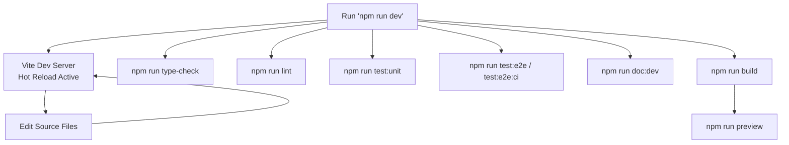
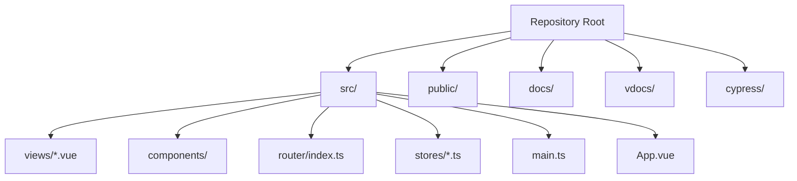
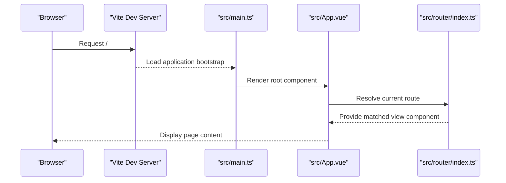

# Getting Started

<cite>
**Referenced Files in This Document**
- [README.md](file://README.md)
- [package.json](file://package.json)
- [vite.config.ts](file://vite.config.ts)
- [tsconfig.json](file://tsconfig.json)
- [tsconfig.app.json](file://tsconfig.app.json)
- [src/main.ts](file://src/main.ts)
- [src/App.vue](file://src/App.vue)
- [src/router/index.ts](file://src/router/index.ts)
- [src/stores/counter.ts](file://src/stores/counter.ts)
- [cypress.config.ts](file://cypress.config.ts)
- [vdocs/package.json](file://vdocs/package.json)
- [.eslintrc.cjs](file://.eslintrc.cjs)
</cite>

## Table of Contents
1. [Introduction](#introduction)
2. [Prerequisites](#prerequisites)
3. [Installation](#installation)
4. [Development Workflow](#development-workflow)
5. [Project Structure](#project-structure)
6. [Environment Setup](#environment-setup)
7. [IDE Configuration Recommendations](#ide-configuration-recommendations)
8. [Initial Project Navigation](#initial-project-navigation)
9. [Common Setup Issues and Troubleshooting](#common-setup-issues-and-troubleshooting)
10. [Conclusion](#conclusion)

## Introduction
Adminfyy is a Vue 2 application configured with Vite, TypeScript, Pinia for state management, and Vue Router for client-side routing. It includes unit tests with Vitest, end-to-end tests with Cypress, ESLint for code quality, and a documentation site powered by VuePress. The project is structured to support modern web development practices while maintaining compatibility with older browsers via the legacy plugin.

## Prerequisites
- Node.js: The project specifies TypeScript ~4.7.4 and Vite ^3.x in its dependencies. Use a Node.js version compatible with these toolchain versions. While exact semver ranges are not declared in the repository, align your Node.js runtime with the versions used by the project’s tooling.
- Package Manager: npm or yarn can be used interchangeably. The scripts in the repository are written for npm, but yarn is supported by the lock file.
- Git: Required to clone the repository and manage local changes.

**Section sources**
- [package.json:28-59](file://package.json#L28-L59)
- [vite.config.ts:1-27](file://vite.config.ts#L1-L27)
- [tsconfig.app.json:1-13](file://tsconfig.app.json#L1-L13)

## Installation
Follow these steps to set up the project locally:

1. Clone the repository and navigate into the project directory.
2. Install dependencies using your preferred package manager:
   - npm: npm install
   - yarn: yarn
3. Start the development server:
   - npm run dev
4. Build for production:
   - npm run build
5. Preview the production build:
   - npm run preview

Notes:
- The project uses Vite for development and building. The build output is directed to the docs directory.
- The documentation site is managed separately under vdocs and can be developed or built independently.

**Section sources**
- [README.md:24-59](file://README.md#L24-L59)
- [package.json:15-27](file://package.json#L15-L27)
- [vite.config.ts:23-25](file://vite.config.ts#L23-L25)

## Development Workflow
- Hot reload: Run npm run dev to start the Vite dev server with live reloading.
- Type checking: npm run type-check validates TypeScript types without emitting output.
- Linting: npm run lint applies ESLint rules across the project, including Cypress-specific overrides.
- Unit tests: npm run test:unit executes Vitest-based unit tests.
- End-to-end tests: npm run test:e2e opens the Cypress interactive runner; use npm run test:e2e:ci for headless CI runs.
- Documentation site: npm run doc:dev and npm run doc:build control the VuePress documentation site under vdocs.

**Section sources**
- [package.json:15-27](file://package.json#L15-L27)
- [cypress.config.ts:1-9](file://cypress.config.ts#L1-L9)
- [vdocs/package.json:4-7](file://vdocs/package.json#L4-L7)

## Project Structure
High-level layout of key directories and files:
- src: Application source code (components, views, router, stores, main entry)
- public: Static assets served as-is
- docs: Build output directory for the application
- vdocs: Separate VuePress documentation site
- cypress: End-to-end tests
- Root configuration files: vite.config.ts, tsconfig.*.json, package.json, .eslintrc.cjs

**Diagram sources**
- [vite.config.ts:18-25](file://vite.config.ts#L18-L25)
- [src/main.ts:1-16](file://src/main.ts#L1-L16)
- [src/App.vue:1-110](file://src/App.vue#L1-L110)
- [src/router/index.ts:1-65](file://src/router/index.ts#L1-L65)
- [src/stores/counter.ts:1-17](file://src/stores/counter.ts#L1-L17)

**Section sources**
- [vite.config.ts:18-25](file://vite.config.ts#L18-L25)
- [src/main.ts:1-16](file://src/main.ts#L1-L16)
- [src/App.vue:1-110](file://src/App.vue#L1-L110)
- [src/router/index.ts:1-65](file://src/router/index.ts#L1-L65)
- [src/stores/counter.ts:1-17](file://src/stores/counter.ts#L1-L17)

## Environment Setup
- Path aliases: The project defines @ as an alias pointing to src. This is reflected in both Vite configuration and TypeScript path mapping.
- Base URL for router: The router uses import.meta.env.BASE_URL for history mode base configuration.
- Build output: The Vite build writes to the docs directory.

Recommended adjustments:
- If you change the build output directory, update the preview port and Cypress baseUrl accordingly.
- Ensure your editor recognizes the @ alias for proper TypeScript and import resolution.

**Section sources**
- [vite.config.ts:18-25](file://vite.config.ts#L18-L25)
- [tsconfig.app.json:8-11](file://tsconfig.app.json#L8-L11)
- [src/router/index.ts:8-10](file://src/router/index.ts#L8-L10)

## IDE Configuration Recommendations
- Editor: VSCode is recommended.
- Extensions:
  - Volar (disable Vetur)
  - TypeScript Vue Plugin (Volar) for accurate TypeScript support in .vue files
- Take Over Mode: Optional performance improvement by disabling the built-in TypeScript extension and enabling Volar’s Take Over Mode.
- Type Checking: The project uses vue-tsc for type checking in editors; ensure your editor integrates with the TypeScript Vue Plugin.

These recommendations are aligned with the project’s documentation and TypeScript configuration.

**Section sources**
- [README.md:5-19](file://README.md#L5-L19)
- [tsconfig.app.json:1-13](file://tsconfig.app.json#L1-L13)

## Initial Project Navigation
- Entry point: src/main.ts initializes Vue, registers Pinia, and mounts the root App component.
- Root component: src/App.vue renders the header with dynamic navigation generated from router routes and a router-view for page content.
- Routing: src/router/index.ts defines routes including lazy-loaded views and metadata for titles.
- State management: src/stores/counter.ts demonstrates a basic Pinia store with state, getters, and actions.
- Views: src/views/*.vue represent pages rendered by the router.

**Diagram sources**
- [src/main.ts:1-16](file://src/main.ts#L1-L16)
- [src/App.vue:1-110](file://src/App.vue#L1-L110)
- [src/router/index.ts:1-65](file://src/router/index.ts#L1-L65)

**Section sources**
- [src/main.ts:1-16](file://src/main.ts#L1-L16)
- [src/App.vue:1-110](file://src/App.vue#L1-L110)
- [src/router/index.ts:1-65](file://src/router/index.ts#L1-L65)
- [src/stores/counter.ts:1-17](file://src/stores/counter.ts#L1-L17)

## Common Setup Issues and Troubleshooting
- Node.js version mismatch:
  - Symptom: Dependency resolution errors or unexpected behavior.
  - Action: Align your Node.js version with the toolchain versions used by the project (TypeScript ~4.7.x, Vite ^3.x).
- Missing environment file:
  - The repository does not include a .env file. If your application requires environment variables, create one at the project root and configure Vite to load it.
- Legacy browser support:
  - The project enables the legacy plugin targeting IE 11+. If you remove or modify this plugin, verify compatibility with your target browsers.
- Path alias resolution:
  - Ensure your editor recognizes the @ alias. The alias is defined in Vite and TypeScript configuration.
- Cypress baseUrl:
  - The Cypress configuration expects the preview server to run on http://localhost:4173. If you change the preview port, update cypress.config.ts accordingly.
- ESLint overrides:
  - Cypress-specific rules are applied to files under cypress/e2e. Ensure your editor’s ESLint integration respects these overrides.

**Section sources**
- [vite.config.ts:13-16](file://vite.config.ts#L13-L16)
- [tsconfig.app.json:8-11](file://tsconfig.app.json#L8-L11)
- [cypress.config.ts:4-7](file://cypress.config.ts#L4-L7)
- [.eslintrc.cjs:12-21](file://.eslintrc.cjs#L12-L21)

## Conclusion
You now have the essentials to install, run, and iterate on Adminfyy. Use npm run dev for rapid iteration, npm run build for production, and leverage npm run test:unit and npm run test:e2e for quality assurance. Keep your Node.js version aligned with the toolchain, configure your IDE with Volar and the TypeScript Vue Plugin, and adjust environment variables as needed. For documentation needs, use the vdocs site with npm run doc:dev and npm run doc:build.