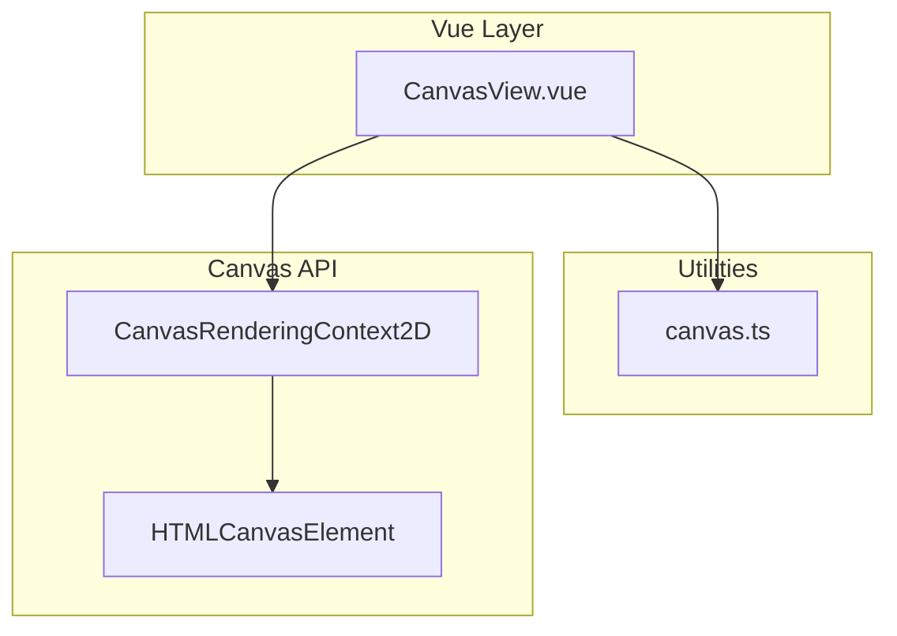
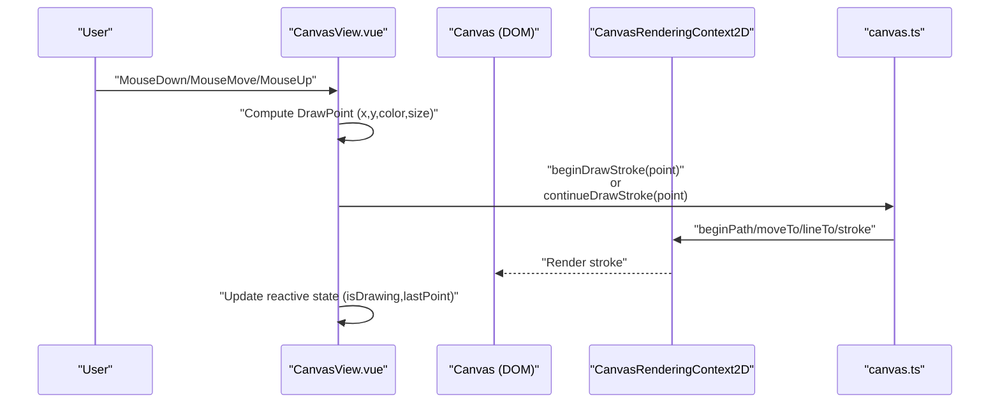
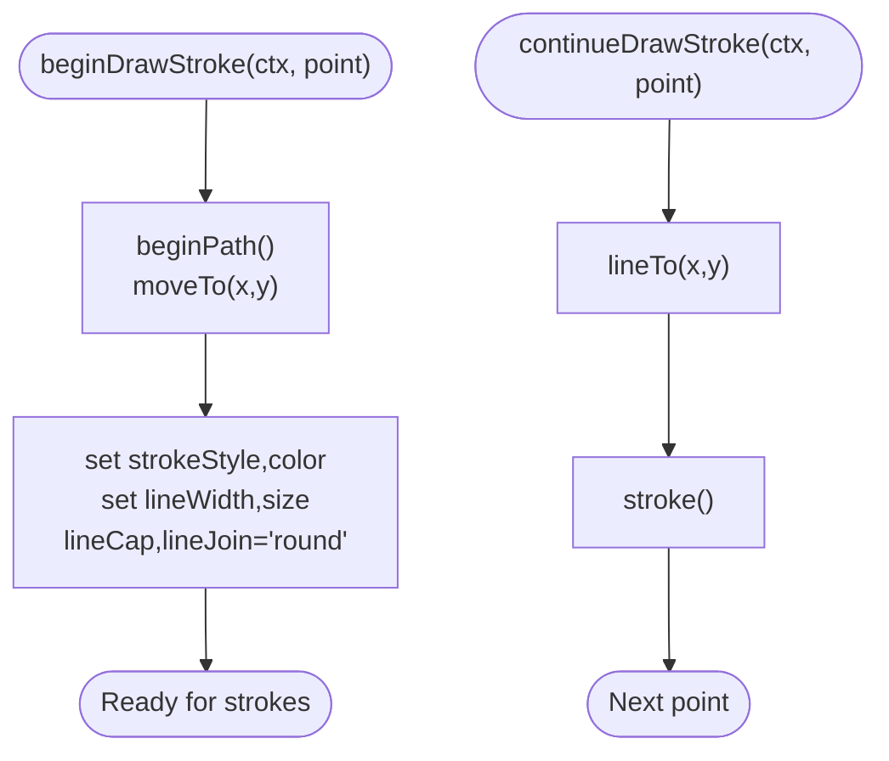
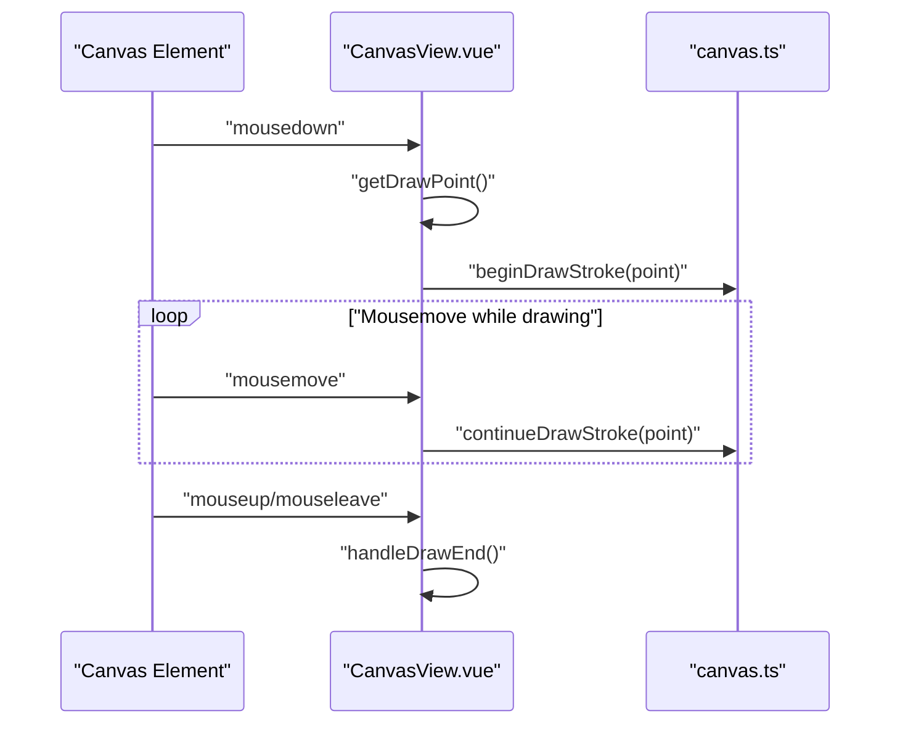
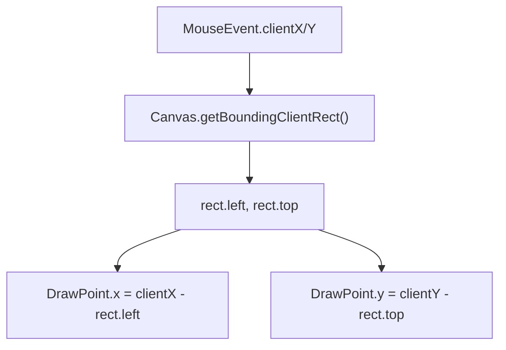
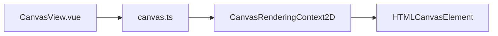

# Canvas Drawing System

<cite>
**Referenced Files in This Document**
- [canvas.ts](file://src/utils/canvas.ts)
- [CanvasView.vue](file://src/views/CanvasView.vue)
- [canvas.spec.ts](file://src/components/__tests__/canvas.spec.ts)
- [package.json](file://package.json)
</cite>

## Table of Contents
1. [Introduction](#introduction)
2. [Project Structure](#project-structure)
3. [Core Components](#core-components)
4. [Architecture Overview](#architecture-overview)
5. [Detailed Component Analysis](#detailed-component-analysis)
6. [Dependency Analysis](#dependency-analysis)
7. [Performance Considerations](#performance-considerations)
8. [Troubleshooting Guide](#troubleshooting-guide)
9. [Conclusion](#conclusion)
10. [Appendices](#appendices)

## Introduction
This document explains the HTML5 Canvas drawing system implemented in the project. It covers context initialization, drawing state management, coordinate transformations, mouse event handling for drawing, and how the system integrates with Vue’s reactivity. It also documents the drawing tools, canvas manipulation techniques, and outlines how to extend the system with new tools, undo/redo, and performance optimizations.

## Project Structure
The drawing system is composed of:
- A reusable utility module that encapsulates Canvas primitives and demos (particle animation, drawing helpers, charts, and wave animation).
- A Vue view that wires up the Canvas context, handles user events, and manages drawing state.
- Unit tests validating the behavior of Canvas utilities.

**Diagram sources**
- [CanvasView.vue:1-472](file://src/views/CanvasView.vue#L1-L472)
- [canvas.ts:1-204](file://src/utils/canvas.ts#L1-L204)

**Section sources**
- [CanvasView.vue:1-472](file://src/views/CanvasView.vue#L1-L472)
- [canvas.ts:1-204](file://src/utils/canvas.ts#L1-L204)

## Core Components
- Canvas utilities module:
  - Drawing helpers: stroke initialization and continuation, clearing the canvas.
  - Rendering helpers: bar chart, sine wave animation, particle system.
- Vue view:
  - Initializes Canvas contexts and sizes.
  - Manages drawing state (color, size, is-drawing flag).
  - Translates mouse coordinates to Canvas space.
  - Invokes drawing utilities during user interaction.

Key responsibilities:
- Context initialization: set canvas width/height to client dimensions and obtain 2D context.
- Drawing state management: reactive color and size, drawing flag, last point.
- Coordinate transformation: convert mouse event client coordinates to Canvas-local coordinates using bounding rectangle.
- Event-driven drawing: start, move, end handlers invoke drawing utilities.

**Section sources**
- [canvas.ts:91-125](file://src/utils/canvas.ts#L91-L125)
- [CanvasView.vue:86-143](file://src/views/CanvasView.vue#L86-L143)

## Architecture Overview
The drawing pipeline follows a straightforward flow: user events trigger updates to drawing state, which then invokes Canvas utilities to render strokes. The view ensures the Canvas is sized appropriately and maintains a dark background for visibility.

**Diagram sources**
- [CanvasView.vue:106-134](file://src/views/CanvasView.vue#L106-L134)
- [canvas.ts:103-121](file://src/utils/canvas.ts#L103-L121)

## Detailed Component Analysis

### Canvas Utilities Module
This module centralizes Canvas operations:
- DrawPoint and DrawConfig define the minimal data needed for drawing.
- beginDrawStroke initializes a stroke with current color and size and sets line caps.
- continueDrawStroke adds a line segment and strokes it.
- clearCanvas clears the entire canvas.

**Diagram sources**
- [canvas.ts:103-121](file://src/utils/canvas.ts#L103-L121)

**Section sources**
- [canvas.ts:91-125](file://src/utils/canvas.ts#L91-L125)

### Vue Drawing View
The view manages:
- Canvas sizing and context creation.
- Reactive drawing parameters (color, size).
- Mouse event handlers for drawing lifecycle.
- Coordinate conversion from page to Canvas space.

Implementation highlights:
- initDrawCanvas sets width/height to client size and obtains the 2D context, then fills a dark background.
- getDrawPoint computes x/y relative to the Canvas using getBoundingClientRect.
- handleDrawStart toggles drawing state, captures the initial point, and starts a stroke.
- handleDrawMove continues the stroke while dragging.
- handleDrawEnd stops drawing and clears last point.
- clearDrawing clears the Canvas and redraws the dark background.

**Diagram sources**
- [CanvasView.vue:94-134](file://src/views/CanvasView.vue#L94-L134)
- [canvas.ts:103-121](file://src/utils/canvas.ts#L103-L121)

**Section sources**
- [CanvasView.vue:86-143](file://src/views/CanvasView.vue#L86-L143)

### Coordinate Transformations
The view converts mouse coordinates to Canvas-local coordinates using the element’s bounding rectangle. This ensures drawing remains accurate regardless of scroll position or container offsets.

**Diagram sources**
- [CanvasView.vue:106-115](file://src/views/CanvasView.vue#L106-L115)

**Section sources**
- [CanvasView.vue:106-115](file://src/views/CanvasView.vue#L106-L115)

### Touch Event Support and Gesture Recognition
- Current implementation handles mouse events (mousedown, mousemove, mouseup, mouseleave).
- No explicit touch event bindings are present in the view.
- To add touch support:
  - Bind touchstart/touchmove/touchend to equivalent handlers.
  - Convert e.touches[0].clientX/clientY similarly to getDrawPoint.
  - Consider adding gesture recognition (pinch-to-zoom, pan) via touch event APIs.

[No sources needed since this section provides extension guidance]

### Drawing Tools Implementation
- Brush types: round line caps/joins are configured in beginDrawStroke for smoother curves.
- Colors: drawn from a reactive color input bound to a native color picker.
- Line thickness: controlled by a reactive size bound to a range input.
- Special effects: the module does not implement blending modes or textures; effects can be added by extending the drawing utilities.

**Section sources**
- [canvas.ts:103-113](file://src/utils/canvas.ts#L103-L113)
- [CanvasView.vue:274-283](file://src/views/CanvasView.vue#L274-L283)

### Canvas Manipulation Techniques
- Image loading: not implemented in the current codebase.
- Pixel manipulation: not implemented in the current codebase.
- Canvas export: not implemented in the current codebase.

[No sources needed since this section summarizes absence of features]

### Examples: Extending the System
- Adding a new drawing tool:
  - Define a new tool state (e.g., eraser mode).
  - Extend beginDrawStroke/continueDrawStroke to use compositing modes or temporary buffers.
  - Add UI controls to toggle and configure the tool.
- Implementing undo/redo:
  - Maintain a stack of canvas images (getImageData snapshots) after significant actions.
  - On undo/redo, restore the appropriate snapshot.
- Optimizing performance:
  - Throttle or limit the rate of continueDrawStroke calls.
  - Use requestAnimationFrame loops for animations; avoid synchronous heavy operations.
  - Prefer batching Canvas operations and minimizing property writes.

[No sources needed since this section provides conceptual guidance]

## Dependency Analysis
The view depends on the utilities module for Canvas operations. The utilities module exposes pure functions operating on CanvasRenderingContext2D, enabling testability and reuse.

**Diagram sources**
- [CanvasView.vue:10-11](file://src/views/CanvasView.vue#L10-L11)
- [canvas.ts:103-121](file://src/utils/canvas.ts#L103-L121)

**Section sources**
- [CanvasView.vue:10-11](file://src/views/CanvasView.vue#L10-L11)
- [canvas.ts:103-121](file://src/utils/canvas.ts#L103-L121)

## Performance Considerations
- Event handling: Mousemove triggers frequent drawing calls; consider throttling or reducing stroke granularity for smoother performance.
- Background redraw: The drawing view redraws a dark background each frame; ensure this is intentional and efficient.
- Animation frames: Other demos use requestAnimationFrame; apply similar patterns for continuous updates.
- Memory: Avoid retaining references to large image data or excessive snapshots for undo/redo.

[No sources needed since this section provides general guidance]

## Troubleshooting Guide
- Strokes not visible:
  - Verify the dark background is drawn and color contrast is sufficient.
  - Ensure beginDrawStroke is called before continueDrawStroke.
- Coordinates incorrect:
  - Confirm getBoundingClientRect is used to compute DrawPoint offsets.
- Events not firing:
  - Ensure the canvas element is mounted and the event handlers are attached.
- Tests validation:
  - Unit tests assert that drawing functions call expected Canvas methods and clear the chart background.

**Section sources**
- [CanvasView.vue:106-134](file://src/views/CanvasView.vue#L106-L134)
- [canvas.spec.ts:78-130](file://src/components/__tests__/canvas.spec.ts#L78-L130)

## Conclusion
The project demonstrates a clean separation between Canvas utilities and a Vue-driven UI. The drawing system initializes the Canvas context, manages drawing state reactively, and translates user input into Canvas operations. Extending the system with touch support, advanced tools, export capabilities, and undo/redo is feasible by building on the existing modular structure.

## Appendices

### Environment and Tooling
- Unit testing environment uses Vitest with jsdom for Canvas simulation.

**Section sources**
- [package.json:21-21](file://package.json#L21-L21)