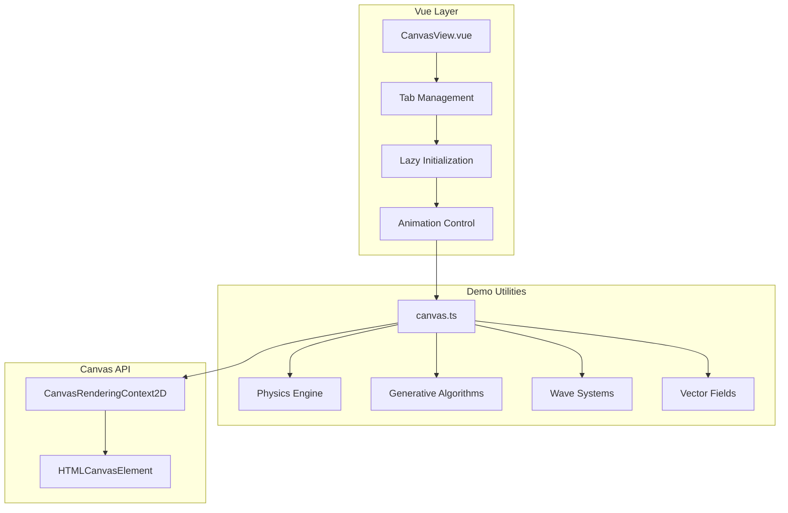
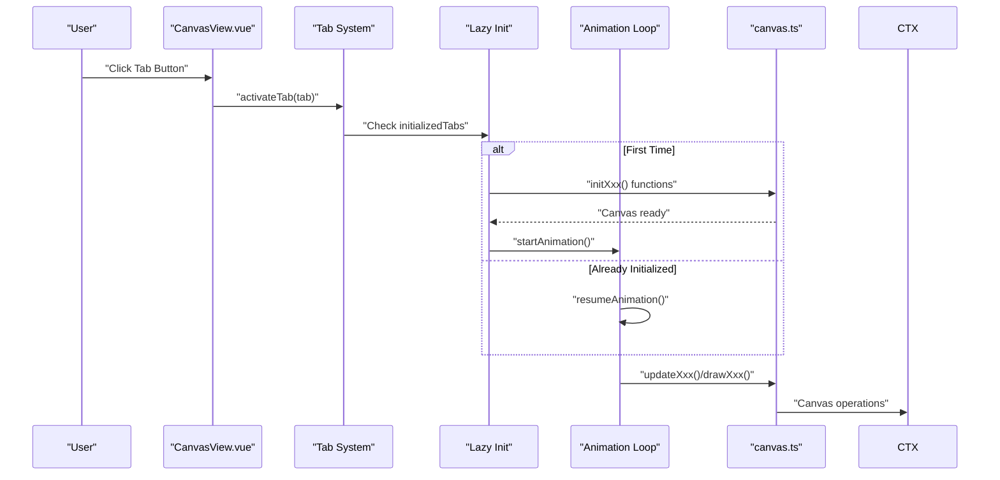
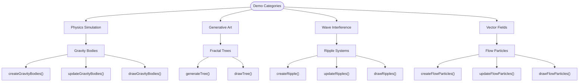
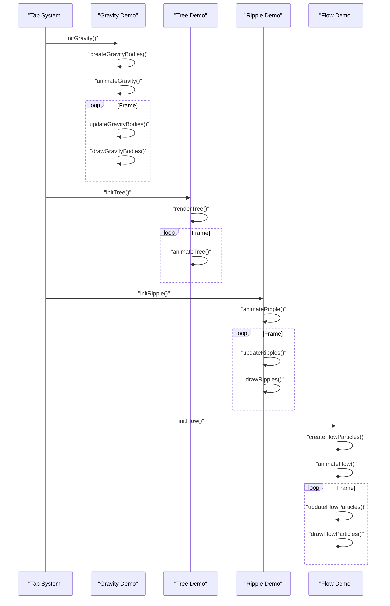
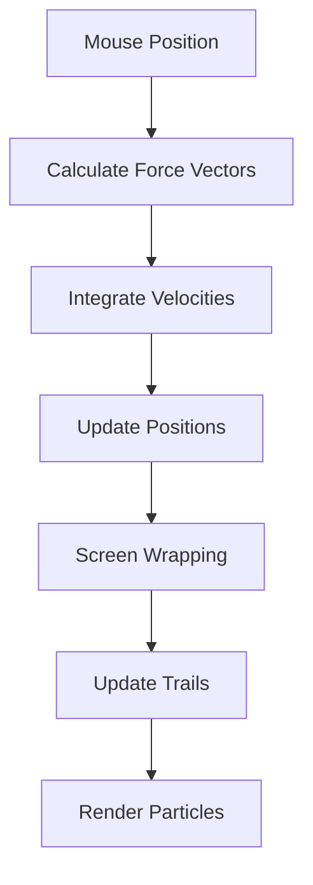
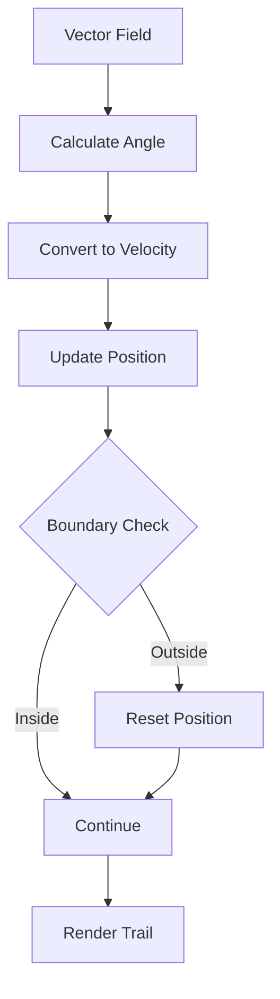
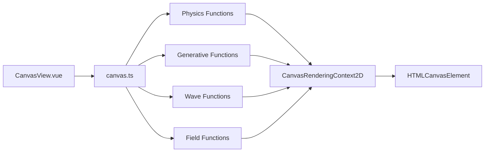

# Canvas Drawing System

<cite>
**Referenced Files in This Document**
- [canvas.ts](file://src/utils/canvas.ts)
- [CanvasView.vue](file://src/views/CanvasView.vue)
- [canvas.spec.ts](file://src/components/__tests__/canvas.spec.ts)
- [package.json](file://package.json)
</cite>

## Update Summary
**Changes Made**
- Updated CanvasView.vue documentation to reflect four interactive demos: Gravity Field, Fractal Tree, Ripple Waves, and Flow Field
- Enhanced canvas.ts documentation to cover comprehensive utility functions for physics simulation, generative art, wave interference, and vector fields
- Added detailed explanations of each demo's physics principles and mathematical implementations
- Updated architecture diagrams to show the new tabbed interface and lazy initialization pattern
- Expanded performance considerations for animation loops and memory management

## Table of Contents
1. [Introduction](#introduction)
2. [Project Structure](#project-structure)
3. [Core Components](#core-components)
4. [Architecture Overview](#architecture-overview)
5. [Detailed Component Analysis](#detailed-component-analysis)
6. [Interactive Demo System](#interactive-demo-system)
7. [Physics Simulation Demos](#physics-simulation-demos)
8. [Generative Art Demos](#generative-art-demos)
9. [Wave Interference and Vector Fields](#wave-interference-and-vector-fields)
10. [Dependency Analysis](#dependency-analysis)
11. [Performance Considerations](#performance-considerations)
12. [Troubleshooting Guide](#troubleshooting-guide)
13. [Conclusion](#conclusion)
14. [Appendices](#appendices)

## Introduction
This document explains the enhanced HTML5 Canvas drawing system featuring four interactive physics and generative art demonstrations. The system showcases advanced Canvas API capabilities including particle systems, recursive algorithms, wave interference patterns, and vector field simulations. It covers context initialization, drawing state management, coordinate transformations, mouse event handling, and the integration with Vue's reactivity system for creating immersive interactive experiences.

## Project Structure
The drawing system is composed of:
- A comprehensive utility module that encapsulates four distinct Canvas demos: Physics simulation, Fractal generation, Wave interference, and Vector field visualization
- A Vue view with tabbed interface that lazily initializes each demo and manages animation loops
- Unit tests validating the behavior of Canvas utilities and animation systems

**Diagram sources**
- [CanvasView.vue:1-206](file://src/views/CanvasView.vue#L1-L206)
- [canvas.ts:1-231](file://src/utils/canvas.ts#L1-L231)

**Section sources**
- [CanvasView.vue:1-206](file://src/views/CanvasView.vue#L1-L206)
- [canvas.ts:1-231](file://src/utils/canvas.ts#L1-L231)

## Core Components
The system features four specialized demo modules:

### Physics Simulation Demo (Gravity Field)
- N-body particle system with gravitational attraction toward cursor
- Velocity-based motion with friction damping
- Screen wrapping for continuous particle movement
- Motion blur trails using position history arrays

### Generative Art Demo (Fractal Tree)
- Recursive tree generation with branch angle variation
- Wind sway simulation using trigonometric functions
- Color interpolation from brown trunk to green tips
- Depth-based line width scaling for natural appearance

### Wave Interference Demo (Ripple Waves)
- Click-triggered wave generation with expanding rings
- Multi-layered concentric circles for depth perception
- HSL color cycling for rainbow interference effects
- Alpha fading based on radius expansion

### Vector Field Demo (Flow Field)
- 2,000 particles following sine-noise vector fields
- Semi-transparent overlay for persistent trails
- Particle recycling for infinite animation
- Scale-based field generation using mathematical functions

**Section sources**
- [canvas.ts:17-93](file://src/utils/canvas.ts#L17-L93)
- [canvas.ts:95-145](file://src/utils/canvas.ts#L95-L145)
- [canvas.ts:147-179](file://src/utils/canvas.ts#L147-L179)
- [canvas.ts:181-230](file://src/utils/canvas.ts#L181-L230)

## Architecture Overview
The enhanced system follows a tabbed interface architecture with lazy initialization and separate animation loops for each demo. The CanvasView.vue manages demo activation, while canvas.ts provides specialized utilities for each simulation type.

**Diagram sources**
- [CanvasView.vue:182-202](file://src/views/CanvasView.vue#L182-L202)
- [canvas.ts:28-43](file://src/utils/canvas.ts#L28-L43)

## Detailed Component Analysis

### Canvas Utilities Module
The canvas.ts module provides comprehensive utility functions organized by demo category:

#### Physics Simulation Functions
- `createGravityBodies()`: Generates N particles with randomized properties
- `updateGravityBodies()`: Implements gravitational forces and velocity calculations
- `drawGravityBodies()`: Renders particles with motion trails and glow effects

#### Generative Algorithm Functions
- `generateTree()`: Recursively creates branch segments with wind sway
- `drawTree()`: Renders branches with color interpolation and depth-based styling

#### Wave System Functions
- `createRipple()`: Initializes wave objects at click positions
- `updateRipples()`: Manages radius expansion and lifecycle
- `drawRipples()`: Renders multi-layered concentric rings with color effects

#### Vector Field Functions
- `createFlowParticles()`: Generates 2,000 particles with randomized properties
- `updateFlowParticles()`: Calculates particle movement using sine-noise fields
- `drawFlowParticles()`: Renders particle trails with HSL coloring

**Diagram sources**
- [canvas.ts:17-93](file://src/utils/canvas.ts#L17-L93)
- [canvas.ts:95-145](file://src/utils/canvas.ts#L95-L145)
- [canvas.ts:147-179](file://src/utils/canvas.ts#L147-L179)
- [canvas.ts:181-230](file://src/utils/canvas.ts#L181-L230)

**Section sources**
- [canvas.ts:13-15](file://src/utils/canvas.ts#L13-L15)
- [canvas.ts:17-230](file://src/utils/canvas.ts#L17-L230)

### Vue Demo View
The CanvasView.vue implements a sophisticated tabbed interface with lazy initialization:

#### Tab Management System
- Active tab tracking with reactive state management
- Lazy initialization to optimize performance
- Animation loop control with requestAnimationFrame

#### Demo-Specific Implementations
- **Gravity Field**: Mouse tracking with gravitational attraction, particle trails, and screen wrapping
- **Fractal Tree**: Interactive depth and angle controls with wind simulation
- **Ripple Waves**: Click-triggered wave generation with multi-layer rendering
- **Flow Field**: Continuous particle animation with vector field calculations

#### Event Handling and State Management
- Mouse event processing for interactive demos
- Canvas sizing and responsive design
- Animation cleanup and resource management

**Diagram sources**
- [CanvasView.vue:182-202](file://src/views/CanvasView.vue#L182-L202)
- [CanvasView.vue:22-51](file://src/views/CanvasView.vue#L22-L51)
- [CanvasView.vue:69-99](file://src/views/CanvasView.vue#L69-L99)
- [CanvasView.vue:107-146](file://src/views/CanvasView.vue#L107-L146)
- [CanvasView.vue:155-180](file://src/views/CanvasView.vue#L155-L180)

**Section sources**
- [CanvasView.vue:1-206](file://src/views/CanvasView.vue#L1-L206)

### Coordinate Transformations
Each demo implements precise coordinate transformation for accurate interaction:

#### Mouse Position Tracking
- Gravity Field: Real-time mouse position tracking with canvas-relative coordinates
- Ripple Waves: Click position calculation with scale factor adjustments for different canvas sizes
- Fractal Tree: Static positioning with bottom-center origin for tree growth
- Flow Field: Continuous position tracking with boundary detection

#### Canvas Sizing and Responsive Design
- Dynamic canvas resizing based on container dimensions
- Aspect ratio maintenance for optimal visual presentation
- High-DPI support for crisp rendering on modern displays

**Section sources**
- [CanvasView.vue:53-57](file://src/views/CanvasView.vue#L53-L57)
- [CanvasView.vue:133-143](file://src/views/CanvasView.vue#L133-L143)

### Touch Event Support and Gesture Recognition
The current implementation focuses on mouse interaction for desktop users. Touch support could be enhanced by:

- Adding touch event listeners for mobile devices
- Implementing pinch-to-zoom for zooming in/out
- Adding swipe gestures for demo navigation
- Optimizing touch responsiveness for smooth interactions

**Section sources**
- [CanvasView.vue:53-57](file://src/views/CanvasView.vue#L53-L57)
- [CanvasView.vue:133-143](file://src/views/CanvasView.vue#L133-L143)

## Interactive Demo System

### Tabbed Interface Architecture
The CanvasView.vue implements a sophisticated tab system that manages four distinct demos with separate initialization and animation cycles:

#### Demo Activation Flow
1. Tab selection triggers `activateTab()` function
2. Previous animations are stopped to prevent conflicts
3. Lazy initialization checks if demo has been loaded
4. First-time demos initialize canvas and start animation loops
5. Subsequent activations resume existing animations

#### State Management
- Reactive tab tracking with Vue's reactivity system
- Animation loop state management with requestAnimationFrame
- Canvas context preservation across tab switches
- Memory optimization through animation cleanup

**Section sources**
- [CanvasView.vue:182-202](file://src/views/CanvasView.vue#L182-L202)

### Animation Loop Management
Each demo runs its own animation loop with optimized performance characteristics:

#### RequestAnimationFrame Usage
- Smooth 60fps animations using browser optimization
- Animation cleanup to prevent memory leaks
- Frame rate independent movement calculations
- Efficient rendering with minimal DOM operations

#### Performance Optimization Strategies
- Separate animation loops prevent interference between demos
- Lazy initialization reduces initial load time
- Canvas clearing optimized for each demo's needs
- State updates batched for better performance

**Section sources**
- [CanvasView.vue:22-51](file://src/views/CanvasView.vue#L22-L51)
- [CanvasView.vue:69-99](file://src/views/CanvasView.vue#L69-L99)
- [CanvasView.vue:107-146](file://src/views/CanvasView.vue#L107-L146)
- [CanvasView.vue:155-180](file://src/views/CanvasView.vue#L155-L180)

## Physics Simulation Demos

### Gravity Field Implementation
The gravity field demo showcases advanced physics simulation with realistic particle behavior:

#### Mathematical Foundation
- **Inverse Square Law**: Gravitational force follows F = G/(d² + ε) where ε prevents singularities
- **Velocity Integration**: Euler integration with damping factor (0.985) for stable orbits
- **Screen Wrapping**: Particles reappear on opposite edges for continuous simulation
- **Motion Trails**: Position history arrays create trailing effects

#### Implementation Details
- Particle generation with randomized mass and velocity
- Force calculation using distance vectors and normalization
- Friction damping prevents unbounded acceleration
- Trail management with fixed-length position arrays

**Diagram sources**
- [canvas.ts:45-71](file://src/utils/canvas.ts#L45-L71)
- [CanvasView.vue:31-51](file://src/views/CanvasView.vue#L31-L51)

**Section sources**
- [canvas.ts:17-93](file://src/utils/canvas.ts#L17-L93)
- [CanvasView.vue:16-51](file://src/views/CanvasView.vue#L16-L51)

### Fractal Tree Generation
The fractal tree demo demonstrates recursive algorithm implementation with natural aesthetics:

#### Recursive Algorithm
- **Branching Logic**: Each branch splits into two child branches at ±branchAngle
- **Geometric Scaling**: Length decreases by 28% per generation (0.72 multiplier)
- **Wind Simulation**: Sinusoidal sway with depth-dependent phase offset
- **Color Interpolation**: Brown trunk (rgb:101,67,33) to green tips (rgb:34,197,94)

#### Implementation Features
- Depth-based line width scaling for natural tapering
- Trigonometric functions for realistic branch angles
- Randomization for organic variation in leaf placement
- Performance optimization through recursive depth limiting

**Section sources**
- [canvas.ts:95-145](file://src/utils/canvas.ts#L95-L145)
- [CanvasView.vue:62-99](file://src/views/CanvasView.vue#L62-L99)

## Generative Art Demos

### Ripple Wave System
The ripple wave demo creates beautiful interference patterns through mathematical wave propagation:

#### Wave Mathematics
- **Circular Expansion**: Radius increases linearly over time
- **Multi-Layer Rendering**: Three concentric rings per ripple for depth perception
- **Color Cycling**: HSL hue shifts create rainbow interference effects
- **Alpha Fading**: Linear fade-out based on radius proportion

#### Implementation Strategy
- Click event capture for ripple spawning
- Radius-based lifecycle management
- Multi-stroke rendering for visual depth
- Performance optimization through array filtering

**Section sources**
- [canvas.ts:147-179](file://src/utils/canvas.ts#L147-L179)
- [CanvasView.vue:101-146](file://src/views/CanvasView.vue#L101-L146)

## Wave Interference and Vector Fields

### Flow Field Vector System
The flow field demo showcases advanced vector mathematics with particle-based visualization:

#### Vector Field Mathematics
- **Sine-Noises**: Combines sin(x·s + t) and cos(y·s + t) for complex field patterns
- **Angle Calculation**: Polar-to-Cartesian conversion using trigonometric functions
- **Particle Movement**: Velocity integration with boundary recycling
- **Trail Effects**: Semi-transparent overlays create persistent motion trails

#### Implementation Architecture
- 2,000 particles with randomized properties
- Scale-based field generation for different visual effects
- Time-based animation for dynamic field evolution
- Performance optimization through efficient particle management

**Diagram sources**
- [canvas.ts:198-219](file://src/utils/canvas.ts#L198-L219)
- [CanvasView.vue:167-177](file://src/views/CanvasView.vue#L167-L177)

**Section sources**
- [canvas.ts:181-230](file://src/utils/canvas.ts#L181-L230)
- [CanvasView.vue:148-180](file://src/views/CanvasView.vue#L148-L180)

## Dependency Analysis
The enhanced system maintains clear separation between demo utilities and Vue components:

**Diagram sources**
- [CanvasView.vue:1-11](file://src/views/CanvasView.vue#L1-L11)
- [canvas.ts:17-230](file://src/utils/canvas.ts#L17-L230)

**Section sources**
- [CanvasView.vue:1-11](file://src/views/CanvasView.vue#L1-L11)
- [canvas.ts:17-230](file://src/utils/canvas.ts#L17-L230)

## Performance Considerations
The enhanced system implements several optimization strategies:

### Animation Performance
- **requestAnimationFrame**: Browser-optimized animation loops
- **Lazy Initialization**: Demos only load when activated
- **Animation Cleanup**: Proper resource management on tab switching
- **Frame Rate Independence**: Time-based calculations prevent performance issues

### Memory Management
- **Array Recycling**: Trail arrays with fixed maximum lengths
- **Object Pooling**: Reuse of particle and ripple objects
- **Canvas Clearing**: Efficient clearing strategies per demo type
- **Event Listener Cleanup**: Proper removal of mouse event handlers

### Rendering Optimization
- **Selective Redraw**: Only updated portions of canvas rendered
- **Batch Operations**: Multiple canvas operations grouped together
- **Alpha Blending**: Strategic use of transparency for visual effects
- **Resolution Scaling**: Adaptive rendering for different display densities

**Section sources**
- [CanvasView.vue:182-202](file://src/views/CanvasView.vue#L182-L202)
- [canvas.ts:62-63](file://src/utils/canvas.ts#L62-L63)

## Troubleshooting Guide
Common issues and solutions for the enhanced Canvas system:

### Demo Not Loading
- **Symptom**: Canvas appears blank when switching tabs
- **Solution**: Verify lazy initialization completed successfully
- **Debug**: Check console for initialization errors
- **Prevention**: Ensure canvas dimensions are non-zero before initialization

### Animation Performance Issues
- **Symptom**: Choppy animations or dropped frames
- **Solution**: Reduce particle counts or simplify calculations
- **Debug**: Monitor requestAnimationFrame timing
- **Prevention**: Implement frame rate limiting for complex demos

### Mouse Interaction Problems
- **Symptom**: Mouse events not registering correctly
- **Solution**: Verify coordinate transformation calculations
- **Debug**: Log mouse position vs. canvas position differences
- **Prevention**: Handle canvas resize events properly

### Memory Leaks
- **Symptom**: Gradual performance degradation over time
- **Solution**: Cancel animation frames and clear intervals
- **Debug**: Monitor memory usage during demo usage
- **Prevention**: Implement proper cleanup in onUnmounted hooks

**Section sources**
- [CanvasView.vue:182-202](file://src/views/CanvasView.vue#L182-L202)
- [canvas.spec.ts:47-87](file://src/components/__tests__/canvas.spec.ts#L47-L87)

## Conclusion
The enhanced Canvas Drawing System demonstrates sophisticated HTML5 Canvas capabilities through four distinct interactive demos. The system successfully balances performance, visual appeal, and educational value by implementing advanced physics simulations, generative algorithms, wave mathematics, and vector field visualization. The modular architecture allows for easy extension with additional demos while maintaining optimal performance through lazy initialization and efficient animation management.

## Appendices

### Environment and Tooling
- **Unit Testing**: Vitest with jsdom environment for Canvas simulation
- **Component Testing**: Comprehensive test coverage for all demo utilities
- **TypeScript Integration**: Full type safety across all Canvas operations
- **Build System**: Vite configuration with Vue 2.x support

**Section sources**
- [package.json:21](file://package.json#L21)
- [canvas.spec.ts:1-194](file://src/components/__tests__/canvas.spec.ts#L1-L194)