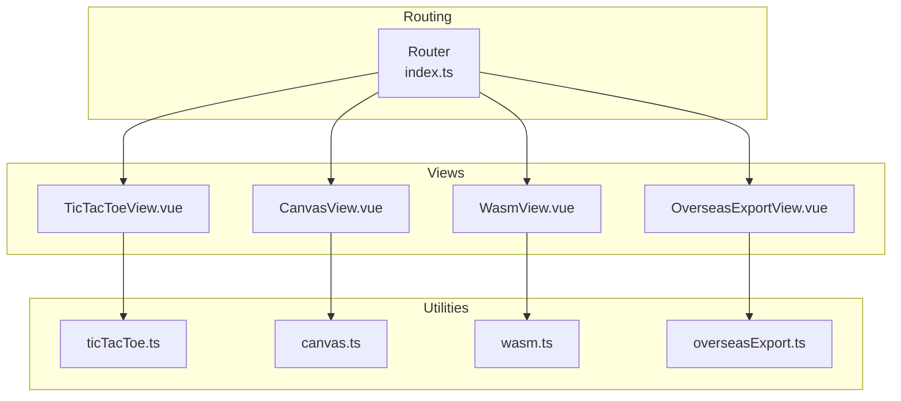
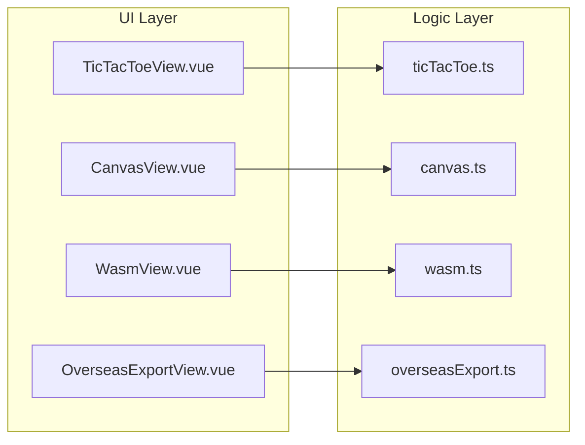
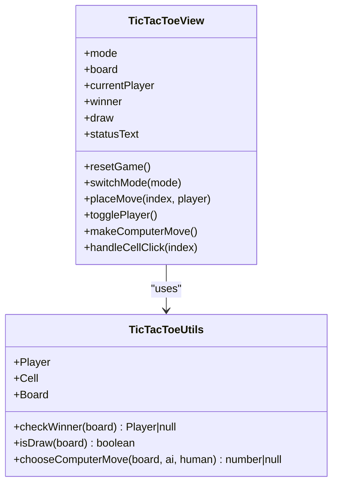
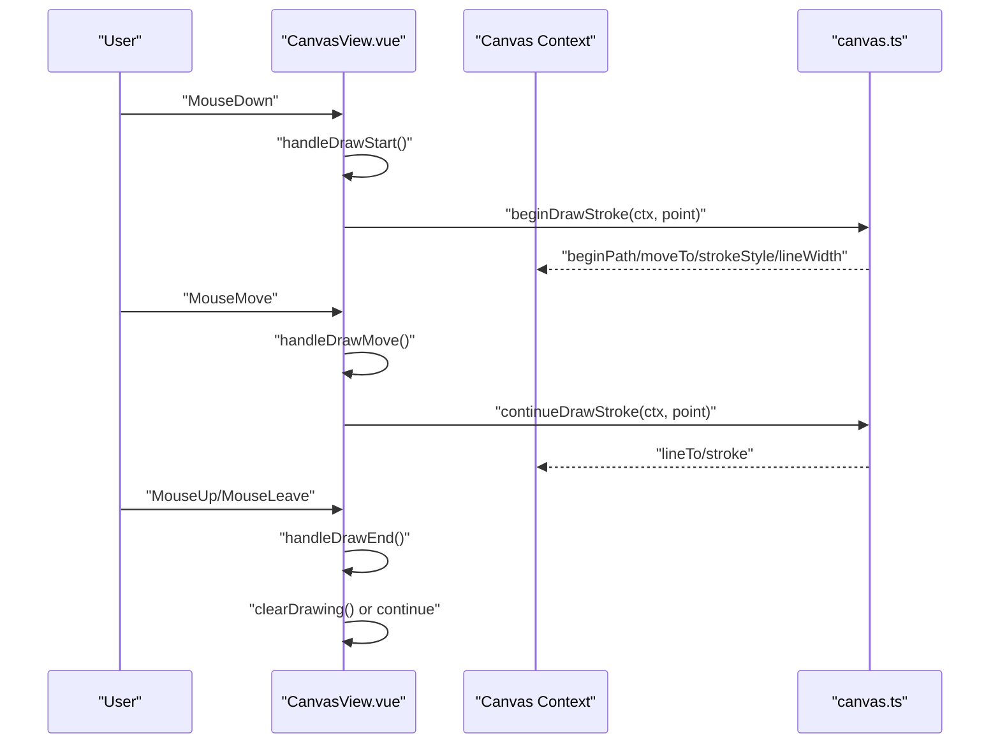
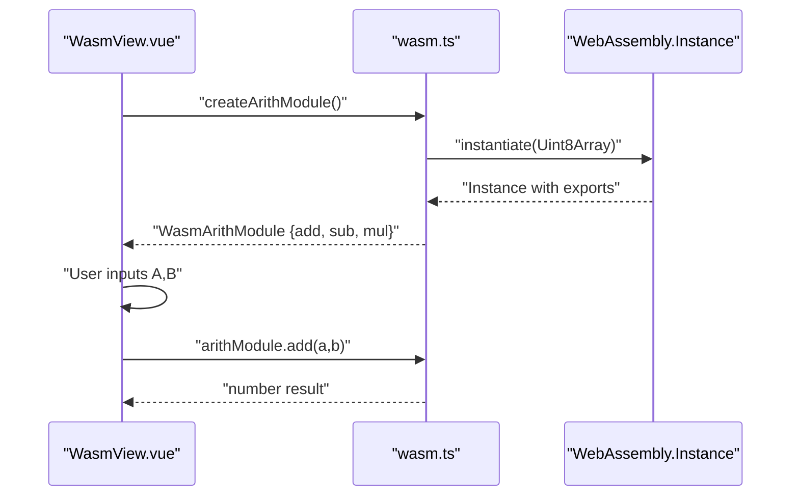
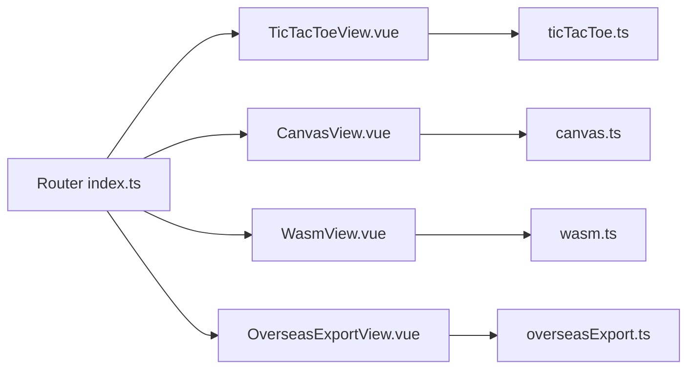

# Interactive Applications

<cite>
**Referenced Files in This Document**
- [ticTacToe.ts](file://src/utils/ticTacToe.ts)
- [TicTacToeView.vue](file://src/views/TicTacToeView.vue)
- [canvas.ts](file://src/utils/canvas.ts)
- [CanvasView.vue](file://src/views/CanvasView.vue)
- [wasm.ts](file://src/utils/wasm.ts)
- [WasmView.vue](file://src/views/WasmView.vue)
- [overseasExport.ts](file://src/utils/overseasExport.ts)
- [OverseasExportView.vue](file://src/views/OverseasExportView.vue)
- [index.ts](file://src/router/index.ts)
- [ticTacToe.spec.ts](file://src/components/__tests__/ticTacToe.spec.ts)
- [canvas.spec.ts](file://src/components/__tests__/canvas.spec.ts)
- [wasm.spec.ts](file://src/components/__tests__/wasm.spec.ts)
- [overseasExport.spec.ts](file://src/components/__tests__/overseasExport.spec.ts)
</cite>

## Table of Contents
1. [Introduction](#introduction)
2. [Project Structure](#project-structure)
3. [Core Components](#core-components)
4. [Architecture Overview](#architecture-overview)
5. [Detailed Component Analysis](#detailed-component-analysis)
6. [Dependency Analysis](#dependency-analysis)
7. [Performance Considerations](#performance-considerations)
8. [Troubleshooting Guide](#troubleshooting-guide)
9. [Conclusion](#conclusion)

## Introduction
This document presents the interactive applications section of the project, focusing on four distinct interactive demos: Tic-Tac-Toe game logic and UI, HTML5 Canvas drawing and animations, WebAssembly arithmetic and benchmarking, and an overseas export toolkit. It explains the implementation patterns, state management, user interaction flows, canvas manipulation techniques, WASM module loading and performance characteristics, and practical utility applications for international trade. It also highlights technical challenges and solutions, and provides extension points and customization examples.

## Project Structure
The interactive applications are organized as Vue Single File Components (SFCs) under the views directory, each backed by a dedicated utility module in the utils directory. Routing integrates these views under clean URLs for easy navigation.

**Diagram sources**
- [index.ts:1-65](file://src/router/index.ts#L1-L65)
- [TicTacToeView.vue:1-181](file://src/views/TicTacToeView.vue#L1-L181)
- [CanvasView.vue:1-472](file://src/views/CanvasView.vue#L1-L472)
- [WasmView.vue:1-842](file://src/views/WasmView.vue#L1-L842)
- [OverseasExportView.vue:1-399](file://src/views/OverseasExportView.vue#L1-L399)
- [ticTacToe.ts:1-55](file://src/utils/ticTacToe.ts#L1-L55)
- [canvas.ts:1-204](file://src/utils/canvas.ts#L1-L204)
- [wasm.ts:1-163](file://src/utils/wasm.ts#L1-L163)
- [overseasExport.ts:1-104](file://src/utils/overseasExport.ts#L1-L104)

**Section sources**
- [index.ts:1-65](file://src/router/index.ts#L1-L65)

## Core Components
- Tic-Tac-Toe Game: Pure logic module plus reactive UI with two modes (player vs player and player vs computer), including a simple AI strategy.
- Canvas Demos: A collection of canvas utilities and demos including particle systems, drawing pad, bar charts, and animated sine waves.
- WebAssembly Demo: A minimal WASM arithmetic module instantiated from raw bytes, plus benchmarks and a Mandelbrot renderer.
- Overseas Export Toolkit: A practical calculator and checklist builder for international trade quoting and compliance.

**Section sources**
- [TicTacToeView.vue:1-181](file://src/views/TicTacToeView.vue#L1-L181)
- [CanvasView.vue:1-472](file://src/views/CanvasView.vue#L1-L472)
- [WasmView.vue:1-842](file://src/views/WasmView.vue#L1-L842)
- [OverseasExportView.vue:1-399](file://src/views/OverseasExportView.vue#L1-L399)

## Architecture Overview
Each application follows a clear separation of concerns:
- Views: Define templates, user interactions, and lifecycle hooks.
- Utilities: Encapsulate pure logic and reusable drawing/benchmark helpers.
- Tests: Validate correctness and edge cases for each utility.

**Diagram sources**
- [TicTacToeView.vue:1-181](file://src/views/TicTacToeView.vue#L1-L181)
- [CanvasView.vue:1-472](file://src/views/CanvasView.vue#L1-L472)
- [WasmView.vue:1-842](file://src/views/WasmView.vue#L1-L842)
- [OverseasExportView.vue:1-399](file://src/views/OverseasExportView.vue#L1-L399)
- [ticTacToe.ts:1-55](file://src/utils/ticTacToe.ts#L1-L55)
- [canvas.ts:1-204](file://src/utils/canvas.ts#L1-L204)
- [wasm.ts:1-163](file://src/utils/wasm.ts#L1-L163)
- [overseasExport.ts:1-104](file://src/utils/overseasExport.ts#L1-L104)

## Detailed Component Analysis

### Tic-Tac-Toe Game
The game combines a pure logic module with a reactive Vue view. The logic module defines types, win detection, draw detection, and a simple AI that prioritizes winning, blocking, center, corners, and otherwise random moves.

**Diagram sources**
- [ticTacToe.ts:1-55](file://src/utils/ticTacToe.ts#L1-L55)
- [TicTacToeView.vue:1-181](file://src/views/TicTacToeView.vue#L1-L181)

Key behaviors:
- Two game modes: pvp and pve. In pve, the human plays X; the computer plays O.
- Win/draw detection computed from the board state.
- Computer AI selects moves based on priority: win, block, center, corner, random.
- UI updates state reactively and disables actions when the game ends.

User interaction patterns:
- Clicking a cell places the current player’s mark if legal.
- Status text reflects current mode and whose turn it is.
- Reset button clears the board and sets the starting player.

Technical notes:
- The board is represented as a flat array of nine cells.
- The AI uses snapshots to test potential winning moves without mutating the real board.
- The view uses refs and computed properties for reactive state and derived values.

Extensibility ideas:
- Add difficulty levels by adjusting AI move priority or introducing randomness.
- Add score tracking across multiple games.
- Local storage persistence for recent scores or preferences.

**Section sources**
- [ticTacToe.ts:1-55](file://src/utils/ticTacToe.ts#L1-L55)
- [TicTacToeView.vue:1-181](file://src/views/TicTacToeView.vue#L1-L181)
- [ticTacToe.spec.ts:1-32](file://src/components/__tests__/ticTacToe.spec.ts#L1-L32)

### Canvas Drawing System
The canvas utilities provide particle physics, drawing strokes, bar charts, and sine wave animations. The view composes these into interactive demos with mouse events and animation loops.

**Diagram sources**
- [CanvasView.vue:106-143](file://src/views/CanvasView.vue#L106-L143)
- [canvas.ts:103-125](file://src/utils/canvas.ts#L103-L125)

Canvas manipulation techniques:
- Mouse event handlers convert client coordinates to canvas-relative positions.
- Stroke drawing uses beginPath/moveTo/lineTo with rounded caps and joins.
- Clearing and background fills are used to create layered effects.
- Animation frames drive continuous updates for particle networks and wave animations.

Data flow:
- The view maintains per-tab state (particle system, drawing state, chart data, wave parameters).
- Each demo initializes its canvas size and context on mount, then runs its own RAF loop.

Extensibility ideas:
- Add brush shapes (spray, eraser).
- Persist drawings to server or export as images.
- Introduce multi-layer canvases for undo/redo.

**Section sources**
- [canvas.ts:1-204](file://src/utils/canvas.ts#L1-L204)
- [CanvasView.vue:1-472](file://src/views/CanvasView.vue#L1-L472)
- [canvas.spec.ts:1-131](file://src/components/__tests__/canvas.spec.ts#L1-L131)

### WebAssembly Integration
The WASM demo loads a minimal arithmetic module from raw bytes, exposes typed exports, and demonstrates performance comparisons and visualization.

**Diagram sources**
- [wasm.ts:44-47](file://src/utils/wasm.ts#L44-L47)
- [WasmView.vue:499-534](file://src/views/WasmView.vue#L499-L534)

Implementation highlights:
- The arithmetic module exports add, sub, mul functions.
- The module is instantiated from a prebuilt byte array.
- Benchmarks compare recursive and iterative Fibonacci approaches.
- Mandelbrot rendering uses pure JS computation and Canvas ImageData.

Memory and performance:
- WASM instantiation occurs once and results are cached in a ref.
- ImageData manipulation is efficient for pixel-level rendering.
- Benchmarking uses performance.now() for precise timing.

Extensibility ideas:
- Load WASM from external files for larger modules.
- Add SIMD or threading hints for heavy computations.
- Visualize benchmark results in charts.

**Section sources**
- [wasm.ts:1-163](file://src/utils/wasm.ts#L1-L163)
- [WasmView.vue:1-842](file://src/views/WasmView.vue#L1-L842)
- [wasm.spec.ts:1-97](file://src/components/__tests__/wasm.spec.ts#L1-L97)

### Overseas Export Tools
The export toolkit computes international trade pricing and generates a compliance checklist based on market and product attributes.

**Diagram sources**
- [overseasExport.ts:38-64](file://src/utils/overseasExport.ts#L38-L64)
- [overseasExport.ts:66-103](file://src/utils/overseasExport.ts#L66-L103)
- [OverseasExportView.vue:23-43](file://src/views/OverseasExportView.vue#L23-L43)

Key features:
- Robust numeric guards against invalid inputs (e.g., zero exchange rate).
- Percent conversion helpers and rounding utilities.
- Dynamic checklist items based on target market, incoterms, battery inclusion, and trademark presence.

Extensibility ideas:
- Add currency conversion helpers.
- Integrate with external APIs for real-time rates and HS codes.
- Export checklist to PDF or shareable link.

**Section sources**
- [overseasExport.ts:1-104](file://src/utils/overseasExport.ts#L1-L104)
- [OverseasExportView.vue:1-399](file://src/views/OverseasExportView.vue#L1-L399)
- [overseasExport.spec.ts:1-61](file://src/components/__tests__/overseasExport.spec.ts#L1-L61)

## Dependency Analysis
- Views depend on their respective utility modules for logic and rendering helpers.
- The router lazily loads views to optimize initial bundle size.
- Tests validate the behavior of utility functions independently.

**Diagram sources**
- [index.ts:1-65](file://src/router/index.ts#L1-L65)
- [TicTacToeView.vue:1-181](file://src/views/TicTacToeView.vue#L1-L181)
- [CanvasView.vue:1-472](file://src/views/CanvasView.vue#L1-L472)
- [WasmView.vue:1-842](file://src/views/WasmView.vue#L1-L842)
- [OverseasExportView.vue:1-399](file://src/views/OverseasExportView.vue#L1-L399)
- [ticTacToe.ts:1-55](file://src/utils/ticTacToe.ts#L1-L55)
- [canvas.ts:1-204](file://src/utils/canvas.ts#L1-L204)
- [wasm.ts:1-163](file://src/utils/wasm.ts#L1-L163)
- [overseasExport.ts:1-104](file://src/utils/overseasExport.ts#L1-L104)

**Section sources**
- [index.ts:1-65](file://src/router/index.ts#L1-L65)

## Performance Considerations
- Canvas demos:
  - Use requestAnimationFrame for smooth animations.
  - Minimize overdraw by clearing only when necessary and batching drawing operations.
  - Prefer preallocated arrays for particle systems to reduce GC pressure.
- WASM:
  - Instantiate once and reuse exports.
  - For heavy computations, consider streaming data to WASM memory and using typed arrays.
- Tic-Tac-Toe:
  - Keep board updates minimal and rely on computed properties to avoid redundant renders.
- Export toolkit:
  - Defer expensive calculations until inputs change (computed properties already help here).

[No sources needed since this section provides general guidance]

## Troubleshooting Guide
Common issues and resolutions:
- Canvas not responding to mouse events:
  - Ensure the canvas element has a valid context and width/height set.
  - Verify event handlers are attached to the correct DOM element.
- Particle system flickering:
  - Clear the canvas with a semi-transparent fill to create motion trails.
  - Limit the number of particles or adjust lifetimes.
- WASM instantiation errors:
  - Confirm the byte array is valid and complete.
  - Check browser support for WebAssembly features.
- Export calculations incorrect:
  - Validate input ranges and guard against invalid values (e.g., zero exchange rate).
  - Round results consistently to avoid floating-point precision surprises.

**Section sources**
- [canvas.spec.ts:1-131](file://src/components/__tests__/canvas.spec.ts#L1-L131)
- [wasm.spec.ts:1-97](file://src/components/__tests__/wasm.spec.ts#L1-L97)
- [overseasExport.spec.ts:1-61](file://src/components/__tests__/overseasExport.spec.ts#L1-L61)

## Conclusion
The interactive applications showcase practical implementations of game logic, canvas-based animations, WebAssembly integration, and international trade utilities. Each component emphasizes modularity, reactivity, and testability. The provided extension points enable adding new features, optimizing performance, and integrating with backend services.