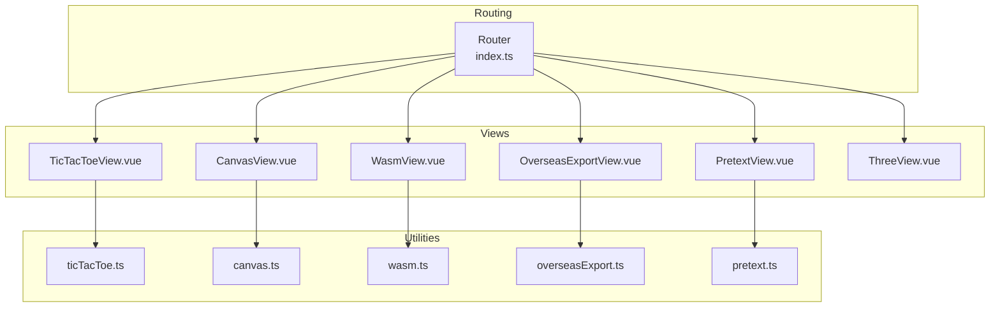
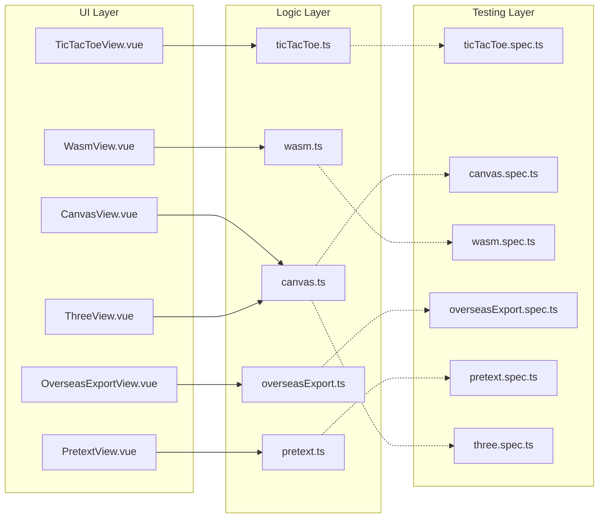
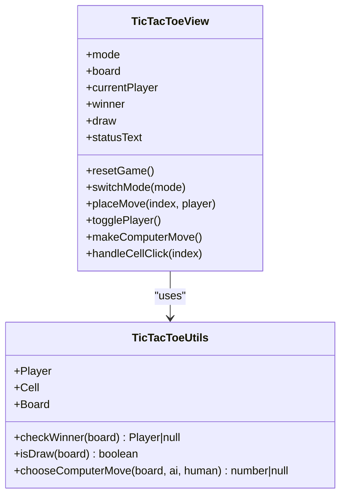
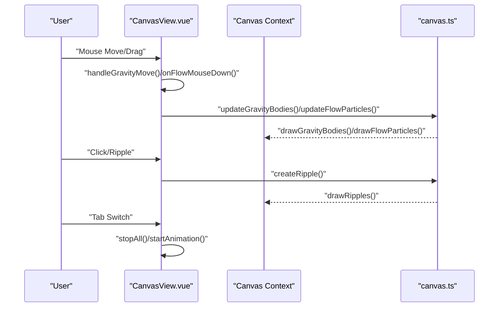
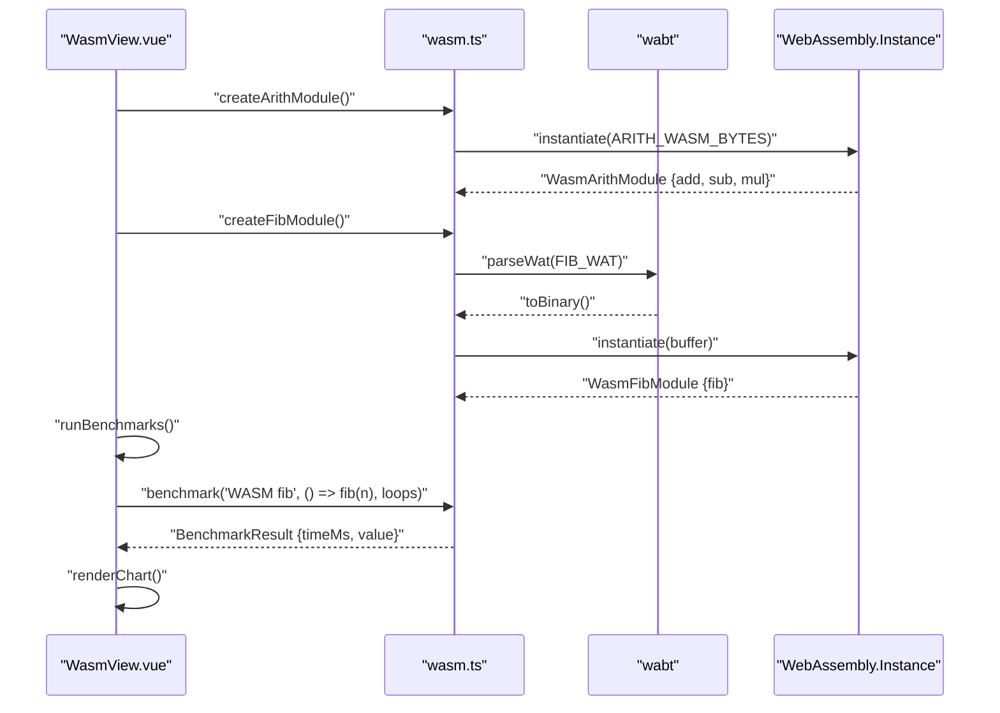
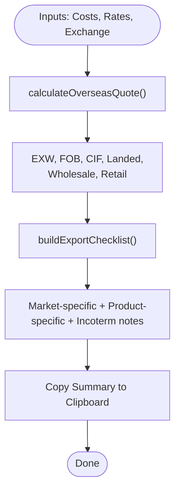
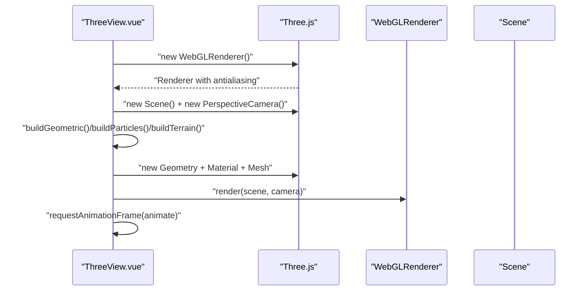
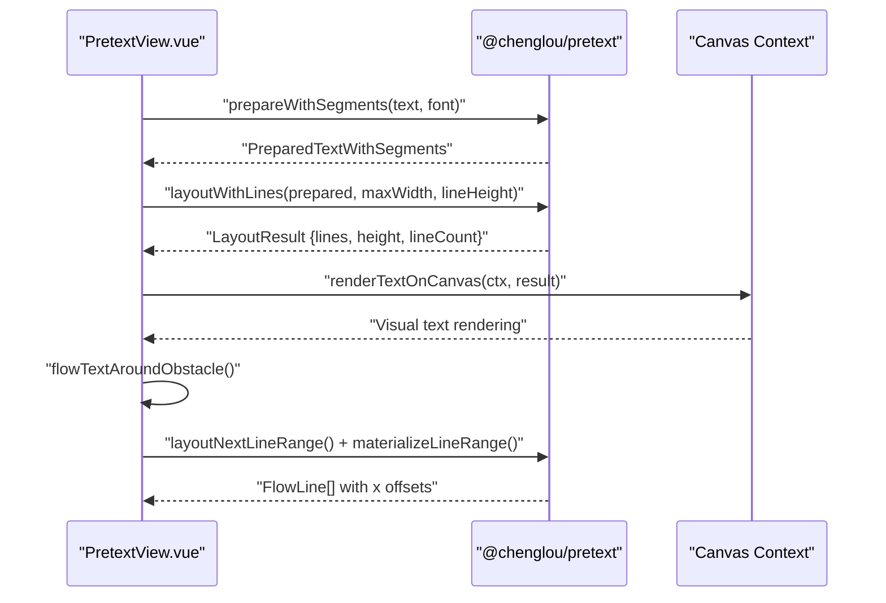
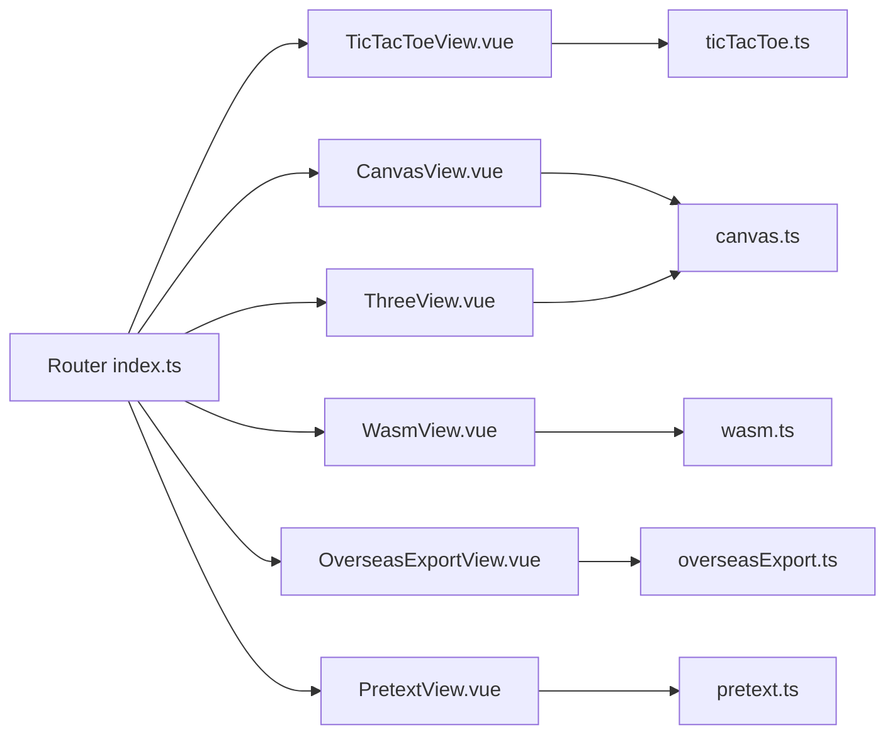

# Interactive Applications

<cite>
**Referenced Files in This Document**
- [ticTacToe.ts](file://src/utils/ticTacToe.ts)
- [TicTacToeView.vue](file://src/views/TicTacToeView.vue)
- [canvas.ts](file://src/utils/canvas.ts)
- [CanvasView.vue](file://src/views/CanvasView.vue)
- [wasm.ts](file://src/utils/wasm.ts)
- [WasmView.vue](file://src/views/WasmView.vue)
- [overseasExport.ts](file://src/utils/overseasExport.ts)
- [OverseasExportView.vue](file://src/views/OverseasExportView.vue)
- [pretext.ts](file://src/utils/pretext.ts)
- [PretextView.vue](file://src/views/PretextView.vue)
- [ThreeView.vue](file://src/views/ThreeView.vue)
- [index.ts](file://src/router/index.ts)
- [ticTacToe.spec.ts](file://src/components/__tests__/ticTacToe.spec.ts)
- [canvas.spec.ts](file://src/components/__tests__/canvas.spec.ts)
- [wasm.spec.ts](file://src/components/__tests__/wasm.spec.ts)
- [overseasExport.spec.ts](file://src/components/__tests__/overseasExport.spec.ts)
- [pretext.spec.ts](file://src/components/__tests__/pretext.spec.ts)
- [three.spec.ts](file://src/components/__tests__/three.spec.ts)
</cite>

## Update Summary
**Changes Made**
- Added comprehensive documentation for four new interactive applications: CanvasView, ThreeView, WasmView, and PretextView
- Updated project structure to reflect the expanded interactive applications suite
- Removed references to CodexView as it was completely removed from the codebase
- Enhanced architecture overview to include the new Three.js and Pretext.js integrations
- Added detailed coverage of advanced canvas techniques, 3D graphics programming, and text layout systems

## Table of Contents
1. [Introduction](#introduction)
2. [Project Structure](#project-structure)
3. [Core Components](#core-components)
4. [Architecture Overview](#architecture-overview)
5. [Detailed Component Analysis](#detailed-component-analysis)
6. [Dependency Analysis](#dependency-analysis)
7. [Performance Considerations](#performance-considerations)
8. [Troubleshooting Guide](#troubleshooting-guide)
9. [Conclusion](#conclusion)

## Introduction
This document presents the interactive applications section of the project, featuring seven distinct interactive demos that showcase modern web technologies. The applications include: Tic-Tac-Toe game logic and UI, HTML5 Canvas drawing and animations, WebAssembly arithmetic and benchmarking, an overseas export toolkit, advanced canvas physics simulations, 3D WebGL graphics with Three.js, and a sophisticated text layout system using Pretext.js. Each demo demonstrates different aspects of web development including state management, user interaction flows, canvas manipulation techniques, WASM module loading and performance characteristics, practical utility applications, 3D graphics programming, and advanced text rendering systems.

## Project Structure
The interactive applications are organized as Vue Single File Components (SFCs) under the views directory, each backed by dedicated utility modules in the utils directory. The routing system integrates these views under clean URLs for easy navigation, with lazy loading for optimal performance.

**Diagram sources**
- [index.ts:1-77](file://src/router/index.ts#L1-L77)
- [TicTacToeView.vue:1-181](file://src/views/TicTacToeView.vue#L1-L181)
- [CanvasView.vue:1-328](file://src/views/CanvasView.vue#L1-L328)
- [WasmView.vue:1-424](file://src/views/WasmView.vue#L1-L424)
- [OverseasExportView.vue:1-399](file://src/views/OverseasExportView.vue#L1-L399)
- [PretextView.vue:1-462](file://src/views/PretextView.vue#L1-L462)
- [ThreeView.vue:1-429](file://src/views/ThreeView.vue#L1-L429)
- [ticTacToe.ts:1-55](file://src/utils/ticTacToe.ts#L1-L55)
- [canvas.ts:1-231](file://src/utils/canvas.ts#L1-L231)
- [wasm.ts:1-298](file://src/utils/wasm.ts#L1-L298)
- [overseasExport.ts:1-104](file://src/utils/overseasExport.ts#L1-L104)
- [pretext.ts:1-223](file://src/utils/pretext.ts#L1-L223)

**Section sources**
- [index.ts:1-77](file://src/router/index.ts#L1-L77)

## Core Components
- **Tic-Tac-Toe Game**: Pure logic module plus reactive UI with two modes (player vs player and player vs computer), including a simple AI strategy.
- **Canvas Demos**: Advanced canvas utilities featuring particle physics, fractal tree generation, ripple wave interference, and vector field flow demonstrations.
- **WebAssembly Demo**: Comprehensive WASM benchmarking with multiple modules (arithmetic, Fibonacci, prime sieve, matrix multiplication) and performance comparison tools.
- **Overseas Export Toolkit**: Practical calculator and checklist builder for international trade quoting and compliance.
- **3D Graphics**: Three.js integration with geometric animations, particle systems, and procedural terrain generation.
- **Text Layout System**: Pretext.js-powered text rendering with canvas integration, obstacle-aware text flow, virtual list height prediction, and performance benchmarks.

**Section sources**
- [TicTacToeView.vue:1-181](file://src/views/TicTacToeView.vue#L1-L181)
- [CanvasView.vue:1-328](file://src/views/CanvasView.vue#L1-L328)
- [WasmView.vue:1-424](file://src/views/WasmView.vue#L1-L424)
- [OverseasExportView.vue:1-399](file://src/views/OverseasExportView.vue#L1-L399)
- [PretextView.vue:1-462](file://src/views/PretextView.vue#L1-L462)
- [ThreeView.vue:1-429](file://src/views/ThreeView.vue#L1-L429)

## Architecture Overview
Each application follows a clear separation of concerns with specialized utility modules and comprehensive testing:

**Diagram sources**
- [TicTacToeView.vue:1-181](file://src/views/TicTacToeView.vue#L1-L181)
- [CanvasView.vue:1-328](file://src/views/CanvasView.vue#L1-L328)
- [WasmView.vue:1-424](file://src/views/WasmView.vue#L1-L424)
- [OverseasExportView.vue:1-399](file://src/views/OverseasExportView.vue#L1-L399)
- [PretextView.vue:1-462](file://src/views/PretextView.vue#L1-L462)
- [ThreeView.vue:1-429](file://src/views/ThreeView.vue#L1-L429)
- [ticTacToe.ts:1-55](file://src/utils/ticTacToe.ts#L1-L55)
- [canvas.ts:1-231](file://src/utils/canvas.ts#L1-L231)
- [wasm.ts:1-298](file://src/utils/wasm.ts#L1-L298)
- [overseasExport.ts:1-104](file://src/utils/overseasExport.ts#L1-L104)
- [pretext.ts:1-223](file://src/utils/pretext.ts#L1-L223)
- [ticTacToe.spec.ts:1-32](file://src/components/__tests__/ticTacToe.spec.ts#L1-L32)
- [canvas.spec.ts:1-131](file://src/components/__tests__/canvas.spec.ts#L1-L131)
- [wasm.spec.ts:1-97](file://src/components/__tests__/wasm.spec.ts#L1-L97)
- [overseasExport.spec.ts:1-61](file://src/components/__tests__/overseasExport.spec.ts#L1-L61)
- [pretext.spec.ts:1-232](file://src/components/__tests__/pretext.spec.ts#L1-L232)
- [three.spec.ts:1-123](file://src/components/__tests__/three.spec.ts#L1-L123)

## Detailed Component Analysis

### Tic-Tac-Toe Game
The game combines a pure logic module with a reactive Vue view. The logic module defines types, win detection, draw detection, and a simple AI that prioritizes winning, blocking, center, corners, and otherwise random moves.

**Diagram sources**
- [ticTacToe.ts:1-55](file://src/utils/ticTacToe.ts#L1-L55)
- [TicTacToeView.vue:1-181](file://src/views/TicTacToeView.vue#L1-L181)

Key behaviors:
- Two game modes: pvp and pve. In pve, the human plays X; the computer plays O.
- Win/draw detection computed from the board state.
- Computer AI selects moves based on priority: win, block, center, corner, random.
- UI updates state reactively and disables actions when the game ends.

User interaction patterns:
- Clicking a cell places the current player's mark if legal.
- Status text reflects current mode and whose turn it is.
- Reset button clears the board and sets the starting player.

Technical notes:
- The board is represented as a flat array of nine cells.
- The AI uses snapshots to test potential winning moves without mutating the real board.
- The view uses refs and computed properties for reactive state and derived values.

Extensibility ideas:
- Add difficulty levels by adjusting AI move priority or introducing randomness.
- Add score tracking across multiple games.
- Local storage persistence for recent scores or preferences.

**Section sources**
- [ticTacToe.ts:1-55](file://src/utils/ticTacToe.ts#L1-L55)
- [TicTacToeView.vue:1-181](file://src/views/TicTacToeView.vue#L1-L181)
- [ticTacToe.spec.ts:1-32](file://src/components/__tests__/ticTacToe.spec.ts#L1-L32)

### Advanced Canvas Physics System
The canvas utilities provide sophisticated physics simulations including gravity fields, fractal tree generation, ripple wave interference, and vector field flow demonstrations. The view composes these into interactive demos with mouse events and animation loops.

**Diagram sources**
- [CanvasView.vue:53-60](file://src/views/CanvasView.vue#L53-L60)
- [CanvasView.vue:95-116](file://src/views/CanvasView.vue#L95-L116)
- [CanvasView.vue:133-143](file://src/views/CanvasView.vue#L133-L143)
- [CanvasView.vue:185-202](file://src/views/CanvasView.vue#L185-L202)
- [canvas.ts:45-71](file://src/utils/canvas.ts#L45-L71)
- [canvas.ts:198-219](file://src/utils/canvas.ts#L198-L219)

Canvas manipulation techniques:
- Mouse event handlers convert client coordinates to canvas-relative positions with proper scaling.
- Physics simulations use mathematical models: gravitational force F = G/(d²), vector field angles, and trigonometric functions.
- Motion trails created using coordinate history arrays with alpha blending for visual effects.
- Screen wrapping implemented for boundary conditions in particle systems.
- Multi-layer rendering with semi-transparent overlays for particle trails and glow effects.

Data flow:
- The view maintains per-tab state with initialization flags and animation control.
- Each demo initializes its canvas size and context on mount, then runs independent RAF loops.
- Lazy initialization ensures optimal performance by only creating resources when needed.

Extensibility ideas:
- Add collision detection between different particle types.
- Implement particle spawning based on time or user input.
- Create custom brush tools for drawing with physics properties.
- Add sound effects synchronized with particle interactions.

**Section sources**
- [canvas.ts:1-231](file://src/utils/canvas.ts#L1-L231)
- [CanvasView.vue:1-328](file://src/views/CanvasView.vue#L1-L328)
- [canvas.spec.ts:1-131](file://src/components/__tests__/canvas.spec.ts#L1-L131)

### WebAssembly Integration and Benchmarking
The WASM demo provides comprehensive benchmarking across multiple algorithms and data structures, demonstrating performance comparisons between JavaScript and WebAssembly implementations.

**Diagram sources**
- [wasm.ts:45-48](file://src/utils/wasm.ts#L45-L48)
- [wasm.ts:178-181](file://src/utils/wasm.ts#L178-L181)
- [wasm.ts:188-191](file://src/utils/wasm.ts#L188-L191)
- [WasmView.vue:82-152](file://src/views/WasmView.vue#L82-L152)
- [WasmView.vue:157-206](file://src/views/WasmView.vue#L157-L206)

Implementation highlights:
- Multiple WASM modules compiled at runtime using WABT (WebAssembly Binary Toolkit).
- Arithmetic module with pre-compiled bytes for immediate instantiation.
- Fibonacci sequence calculation with iterative algorithm in both JS and WASM.
- Prime number sieve implementation demonstrating algorithmic complexity.
- Matrix multiplication with manual memory management and linear addressing.
- Comprehensive benchmarking framework with statistical analysis.

Memory and performance:
- WASM instantiation occurs once and results are cached in Vue refs.
- Linear memory management for matrix operations with careful offset calculations.
- Performance.now() provides precise timing measurements for micro-benchmarks.
- Memory dumps show actual WASM bytecode for educational purposes.

Extensibility ideas:
- Add SIMD support for vectorized operations.
- Implement threading for CPU-intensive calculations.
- Create custom WASM modules for specialized algorithms.
- Add visualization of memory layouts and register states.

**Section sources**
- [wasm.ts:1-298](file://src/utils/wasm.ts#L1-L298)
- [WasmView.vue:1-424](file://src/views/WasmView.vue#L1-L424)
- [wasm.spec.ts:1-97](file://src/components/__tests__/wasm.spec.ts#L1-L97)

### Overseas Export Tools
The export toolkit computes international trade pricing and generates a compliance checklist based on market and product attributes.

**Diagram sources**
- [overseasExport.ts:38-64](file://src/utils/overseasExport.ts#L38-L64)
- [overseasExport.ts:66-103](file://src/utils/overseasExport.ts#L66-L103)
- [OverseasExportView.vue:23-43](file://src/views/OverseasExportView.vue#L23-L43)

Key features:
- Robust numeric guards against invalid inputs (e.g., zero exchange rate).
- Percent conversion helpers and rounding utilities.
- Dynamic checklist items based on target market, incoterms, battery inclusion, and trademark presence.

Extensibility ideas:
- Add currency conversion helpers.
- Integrate with external APIs for real-time rates and HS codes.
- Export checklist to PDF or shareable link.

**Section sources**
- [overseasExport.ts:1-104](file://src/utils/overseasExport.ts#L1-L104)
- [OverseasExportView.vue:1-399](file://src/views/OverseasExportView.vue#L1-L399)
- [overseasExport.spec.ts:1-61](file://src/components/__tests__/overseasExport.spec.ts#L1-L61)

### 3D Graphics with Three.js
The Three.js integration provides interactive 3D scenes with geometric animations, particle systems, and procedural terrain generation.

**Diagram sources**
- [ThreeView.vue:279-313](file://src/views/ThreeView.vue#L279-L313)
- [ThreeView.vue:55-63](file://src/views/ThreeView.vue#L55-L63)
- [ThreeView.vue:198-265](file://src/views/ThreeView.vue#L198-L265)

Advanced 3D techniques:
- Geometric animations with parametric surfaces and orbital mechanics.
- Particle systems using BufferGeometry for GPU-accelerated rendering.
- Procedural terrain generation with mathematical functions and vertex manipulation.
- Real-time lighting with ambient, directional, and point light sources.
- Camera controls with mouse drag orbit and auto-rotation.

Scene composition:
- Multiple scene modes with lazy loading and resource cleanup.
- Dynamic geometry creation and modification during runtime.
- Performance monitoring with FPS counter and frame statistics.
- Responsive design with automatic resize handling.

Extensibility ideas:
- Add post-processing effects and shaders.
- Implement physics-based animations with Cannon.js.
- Create interactive lighting controls and environment maps.
- Add VR/AR support for immersive experiences.

**Section sources**
- [ThreeView.vue:1-429](file://src/views/ThreeView.vue#L1-L429)
- [three.spec.ts:1-123](file://src/components/__tests__/three.spec.ts#L1-L123)

### Pretext.js Text Layout System
The Pretext.js integration demonstrates advanced text measurement and layout without DOM reflow, showcasing performance benefits and international text support.

**Diagram sources**
- [pretext.ts:41-65](file://src/utils/pretext.ts#L41-L65)
- [pretext.ts:76-104](file://src/utils/pretext.ts#L76-L104)
- [pretext.ts:114-120](file://src/utils/pretext.ts#L114-L120)
- [pretext.ts:131-163](file://src/utils/pretext.ts#L131-L163)
- [PretextView.vue:30-44](file://src/views/PretextView.vue#L30-L44)
- [PretextView.vue:56-93](file://src/views/PretextView.vue#L56-L93)

Text processing capabilities:
- Multilingual support with CJK, Arabic, emoji, and bidirectional text.
- Grapheme-accurate segmentation using Intl.Segmenter.
- Variable-width text flow around obstacles with dynamic width adjustment.
- Height prediction for virtualized lists without DOM measurement.
- Shrink-wrap optimization for balanced text containers.

Performance optimization:
- Zero DOM reflow with pure arithmetic layout calculations.
- Binary search algorithms for optimal width determination.
- Cached measurements and prepared text segments for repeated use.
- Efficient line range materialization for incremental rendering.

Extensibility ideas:
- Add custom typography engines and font loading.
- Implement text selection and editing capabilities.
- Create SVG and WebGL text rendering pipelines.
- Add text animation and morphing effects.

**Section sources**
- [pretext.ts:1-223](file://src/utils/pretext.ts#L1-L223)
- [PretextView.vue:1-462](file://src/views/PretextView.vue#L1-L462)
- [pretext.spec.ts:1-232](file://src/components/__tests__/pretext.spec.ts#L1-L232)

## Dependency Analysis
The interactive applications demonstrate a modular architecture with specialized dependencies:

**Diagram sources**
- [index.ts:1-77](file://src/router/index.ts#L1-L77)
- [TicTacToeView.vue:1-181](file://src/views/TicTacToeView.vue#L1-L181)
- [CanvasView.vue:1-328](file://src/views/CanvasView.vue#L1-L328)
- [WasmView.vue:1-424](file://src/views/WasmView.vue#L1-L424)
- [OverseasExportView.vue:1-399](file://src/views/OverseasExportView.vue#L1-L399)
- [PretextView.vue:1-462](file://src/views/PretextView.vue#L1-L462)
- [ThreeView.vue:1-429](file://src/views/ThreeView.vue#L1-L429)
- [ticTacToe.ts:1-55](file://src/utils/ticTacToe.ts#L1-L55)
- [canvas.ts:1-231](file://src/utils/canvas.ts#L1-L231)
- [wasm.ts:1-298](file://src/utils/wasm.ts#L1-L298)
- [overseasExport.ts:1-104](file://src/utils/overseasExport.ts#L1-L104)
- [pretext.ts:1-223](file://src/utils/pretext.ts#L1-L223)

**Section sources**
- [index.ts:1-77](file://src/router/index.ts#L1-L77)

## Performance Considerations
- **Canvas demos**: Use requestAnimationFrame for smooth animations, minimize overdraw with selective clearing, implement lazy initialization for resource-heavy demos.
- **WASM**: Instantiate modules once and reuse exports, use linear memory efficiently for large datasets, implement proper error handling for unsupported browsers.
- **3D graphics**: Optimize geometry with BufferGeometry, use instancing for particle systems, implement level-of-detail scaling, leverage GPU acceleration.
- **Text layout**: Cache prepared text segments, use binary search for optimal width calculations, avoid DOM measurements in favor of arithmetic layout.
- **Tic-Tac-Toe**: Keep board updates minimal with computed properties, use reactive refs for state management.
- **Export toolkit**: Defer expensive calculations with computed properties, implement input validation to prevent unnecessary recomputation.

## Troubleshooting Guide
Common issues and resolutions:

**Canvas-related problems:**
- Canvas not responding to mouse events: Ensure proper event handler attachment and coordinate transformation.
- Particle system flickering: Adjust alpha blending and trail lengths, implement proper motion blur techniques.
- Memory leaks: Clean up RAF loops and clear intervals on component unmount.

**WASM integration issues:**
- WASM instantiation errors: Verify browser support and module compilation success.
- Memory access violations: Check array bounds and proper offset calculations.
- Performance degradation: Profile memory usage and optimize data structures.

**3D graphics problems:**
- Three.js not rendering: Verify WebGL support and proper scene setup.
- Performance issues: Reduce polygon counts, implement frustum culling, optimize materials.
- Lighting artifacts: Check normal calculations and light positioning.

**Text layout issues:**
- Incorrect text measurement: Verify font loading and text preparation steps.
- International text display problems: Ensure proper Unicode handling and font fallbacks.
- Performance bottlenecks: Use caching and avoid frequent re-layout calculations.

**Section sources**
- [canvas.spec.ts:1-131](file://src/components/__tests__/canvas.spec.ts#L1-L131)
- [wasm.spec.ts:1-97](file://src/components/__tests__/wasm.spec.ts#L1-L97)
- [overseasExport.spec.ts:1-61](file://src/components/__tests__/overseasExport.spec.ts#L1-L61)
- [pretext.spec.ts:1-232](file://src/components/__tests__/pretext.spec.ts#L1-L232)
- [three.spec.ts:1-123](file://src/components/__tests__/three.spec.ts#L1-L123)

## Conclusion
The interactive applications showcase a comprehensive suite of modern web technologies, demonstrating practical implementations of game logic, advanced canvas physics, WebAssembly benchmarking, international trade utilities, 3D graphics programming, and sophisticated text layout systems. Each component emphasizes modularity, reactivity, and testability while pushing the boundaries of what's possible in the browser. The extensive testing coverage ensures reliability across different scenarios and edge cases. The provided extension points enable developers to add new features, optimize performance, integrate with backend services, and create entirely new interactive experiences.