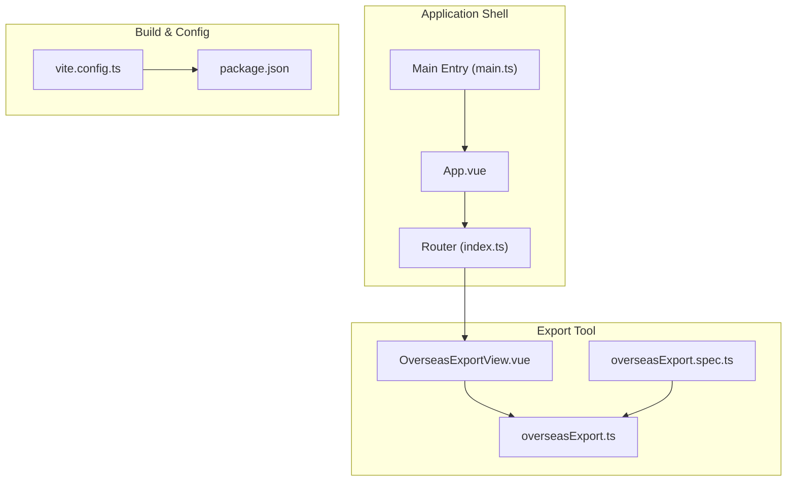
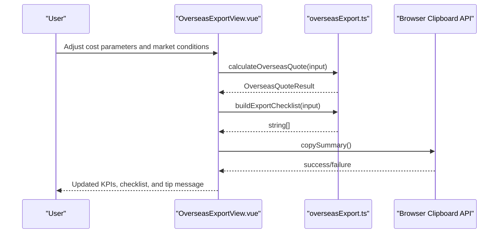
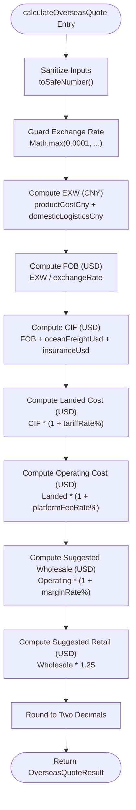
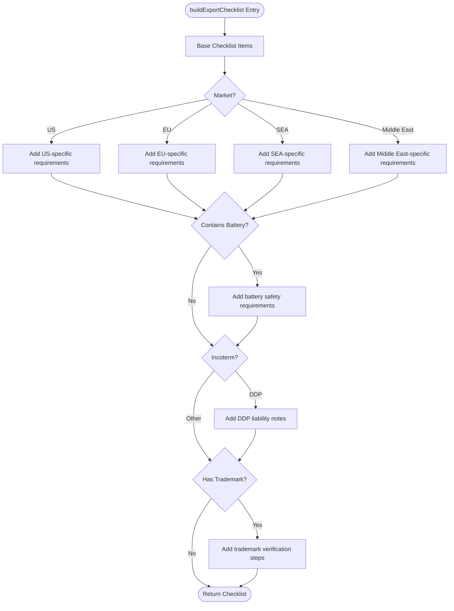
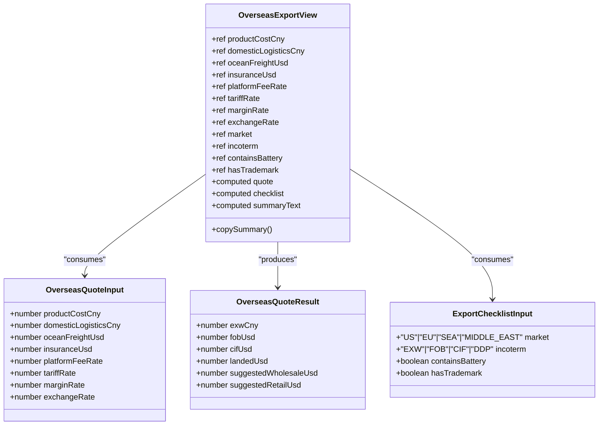
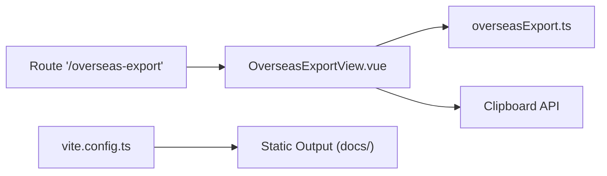
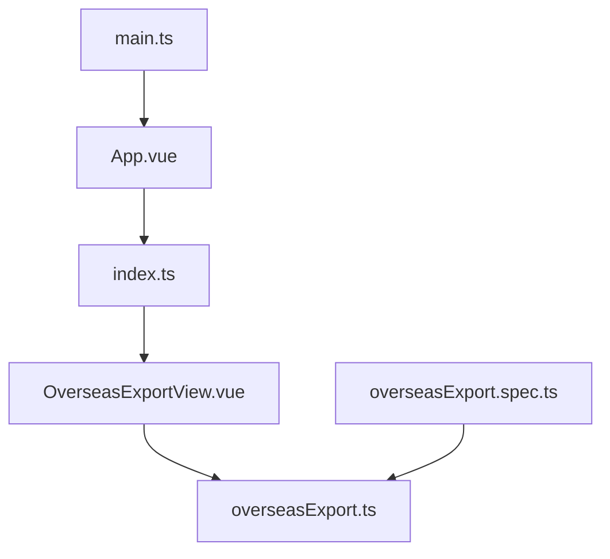

# Overseas Export Tools

<cite>
**Referenced Files in This Document**
- [overseasExport.ts](file://src/utils/overseasExport.ts)
- [OverseasExportView.vue](file://src/views/OverseasExportView.vue)
- [overseasExport.spec.ts](file://src/components/__tests__/overseasExport.spec.ts)
- [index.ts](file://src/router/index.ts)
- [main.ts](file://src/main.ts)
- [App.vue](file://src/App.vue)
- [vite.config.ts](file://vite.config.ts)
- [package.json](file://package.json)
</cite>

## Table of Contents
1. [Introduction](#introduction)
2. [Project Structure](#project-structure)
3. [Core Components](#core-components)
4. [Architecture Overview](#architecture-overview)
5. [Detailed Component Analysis](#detailed-component-analysis)
6. [Dependency Analysis](#dependency-analysis)
7. [Performance Considerations](#performance-considerations)
8. [Troubleshooting Guide](#troubleshooting-guide)
9. [Conclusion](#conclusion)
10. [Appendices](#appendices)

## Introduction
The Overseas Export Tools provide a practical solution for international trade scenarios, enabling users to calculate export pricing, estimate shipping costs, and generate export documentation checklists. The system focuses on:
- Currency conversion calculations using configurable exchange rates
- Shipping cost estimations across EXW, FOB, CIF, and DDP trade terms
- Export documentation formatting tailored to target markets (US, EU, SEA, Middle East)
- Compliance guidance for products containing batteries and branded items
- Real-time UI updates with copy-to-clipboard functionality for quick sharing

The tools are implemented as a Vue 2 application with TypeScript utilities, offering a streamlined workflow for exporters to validate pricing assumptions and prepare compliance documentation.

## Project Structure
The Overseas Export Tools are organized around a modular architecture:
- Utility functions encapsulate core calculation logic and checklist generation
- A dedicated Vue view composes the user interface and binds reactive inputs to calculations
- Routing integrates the export tool into the broader application navigation
- Testing validates calculation accuracy and defensive behavior
- Build configuration targets static deployment for documentation hosting

**Diagram sources**
- [App.vue:1-110](file://src/App.vue#L1-L110)
- [index.ts:1-65](file://src/router/index.ts#L1-L65)
- [main.ts:1-16](file://src/main.ts#L1-L16)
- [OverseasExportView.vue:1-399](file://src/views/OverseasExportView.vue#L1-L399)
- [overseasExport.ts:1-104](file://src/utils/overseasExport.ts#L1-L104)
- [overseasExport.spec.ts:1-61](file://src/components/__tests__/overseasExport.spec.ts#L1-L61)
- [vite.config.ts:1-27](file://vite.config.ts#L1-L27)
- [package.json:1-61](file://package.json#L1-L61)

**Section sources**
- [index.ts:44-48](file://src/router/index.ts#L44-L48)
- [OverseasExportView.vue:85-245](file://src/views/OverseasExportView.vue#L85-L245)
- [overseasExport.ts:38-64](file://src/utils/overseasExport.ts#L38-L64)

## Core Components
The Overseas Export Tools consist of two primary components:
- Calculation utilities: Provide precise financial computations for export pricing and compliance checklist generation
- Export view: Presents an interactive form for inputting cost parameters and market conditions, displaying real-time results and a formatted summary

Key capabilities:
- Exchange rate-driven currency conversion from CNY to USD
- Tariff and platform fee inclusion in landed cost calculations
- Margin-based pricing for wholesale and retail suggestions
- Market-specific compliance requirements and product risk indicators
- Copy-to-clipboard functionality for quick sharing of summaries

**Section sources**
- [overseasExport.ts:12-19](file://src/utils/overseasExport.ts#L12-L19)
- [overseasExport.ts:21-26](file://src/utils/overseasExport.ts#L21-L26)
- [OverseasExportView.vue:23-43](file://src/views/OverseasExportView.vue#L23-L43)

## Architecture Overview
The system follows a clean separation of concerns:
- View layer (Vue 2) handles user interactions and reactive updates
- Utility layer (TypeScript) encapsulates business logic and data transformations
- Test layer ensures correctness under normal and edge-case conditions
- Routing layer integrates the export tool into the application’s navigation

**Diagram sources**
- [OverseasExportView.vue:23-82](file://src/views/OverseasExportView.vue#L23-L82)
- [overseasExport.ts:38-64](file://src/utils/overseasExport.ts#L38-L64)
- [overseasExport.ts:66-103](file://src/utils/overseasExport.ts#L66-L103)

## Detailed Component Analysis

### Calculation Utilities
The calculation utilities implement robust financial formulas and defensive data handling:
- Input sanitization ensures numeric values are finite and non-negative
- Percent conversions normalize user inputs into decimal multipliers
- Round-to-two-decimal precision maintains consistency across currencies
- Exchange rate guard prevents division by zero or invalid values

**Diagram sources**
- [overseasExport.ts:28-36](file://src/utils/overseasExport.ts#L28-L36)
- [overseasExport.ts:38-64](file://src/utils/overseasExport.ts#L38-L64)

**Section sources**
- [overseasExport.ts:28-36](file://src/utils/overseasExport.ts#L28-L36)
- [overseasExport.ts:38-64](file://src/utils/overseasExport.ts#L38-L64)

### Export Checklist Builder
The checklist builder dynamically constructs compliance guidance based on:
- Target market (US, EU, SEA, Middle East)
- Trade term (EXW, FOB, CIF, DDP)
- Product attributes (battery presence, trademark ownership)

**Diagram sources**
- [overseasExport.ts:66-103](file://src/utils/overseasExport.ts#L66-L103)

**Section sources**
- [overseasExport.ts:66-103](file://src/utils/overseasExport.ts#L66-L103)

### User Interface Components
The export view provides an intuitive form and results panel:
- Cost parameters: product cost, domestic logistics, freight, insurance, platform fee, tariff, margin, and exchange rate
- Market conditions: target market selection, trade term selection, and product flags
- Results panel: KPI cards for EXW, FOB, CIF, landed cost, suggested wholesale, and suggested retail
- Compliance checklist: dynamic list generated from the checklist builder
- Summary text area and copy button for quick sharing

**Diagram sources**
- [OverseasExportView.vue:1-83](file://src/views/OverseasExportView.vue#L1-L83)
- [overseasExport.ts:1-26](file://src/utils/overseasExport.ts#L1-L26)

**Section sources**
- [OverseasExportView.vue:96-242](file://src/views/OverseasExportView.vue#L96-L242)

### Integration Points
- Routing: The export tool is integrated via a dedicated route that lazily loads the view component
- Clipboard API: The UI leverages the browser clipboard API for copying summaries
- Build pipeline: Vite configuration aliases paths and outputs to the docs directory for static hosting

**Diagram sources**
- [index.ts:44-48](file://src/router/index.ts#L44-L48)
- [OverseasExportView.vue:71-82](file://src/views/OverseasExportView.vue#L71-L82)
- [vite.config.ts:23-25](file://vite.config.ts#L23-L25)

**Section sources**
- [index.ts:44-48](file://src/router/index.ts#L44-L48)
- [OverseasExportView.vue:71-82](file://src/views/OverseasExportView.vue#L71-L82)
- [vite.config.ts:23-25](file://vite.config.ts#L23-L25)

## Dependency Analysis
The system exhibits low coupling and high cohesion:
- The view depends on utility functions for calculations and checklist generation
- Utilities are pure functions with no external dependencies
- Tests validate both calculation outputs and defensive behaviors
- Routing isolates the export tool from other application routes

**Diagram sources**
- [OverseasExportView.vue:4-7](file://src/views/OverseasExportView.vue#L4-L7)
- [overseasExport.ts:1-104](file://src/utils/overseasExport.ts#L1-L104)
- [overseasExport.spec.ts:3-6](file://src/components/__tests__/overseasExport.spec.ts#L3-L6)
- [index.ts:44-48](file://src/router/index.ts#L44-L48)
- [main.ts:11-15](file://src/main.ts#L11-L15)
- [App.vue:28](file://src/App.vue#L28)

**Section sources**
- [overseasExport.ts:1-104](file://src/utils/overseasExport.ts#L1-L104)
- [overseasExport.spec.ts:1-61](file://src/components/__tests__/overseasExport.spec.ts#L1-L61)
- [index.ts:44-48](file://src/router/index.ts#L44-L48)

## Performance Considerations
- Computation efficiency: Calculations are lightweight and executed reactively; results update instantly as users adjust inputs
- Memory footprint: Pure functions minimize memory overhead; no persistent state is maintained
- Rendering performance: The UI uses computed properties to avoid unnecessary re-renders
- Network integration: No external API calls are currently implemented; future integrations should leverage caching and debounced requests

[No sources needed since this section provides general guidance]

## Troubleshooting Guide
Common issues and resolutions:
- Invalid exchange rate: The calculator guards against zero or invalid values by enforcing a minimum exchange rate
- Non-finite inputs: Numeric sanitization ensures invalid values are replaced with safe defaults
- Browser clipboard support: The UI gracefully handles environments without clipboard access and displays a user-friendly tip

Validation references:
- Exchange rate guard behavior is covered by unit tests
- Defensive input handling is validated through targeted test cases

**Section sources**
- [overseasExport.ts:41](file://src/utils/overseasExport.ts#L41)
- [overseasExport.spec.ts:29-43](file://src/components/__tests__/overseasExport.spec.ts#L29-L43)

## Conclusion
The Overseas Export Tools deliver a focused, efficient solution for international trade pricing and compliance preparation. By combining robust calculation logic with an intuitive UI, the system enables exporters to quickly validate pricing assumptions, estimate shipping costs across trade terms, and generate market-specific compliance checklists. The modular architecture supports easy extension for additional markets, trade terms, or integration with external systems.

[No sources needed since this section summarizes without analyzing specific files]

## Appendices

### Practical Utility Applications
- Currency conversion calculations: Convert CNY product and logistics costs to USD using configurable exchange rates
- Shipping cost estimations: Compute FOB, CIF, and landed costs based on freight and insurance inputs
- Export documentation formatting: Generate market-specific compliance checklists with actionable steps
- Pricing strategy support: Provide suggested wholesale and retail prices considering tariffs, platform fees, and margins

### Customization Examples
- Adding new calculation modules:
  - Extend the utility functions with new interfaces and computation logic
  - Update the view to expose new inputs and integrate computed results
  - Add unit tests to validate new scenarios and edge cases
- Integrating with external systems:
  - Exchange rates: Introduce an asynchronous exchange rate provider and cache results
  - Shipping providers: Add endpoints for carrier quotes and delivery estimates
  - Regulatory compliance: Connect to external databases for HS codes, tariff rates, and certification requirements

### Data Privacy and Compliance
- Data handling: Inputs are processed locally; no sensitive data is transmitted without explicit user consent
- Localization: The UI supports multiple languages; ensure translations are maintained for all dynamic content
- Audit trails: Consider logging user actions for internal compliance and quality assurance

[No sources needed since this section provides general guidance]