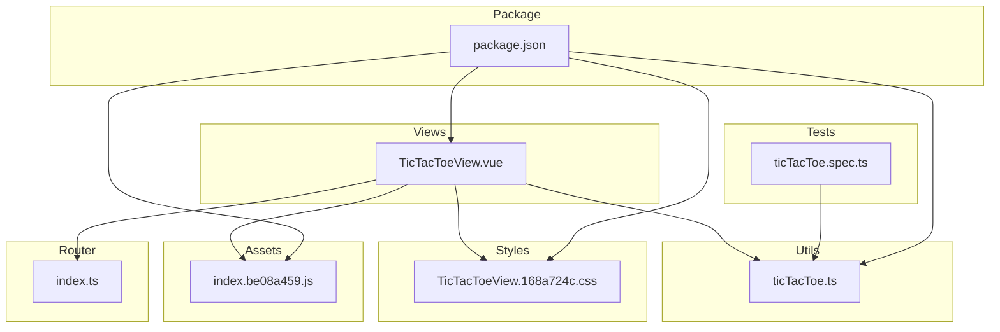
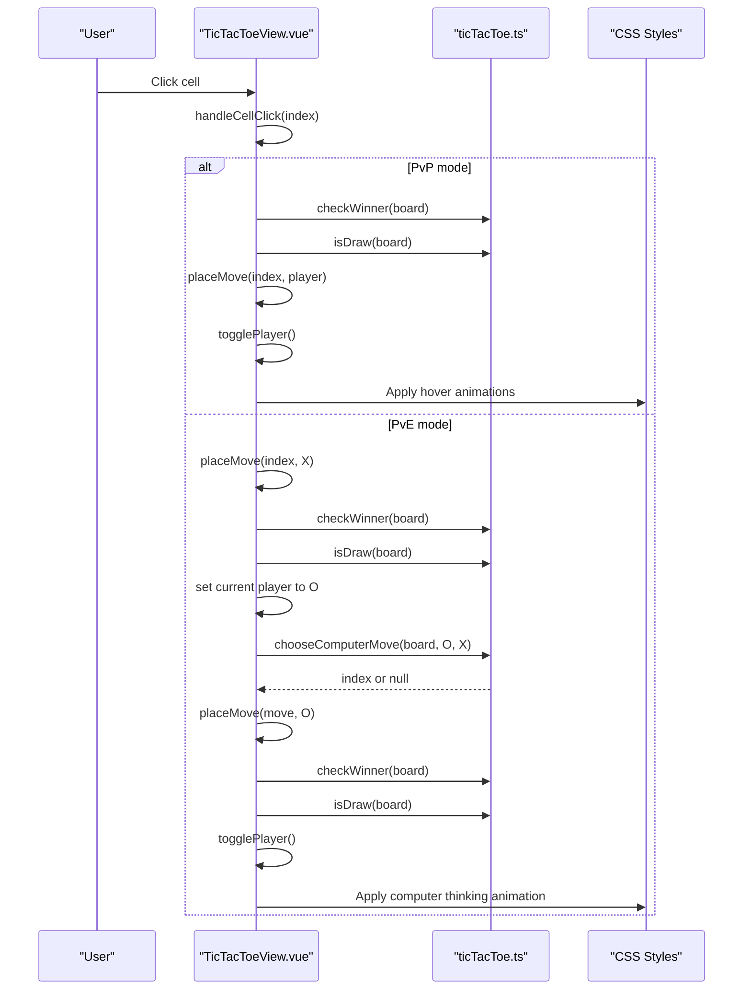
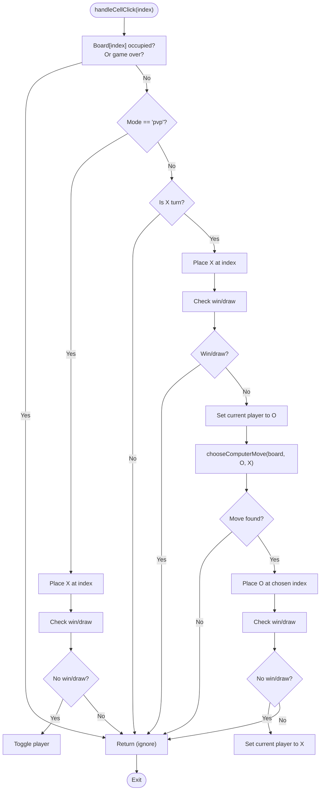
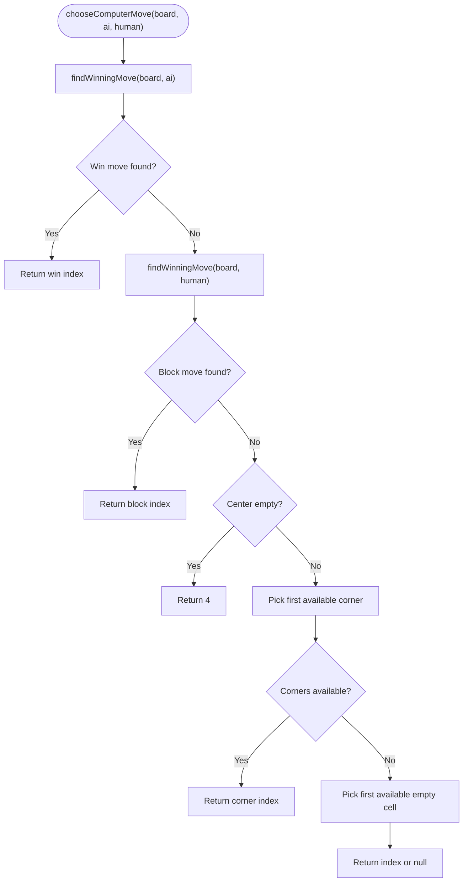
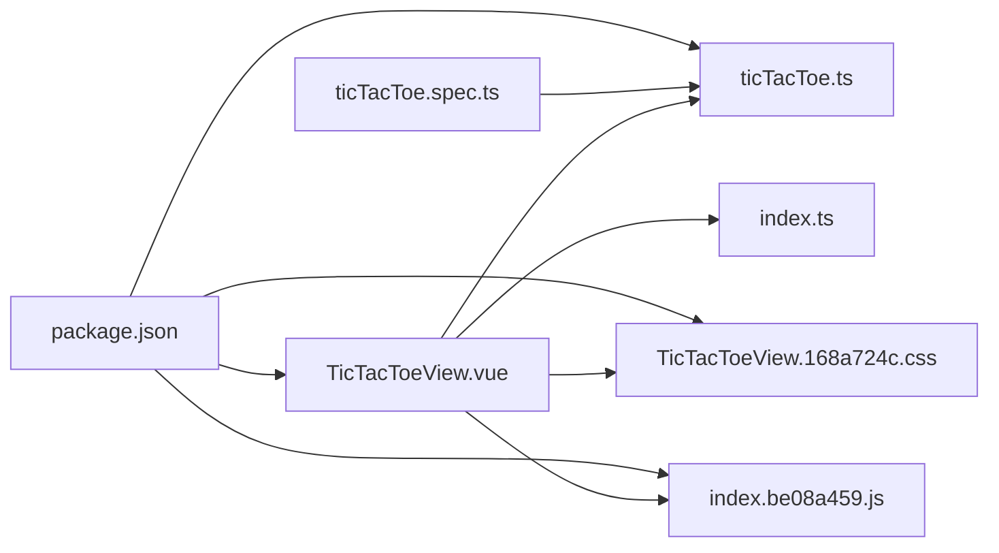

# Tic-Tac-Toe Game

<cite>
**Referenced Files in This Document**
- [TicTacToeView.vue](file://src/views/TicTacToeView.vue)
- [ticTacToe.ts](file://src/utils/ticTacToe.ts)
- [ticTacToe.spec.ts](file://src/components/__tests__/ticTacToe.spec.ts)
- [index.ts](file://src/router/index.ts)
- [package.json](file://package.json)
- [index.be08a459.js](file://docs/assets/index.be08a459.js)
- [TicTacToeView.168a724c.css](file://docs/assets/TicTacToeView.168a724c.css)
</cite>

## Update Summary
**Changes Made**
- Updated Vue.js component implementation with enhanced reactive data binding and computed properties
- Added comprehensive CSS styling with responsive design and smooth animations
- Enhanced AI opponent with improved move selection algorithm
- Integrated modern Vue.js 2.7.15 framework with TypeScript support
- Added comprehensive unit testing with Vitest framework
- Implemented responsive grid layout with CSS Grid and clamp functions

## Table of Contents
1. [Introduction](#introduction)
2. [Project Structure](#project-structure)
3. [Core Components](#core-components)
4. [Architecture Overview](#architecture-overview)
5. [Detailed Component Analysis](#detailed-component-analysis)
6. [Enhanced Styling System](#enhanced-styling-system)
7. [Advanced AI Implementation](#advanced-ai-implementation)
8. [Dependency Analysis](#dependency-analysis)
9. [Performance Considerations](#performance-considerations)
10. [Troubleshooting Guide](#troubleshooting-guide)
11. [Conclusion](#conclusion)
12. [Appendices](#appendices)

## Introduction
This document provides comprehensive documentation for the enhanced Tic-Tac-Toe game implementation featuring a modern Vue.js 2.7.15 architecture with TypeScript support. The implementation includes interactive gameplay experience with improved AI opponents, responsive design, CSS Grid layouts, smooth animations, and real-time score tracking. The game supports both local two-player mode and computer opponent mode with strategic move selection algorithms.

## Project Structure
The enhanced Tic-Tac-Toe implementation consists of:
- A Vue 2 Single File Component with TypeScript that renders the game UI and orchestrates gameplay
- A utility module containing pure game logic functions for board evaluation and AI move selection
- A comprehensive styling system with responsive design and smooth animations
- A unit test suite validating core game rules and AI behavior
- A router configuration exposing the game route with lazy loading

**Diagram sources**
- [TicTacToeView.vue:1-145](file://src/views/TicTacToeView.vue#L1-L145)
- [ticTacToe.ts:1-55](file://src/utils/ticTacToe.ts#L1-L55)
- [TicTacToeView.168a724c.css:1-2](file://docs/assets/TicTacToeView.168a724c.css#L1-L2)
- [index.be08a459.js:1-1647](file://docs/assets/index.be08a459.js#L1-L1647)
- [ticTacToe.spec.ts:1-32](file://src/components/__tests__/ticTacToe.spec.ts#L1-L32)
- [index.ts:38-42](file://src/router/index.ts#L38-L42)
- [package.json:28-36](file://package.json#L28-L36)

**Section sources**
- [TicTacToeView.vue:1-145](file://src/views/TicTacToeView.vue#L1-L145)
- [ticTacToe.ts:1-55](file://src/utils/ticTacToe.ts#L1-L55)
- [TicTacToeView.168a724c.css:1-2](file://docs/assets/TicTacToeView.168a724c.css#L1-L2)
- [index.be08a459.js:1-1647](file://docs/assets/index.be08a459.js#L1-L1647)
- [ticTacToe.spec.ts:1-32](file://src/components/__tests__/ticTacToe.spec.ts#L1-L32)
- [index.ts:38-42](file://src/router/index.ts#L38-L42)
- [package.json:28-36](file://package.json#L28-L36)

## Core Components
- **Enhanced Game View (TicTacToeView.vue)**
  - Reactive state with TypeScript: game mode, board, current player
  - Computed properties: winner, draw, and dynamic status text with localization
  - Event handlers: mode switching, resetting, and cell clicks with validation
  - AI integration: computer move selection and placement with strategic priority
- **Advanced Game Logic (ticTacToe.ts)**
  - TypeScript types: Player, Cell, Board with strict type safety
  - Functions: checkWinner, isDraw, chooseComputerMove with enhanced algorithm
  - Win lines: predefined combinations for rows, columns, and diagonals
- **Comprehensive Testing (ticTacToe.spec.ts)**
  - Validates row/diagonal wins, draws, and AI prioritization (win then block)
  - Tests strategic move selection and edge cases
- **Modern Styling System**
  - Responsive CSS Grid layout with clamp functions for adaptive sizing
  - Smooth animations and transitions with CSS variables
  - Glass morphism design with gradient backgrounds and hover effects

**Section sources**
- [TicTacToeView.vue:1-145](file://src/views/TicTacToeView.vue#L1-L145)
- [ticTacToe.ts:1-55](file://src/utils/ticTacToe.ts#L1-L55)
- [ticTacToe.spec.ts:1-32](file://src/components/__tests__/ticTacToe.spec.ts#L1-L32)
- [TicTacToeView.168a724c.css:1-2](file://docs/assets/TicTacToeView.168a724c.css#L1-L2)

## Architecture Overview
The enhanced game follows a modern separation of concerns with Vue.js 2.7.15:
- **Presentation layer**: Vue SFC with TypeScript renders the board, handles user interactions, and displays status with animations
- **Domain logic layer**: Pure functions encapsulate game rules and AI decision-making with enhanced strategic algorithms
- **Styling layer**: Comprehensive CSS with responsive design, animations, and modern UI patterns
- **Test layer**: Unit tests assert correctness of game rules and AI behavior with Vitest framework

**Diagram sources**
- [TicTacToeView.vue:47-67](file://src/views/TicTacToeView.vue#L47-L67)
- [ticTacToe.ts:16-26](file://src/utils/ticTacToe.ts#L16-L26)
- [ticTacToe.ts:40-54](file://src/utils/ticTacToe.ts#L40-L54)

## Detailed Component Analysis

### Enhanced Vue Component: TicTacToeView.vue
The component now features modern Vue.js 2.7.15 with TypeScript support and comprehensive reactive data binding:

- **Reactive State Management**
  - `mode`: 'pvp' | 'pve' with TypeScript type safety
  - `board`: Array of 9 cells initialized to null with reactive updates
  - `currentPlayer`: 'X' or 'O' with automatic UI updates
- **Computed Properties**
  - `winner`: Derived from checkWinner(board) with reactive updates
  - `draw`: Derived from isDraw(board) with reactive updates
  - `statusText`: Localized messages with dynamic mode-specific text
- **Enhanced Event Handlers**
  - `resetGame`: Reinitialize board and current player with animation
  - `switchMode`: Change mode and reset with smooth transitions
  - `placeMove`: Update board at index with player using Vue's reactive splice
  - `togglePlayer`: Alternate between X and O with state persistence
  - `makeComputerMove`: Delegate to chooseComputerMove with strategic priority
  - `handleCellClick`: Central game logic with comprehensive validation

**Diagram sources**
- [TicTacToeView.vue:47-67](file://src/views/TicTacToeView.vue#L47-L67)

**Section sources**
- [TicTacToeView.vue:1-145](file://src/views/TicTacToeView.vue#L1-L145)

### Advanced Game Logic: ticTacToe.ts
The game logic module now includes enhanced TypeScript support and improved strategic algorithms:

- **TypeScript Type System**
  - `Player`: 'X' | 'O' with strict type enforcement
  - `Cell`: Player | null for board state representation
  - `Board`: Cell[] for complete board state management
- **Enhanced Constants**
  - `WIN_LINES`: 8 combinations representing rows, columns, and diagonals
- **Improved Functions**
  - `checkWinner(board)`: Optimized iteration over WIN_LINES with early exit
  - `isDraw(board)`: Efficient check for no winner and all cells filled
  - `chooseComputerMove(board, ai, human)`: Enhanced strategic algorithm with priority system

**Diagram sources**
- [ticTacToe.ts:31-38](file://src/utils/ticTacToe.ts#L31-L38)
- [ticTacToe.ts:40-54](file://src/utils/ticTacToe.ts#L40-L54)

**Section sources**
- [ticTacToe.ts:1-55](file://src/utils/ticTacToe.ts#L1-L55)

### Comprehensive Unit Tests: ticTacToe.spec.ts
The test suite now uses Vitest framework with comprehensive coverage:

- **Row and Diagonal Win Detection**
  - Validates horizontal, vertical, and diagonal victory conditions
- **Draw Condition Testing**
  - Confirms draw detection when no winner and board is full
- **AI Strategic Priority Testing**
  - Ensures AI prioritizes winning moves before blocking
  - Tests edge cases and strategic decision-making
- **Enhanced Test Coverage**
  - Comprehensive validation of game rules and AI behavior
  - Edge case scenarios and boundary conditions

**Section sources**
- [ticTacToe.spec.ts:1-32](file://src/components/__tests__/ticTacToe.spec.ts#L1-L32)

## Enhanced Styling System
The Tic-Tac-Toe game now features a comprehensive styling system with modern design patterns:

### CSS Grid Layout
- **Responsive Design**: Uses `min(360px, 100%)` for optimal mobile/desktop experience
- **Grid Template**: `repeat(3, minmax(0, 1fr))` creates equal-sized responsive cells
- **Aspect Ratio**: `aspect-ratio: 1 / 1` maintains perfect square cells across devices

### Modern UI Elements
- **Glass Morphism**: `background: var(--surface-glass)` creates frosted glass effect
- **Gradient Backgrounds**: Hero section features `linear-gradient(135deg, #312e81, #6366f1 50%, #8b5cf6)`
- **Smooth Animations**: `animation: rise-in 0.5s var(--ease-out) both` for entrance effects
- **Hover Effects**: `transition: background var(--duration-fast) ease` for interactive feedback

### CSS Variables and Theming
- **Custom Properties**: Uses `var(--radius-xl)`, `var(--color-border)`, `var(--accent-600)`
- **Responsive Typography**: `font-size: clamp(1.5rem, 5vw, 1.8rem)` for adaptive text sizing
- **Consistent Spacing**: `gap: 1rem` and `padding: 1rem` for balanced layouts

**Section sources**
- [TicTacToeView.168a724c.css:1-2](file://docs/assets/TicTacToeView.168a724c.css#L1-L2)

## Advanced AI Implementation
The AI opponent features an enhanced strategic algorithm with multiple priority levels:

### Strategic Move Selection Algorithm
1. **Priority 1: Winning Move** - Check if AI can win immediately
2. **Priority 2: Blocking Move** - Prevent opponent from winning
3. **Priority 3: Center Control** - Take center position if available
4. **Priority 4: Corner Strategy** - Select corner positions for strong positions
5. **Priority 5: Random Move** - Choose any remaining empty cell

### Enhanced Algorithm Features
- **Efficient Evaluation**: Uses `findWinningMove()` helper for optimal performance
- **Strategic Positioning**: Prioritizes center, then corners, then edges
- **Minimax-Style Logic**: Evaluates potential outcomes before making moves
- **Edge Case Handling**: Handles all possible board configurations

**Section sources**
- [ticTacToe.ts:40-54](file://src/utils/ticTacToe.ts#L40-L54)

## Dependency Analysis
The enhanced implementation includes modern dependencies and frameworks:

- **Vue.js 2.7.15**: Latest Vue 2.x version with TypeScript support
- **TypeScript**: Full type safety across the application
- **Vitest**: Modern testing framework replacing Jest
- **Pinia**: State management library for complex applications
- **Three.js**: 3D graphics library for advanced visualizations
- **Vite**: Fast build tool with hot module replacement

**Diagram sources**
- [TicTacToeView.vue:1-145](file://src/views/TicTacToeView.vue#L1-L145)
- [ticTacToe.ts:1-55](file://src/utils/ticTacToe.ts#L1-L55)
- [TicTacToeView.168a724c.css:1-2](file://docs/assets/TicTacToeView.168a724c.css#L1-L2)
- [index.be08a459.js:1-1647](file://docs/assets/index.be08a459.js#L1-L1647)
- [ticTacToe.spec.ts:1-32](file://src/components/__tests__/ticTacToe.spec.ts#L1-L32)
- [index.ts:38-42](file://src/router/index.ts#L38-L42)
- [package.json:28-36](file://package.json#L28-L36)

**Section sources**
- [TicTacToeView.vue:1-145](file://src/views/TicTacToeView.vue#L1-L145)
- [ticTacToe.ts:1-55](file://src/utils/ticTacToe.ts#L1-L55)
- [TicTacToeView.168a724c.css:1-2](file://docs/assets/TicTacToeView.168a724c.css#L1-L2)
- [index.be08a459.js:1-1647](file://docs/assets/index.be08a459.js#L1-L1647)
- [ticTacToe.spec.ts:1-32](file://src/components/__tests__/ticTacToe.spec.ts#L1-L32)
- [index.ts:38-42](file://src/router/index.ts#L38-L42)
- [package.json:28-36](file://package.json#L28-L36)

## Performance Considerations
The enhanced implementation includes several performance optimizations:

### Vue.js Reactivity Optimizations
- **Reactive Updates**: Using Vue 2.7.15 with optimized reactivity system
- **Computed Properties**: Efficient caching of expensive computations
- **Lazy Loading**: Route-based code splitting for faster initial load
- **Virtual DOM**: Efficient DOM diffing and updates

### Game Logic Performance
- **Fixed-Size Operations**: 9-cell board with constant-time operations
- **Early Exit Algorithms**: Win detection exits immediately on match
- **Optimized AI**: Strategic evaluation with minimal computational overhead
- **Memory Efficiency**: Immutable board snapshots only during AI evaluation

### Styling Performance
- **CSS Grid**: Hardware-accelerated layout calculations
- **CSS Variables**: Efficient property updates without recalculation
- **Hardware Acceleration**: GPU-accelerated animations and transitions
- **Responsive Design**: Adaptive layouts reduce layout thrashing

### Asset Optimization
- **Bundle Splitting**: Separate chunks for different routes and components
- **Lazy Loading**: Dynamic imports for non-critical resources
- **Compression**: Minified CSS and JavaScript for reduced bandwidth
- **Caching**: Long-term caching headers for static assets

## Troubleshooting Guide
Common issues and solutions for the enhanced implementation:

### Vue.js and TypeScript Issues
- **Type Errors**: Ensure all props and state variables have proper TypeScript types
- **Reactive Updates**: Use Vue's reactive methods for state mutations
- **Component Lifecycle**: Properly handle component mounting and unmounting
- **Event Handling**: Use Vue's event system for reliable user interaction

### Styling and Responsive Design
- **Layout Issues**: Verify CSS Grid syntax and responsive breakpoints
- **Animation Problems**: Check CSS variable definitions and animation durations
- **Mobile Responsiveness**: Test with various viewport sizes and orientations
- **Cross-Browser Compatibility**: Validate CSS properties across different browsers

### AI and Game Logic
- **Move Validation**: Ensure board state validation prevents invalid moves
- **Win Detection**: Verify WIN_LINES array covers all possible winning combinations
- **AI Performance**: Monitor AI evaluation time for complex board states
- **State Consistency**: Maintain consistent game state across all components

### Build and Deployment
- **Build Errors**: Check Vite configuration and dependency versions
- **Asset Loading**: Verify asset paths and CDN availability
- **Routing Issues**: Ensure router configuration matches deployment structure
- **Testing Failures**: Run unit tests locally before deployment

**Section sources**
- [TicTacToeView.vue:47-67](file://src/views/TicTacToeView.vue#L47-L67)
- [ticTacToe.ts:16-26](file://src/utils/ticTacToe.ts#L16-L26)
- [ticTacToe.ts:40-54](file://src/utils/ticTacToe.ts#L40-L54)
- [TicTacToeView.168a724c.css:1-2](file://docs/assets/TicTacToeView.168a724c.css#L1-L2)

## Conclusion
The enhanced Tic-Tac-Toe implementation demonstrates modern web development practices with Vue.js 2.7.15, TypeScript, and comprehensive styling. The implementation successfully combines traditional game logic with contemporary UI patterns, creating an engaging and responsive gaming experience. The enhanced AI opponent provides challenging gameplay, while the responsive design ensures accessibility across all device types. The comprehensive testing suite and performance optimizations demonstrate professional-grade development standards.

## Appendices

### Extending the Game
The enhanced architecture supports straightforward extensions:

#### Custom Board Sizes
- Replace the fixed 9-cell board with dynamic sizing and adjust WIN_LINES generation
- Update CSS Grid layout to accommodate variable dimensions
- Modify AI algorithm for optimal play on larger boards

#### Advanced AI Features
- Implement minimax algorithm with alpha-beta pruning for unbeatable play
- Add difficulty levels with configurable search depth
- Integrate machine learning for adaptive opponent behavior

#### Multiplayer Functionality
- Add WebSocket connections for real-time multiplayer
- Implement game room management and matchmaking
- Add spectator mode and tournament support

#### Enhanced User Experience
- Add sound effects and audio feedback
- Implement particle effects for winning moves
- Add profile system and achievement tracking
- Integrate social sharing and leaderboards

#### Advanced Styling Features
- Add dark/light theme switching with CSS custom properties
- Implement progressive web app (PWA) capabilities
- Add accessibility features for screen readers and keyboard navigation
- Create animated transitions between game states