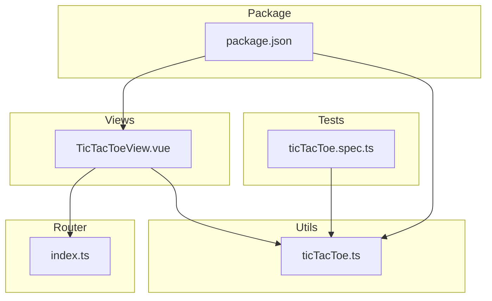
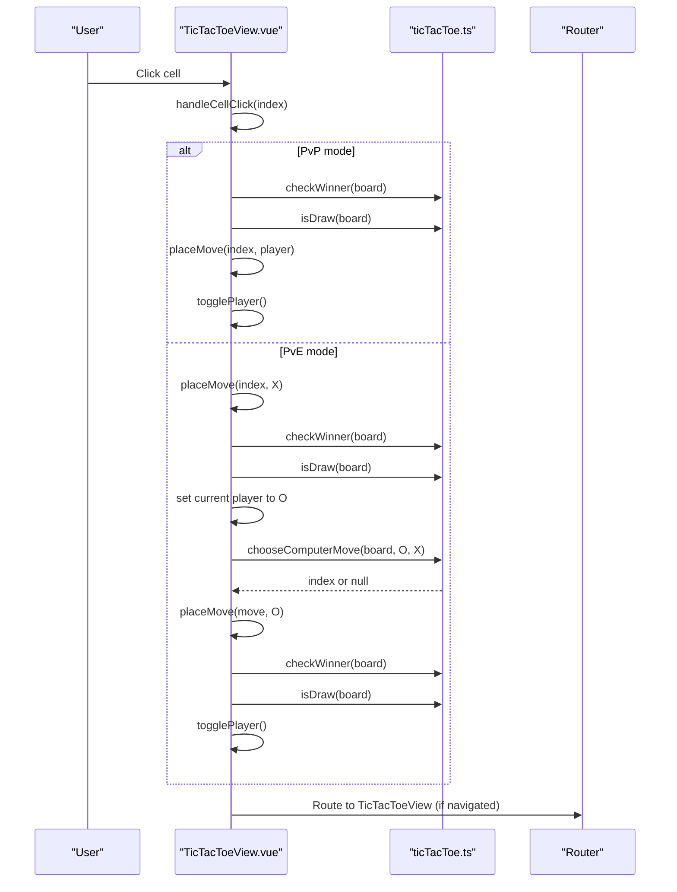
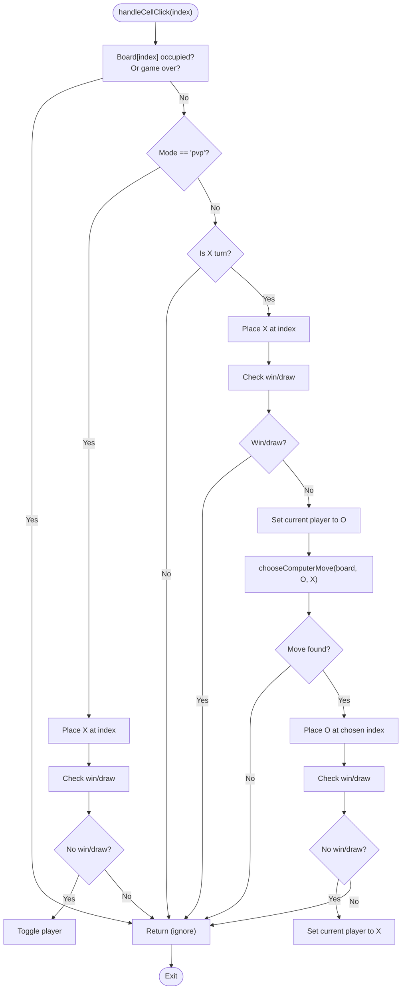
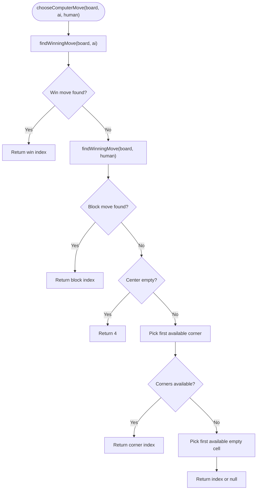
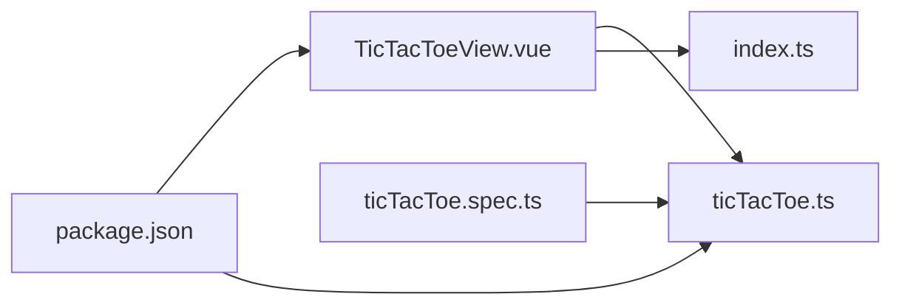

# Tic-Tac-Toe Game

<cite>
**Referenced Files in This Document**
- [TicTacToeView.vue](file://src/views/TicTacToeView.vue)
- [ticTacToe.ts](file://src/utils/ticTacToe.ts)
- [ticTacToe.spec.ts](file://src/components/__tests__/ticTacToe.spec.ts)
- [index.ts](file://src/router/index.ts)
- [package.json](file://package.json)
</cite>

## Table of Contents
1. [Introduction](#introduction)
2. [Project Structure](#project-structure)
3. [Core Components](#core-components)
4. [Architecture Overview](#architecture-overview)
5. [Detailed Component Analysis](#detailed-component-analysis)
6. [Dependency Analysis](#dependency-analysis)
7. [Performance Considerations](#performance-considerations)
8. [Troubleshooting Guide](#troubleshooting-guide)
9. [Conclusion](#conclusion)
10. [Appendices](#appendices)

## Introduction
This document provides comprehensive documentation for the Tic-Tac-Toe game implementation in a Vue.js project. It covers game logic (board state management, win/draw detection, turn alternation, and status tracking), the Vue component architecture (reactive data binding, computed properties, and event handlers), the AI strategy (including a simplified heuristic-based computer opponent), and practical guidance for extending the game with new features such as custom board sizes, difficulty levels, and multiplayer capabilities. It also includes performance considerations and user experience enhancements.

## Project Structure
The Tic-Tac-Toe implementation consists of:
- A Vue 2 Single File Component that renders the game UI and orchestrates gameplay.
- A utility module containing pure game logic functions for board evaluation and AI move selection.
- A unit test suite validating core game rules and AI behavior.
- A router configuration exposing the game route.

**Diagram sources**
- [TicTacToeView.vue:1-181](file://src/views/TicTacToeView.vue#L1-L181)
- [ticTacToe.ts:1-55](file://src/utils/ticTacToe.ts#L1-L55)
- [ticTacToe.spec.ts:1-32](file://src/components/__tests__/ticTacToe.spec.ts#L1-L32)
- [index.ts:38-42](file://src/router/index.ts#L38-L42)
- [package.json:28-32](file://package.json#L28-L32)

**Section sources**
- [TicTacToeView.vue:1-181](file://src/views/TicTacToeView.vue#L1-L181)
- [ticTacToe.ts:1-55](file://src/utils/ticTacToe.ts#L1-L55)
- [ticTacToe.spec.ts:1-32](file://src/components/__tests__/ticTacToe.spec.ts#L1-L32)
- [index.ts:38-42](file://src/router/index.ts#L38-L42)
- [package.json:28-32](file://package.json#L28-L32)

## Core Components
- Game View (TicTacToeView.vue)
  - Reactive state: game mode, board, current player.
  - Computed properties: winner, draw, and dynamic status text.
  - Event handlers: mode switching, resetting, and cell clicks.
  - AI integration: computer move selection and placement.
- Game Logic (ticTacToe.ts)
  - Types: Player, Cell, Board.
  - Functions: checkWinner, isDraw, chooseComputerMove.
  - Win lines: predefined combinations for rows, columns, and diagonals.
- Tests (ticTacToe.spec.ts)
  - Validates row/diagonal wins, draws, and AI prioritization (win then block).

**Section sources**
- [TicTacToeView.vue:1-181](file://src/views/TicTacToeView.vue#L1-L181)
- [ticTacToe.ts:1-55](file://src/utils/ticTacToe.ts#L1-L55)
- [ticTacToe.spec.ts:1-32](file://src/components/__tests__/ticTacToe.spec.ts#L1-L32)

## Architecture Overview
The game follows a clean separation of concerns:
- Presentation layer: Vue SFC renders the board, handles user interactions, and displays status.
- Domain logic layer: Pure functions encapsulate game rules and AI decision-making.
- Test layer: Unit tests assert correctness of game rules and AI behavior.

**Diagram sources**
- [TicTacToeView.vue:47-67](file://src/views/TicTacToeView.vue#L47-L67)
- [ticTacToe.ts:16-26](file://src/utils/ticTacToe.ts#L16-L26)
- [ticTacToe.ts:40-54](file://src/utils/ticTacToe.ts#L40-L54)
- [index.ts:38-42](file://src/router/index.ts#L38-L42)

## Detailed Component Analysis

### Vue Component: TicTacToeView.vue
- Reactive state
  - mode: 'pvp' | 'pve'
  - board: array of 9 cells initialized to null
  - currentPlayer: 'X' or 'O'
- Computed properties
  - winner: derived from checkWinner(board)
  - draw: derived from isDraw(board)
  - statusText: localized messages based on game state and mode
- Event handlers
  - resetGame: reinitialize board and current player
  - switchMode: change mode and reset
  - placeMove: update board at index with player
  - togglePlayer: alternate between X and O
  - makeComputerMove: delegate to chooseComputerMove and place the move
  - handleCellClick: central game logic for both PvP and PvE modes

**Diagram sources**
- [TicTacToeView.vue:47-67](file://src/views/TicTacToeView.vue#L47-L67)

**Section sources**
- [TicTacToeView.vue:1-181](file://src/views/TicTacToeView.vue#L1-L181)

### Game Logic: ticTacToe.ts
- Types
  - Player: 'X' | 'O'
  - Cell: Player | null
  - Board: Cell[]
- Constants
  - WIN_LINES: 8 combinations representing rows, columns, and diagonals
- Functions
  - checkWinner(board): iterate over WIN_LINES to detect a three-in-a-row
  - isDraw(board): true if no winner and all cells filled
  - chooseComputerMove(board, ai, human):
    - Prefer winning move for ai
    - Else block opponent's winning move
    - Else take center if available
    - Else take a corner if available
    - Else pick any remaining empty cell

**Diagram sources**
- [ticTacToe.ts:31-38](file://src/utils/ticTacToe.ts#L31-L38)
- [ticTacToe.ts:40-54](file://src/utils/ticTacToe.ts#L40-L54)

**Section sources**
- [ticTacToe.ts:1-55](file://src/utils/ticTacToe.ts#L1-L55)

### Unit Tests: ticTacToe.spec.ts
- Validates row and diagonal wins
- Confirms draw detection when no winner and board full
- Ensures AI prioritizes winning moves before blocking
- Demonstrates expected behavior for strategic move selection

**Section sources**
- [ticTacToe.spec.ts:1-32](file://src/components/__tests__/ticTacToe.spec.ts#L1-L32)

## Dependency Analysis
- TicTacToeView.vue depends on:
  - ticTacToe.ts for game rules and AI move selection
  - Router for navigation to the game route
- ticTacToe.ts is a pure module with no external dependencies
- Tests depend on ticTacToe.ts exports

**Diagram sources**
- [TicTacToeView.vue:4-5](file://src/views/TicTacToeView.vue#L4-L5)
- [ticTacToe.ts:1-55](file://src/utils/ticTacToe.ts#L1-L55)
- [ticTacToe.spec.ts](file://src/components/__tests__/ticTacToe.spec.ts#L3)
- [index.ts:38-42](file://src/router/index.ts#L38-L42)
- [package.json:28-32](file://package.json#L28-L32)

**Section sources**
- [TicTacToeView.vue:4-5](file://src/views/TicTacToeView.vue#L4-L5)
- [ticTacToe.ts:1-55](file://src/utils/ticTacToe.ts#L1-L55)
- [ticTacToe.spec.ts](file://src/components/__tests__/ticTacToe.spec.ts#L3)
- [index.ts:38-42](file://src/router/index.ts#L38-L42)
- [package.json:28-32](file://package.json#L28-L32)

## Performance Considerations
- Board representation
  - Fixed-size 9-cell array simplifies indexing and reduces overhead.
- Win detection
  - Constant-time scan over 8 lines with early exit on match.
- Draw detection
  - Single pass to confirm no winner and all cells filled.
- AI move selection
  - Linear scans over empty cells and fixed-length win lines; negligible cost for 3x3 boards.
- Vue reactivity
  - Using splice to update a single index is efficient; consider immutable updates if broader state changes occur.
- Rendering
  - Grid layout with 3x3 buttons; minimal DOM nodes and simple template rendering.

[No sources needed since this section provides general guidance]

## Troubleshooting Guide
- Game does not respond to clicks
  - Ensure the cell is empty and the game is not over (winner or draw).
  - Verify mode conditions and player turn checks in handleCellClick.
- AI does not block or win
  - Confirm chooseComputerMove returns a valid index and placeMove is invoked.
  - Review findWinningMove logic and WIN_LINES correctness.
- Status text not updating
  - Check computed properties for winner, draw, and statusText logic.
- Reset not working
  - Ensure resetGame reinitializes board and sets current player to 'X'.

**Section sources**
- [TicTacToeView.vue:47-67](file://src/views/TicTacToeView.vue#L47-L67)
- [ticTacToe.ts:16-26](file://src/utils/ticTacToe.ts#L16-L26)
- [ticTacToe.ts:40-54](file://src/utils/ticTacToe.ts#L40-L54)

## Conclusion
The Tic-Tac-Toe implementation cleanly separates presentation and logic, leveraging Vue’s reactive system for UI updates and pure functions for deterministic game rules and AI behavior. The current AI employs a simple heuristic prioritizing immediate wins, blocking threats, center control, and corner positioning. The architecture supports straightforward extensions for larger boards, configurable difficulty, and multiplayer features while maintaining readability and testability.

[No sources needed since this section summarizes without analyzing specific files]

## Appendices

### Extending the Game
- Custom board sizes
  - Replace the fixed 9-cell board with a dynamic size and adjust WIN_LINES generation to match the new dimension.
  - Update render loop to reflect grid size and adjust CSS grid-template-columns accordingly.
- Difficulty levels
  - Introduce a configurable depth or randomness factor in AI move selection to vary strategy strength.
- Multiplayer functionality
  - Add real-time synchronization via a backend or shared state mechanism; manage turn order and state consistency server-side.
- Additional UX enhancements
  - Animations for move transitions, sound effects, and visual indicators for winning lines.
  - Persistent scores and game history storage.

[No sources needed since this section provides general guidance]