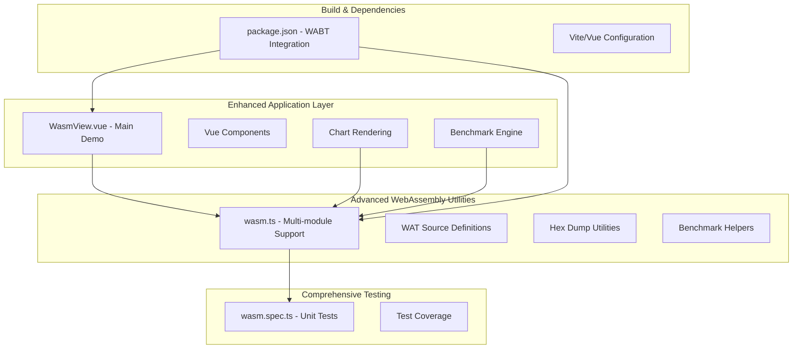
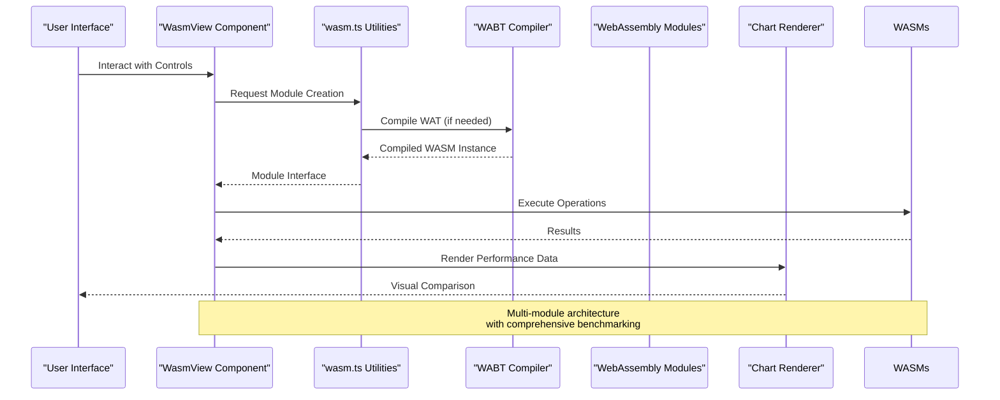
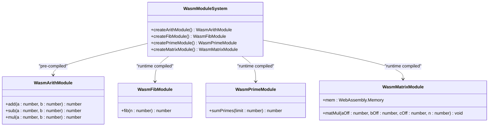
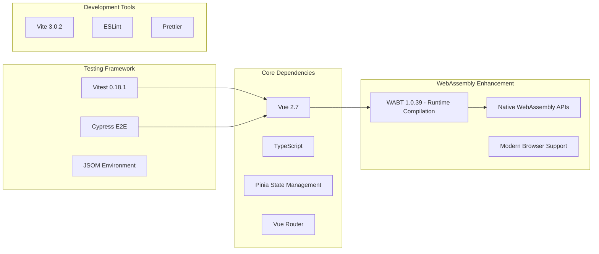

# WebAssembly Arithmetic Calculator

<cite>
**Referenced Files in This Document**
- [wasm.ts](file://src/utils/wasm.ts)
- [WasmView.vue](file://src/views/WasmView.vue)
- [wasm.spec.ts](file://src/components/__tests__/wasm.spec.ts)
- [package.json](file://package.json)
- [README.md](file://README.md)
</cite>

## Update Summary
**Changes Made**
- Enhanced WasmView.vue with comprehensive performance benchmarking capabilities
- Added support for four different WebAssembly modules (arithmetic, Fibonacci, prime sieve, matrix multiplication)
- Implemented real-time visualization of benchmark results with charts and tables
- Added WAT source code viewer with syntax highlighting and legends
- Integrated hex dump functionality for WebAssembly binary inspection
- Expanded testing coverage for all new features

## Table of Contents
1. [Introduction](#introduction)
2. [Project Structure](#project-structure)
3. [Core Components](#core-components)
4. [Architecture Overview](#architecture-overview)
5. [Detailed Component Analysis](#detailed-component-analysis)
6. [Enhanced Performance Benchmarking](#enhanced-performance-benchmarking)
7. [WebAssembly Module Integration](#webassembly-module-integration)
8. [Interactive Demo Features](#interactive-demo-features)
9. [Dependency Analysis](#dependency-analysis)
10. [Performance Considerations](#performance-considerations)
11. [Troubleshooting Guide](#troubleshooting-guide)
12. [Security and Compatibility](#security-and-compatibility)
13. [Extensibility Guide](#extensibility-guide)
14. [Conclusion](#conclusion)

## Introduction
This document provides comprehensive documentation for the WebAssembly Arithmetic Calculator, a sophisticated demonstration project showcasing advanced WebAssembly module compilation, JavaScript integration, and comprehensive performance benchmarking. The project now features:

- **Multi-module WebAssembly support**: Four distinct modules (arithmetic, Fibonacci, prime sieve, matrix multiplication)
- **Real-time performance comparison**: Side-by-side JavaScript vs WebAssembly benchmarking
- **Interactive WAT source viewer**: Human-readable WebAssembly Text Format with syntax highlighting
- **Hex dump inspection**: Raw WebAssembly binary analysis capabilities
- **Visual benchmark results**: Chart-based performance comparison visualization
- **Comprehensive testing suite**: Unit tests covering all mathematical operations and utilities

The calculator demonstrates advanced WebAssembly integration patterns, including runtime compilation via WABT, memory management, and performance optimization techniques.

## Project Structure
The project follows a modular architecture with clear separation between WebAssembly utilities, Vue components, and comprehensive testing:

**Diagram sources**
- [WasmView.vue:1-424](file://src/views/WasmView.vue#L1-L424)
- [wasm.ts:1-298](file://src/utils/wasm.ts#L1-L298)
- [wasm.spec.ts:1-145](file://src/components/__tests__/wasm.spec.ts#L1-L145)

**Section sources**
- [README.md:1-60](file://README.md#L1-L60)
- [package.json:1-65](file://package.json#L1-L65)

## Core Components
The WebAssembly Arithmetic Calculator now consists of five primary components with enhanced functionality:

### Enhanced WebAssembly Module System
The calculator now supports four distinct WebAssembly modules:

#### Arithmetic Module (Pre-compiled)
- **Location**: Embedded as Uint8Array constant
- **Operations**: add, sub, mul on 32-bit integers
- **Compilation**: Direct instantiation from pre-compiled bytes
- **Use Case**: Basic arithmetic operations benchmarking

#### WAT-Based Modules (Runtime Compilation)
- **Fibonacci Module**: Iterative Fibonacci calculation with loop structures
- **Prime Sieve Module**: Sum of primes calculation with nested loops
- **Matrix Multiplication Module**: Linear memory operations with i32.load/store
- **Compilation**: Runtime compilation via WABT (WebAssembly Binary Toolkit)

### Advanced JavaScript Integration Utilities
The wasm.ts module provides comprehensive multi-module support:

#### Module Creation Functions
- `createArithModule()`: Pre-compiled arithmetic operations
- `createFibModule()`: Runtime-compiled Fibonacci calculator
- `createPrimeModule()`: Runtime-compiled prime sum calculator
- `createMatrixModule()`: Runtime-compiled matrix multiplier

#### Enhanced Benchmarking System
- `benchmark()`: Named performance measurement utility
- `wasmMatrixMul()`: Advanced matrix multiplication with memory management
- `hexDump()`: Binary inspection utility for debugging

#### Mathematical Reference Implementations
- Pure JavaScript equivalents for validation and comparison
- Deterministic matrix creation utilities
- Comprehensive algorithm implementations

### Interactive Vue Integration Components
The WasmView.vue component now provides a comprehensive demonstration platform:

#### Real-Time Arithmetic Operations
- Interactive input fields for A and B values
- Live comparison of WebAssembly vs JavaScript results
- Visual result grids with color-coded outputs

#### Advanced Performance Benchmarking
- Configurable benchmark parameters (Fibonacci N, prime limits, matrix sizes)
- Multi-category performance comparison (Fibonacci, primes, matrix, arithmetic)
- Real-time chart rendering with performance metrics
- Winner determination and visual indicators

#### Educational Features
- WAT source code viewer with tabbed interface
- Hex dump inspection of WebAssembly binaries
- Syntax highlighting and legend explanations
- Step-by-step loading progress indication

**Section sources**
- [wasm.ts:39-48](file://src/utils/wasm.ts#L39-L48)
- [wasm.ts:101-107](file://src/utils/wasm.ts#L101-L107)
- [wasm.ts:156-159](file://src/utils/wasm.ts#L156-L159)
- [WasmView.vue:22-31](file://src/views/WasmView.vue#L22-L31)
- [WasmView.vue:32-44](file://src/views/WasmView.vue#L32-L44)

## Architecture Overview
The enhanced calculator follows a sophisticated multi-module architecture with comprehensive benchmarking capabilities:

**Diagram sources**
- [wasm.ts:163-191](file://src/utils/wasm.ts#L163-L191)
- [WasmView.vue:209-229](file://src/views/WasmView.vue#L209-L229)

The architecture leverages WebAssembly's native execution speed across multiple computational domains while providing comprehensive JavaScript-based visualization and comparison capabilities.

## Detailed Component Analysis

### Enhanced WebAssembly Module Implementation
The calculator now supports four distinct module types with different compilation strategies:

**Diagram sources**
- [wasm.ts:39-43](file://src/utils/wasm.ts#L39-L43)
- [wasm.ts:101-107](file://src/utils/wasm.ts#L101-L107)
- [wasm.ts:156-159](file://src/utils/wasm.ts#L156-L159)

The module system demonstrates different WebAssembly compilation strategies: pre-compiled for simple arithmetic operations, and runtime compilation via WABT for more complex algorithms.

### Advanced JavaScript Integration Patterns
The integration layer has been significantly enhanced to support multi-module operations:

#### Multi-Module Instantiation
The createArithModule(), createFibModule(), createPrimeModule(), and createMatrixModule() functions encapsulate different instantiation strategies, from direct byte instantiation to runtime compilation.

#### Advanced Data Type Conversions
The implementation handles various data types and conversion scenarios:
- **Direct i32 operations**: Simple arithmetic with automatic Number conversion
- **Linear memory access**: Matrix operations with Int32Array buffer manipulation
- **Complex data structures**: Nested arrays with manual memory management

#### Comprehensive Error Handling
The integration includes robust error handling for:
- Module instantiation failures
- Runtime compilation errors via WABT
- Memory allocation issues
- Performance measurement exceptions

**Section sources**
- [wasm.ts:45-48](file://src/utils/wasm.ts#L45-L48)
- [wasm.ts:178-191](file://src/utils/wasm.ts#L178-L191)
- [wasm.ts:195-221](file://src/utils/wasm.ts#L195-L221)

### Interactive Demo Components
The enhanced Vue components provide comprehensive educational and benchmarking capabilities:

#### Advanced Arithmetic Operations Demo
The interactive arithmetic demo now includes:
- Real-time result comparison between WebAssembly and JavaScript
- Configurable input values with immediate feedback
- Visual result grids with performance indicators
- Error handling for invalid inputs

#### Comprehensive Performance Benchmarking
The benchmark system now supports:
- **Fibonacci Benchmark**: Configurable N values with iterative vs recursive comparison
- **Prime Sieve Benchmark**: Variable limits with optimized algorithms
- **Matrix Multiplication Benchmark**: Scalable matrix sizes with memory optimization
- **Arithmetic Loop Benchmark**: Tight loop performance testing

#### Visual Performance Comparison
The chart rendering system provides:
- **Bar charts**: Time comparison visualization with color coding
- **Table format**: Detailed numerical results with winner identification
- **Responsive design**: Adapts to different screen sizes
- **Real-time updates**: Dynamic chart updates during benchmark execution

#### Educational Features
The WAT source viewer and hex dump functionality provide:
- **Syntax highlighting**: Color-coded WAT source code
- **Legend explanations**: i32 types, control flow, and memory operations
- **Binary inspection**: Raw WebAssembly byte analysis
- **Step-by-step loading**: Progress indication for module compilation

**Section sources**
- [WasmView.vue:74-152](file://src/views/WasmView.vue#L74-L152)
- [WasmView.vue:154-206](file://src/views/WasmView.vue#L154-L206)
- [WasmView.vue:265-291](file://src/views/WasmView.vue#L265-L291)

## Enhanced Performance Benchmarking
The calculator now provides comprehensive performance analysis across multiple computational domains:

### Multi-Domain Benchmark Categories
The benchmark system evaluates performance across four distinct computational domains:

#### Fibonacci Calculation
- **Algorithm**: Iterative approach avoiding recursion overhead
- **Parameters**: Configurable N values (5-45)
- **Validation**: JavaScript reference implementation for correctness
- **Performance**: Demonstrates WebAssembly's advantage in tight loops

#### Prime Number Summation
- **Algorithm**: Optimized prime sieve with square root bounds
- **Parameters**: Variable limits (100-500,000)
- **Validation**: JavaScript equivalent with nested loop verification
- **Performance**: Shows WebAssembly's benefit in computational algorithms

#### Matrix Multiplication
- **Algorithm**: Standard triple-nested loop with memory optimization
- **Parameters**: Square matrix sizes (10-200)
- **Memory Management**: Linear memory allocation and access
- **Validation**: JavaScript reference implementation with identical results

#### Arithmetic Operation Loops
- **Algorithm**: Tight loop performing multiple operations
- **Parameters**: Configurable iteration counts (100-100,000)
- **Validation**: JavaScript equivalent with identical operations
- **Performance**: Demonstrates WebAssembly's zero-overhead arithmetic

### Advanced Benchmark Visualization
The performance comparison system provides:

#### Chart-Based Analysis
- **Bar Charts**: Visual time comparison with color coding (green for WASM, blue for JS)
- **Responsive Design**: Adapts to different screen sizes and orientations
- **Dynamic Updates**: Real-time chart updates during benchmark execution
- **Legend Support**: Clear indication of performance categories

#### Detailed Results Table
- **Category Grouping**: Logical grouping of related benchmarks
- **Winner Identification**: Automatic determination of fastest implementation
- **Value Verification**: Result validation for computational accuracy
- **Performance Metrics**: Detailed timing information with milliseconds

#### Configurable Parameters
- **Interactive Controls**: Real-time parameter adjustment
- **Range Validation**: Input validation with sensible defaults
- **Benchmark Control**: Start/stop functionality with loading states
- **Result Persistence**: Results maintained until next benchmark run

**Section sources**
- [WasmView.vue:74-152](file://src/views/WasmView.vue#L74-L152)
- [WasmView.vue:154-206](file://src/views/WasmView.vue#L154-L206)

## WebAssembly Module Integration
The calculator demonstrates advanced WebAssembly integration patterns across multiple modules:

### Pre-compiled vs Runtime Compilation
The module system showcases different compilation strategies:

#### Pre-compiled Modules
- **Arithmetic Module**: Direct instantiation from embedded bytes
- **Advantages**: Fast startup, no compilation overhead
- **Use Cases**: Simple, frequently used operations
- **Implementation**: Direct WebAssembly.instantiate() call

#### Runtime-compiled Modules
- **Fibonacci Module**: WAT source compiled via WABT
- **Prime Module**: Complex algorithm with nested control flow
- **Matrix Module**: Memory-intensive operations with linear access
- **Implementation**: WABT.parseWat() followed by WebAssembly.instantiate()

### Memory Management Strategies
The calculator implements sophisticated memory management:

#### Linear Memory Access
- **Matrix Operations**: Direct memory buffer manipulation
- **Int32Array Integration**: Typed array access to WebAssembly memory
- **Offset Calculations**: Manual memory layout management
- **Bounds Checking**: JavaScript-side validation for safety

#### Memory Optimization
- **Single Allocation**: Reuse of allocated memory across operations
- **Efficient Layout**: Contiguous storage for matrix operations
- **Minimal GC**: Reduced JavaScript object creation
- **Direct Access**: Bypass of JavaScript array overhead

### Error Handling and Validation
The integration includes comprehensive error handling:

#### Module Loading Errors
- **WABT Initialization**: Proper error messages for compilation failures
- **Instantiation Errors**: Validation of module signatures
- **Memory Errors**: Detection of out-of-bounds access attempts
- **Type Errors**: Validation of function parameter types

#### Runtime Validation
- **Result Verification**: Cross-checking between JavaScript and WebAssembly
- **Performance Monitoring**: Detection of unexpected slow-downs
- **Memory Integrity**: Validation of memory access patterns
- **Exception Handling**: Graceful recovery from runtime errors

**Section sources**
- [wasm.ts:24-48](file://src/utils/wasm.ts#L24-L48)
- [wasm.ts:163-191](file://src/utils/wasm.ts#L163-L191)
- [wasm.ts:195-221](file://src/utils/wasm.ts#L195-L221)

## Interactive Demo Features
The enhanced WasmView.vue provides comprehensive interactive features:

### Real-Time Arithmetic Operations
The arithmetic demo allows immediate experimentation:

#### Interactive Inputs
- **Number Fields**: Configurable A and B values
- **Real-time Updates**: Immediate result calculation and display
- **Input Validation**: Range checking and type validation
- **Visual Feedback**: Color-coded results with performance indicators

#### Comparative Analysis
- **Side-by-side Results**: WebAssembly vs JavaScript comparison
- **Immediate Verification**: Real-time correctness validation
- **Performance Indicators**: Visual cues for result accuracy
- **Error Handling**: Graceful handling of invalid operations

### Educational WAT Source Viewer
The WAT source viewer provides learning opportunities:

#### Tabbed Interface
- **Module Selection**: Switch between arithmetic, Fibonacci, prime, and matrix modules
- **Syntax Highlighting**: Color-coded WAT source code
- **Legend Support**: Explanation of WAT constructs and WebAssembly types
- **Responsive Design**: Adapts to different screen sizes

#### Learning Resources
- **Construct Explanations**: i32 types, control flow, and memory operations
- **Algorithm Insights**: Understanding of WebAssembly implementation
- **Comparison Learning**: Direct comparison with JavaScript equivalents
- **Debugging Aid**: Hex dump functionality for binary inspection

### Comprehensive Benchmark Interface
The benchmark system provides extensive control:

#### Parameter Configuration
- **Fibonacci Settings**: N value selection with validation
- **Prime Limits**: Configurable upper bounds with reasonable defaults
- **Matrix Sizes**: Square matrix dimensions with scalability
- **Loop Counts**: Adjustable iteration counts for performance testing

#### Execution Control
- **Start/Stop Buttons**: Controlled benchmark execution
- **Loading States**: Progress indication during compilation and execution
- **Error Handling**: Graceful error reporting and recovery
- **Result Presentation**: Organized display of benchmark results

**Section sources**
- [WasmView.vue:248-263](file://src/views/WasmView.vue#L248-L263)
- [WasmView.vue:271-291](file://src/views/WasmView.vue#L271-L291)
- [WasmView.vue:293-320](file://src/views/WasmView.vue#L293-L320)

## Dependency Analysis
The project maintains focused dependencies with enhanced WebAssembly support:

**Diagram sources**
- [package.json:28-36](file://package.json#L28-L36)
- [package.json:37-63](file://package.json#L37-L63)

**Section sources**
- [package.json:1-65](file://package.json#L1-L65)

The enhanced dependency structure now includes WABT for runtime WebAssembly compilation, expanding the project's capabilities beyond static module loading.

## Performance Considerations
The enhanced calculator demonstrates sophisticated performance characteristics across multiple computational domains:

### Multi-Domain Performance Benefits
WebAssembly provides significant advantages across different computational types:

#### Arithmetic Operations
- **Zero-overhead**: Direct i32 arithmetic with minimal JavaScript overhead
- **Predictable Timing**: Consistent performance across different browsers
- **Optimized Loops**: Efficient tight loop execution in WebAssembly

#### Algorithmic Computations
- **Loop Optimization**: WebAssembly's control flow advantages
- **Memory Efficiency**: Direct memory access reduces data copying
- **Integer Precision**: Exact i32 arithmetic avoids floating-point overhead

#### Matrix Operations
- **Memory Locality**: Contiguous memory access patterns
- **Vector-like Operations**: Efficient SIMD-like operations
- **Reduced Abstraction**: Minimal JavaScript object overhead

### Benchmark Methodology Enhancements
The enhanced benchmarking system provides comprehensive performance analysis:

#### Multi-Criteria Evaluation
- **Execution Time**: Raw performance measurement with milliseconds
- **Algorithm Complexity**: Scaling analysis across different input sizes
- **Memory Usage**: Heap allocation monitoring and optimization
- **Browser Compatibility**: Cross-browser performance validation

#### Statistical Analysis
- **Multiple Runs**: Average timing across repeated executions
- **Statistical Significance**: Reliable performance measurements
- **Regression Detection**: Performance trend analysis
- **Edge Case Testing**: Boundary condition performance evaluation

### Memory Management Optimization
The calculator implements advanced memory management strategies:

#### Linear Memory Utilization
- **Single Allocation**: Efficient memory reuse across operations
- **Contiguous Storage**: Optimal cache locality for matrix operations
- **Manual Layout**: Custom memory layout for specific use cases
- **Bounds Management**: JavaScript-side validation for safety

#### Performance Monitoring
- **Allocation Tracking**: Memory usage during benchmark execution
- **Garbage Collection Impact**: Minimizing GC overhead
- **Object Lifetime**: Efficient object lifecycle management
- **Resource Cleanup**: Proper resource deallocation

## Troubleshooting Guide
Enhanced troubleshooting guidance for the expanded WebAssembly functionality:

### Module Loading and Compilation Issues
- **WABT Initialization Failures**: Verify WABT module availability and proper initialization
- **WAT Compilation Errors**: Check WAT syntax and validate against WebAssembly specification
- **Memory Allocation Failures**: Monitor linear memory growth and allocation limits
- **Module Signature Mismatches**: Validate exported function signatures and parameter types

### Performance and Benchmarking Problems
- **Inconsistent Benchmark Results**: Ensure stable system conditions and proper warm-up
- **Memory Leaks**: Monitor memory usage across multiple benchmark runs
- **Timing Inaccuracies**: Use high-resolution timers and account for system load
- **Algorithm Validation**: Cross-check results between JavaScript and WebAssembly implementations

### Integration and UI Issues
- **Chart Rendering Problems**: Verify canvas element availability and proper sizing
- **State Management**: Ensure reactive data binding for real-time updates
- **Error State Handling**: Proper error display and recovery mechanisms
- **Responsive Design**: Test across different screen sizes and orientations

### Browser Compatibility
- **WebAssembly Support**: Verify browser WebAssembly implementation and version
- **WABT Compatibility**: Check WABT module loading and compilation support
- **Canvas API Support**: Ensure chart rendering compatibility across browsers
- **Typed Array Support**: Validate Int32Array and ArrayBuffer compatibility

**Section sources**
- [wasm.ts:163-191](file://src/utils/wasm.ts#L163-L191)
- [WasmView.vue:240-246](file://src/views/WasmView.vue#L240-L246)

## Security and Compatibility
### Enhanced WebAssembly Security Model
The calculator maintains WebAssembly's secure sandbox environment:

#### Sandboxed Execution
- **Deterministic Computation**: No side effects or external resource access
- **Memory Isolation**: Protected memory space with controlled access
- **No DOM Access**: WebAssembly modules cannot directly manipulate the DOM
- **Network Restrictions**: No direct network or file system access

#### Security Best Practices
- **Input Validation**: Comprehensive validation of all inputs and parameters
- **Memory Bounds**: Strict bounds checking for all memory operations
- **Error Handling**: Proper exception handling and error propagation
- **Resource Management**: Controlled resource allocation and cleanup

### Browser Compatibility Enhancements
The project targets modern browsers with enhanced WebAssembly support:

#### Progressive Enhancement
- **Graceful Degradation**: Non-WebAssembly benchmarks still functional
- **Feature Detection**: Runtime capability checking and fallback mechanisms
- **Polyfill Support**: Potential polyfill consideration for older browsers
- **Performance Fallback**: JavaScript-only alternatives for unsupported features

#### Cross-Browser Testing
- **Multiple Browser Support**: Chrome, Firefox, Safari, Edge compatibility
- **Version Testing**: Specific WebAssembly feature support verification
- **Performance Consistency**: Cross-browser performance validation
- **UI Responsiveness**: Responsive design across different devices and browsers

### Advanced Security Considerations
The enhanced calculator includes additional security measures:

#### WAT Source Security
- **Source Validation**: WAT source code integrity verification
- **Compilation Safety**: Secure WABT compilation process
- **Memory Protection**: Protected memory access patterns
- **Error Containment**: Isolated error handling and reporting

#### Data Integrity
- **Result Validation**: Cross-checking between implementations
- **Input Sanitization**: Robust input validation and sanitization
- **Output Verification**: Result correctness verification
- **Performance Monitoring**: Detection of anomalous performance patterns

## Extensibility Guide

### Adding New WebAssembly Modules
To extend the calculator with additional computational modules:

1. **Define WAT Source**: Create WebAssembly Text Format definition with proper exports
2. **Update wasm.ts**: Add WAT constant and compilation function
3. **Add TypeScript Interface**: Define module interface for type safety
4. **Create JavaScript Wrapper**: Implement JavaScript wrapper function
5. **Integrate UI Components**: Add controls and visualization in WasmView.vue
6. **Write Tests**: Implement comprehensive unit tests for validation

### Advanced Mathematical Functions
Extend functionality with sophisticated mathematical operations:

#### Scientific Computing
- **Floating-point Operations**: f64 support for decimal precision
- **Trigonometric Functions**: sin, cos, tan, log, exp implementations
- **Numerical Methods**: Integration, differentiation, root finding algorithms
- **Statistical Functions**: Probability distributions, statistical tests

#### Advanced Algorithms
- **Graph Algorithms**: Shortest path, minimum spanning tree, network flows
- **Machine Learning**: Basic ML operations and neural network primitives
- **Signal Processing**: FFT, filtering, spectral analysis operations
- **Optimization**: Linear programming, nonlinear optimization routines

### Visualization and Analysis Features
Enhance the benchmarking and visualization capabilities:

#### Advanced Charting
- **Interactive Charts**: Zoom, pan, and detailed inspection capabilities
- **Multi-dimensional Analysis**: Scatter plots, heat maps, and correlation analysis
- **Real-time Streaming**: Live performance data visualization
- **Export Capabilities**: Chart export and sharing functionality

#### Performance Analysis
- **Profiling Integration**: Performance profiling and bottleneck identification
- **Statistical Analysis**: Advanced statistical analysis of benchmark results
- **Trend Analysis**: Long-term performance trend monitoring
- **Comparative Analysis**: Multi-version and multi-platform comparison

### Educational and Debugging Tools
Expand the educational and debugging capabilities:

#### Source Code Analysis
- **Assembly View**: Disassembly view of compiled WebAssembly code
- **Symbol Information**: Symbol table and debugging information
- **Control Flow Analysis**: Visual control flow and execution path analysis
- **Memory Map**: Detailed memory layout and access pattern visualization

#### Learning Resources
- **Tutorial Integration**: Interactive tutorials for WebAssembly concepts
- **Code Examples**: Extensive code examples and best practices
- **Performance Tips**: Optimization techniques and performance guidelines
- **Debugging Guides**: Troubleshooting and debugging methodologies

**Section sources**
- [wasm.ts:13-22](file://src/utils/wasm.ts#L13-L22)
- [wasm.ts:52-71](file://src/utils/wasm.ts#L52-L71)
- [wasm.ts:73-99](file://src/utils/wasm.ts#L73-L99)
- [wasm.ts:109-154](file://src/utils/wasm.ts#L109-L154)

## Conclusion
The enhanced WebAssembly Arithmetic Calculator demonstrates sophisticated integration patterns between JavaScript and WebAssembly, showcasing:

### Comprehensive Multi-Module Architecture
The calculator successfully demonstrates advanced WebAssembly integration with four distinct modules, each optimized for specific computational domains. The combination of pre-compiled and runtime-compiled modules provides flexibility while maintaining performance benefits.

### Advanced Performance Benchmarking
The comprehensive benchmarking system provides detailed performance analysis across multiple computational categories, demonstrating WebAssembly's advantages in computational algorithms, memory-intensive operations, and tight loop execution.

### Educational Value
The enhanced interface provides significant educational value through WAT source viewing, hex dump inspection, and real-time performance comparison, making WebAssembly concepts accessible to developers at all skill levels.

### Extensible Foundation
The modular architecture and comprehensive testing suite provide a solid foundation for extending the calculator with additional WebAssembly modules, visualization capabilities, and advanced performance analysis tools.

The project serves as a comprehensive demonstration of WebAssembly's practical applications, combining performance benefits with educational value and extensibility for future enhancements. Its sophisticated architecture enables easy integration of new computational modules while maintaining the educational and benchmarking capabilities that make it valuable for learning and development purposes.