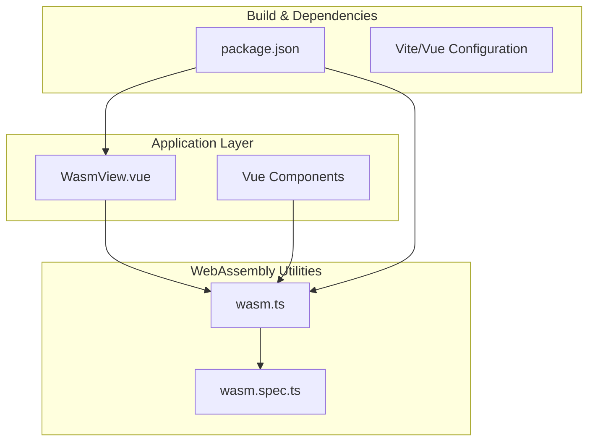
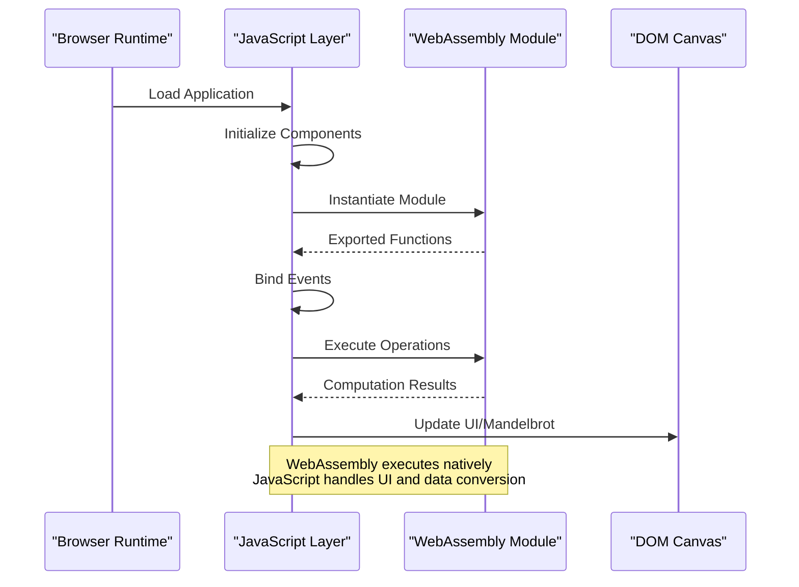
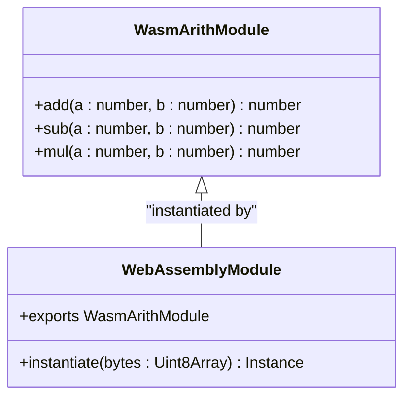
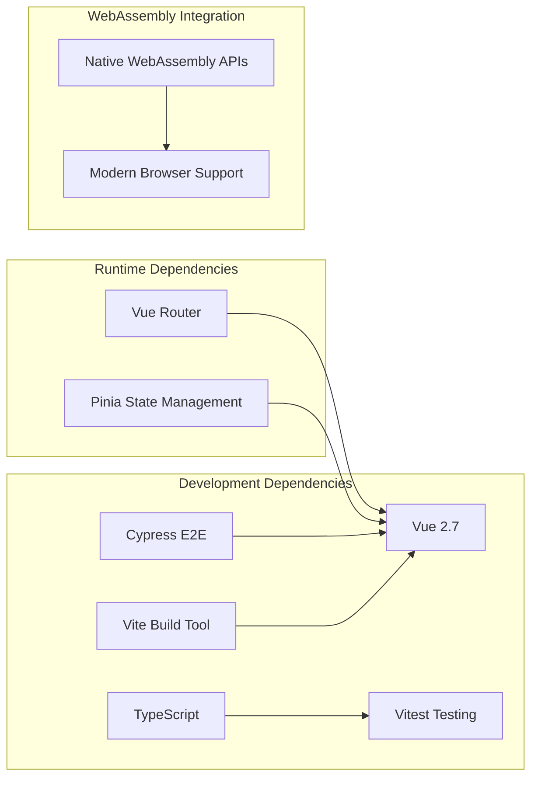

# WebAssembly Arithmetic Calculator

<cite>
**Referenced Files in This Document**
- [wasm.ts](file://src/utils/wasm.ts)
- [WasmView.vue](file://src/views/WasmView.vue)
- [wasm.spec.ts](file://src/components/__tests__/wasm.spec.ts)
- [package.json](file://package.json)
- [README.md](file://README.md)
</cite>

## Table of Contents
1. [Introduction](#introduction)
2. [Project Structure](#project-structure)
3. [Core Components](#core-components)
4. [Architecture Overview](#architecture-overview)
5. [Detailed Component Analysis](#detailed-component-analysis)
6. [Dependency Analysis](#dependency-analysis)
7. [Performance Considerations](#performance-considerations)
8. [Troubleshooting Guide](#troubleshooting-guide)
9. [Security and Compatibility](#security-and-compatibility)
10. [Extensibility Guide](#extensibility-guide)
11. [Conclusion](#conclusion)

## Introduction
This document provides comprehensive documentation for the WebAssembly Arithmetic Calculator, a demonstration project showcasing WebAssembly module compilation, JavaScript integration, and performance comparisons. The project includes:
- A precompiled WebAssembly arithmetic module exposing add, subtract, and multiply operations
- JavaScript integration utilities for instantiation and benchmarking
- Interactive demos for arithmetic operations, Fibonacci performance comparison, and Mandelbrot visualization
- Test coverage validating core functionality

The calculator demonstrates practical WebAssembly integration patterns, including module instantiation from raw bytes, function exports, and performance benefits of native computation.

## Project Structure
The project follows a modular structure with clear separation between WebAssembly utilities, Vue components, and tests:

**Diagram sources**
- [WasmView.vue:1-199](file://src/views/WasmView.vue#L1-L199)
- [wasm.ts:1-163](file://src/utils/wasm.ts#L1-L163)
- [wasm.spec.ts:1-97](file://src/components/__tests__/wasm.spec.ts#L1-L97)

**Section sources**
- [README.md:1-60](file://README.md#L1-L60)
- [package.json:1-61](file://package.json#L1-L61)

## Core Components
The WebAssembly Arithmetic Calculator consists of three primary components:

### WebAssembly Arithmetic Module
The arithmetic module is a precompiled WebAssembly binary containing three 32-bit integer operations:
- Addition (add): Takes two i32 parameters and returns i32
- Subtraction (sub): Takes two i32 parameters and returns i32  
- Multiplication (mul): Takes two i32 parameters and returns i32

The module is embedded as a Uint8Array constant and instantiated using WebAssembly.instantiate().

### JavaScript Integration Utilities
The wasm.ts module provides:
- createArithModule(): Instantiates the WebAssembly module and returns typed exports
- Utility functions for mathematical computations (Fibonacci, Mandelbrot)
- Benchmarking helpers for performance comparisons
- Hex dump functionality for inspecting WebAssembly binaries

### Vue Integration Components
The WasmView.vue component demonstrates:
- Real-time arithmetic operation testing
- Performance benchmarking between JavaScript and WebAssembly
- Mandelbrot set visualization using pure JavaScript
- Error handling and loading states

**Section sources**
- [wasm.ts:8-47](file://src/utils/wasm.ts#L8-L47)
- [WasmView.vue:1-199](file://src/views/WasmView.vue#L1-L199)

## Architecture Overview
The calculator follows a clean separation of concerns with clear boundaries between WebAssembly modules and JavaScript integration:

**Diagram sources**
- [wasm.ts:44-47](file://src/utils/wasm.ts#L44-L47)
- [WasmView.vue:40-61](file://src/views/WasmView.vue#L40-L61)

The architecture leverages WebAssembly's native execution speed for computationally intensive tasks while maintaining JavaScript's flexibility for UI updates and data manipulation.

## Detailed Component Analysis

### WebAssembly Module Implementation
The arithmetic module is implemented as a minimal WebAssembly binary with explicit function exports:

**Diagram sources**
- [wasm.ts:35-39](file://src/utils/wasm.ts#L35-L39)
- [wasm.ts:44-47](file://src/utils/wasm.ts#L44-L47)

The module uses WebAssembly's i32 type for all operations, ensuring compatibility with JavaScript's Number type while leveraging native integer arithmetic.

### JavaScript Integration Patterns
The integration layer handles several critical aspects:

#### Module Instantiation
The createArithModule() function encapsulates the WebAssembly instantiation process, returning a strongly-typed interface that JavaScript developers can use seamlessly.

#### Data Type Conversions
The implementation relies on JavaScript's automatic conversion between Number and WebAssembly's i32 representation. This simplifies integration but requires careful handling of integer overflow and precision considerations.

#### Error Handling
The integration includes comprehensive error handling for module instantiation failures and runtime exceptions during computation.

**Section sources**
- [wasm.ts:44-47](file://src/utils/wasm.ts#L44-L47)
- [wasm.ts:1-163](file://src/utils/wasm.ts#L1-L163)

### Interactive Demo Components
The Vue components demonstrate practical integration patterns:

#### Arithmetic Operations Demo
The interactive arithmetic demo allows real-time testing of WebAssembly operations alongside JavaScript equivalents, enabling immediate performance comparisons.

#### Fibonacci Benchmark
The benchmark component compares recursive versus iterative approaches, showcasing WebAssembly's potential for computational optimization.

#### Mandelbrot Visualization
The Mandelbrot renderer demonstrates JavaScript's capability to handle complex mathematical computations and visualization tasks.

**Section sources**
- [WasmView.vue:116-189](file://src/views/WasmView.vue#L116-L189)
- [WasmView.vue:403-535](file://src/views/WasmView.vue#L403-L535)

## Dependency Analysis
The project maintains minimal external dependencies focused on development and testing:

**Diagram sources**
- [package.json:28-58](file://package.json#L28-L58)

**Section sources**
- [package.json:1-61](file://package.json#L1-L61)

## Performance Considerations
The calculator demonstrates several performance characteristics:

### Native Computation Benefits
WebAssembly provides near-native performance for integer arithmetic operations compared to JavaScript's interpreted execution. The arithmetic module showcases:
- Zero-cost abstraction for mathematical operations
- Predictable performance characteristics
- Efficient memory usage for numeric computations

### Benchmark Methodology
The benchmarking utilities compare:
- Recursive vs iterative Fibonacci implementations
- Single vs repeated operation executions
- Real-world vs synthetic workloads

### Memory Management
The implementation demonstrates efficient memory patterns:
- Minimal heap allocations during arithmetic operations
- Direct data passing between JavaScript and WebAssembly
- No garbage collection overhead for tight loops

## Troubleshooting Guide
Common issues and solutions for WebAssembly integration:

### Module Loading Failures
- Verify WebAssembly support in the target browser
- Check for proper MIME type configuration (application/wasm)
- Ensure binary data integrity for the WebAssembly module

### Performance Issues
- Confirm WebAssembly module is properly compiled and optimized
- Verify JavaScript-side data conversion isn't introducing bottlenecks
- Monitor for excessive memory allocations during large computations

### Integration Problems
- Validate function signatures match between JavaScript and WebAssembly
- Check for proper error handling around module instantiation
- Ensure proper cleanup of resources when components unmount

**Section sources**
- [wasm.ts:44-47](file://src/utils/wasm.ts#L44-L47)
- [WasmView.vue:59-60](file://src/views/WasmView.vue#L59-L60)

## Security and Compatibility
### WebAssembly Security Model
The calculator operates within WebAssembly's secure sandbox:
- Limited to deterministic computation without side effects
- No direct access to DOM or network resources
- Protected from malicious code injection

### Browser Compatibility
The project targets modern browsers with WebAssembly support. Considerations include:
- Progressive enhancement for browsers without WebAssembly
- Graceful degradation to pure JavaScript implementations
- Feature detection for graceful fallback mechanisms

### Cross-Origin Resource Sharing
When loading WebAssembly modules from external sources, proper CORS headers must be configured to prevent loading failures.

## Extensibility Guide

### Adding New Mathematical Operations
To extend the calculator with new operations:

1. **Define WebAssembly Functions**: Extend the module with new mathematical functions
2. **Update TypeScript Interfaces**: Add corresponding method signatures
3. **Implement JavaScript Wrappers**: Create wrapper functions for the new operations
4. **Add UI Components**: Create Vue components for user interaction
5. **Write Tests**: Implement unit tests for validation

### Scientific Notation Support
For floating-point calculations, consider:
- Using WebAssembly's f64 types for decimal precision
- Implementing specialized mathematical functions (log, sin, cos)
- Adding decimal arithmetic libraries for financial calculations

### Graph Plotting Capabilities
To add visualization features:
- Integrate Chart.js or D3.js for interactive plots
- Implement WebGL shaders for advanced graphics
- Add export functionality for sharing results

### Advanced Mathematical Functions
Extend functionality with:
- Complex number arithmetic
- Matrix operations
- Numerical integration and differentiation
- Statistical distribution calculations

**Section sources**
- [wasm.ts:35-39](file://src/utils/wasm.ts#L35-L39)
- [WasmView.vue:116-134](file://src/views/WasmView.vue#L116-L134)

## Conclusion
The WebAssembly Arithmetic Calculator demonstrates effective integration patterns between JavaScript and WebAssembly, showcasing:
- Clean separation of concerns between modules and interfaces
- Practical performance benefits of native computation
- Comprehensive testing and validation approaches
- Extensible architecture for future enhancements

The project serves as a foundation for building more complex WebAssembly applications while maintaining accessibility for developers new to the technology. Its modular design enables easy extension with additional mathematical operations, visualization capabilities, and advanced computational features.