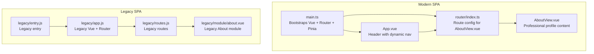
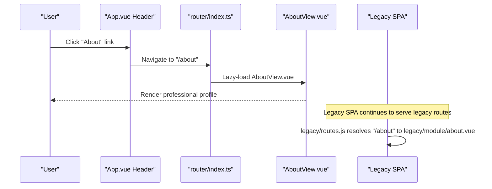
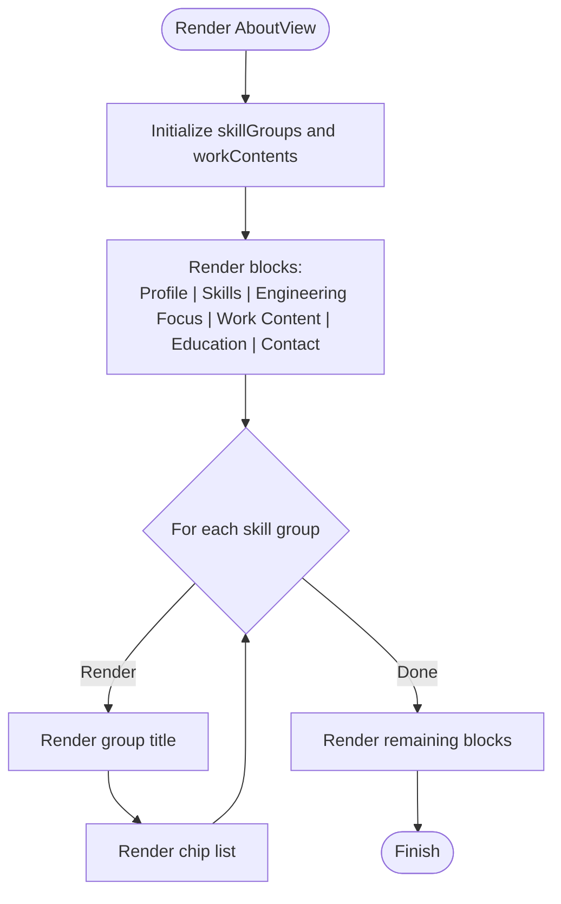
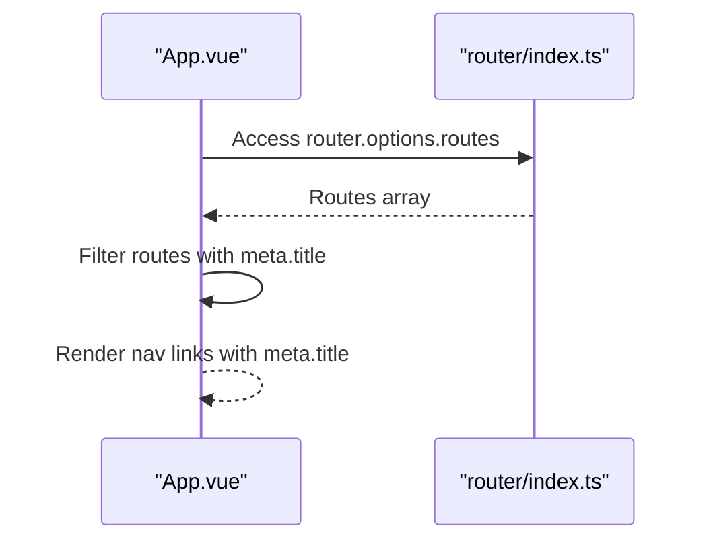
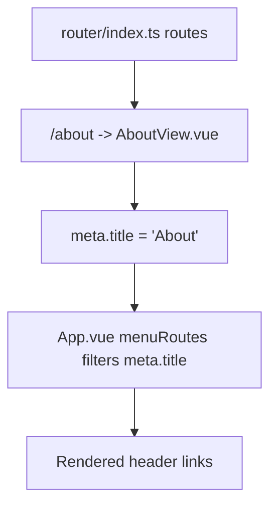
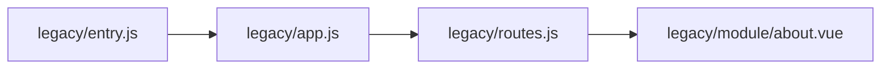
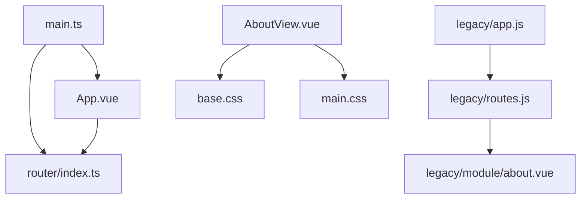

# About Page Structure

<cite>
**Referenced Files in This Document**
- [AboutView.vue](file://src/views/AboutView.vue)
- [App.vue](file://src/App.vue)
- [router/index.ts](file://src/router/index.ts)
- [main.ts](file://src/main.ts)
- [base.css](file://src/assets/base.css)
- [main.css](file://src/assets/main.css)
- [legacy/routes.js](file://src/apps/legacy/routes.js)
- [legacy/app.js](file://src/apps/legacy/app.js)
- [legacy/entry.js](file://src/apps/legacy/entry.js)
- [legacy/module/about.vue](file://src/apps/legacy/module/about.vue)
</cite>

## Table of Contents
1. [Introduction](#introduction)
2. [Project Structure](#project-structure)
3. [Core Components](#core-components)
4. [Architecture Overview](#architecture-overview)
5. [Detailed Component Analysis](#detailed-component-analysis)
6. [Dependency Analysis](#dependency-analysis)
7. [Performance Considerations](#performance-considerations)
8. [Troubleshooting Guide](#troubleshooting-guide)
9. [Conclusion](#conclusion)
10. [Appendices](#appendices)

## Introduction
This document explains the About page structure and professional profile presentation in the project. It covers:
- Professional profile display: skills visualization, experience timeline, and contact integration
- Component architecture: Vue.js Single File Component (SFC) implementation and legacy module integration
- Content organization: personal information, technical expertise, and professional background
- Responsive layout, interactive elements, and accessibility considerations
- Navigation integration: route configuration and metadata
- Customization examples: profile content, skill categories, and external contact methods

## Project Structure
The About page is implemented as a modern Vue 3 SFC and integrated into the current SPA via Vue Router. Legacy routing coexists for historical modules. The global theme and responsive behavior are defined in shared CSS.

**Diagram sources**
- [main.ts:1-16](file://src/main.ts#L1-L16)
- [App.vue:1-110](file://src/App.vue#L1-L110)
- [router/index.ts:1-65](file://src/router/index.ts#L1-L65)
- [AboutView.vue:1-143](file://src/views/AboutView.vue#L1-L143)
- [legacy/entry.js:1-2](file://src/apps/legacy/entry.js#L1-L2)
- [legacy/app.js:1-13](file://src/apps/legacy/app.js#L1-L13)
- [legacy/routes.js:1-21](file://src/apps/legacy/routes.js#L1-L21)
- [legacy/module/about.vue:1-102](file://src/apps/legacy/module/about.vue#L1-L102)

**Section sources**
- [main.ts:1-16](file://src/main.ts#L1-L16)
- [router/index.ts:1-65](file://src/router/index.ts#L1-L65)
- [App.vue:1-110](file://src/App.vue#L1-L110)
- [legacy/entry.js:1-2](file://src/apps/legacy/entry.js#L1-L2)
- [legacy/app.js:1-13](file://src/apps/legacy/app.js#L1-L13)
- [legacy/routes.js:1-21](file://src/apps/legacy/routes.js#L1-L21)

## Core Components
- AboutView.vue: Implements the professional profile with structured sections for profile, skills, engineering focus, work content, education, and contact. Uses reactive arrays for skills and work items, and scoped styles for glassmorphism and animations.
- App.vue: Provides the site header with a dynamic navigation bar generated from router metadata, enabling consistent navigation across pages.
- router/index.ts: Defines routes including the About route with lazy loading and metadata for titles.
- Legacy modules: legacy/routes.js and legacy/module/about.vue represent older routing and a legacy About module, useful for migration or fallback scenarios.

Key implementation highlights:
- Reactive data for skills and work content enables easy customization without changing templates.
- Scoped styles encapsulate About page visuals and integrate with global theme variables.
- Dynamic navigation reads route metadata to populate the header links.

**Section sources**
- [AboutView.vue:1-143](file://src/views/AboutView.vue#L1-L143)
- [App.vue:1-110](file://src/App.vue#L1-L110)
- [router/index.ts:1-65](file://src/router/index.ts#L1-L65)
- [legacy/routes.js:1-21](file://src/apps/legacy/routes.js#L1-L21)
- [legacy/module/about.vue:1-102](file://src/apps/legacy/module/about.vue#L1-L102)

## Architecture Overview
The About page participates in two complementary routing systems:
- Modern SPA: Vue Router with lazy-loaded AboutView.vue and metadata-driven navigation.
- Legacy SPA: Separate Vue Router instance with legacy routes and a legacy About module.

**Diagram sources**
- [App.vue:17-28](file://src/App.vue#L17-L28)
- [router/index.ts:17-25](file://src/router/index.ts#L17-L25)
- [AboutView.vue:25-74](file://src/views/AboutView.vue#L25-L74)
- [legacy/routes.js:9-10](file://src/apps/legacy/routes.js#L9-L10)
- [legacy/module/about.vue:1-102](file://src/apps/legacy/module/about.vue#L1-L102)

## Detailed Component Analysis

### AboutView.vue: Professional Profile Presentation
- Data model:
  - skillGroups: An array of skill category groups with titles and items for chips.
  - workContents: An array of work content entries for the timeline section.
- Template structure:
  - Eyebrow, headline, intro, and multiple blocks for profile, skills, engineering focus, work content, education, and contact.
- Styles:
  - Glassmorphism container with backdrop blur and animation.
  - Chip list with wrap and spacing for skills.
  - Block sections separated by borders and padding.

**Diagram sources**
- [AboutView.vue:2-23](file://src/views/AboutView.vue#L2-L23)
- [AboutView.vue:25-74](file://src/views/AboutView.vue#L25-L74)

Implementation specifics:
- Skills visualization:
  - Use skillGroups to add or remove categories and items.
  - Items render as chips with consistent styling.
- Experience timeline:
  - Add or modify workContents entries to reflect new roles or responsibilities.
- Contact integration:
  - Update contact paragraphs to include phone, email, and location.
  - External contact methods can be added as new list items or links.

Responsive layout and interactivity:
- The glass container and chip list adapt to screen sizes via scoped styles.
- Animation applies a subtle entrance effect to the container.

Accessibility considerations:
- Semantic headings and lists improve screen reader navigation.
- Ensure sufficient color contrast for text and borders as defined by global variables.

**Section sources**
- [AboutView.vue:1-143](file://src/views/AboutView.vue#L1-L143)
- [base.css:1-64](file://src/assets/base.css#L1-L64)
- [main.css:1-43](file://src/assets/main.css#L1-L43)

### App.vue: Navigation Integration and Metadata
- Dynamic navigation:
  - menuRoutes computes visible routes by filtering those with meta.title.
  - Renders router-link entries for each visible route.
- Global header:
  - Branding and subtitle.
  - Responsive layout adjusts alignment and direction on smaller screens.

**Diagram sources**
- [App.vue:32-43](file://src/App.vue#L32-L43)
- [router/index.ts:10-61](file://src/router/index.ts#L10-L61)

**Section sources**
- [App.vue:1-110](file://src/App.vue#L1-L110)
- [router/index.ts:1-65](file://src/router/index.ts#L1-L65)

### Route Configuration and Metadata
- About route:
  - Path "/about" with lazy-loaded component AboutView.vue.
  - meta.title set to "About".
- Navigation:
  - App.vue reads meta.title to populate header links dynamically.

**Diagram sources**
- [router/index.ts:17-25](file://src/router/index.ts#L17-L25)
- [App.vue:36-42](file://src/App.vue#L36-L42)

**Section sources**
- [router/index.ts:1-65](file://src/router/index.ts#L1-L65)
- [App.vue:1-110](file://src/App.vue#L1-L110)

### Legacy Module Integration
- Legacy SPA entry:
  - legacy/entry.js imports legacy/app.js.
  - legacy/app.js creates a Vue instance with legacy routes.
- Legacy routes:
  - legacy/routes.js defines "/about" mapped to legacy/module/about.vue.
- Legacy About module:
  - Provides a visually distinct About page with animated color squares and transitions.

**Diagram sources**
- [legacy/entry.js:1-2](file://src/apps/legacy/entry.js#L1-L2)
- [legacy/app.js:1-13](file://src/apps/legacy/app.js#L1-L13)
- [legacy/routes.js:1-21](file://src/apps/legacy/routes.js#L1-L21)
- [legacy/module/about.vue:1-102](file://src/apps/legacy/module/about.vue#L1-L102)

**Section sources**
- [legacy/entry.js:1-2](file://src/apps/legacy/entry.js#L1-L2)
- [legacy/app.js:1-13](file://src/apps/legacy/app.js#L1-L13)
- [legacy/routes.js:1-21](file://src/apps/legacy/routes.js#L1-L21)
- [legacy/module/about.vue:1-102](file://src/apps/legacy/module/about.vue#L1-L102)

## Dependency Analysis
- AboutView.vue depends on:
  - Global CSS variables for theme consistency.
  - Scoped styles for layout and animations.
- App.vue depends on:
  - router/index.ts for route metadata.
- main.ts bootstraps:
  - Vue, Pinia, and the router for the modern SPA.
- Legacy SPA operates independently with its own entry and routes.

**Diagram sources**
- [main.ts:1-16](file://src/main.ts#L1-L16)
- [router/index.ts:1-65](file://src/router/index.ts#L1-L65)
- [App.vue:1-110](file://src/App.vue#L1-L110)
- [AboutView.vue:76-142](file://src/views/AboutView.vue#L76-L142)
- [base.css:1-64](file://src/assets/base.css#L1-L64)
- [main.css:1-43](file://src/assets/main.css#L1-L43)
- [legacy/app.js:1-13](file://src/apps/legacy/app.js#L1-L13)
- [legacy/routes.js:1-21](file://src/apps/legacy/routes.js#L1-L21)
- [legacy/module/about.vue:1-102](file://src/apps/legacy/module/about.vue#L1-L102)

**Section sources**
- [main.ts:1-16](file://src/main.ts#L1-L16)
- [router/index.ts:1-65](file://src/router/index.ts#L1-L65)
- [App.vue:1-110](file://src/App.vue#L1-L110)
- [AboutView.vue:76-142](file://src/views/AboutView.vue#L76-L142)
- [base.css:1-64](file://src/assets/base.css#L1-L64)
- [main.css:1-43](file://src/assets/main.css#L1-L43)
- [legacy/app.js:1-13](file://src/apps/legacy/app.js#L1-L13)
- [legacy/routes.js:1-21](file://src/apps/legacy/routes.js#L1-L21)

## Performance Considerations
- Lazy loading:
  - About route uses dynamic import for code splitting, reducing initial bundle size.
- Animations:
  - CSS transforms and opacity transitions leverage GPU acceleration.
- Scrolling:
  - Custom scrollbars improve UX without heavy JavaScript.
- Recommendations:
  - Keep skillGroups and workContents arrays reasonably sized to avoid excessive DOM rendering.
  - Consider virtualizing long lists if content grows significantly.

[No sources needed since this section provides general guidance]

## Troubleshooting Guide
- About page not appearing:
  - Verify the route path "/about" and lazy-loaded component mapping.
  - Confirm meta.title is present for navigation visibility.
- Navigation missing:
  - Ensure routes include meta.title so App.vue can filter and render them.
- Legacy About conflicts:
  - Legacy SPA serves its own "/about"; confirm which SPA is active.
- Styling inconsistencies:
  - Confirm global CSS variables and scoped styles are loaded.

**Section sources**
- [router/index.ts:17-25](file://src/router/index.ts#L17-L25)
- [App.vue:36-42](file://src/App.vue#L36-L42)
- [legacy/routes.js:9-10](file://src/apps/legacy/routes.js#L9-L10)

## Conclusion
The About page is a modular, responsive Vue 3 SFC that presents a professional profile with clear sections for skills, experience, and contact. It integrates seamlessly with the SPA’s navigation system via route metadata and supports customization through reactive data structures. Legacy routing remains available for backward compatibility.

[No sources needed since this section summarizes without analyzing specific files]

## Appendices

### Customization Examples
- Customize profile content:
  - Modify the introductory paragraph and profile section content in AboutView.vue.
- Add new skill categories:
  - Extend skillGroups with additional objects containing title and items.
- Integrate external contact methods:
  - Add new list items or links under the Contact section in AboutView.vue.
- Update navigation metadata:
  - Adjust meta.title in router/index.ts for the About route to change header label.

**Section sources**
- [AboutView.vue:25-74](file://src/views/AboutView.vue#L25-L74)
- [router/index.ts:17-25](file://src/router/index.ts#L17-L25)