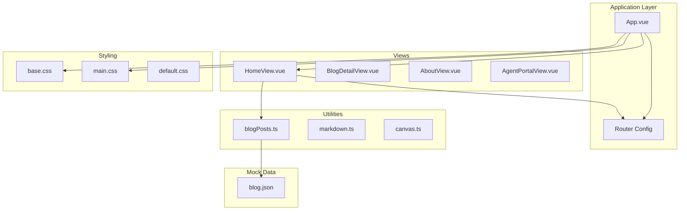
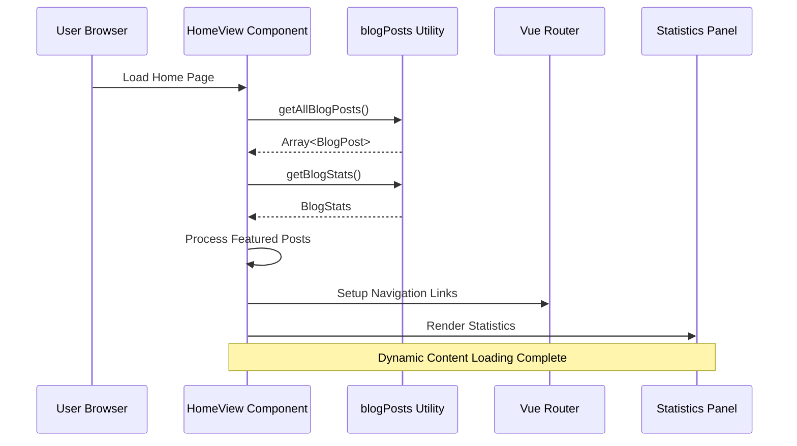
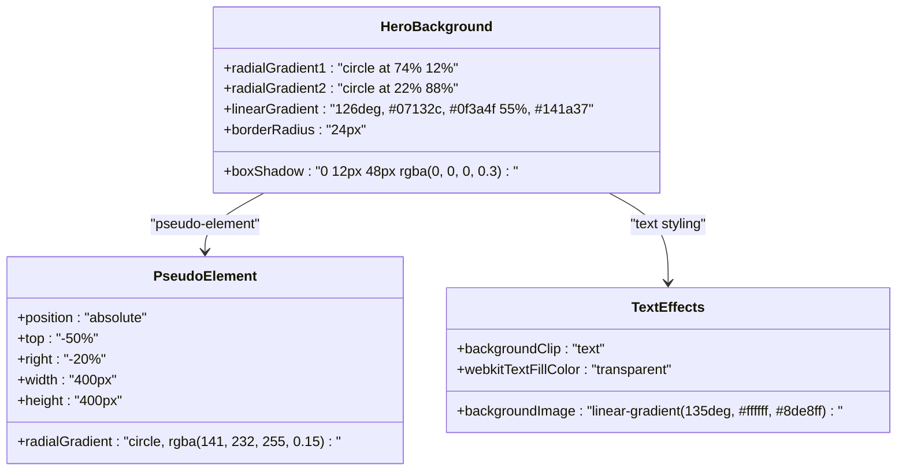
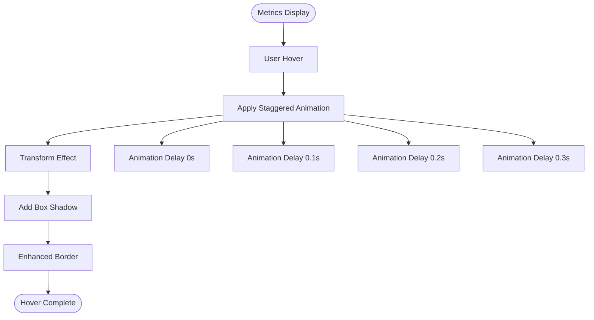
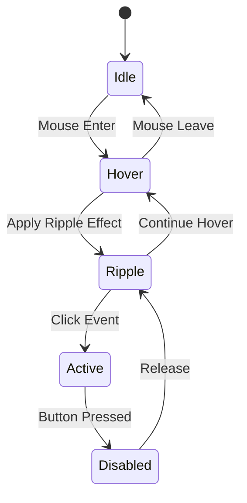
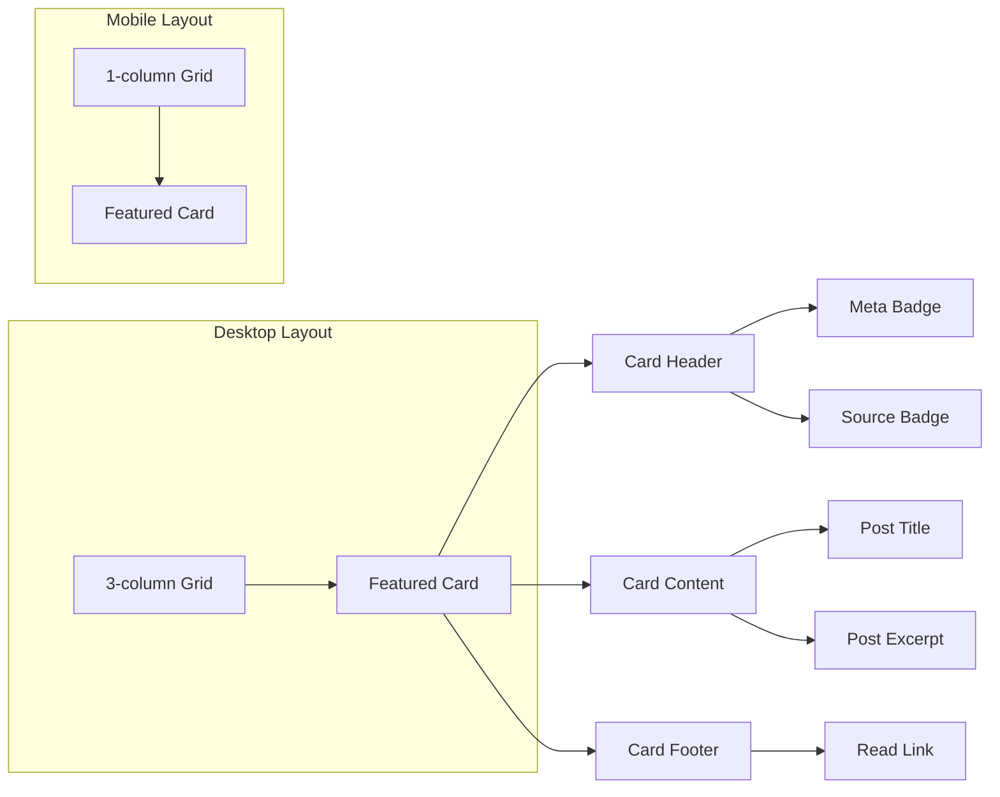
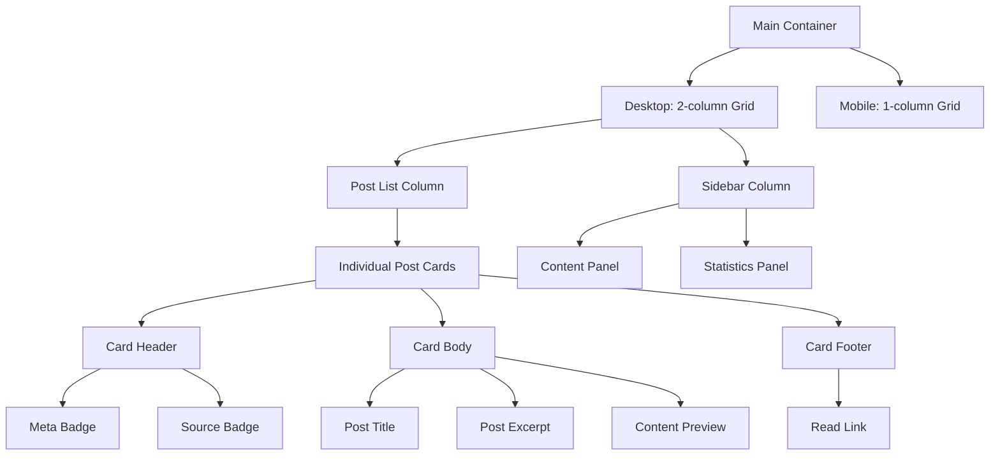
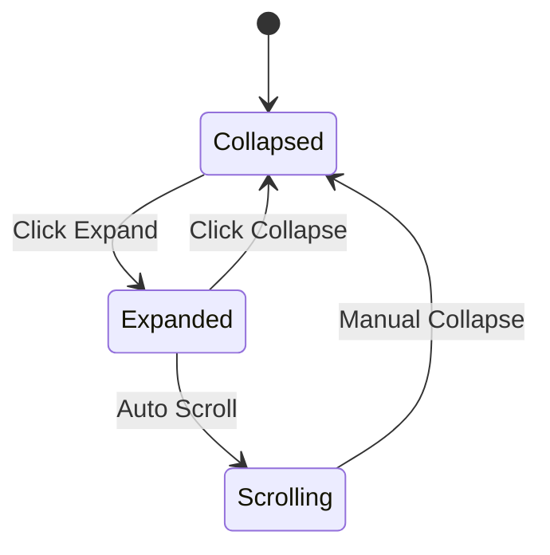
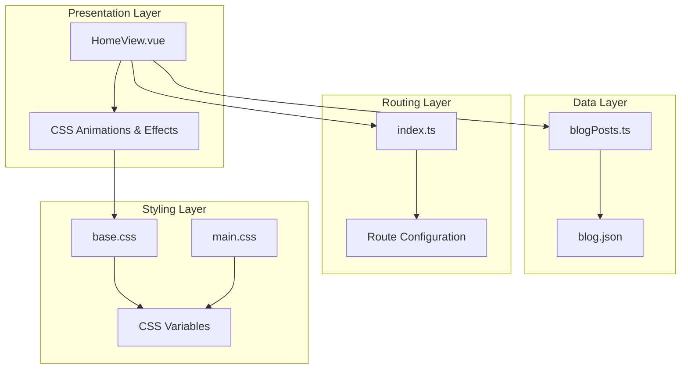
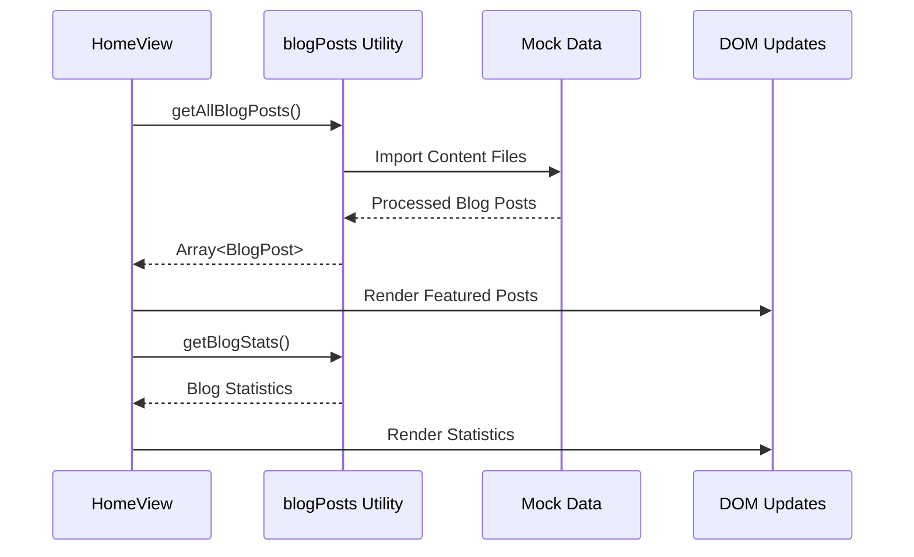

# Home Page Implementation

<cite>
**Referenced Files in This Document**
- [HomeView.vue](file://src/views/HomeView.vue)
- [blogPosts.ts](file://src/utils/blogPosts.ts)
- [index.ts](file://src/router/index.ts)
- [main.css](file://src/assets/main.css)
- [base.css](file://src/assets/base.css)
- [App.vue](file://src/App.vue)
- [main.ts](file://src/main.ts)
- [blog.json](file://src/mock/blog.json)
</cite>

## Table of Contents
1. [Introduction](#introduction)
2. [Project Structure](#project-structure)
3. [Core Components](#core-components)
4. [Architecture Overview](#architecture-overview)
5. [Detailed Component Analysis](#detailed-component-analysis)
6. [Dependency Analysis](#dependency-analysis)
7. [Performance Considerations](#performance-considerations)
8. [Troubleshooting Guide](#troubleshooting-guide)
9. [Conclusion](#conclusion)

## Introduction

The home page implementation showcases a modern, visually appealing blog interface with advanced styling techniques and dynamic content loading. This comprehensive documentation covers the hero section with gradient backgrounds and animated metrics, the featured posts carousel displaying latest blog content, and the blog listing layout with responsive design and statistics panel.

The implementation leverages Vue.js composition API, CSS animations, glass morphism effects, and a sophisticated routing system to create an engaging user experience. The design incorporates gradient backgrounds, floating animations, and responsive breakpoints optimized for various screen sizes.

## Project Structure

The home page implementation follows a modular Vue.js architecture with clear separation of concerns:

**Diagram sources**
- [App.vue:1-110](file://src/App.vue#L1-L110)
- [HomeView.vue:1-648](file://src/views/HomeView.vue#L1-L648)
- [blogPosts.ts:1-110](file://src/utils/blogPosts.ts#L1-L110)

**Section sources**
- [main.ts:1-16](file://src/main.ts#L1-L16)
- [App.vue:1-110](file://src/App.vue#L1-L110)

## Core Components

The home page consists of four primary sections, each serving distinct purposes in the overall user experience:

### Hero Section
The hero section serves as the primary visual focal point, featuring gradient backgrounds, animated metrics display, and prominent call-to-action buttons. It employs advanced CSS techniques including radial gradients, pseudo-elements, and sophisticated animations.

### Featured Posts Carousel
Displays the latest blog content in a responsive grid layout with category badges and source indicators. Implements staggered animations and hover effects for enhanced interactivity.

### Blog Listing Layout
Provides a comprehensive view of all blog posts with content preview functionality and expandable details sections. Features a sidebar with statistics and content source information.

### Navigation Integration
Seamlessly integrates with Vue Router for smooth navigation between different sections of the application.

**Section sources**
- [HomeView.vue:10-138](file://src/views/HomeView.vue#L10-L138)
- [blogPosts.ts:94-110](file://src/utils/blogPosts.ts#L94-L110)

## Architecture Overview

The home page implementation follows a reactive architecture pattern leveraging Vue.js composition API and TypeScript for type safety:

**Diagram sources**
- [HomeView.vue:1-8](file://src/views/HomeView.vue#L1-L8)
- [blogPosts.ts:94-110](file://src/utils/blogPosts.ts#L94-L110)

The architecture demonstrates clear separation of concerns with the HomeView component orchestrating data fetching, processing, and rendering while delegating content management to the blogPosts utility.

**Section sources**
- [HomeView.vue:1-8](file://src/views/HomeView.vue#L1-L8)
- [blogPosts.ts:1-110](file://src/utils/blogPosts.ts#L1-L110)

## Detailed Component Analysis

### Hero Section Implementation

The hero section represents the most visually complex component, incorporating multiple advanced CSS techniques:

#### Gradient Background System
The hero section utilizes layered background gradients for depth and visual interest:

**Diagram sources**
- [HomeView.vue:159-184](file://src/views/HomeView.vue#L159-L184)
- [HomeView.vue:194-203](file://src/views/HomeView.vue#L194-L203)

#### Animated Metrics Display
The metrics section implements sophisticated hover animations with staggered delays:

**Diagram sources**
- [HomeView.vue:278-317](file://src/views/HomeView.vue#L278-L317)
- [HomeView.vue:60](file://src/views/HomeView.vue#L60)

#### Call-to-Action Button System
The button system implements modern hover effects with ripple animations:

**Diagram sources**
- [HomeView.vue:219-276](file://src/views/HomeView.vue#L219-L276)
- [HomeView.vue:232-248](file://src/views/HomeView.vue#L232-L248)

**Section sources**
- [HomeView.vue:159-317](file://src/views/HomeView.vue#L159-L317)

### Featured Posts Carousel

The featured posts carousel implements a responsive grid system with sophisticated animations and interactive elements:

#### Grid Layout System
The carousel uses CSS Grid for responsive layout with automatic column adjustment based on screen size:

**Diagram sources**
- [HomeView.vue:319-451](file://src/views/HomeView.vue#L319-L451)
- [HomeView.vue:339-343](file://src/views/HomeView.vue#L339-L343)

#### Category Badges and Source Indicators
Each post displays contextual information through carefully designed badges:

| Badge Type | Purpose | Styling |
|------------|---------|---------|
| Category Badge | Identifies post category | Gray background, subtle border |
| Source Badge | Indicates content origin | Blue gradient background |
| Small Source Badge | Used in blog listings | Reduced size variant |

**Section sources**
- [HomeView.vue:389-415](file://src/views/HomeView.vue#L389-L415)
- [HomeView.vue:54-72](file://src/views/HomeView.vue#L54-L72)

### Blog Listing Layout

The blog listing provides comprehensive content with advanced interaction capabilities:

#### Responsive Grid System
The layout implements a flexible grid system that adapts to different screen sizes:

**Diagram sources**
- [HomeView.vue:452-627](file://src/views/HomeView.vue#L452-L627)
- [HomeView.vue:458-461](file://src/views/HomeView.vue#L458-L461)

#### Content Preview Functionality
The content preview system provides expandable content sections with smooth animations:

**Diagram sources**
- [HomeView.vue:493-532](file://src/views/HomeView.vue#L493-L532)
- [HomeView.vue:518](file://src/views/HomeView.vue#L518)

**Section sources**
- [HomeView.vue:452-627](file://src/views/HomeView.vue#L452-L627)

### Statistics Panel

The statistics panel provides real-time content analytics with a clean, glass-morphism design:

#### Data Presentation
The panel displays key metrics with visual emphasis on important values:

| Metric | Description | Display Style |
|--------|-------------|---------------|
| Total Articles | Count of all blog posts | Large, prominent value |
| VDocs Count | Number of documentation posts | Secondary metric |
| Pattern Count | Number of pattern posts | Tertiary metric |

**Section sources**
- [HomeView.vue:115-134](file://src/views/HomeView.vue#L115-L134)
- [blogPosts.ts:102-109](file://src/utils/blogPosts.ts#L102-L109)

## Dependency Analysis

The home page implementation demonstrates excellent dependency management with clear separation between presentation and data layers:

**Diagram sources**
- [HomeView.vue:1-8](file://src/views/HomeView.vue#L1-L8)
- [blogPosts.ts:1-110](file://src/utils/blogPosts.ts#L1-L110)
- [index.ts:1-65](file://src/router/index.ts#L1-L65)

### Data Flow Patterns

The implementation follows reactive data flow patterns typical of modern Vue.js applications:

**Diagram sources**
- [HomeView.vue:5-6](file://src/views/HomeView.vue#L5-L6)
- [blogPosts.ts:94-109](file://src/utils/blogPosts.ts#L94-L109)

**Section sources**
- [HomeView.vue:1-8](file://src/views/HomeView.vue#L1-L8)
- [blogPosts.ts:1-110](file://src/utils/blogPosts.ts#L1-L110)

## Performance Considerations

The home page implementation incorporates several performance optimization strategies:

### CSS Animation Performance
- Hardware-accelerated transforms using `transform` property
- Optimized animation timing functions (`ease`, `both`)
- Staggered animations to prevent animation thrashing
- Efficient pseudo-element usage for decorative effects

### Content Loading Strategies
- Eager loading of pattern and vdocs content during build
- Lazy loading of route components for better initial load performance
- Efficient grid layout with CSS Grid for optimal rendering

### Memory Management
- Proper cleanup of event listeners in Vue components
- Efficient reactivity system utilization
- Minimal DOM manipulation through template directives

## Troubleshooting Guide

### Common Issues and Solutions

#### Gradient Background Not Rendering
**Problem**: Hero section gradients appear incorrectly
**Solution**: Verify CSS variable definitions in base.css and ensure proper vendor prefixes

#### Animation Performance Issues
**Problem**: Staggered animations cause performance degradation
**Solution**: Adjust animation duration or reduce stagger delay in template

#### Responsive Layout Breakage
**Problem**: Grid layouts break on specific screen sizes
**Solution**: Review media query breakpoints and adjust grid-template-columns

#### Navigation Link Issues
**Problem**: Router links not functioning correctly
**Solution**: Verify router configuration and ensure proper route definitions

**Section sources**
- [HomeView.vue:615-646](file://src/views/HomeView.vue#L615-L646)
- [index.ts:7-62](file://src/router/index.ts#L7-L62)

## Conclusion

The home page implementation demonstrates advanced front-end development practices with its sophisticated use of CSS animations, glass morphism effects, and responsive design patterns. The modular architecture ensures maintainability while the reactive data flow provides excellent user experience.

Key strengths include:
- Sophisticated visual design with gradient backgrounds and animations
- Responsive layout system with intelligent breakpoint management
- Clean separation of concerns between presentation and data layers
- Modern Vue.js composition API implementation
- Comprehensive TypeScript integration for type safety

The implementation serves as an excellent example of contemporary web development practices, combining aesthetic appeal with functional excellence.