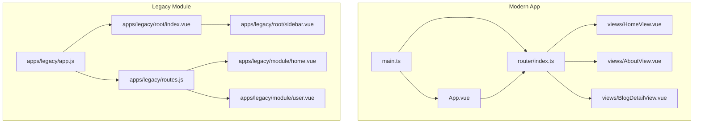
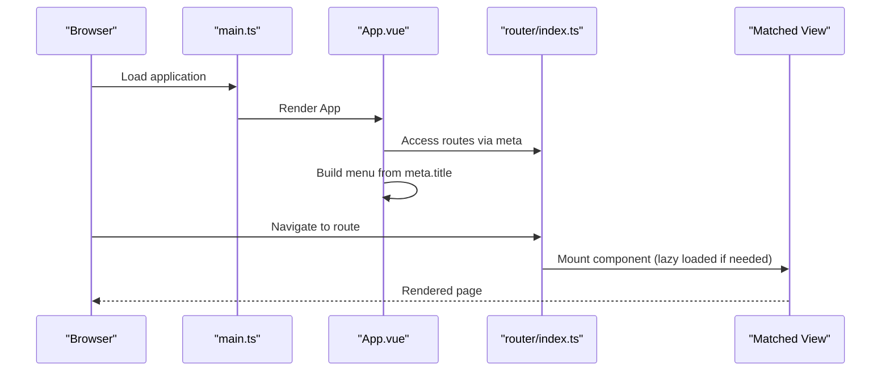
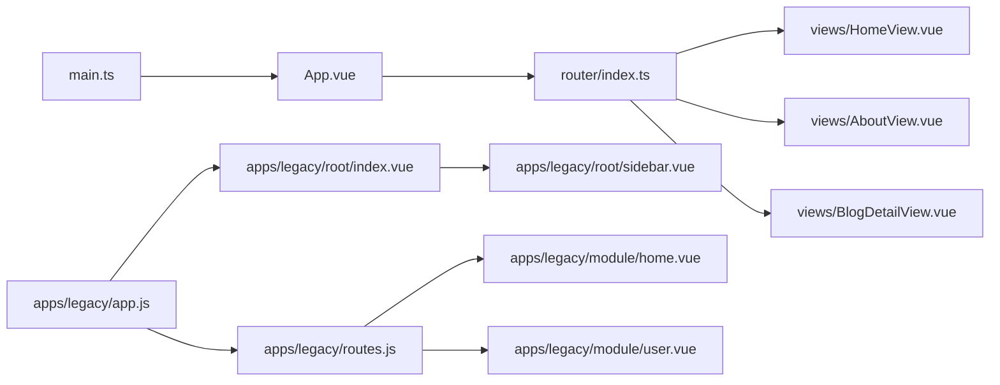

# Navigation System

<cite>
**Referenced Files in This Document**
- [router/index.ts](file://src/router/index.ts)
- [App.vue](file://src/App.vue)
- [main.ts](file://src/main.ts)
- [views/HomeView.vue](file://src/views/HomeView.vue)
- [views/AboutView.vue](file://src/views/AboutView.vue)
- [views/BlogDetailView.vue](file://src/views/BlogDetailView.vue)
- [apps/legacy/app.js](file://src/apps/legacy/app.js)
- [apps/legacy/routes.js](file://src/apps/legacy/routes.js)
- [apps/legacy/root/index.vue](file://src/apps/legacy/root/index.vue)
- [apps/legacy/root/sidebar.vue](file://src/apps/legacy/root/sidebar.vue)
- [apps/legacy/module/home.vue](file://src/apps/legacy/module/home.vue)
- [apps/legacy/module/user.vue](file://src/apps/legacy/module/user.vue)
- [stores/counter.ts](file://src/stores/counter.ts)
</cite>

## Table of Contents
1. [Introduction](#introduction)
2. [Project Structure](#project-structure)
3. [Core Components](#core-components)
4. [Architecture Overview](#architecture-overview)
5. [Detailed Component Analysis](#detailed-component-analysis)
6. [Dependency Analysis](#dependency-analysis)
7. [Performance Considerations](#performance-considerations)
8. [Troubleshooting Guide](#troubleshooting-guide)
9. [Conclusion](#conclusion)
10. [Appendices](#appendices)

## Introduction
This document explains the navigation system of the project, focusing on Vue Router configuration with history mode, lazy loading, and meta-driven navigation labels. It details the component hierarchy with App.vue as the root container, integrates the legacy module, and documents navigation patterns such as programmatic navigation, route guards, and active link states. Accessibility and responsive behavior are covered, along with parameterized routing, navigation state management, and practical examples for extending the system and implementing breadcrumbs.

## Project Structure
The navigation system spans a modern Vue 3 application and a legacy Vue 2 module coexisting under the same domain. The modern stack defines routes and views, while the legacy module maintains its own router and layout.

**Diagram sources**
- [main.ts:11-15](file://src/main.ts#L11-L15)
- [App.vue:1-30](file://src/App.vue#L1-L30)
- [router/index.ts:7-62](file://src/router/index.ts#L7-L62)
- [apps/legacy/app.js:1-12](file://src/apps/legacy/app.js#L1-L12)
- [apps/legacy/routes.js:1-21](file://src/apps/legacy/routes.js#L1-L21)
- [apps/legacy/root/index.vue:1-7](file://src/apps/legacy/root/index.vue#L1-L7)
- [apps/legacy/root/sidebar.vue:1-9](file://src/apps/legacy/root/sidebar.vue#L1-L9)
- [apps/legacy/module/home.vue:1-10](file://src/apps/legacy/module/home.vue#L1-L10)
- [apps/legacy/module/user.vue:1-4](file://src/apps/legacy/module/user.vue#L1-L4)

**Section sources**
- [main.ts:11-15](file://src/main.ts#L11-L15)
- [router/index.ts:7-62](file://src/router/index.ts#L7-L62)
- [apps/legacy/app.js:1-12](file://src/apps/legacy/app.js#L1-L12)
- [apps/legacy/routes.js:1-21](file://src/apps/legacy/routes.js#L1-L21)

## Core Components
- Router configuration with history mode and lazy-loaded views
- Meta-driven navigation labels for dynamic menus
- Programmatic navigation via router-link and template refs
- Active link highlighting and responsive design
- Legacy module with its own router and sidebar navigation

Key implementation highlights:
- History mode routing ensures clean URLs suitable for server deployment.
- Route-level code splitting enables lazy loading of views.
- Meta fields provide navigation labels for automatic menu generation.
- Template-level router-link usage supports active state styling.
- Responsive breakpoints adapt header layout on smaller screens.

**Section sources**
- [router/index.ts:7-62](file://src/router/index.ts#L7-L62)
- [App.vue:17-25](file://src/App.vue#L17-L25)
- [App.vue:36-42](file://src/App.vue#L36-L42)
- [App.vue:103-108](file://src/App.vue#L103-L108)

## Architecture Overview
The modern application initializes Vue with Pinia and mounts App.vue, which embeds a header with a dynamic navigation bar generated from router meta fields and a router-view for matched views. The legacy module runs a separate Vue 2 app with its own router and sidebar.

**Diagram sources**
- [main.ts:11-15](file://src/main.ts#L11-L15)
- [App.vue:17-25](file://src/App.vue#L17-L25)
- [router/index.ts:7-62](file://src/router/index.ts#L7-L62)

**Section sources**
- [main.ts:11-15](file://src/main.ts#L11-L15)
- [App.vue:17-25](file://src/App.vue#L17-L25)
- [router/index.ts:7-62](file://src/router/index.ts#L7-L62)

## Detailed Component Analysis

### Router Configuration and Lazy Loading
- History mode is configured with a base URL from environment variables.
- Routes include static and parameterized paths; most views are lazy-loaded via dynamic imports.
- Meta fields carry human-readable labels for navigation.

Implementation patterns:
- Route-level code splitting separates chunks per route for improved initial load performance.
- Parameterized routes enable dynamic content rendering (e.g., blog detail by slug).

**Section sources**
- [router/index.ts:7-62](file://src/router/index.ts#L7-L62)

### Meta-Driven Navigation Labels
- App.vue computes menu items by filtering routes that have a meta.title field.
- Navigation links render using the meta.title value, ensuring consistency between routes and the header menu.

Accessibility and UX:
- Active link states are styled using router-link’s built-in active classes.
- Responsive adjustments adapt the header layout on small screens.

**Section sources**
- [App.vue:17-25](file://src/App.vue#L17-L25)
- [App.vue:36-42](file://src/App.vue#L36-L42)
- [App.vue:73-82](file://src/App.vue#L73-L82)
- [App.vue:103-108](file://src/App.vue#L103-L108)

### Component Hierarchy and Root Container
- main.ts creates the Vue instance with router and Pinia, mounting App.vue.
- App.vue serves as the root container, embedding the header navigation and router-view.
- Views are rendered inside router-view upon route match.

**Section sources**
- [main.ts:11-15](file://src/main.ts#L11-L15)
- [App.vue:1-30](file://src/App.vue#L1-L30)

### Programmatic Navigation and Active Link States
- Programmatic navigation is demonstrated via router-link usage in templates (e.g., HomeView and BlogDetailView).
- Active link highlighting is handled by router-link’s default active classes and custom CSS targeting the exact active state.

Examples in code:
- HomeView uses router-link to navigate to About and Agent Portal.
- BlogDetailView uses router-link to return to the homepage or list.

**Section sources**
- [views/HomeView.vue:19-27](file://src/views/HomeView.vue#L19-L27)
- [views/HomeView.vue:66-70](file://src/views/HomeView.vue#L66-L70)
- [views/BlogDetailView.vue:37-41](file://src/views/BlogDetailView.vue#L37-L41)
- [views/BlogDetailView.vue:64-66](file://src/views/BlogDetailView.vue#L64-L66)
- [App.vue:73-82](file://src/App.vue#L73-L82)

### Route Guards
- No global or local guards are present in the current configuration.
- If guards are needed (authentication, analytics, scroll restoration), they can be integrated at the router level or per-route.

[No sources needed since this section provides general guidance]

### Parameter Passing and Dynamic Routing
- Parameterized routes (e.g., blog detail by slug) enable dynamic content rendering.
- Views can access route parameters via the route object to fetch and render content.

Example patterns:
- Use the route parameter to load article data in the detail view.
- Pass parameters through router-link bindings in templates.

**Section sources**
- [router/index.ts:33-36](file://src/router/index.ts#L33-L36)
- [views/BlogDetailView.vue:37-41](file://src/views/BlogDetailView.vue#L37-L41)

### Navigation State Management
- Pinia is initialized but not currently used for navigation state.
- Navigation state (e.g., active tab, last visited route) can be stored in a Pinia store if needed.

**Section sources**
- [main.ts:9-15](file://src/main.ts#L9-L15)
- [stores/counter.ts:1-17](file://src/stores/counter.ts#L1-L17)

### Responsive Navigation and Mobile Menu Handling
- The header layout stacks vertically on small screens via a media query.
- Navigation links wrap to fit various screen widths.

Recommendations:
- Introduce a hamburger menu for very narrow screens to improve usability.
- Consider sticky navigation for long pages.

**Section sources**
- [App.vue:103-108](file://src/App.vue#L103-L108)

### Accessibility Compliance
- Ensure all interactive elements (links) are keyboard focusable.
- Provide visible focus indicators and sufficient color contrast for active states.
- Use semantic HTML and ARIA attributes if adding dropdowns or complex navigation widgets.

[No sources needed since this section provides general guidance]

### Legacy Module Integration
- The legacy module runs a separate Vue 2 app with its own router and sidebar.
- It mounts at the same DOM root and uses its own route definitions and components.

Integration notes:
- The legacy sidebar hardcodes route targets; ensure consistency with modern routes.
- Both modules share the same base URL; verify server-side routing does not conflict.

**Section sources**
- [apps/legacy/app.js:1-12](file://src/apps/legacy/app.js#L1-L12)
- [apps/legacy/routes.js:1-21](file://src/apps/legacy/routes.js#L1-L21)
- [apps/legacy/root/index.vue:1-7](file://src/apps/legacy/root/index.vue#L1-L7)
- [apps/legacy/root/sidebar.vue:1-9](file://src/apps/legacy/root/sidebar.vue#L1-L9)
- [apps/legacy/module/home.vue:1-10](file://src/apps/legacy/module/home.vue#L1-L10)
- [apps/legacy/module/user.vue:1-4](file://src/apps/legacy/module/user.vue#L1-L4)

### Adding New Routes
Steps to add a new route:
- Define the route in router/index.ts with a path, component (preferably lazy-loaded), and optional meta.title.
- Create or reuse a view component in the views directory.
- Reference the new route in templates using router-link for navigation.

Example reference paths:
- Add route definition in router configuration.
- Import and register the new view component lazily.
- Use router-link in existing views to link to the new route.

**Section sources**
- [router/index.ts:7-62](file://src/router/index.ts#L7-L62)
- [views/HomeView.vue:19-27](file://src/views/HomeView.vue#L19-L27)

### Customizing Navigation Behavior
Options:
- Modify meta.title values to change label text.
- Adjust active link styles in App.vue to reflect branding.
- Extend App.vue menu computation to filter routes differently (e.g., exclude certain routes).

**Section sources**
- [App.vue:36-42](file://src/App.vue#L36-L42)
- [App.vue:73-82](file://src/App.vue#L73-L82)

### Implementing Breadcrumb Navigation
Approach:
- Compute breadcrumbs from the current route using route.matched and meta.title.
- Render a breadcrumb trail in App.vue or a dedicated component.
- Handle parameterized segments (e.g., blog slug) by resolving display labels.

Reference patterns:
- Use router.currentRoute and route.matched to build breadcrumb items.
- Leverage meta.title for human-readable segment labels.

[No sources needed since this section provides general guidance]

## Dependency Analysis
The modern application depends on Vue Router for navigation and views for rendering. The legacy module operates independently with its own router and components.

**Diagram sources**
- [main.ts:11-15](file://src/main.ts#L11-L15)
- [App.vue:1-30](file://src/App.vue#L1-L30)
- [router/index.ts:7-62](file://src/router/index.ts#L7-L62)
- [apps/legacy/app.js:1-12](file://src/apps/legacy/app.js#L1-L12)
- [apps/legacy/root/index.vue:1-7](file://src/apps/legacy/root/index.vue#L1-L7)
- [apps/legacy/root/sidebar.vue:1-9](file://src/apps/legacy/root/sidebar.vue#L1-L9)
- [apps/legacy/routes.js:1-21](file://src/apps/legacy/routes.js#L1-L21)
- [apps/legacy/module/home.vue:1-10](file://src/apps/legacy/module/home.vue#L1-L10)
- [apps/legacy/module/user.vue:1-4](file://src/apps/legacy/module/user.vue#L1-L4)

**Section sources**
- [main.ts:11-15](file://src/main.ts#L11-L15)
- [router/index.ts:7-62](file://src/router/index.ts#L7-L62)
- [apps/legacy/app.js:1-12](file://src/apps/legacy/app.js#L1-L12)

## Performance Considerations
- Route-level code splitting reduces initial bundle size; keep chunks reasonably sized.
- Avoid unnecessary re-renders by using computed properties for menu generation.
- Prefer lazy-loaded components for infrequently visited routes.

[No sources needed since this section provides general guidance]

## Troubleshooting Guide
Common issues and resolutions:
- Active link styles not applying: Verify router-link classes and CSS selectors match the framework defaults.
- Broken navigation after route changes: Confirm route paths and meta.title values are correct.
- Legacy module conflicts: Ensure legacy routes do not overlap with modern routes unintentionally.

**Section sources**
- [App.vue:73-82](file://src/App.vue#L73-L82)
- [router/index.ts:7-62](file://src/router/index.ts#L7-L62)
- [apps/legacy/routes.js:1-21](file://src/apps/legacy/routes.js#L1-L21)

## Conclusion
The navigation system combines modern Vue Router with history mode and lazy loading, meta-driven labels, and responsive design. App.vue centralizes navigation, while the legacy module remains a separate entity. The architecture supports straightforward extension, customization, and future enhancements such as route guards, breadcrumbs, and centralized navigation state.

## Appendices

### Example: Adding a New Route
- Add a new route object in router/index.ts with a lazy-loaded component and meta.title.
- Create a corresponding view component in the views directory.
- Reference the new route in templates using router-link.

**Section sources**
- [router/index.ts:7-62](file://src/router/index.ts#L7-L62)
- [views/HomeView.vue:19-27](file://src/views/HomeView.vue#L19-L27)

### Example: Implementing Breadcrumbs
- Derive breadcrumb items from route.matched and meta.title.
- Render a breadcrumb component in App.vue or a shared layout.

[No sources needed since this section provides general guidance]