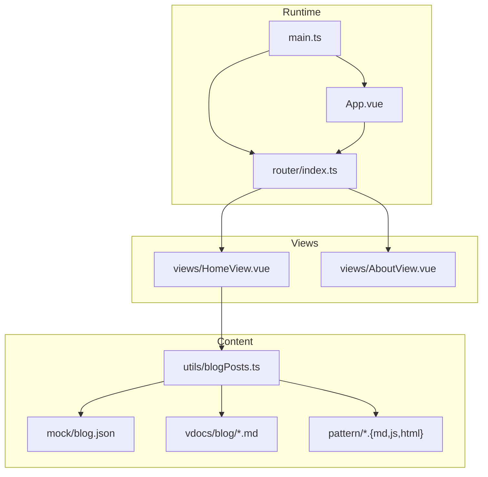
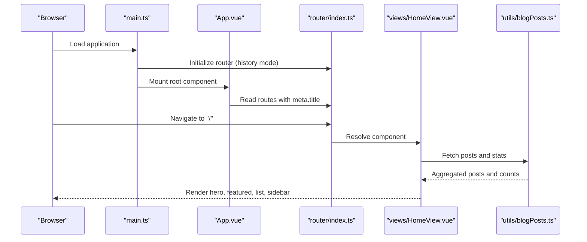
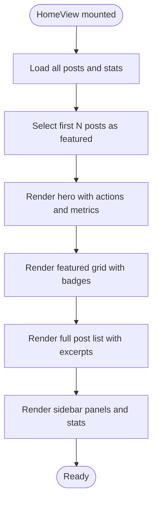
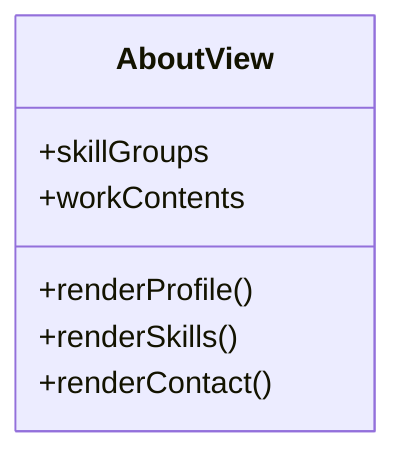
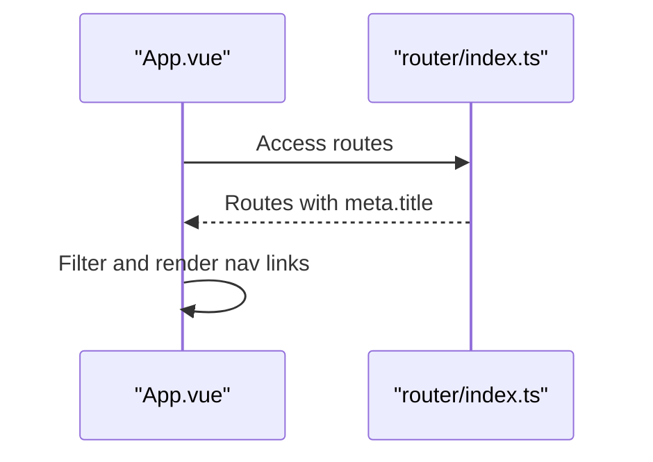
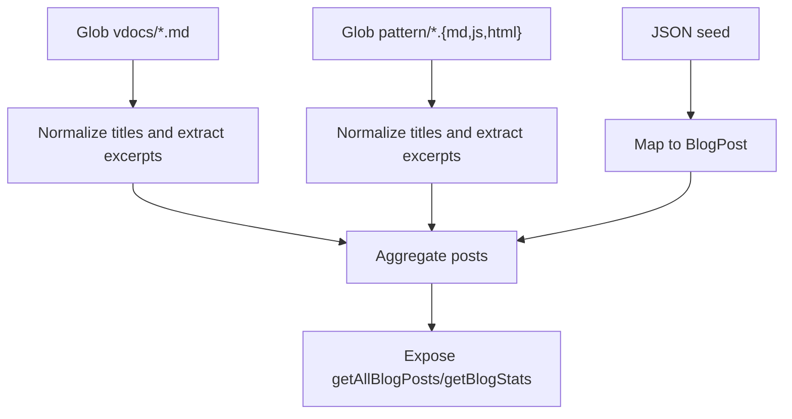
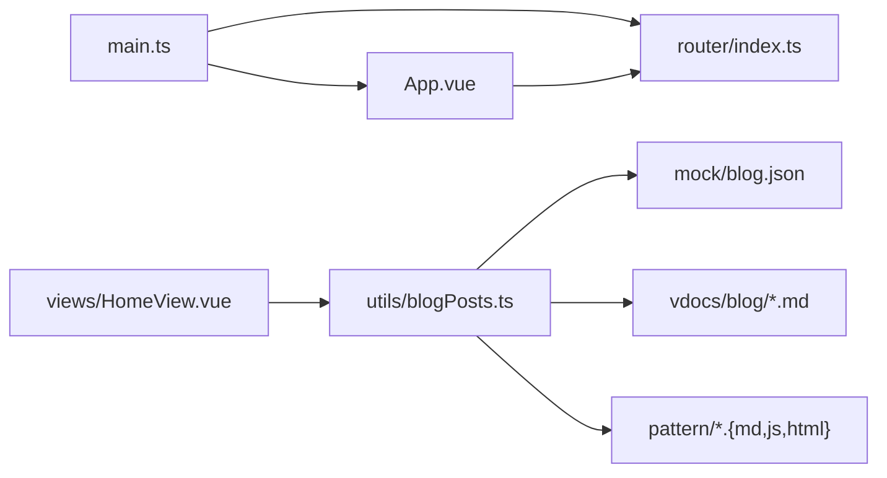

# Portfolio Showcase

<cite>
**Referenced Files in This Document**
- [HomeView.vue](file://src/views/HomeView.vue)
- [AboutView.vue](file://src/views/AboutView.vue)
- [index.ts](file://src/router/index.ts)
- [App.vue](file://src/App.vue)
- [blogPosts.ts](file://src/utils/blogPosts.ts)
- [main.ts](file://src/main.ts)
- [base.css](file://src/assets/base.css)
- [blog.json](file://src/mock/blog.json)
- [routes.js](file://src/apps/legacy/routes.js)
- [home.vue](file://src/apps/legacy/module/home.vue)
- [about.vue](file://src/apps/legacy/module/about.vue)
- [package.json](file://package.json)
</cite>

## Table of Contents
1. [Introduction](#introduction)
2. [Project Structure](#project-structure)
3. [Core Components](#core-components)
4. [Architecture Overview](#architecture-overview)
5. [Detailed Component Analysis](#detailed-component-analysis)
6. [Dependency Analysis](#dependency-analysis)
7. [Performance Considerations](#performance-considerations)
8. [Troubleshooting Guide](#troubleshooting-guide)
9. [Conclusion](#conclusion)
10. [Appendices](#appendices)

## Introduction
This document details the portfolio showcase feature, focusing on the home page’s featured content presentation, navigation system design, responsive layout patterns, and the about page’s professional profile and skills visualization. It also documents the Vue Router configuration with metadata, history mode, content sourcing via Markdown and JSON seeds, and the overall application architecture. Practical guidance is included for customization and content management.

## Project Structure
The portfolio showcase spans several key areas:
- Views: HomeView.vue and AboutView.vue implement the landing and profile pages.
- Router: index.ts defines routes with metadata and lazy-loaded components.
- App shell: App.vue renders the global header with dynamic navigation derived from router metadata.
- Content pipeline: blogPosts.ts aggregates content from VuePress docs, pattern examples, and a JSON seed.
- Legacy apps: A separate legacy routing module exists alongside modern views.
- Global styles: base.css defines theme tokens and typography.

**Diagram sources**
- [main.ts:1-16](file://src/main.ts#L1-L16)
- [App.vue:1-110](file://src/App.vue#L1-L110)
- [index.ts:1-65](file://src/router/index.ts#L1-L65)
- [HomeView.vue:1-648](file://src/views/HomeView.vue#L1-L648)
- [AboutView.vue:1-143](file://src/views/AboutView.vue#L1-L143)
- [blogPosts.ts:1-110](file://src/utils/blogPosts.ts#L1-L110)
- [blog.json:1-14](file://src/mock/blog.json#L1-L14)

**Section sources**
- [main.ts:1-16](file://src/main.ts#L1-L16)
- [App.vue:1-110](file://src/App.vue#L1-L110)
- [index.ts:1-65](file://src/router/index.ts#L1-L65)
- [HomeView.vue:1-648](file://src/views/HomeView.vue#L1-L648)
- [AboutView.vue:1-143](file://src/views/AboutView.vue#L1-L143)
- [blogPosts.ts:1-110](file://src/utils/blogPosts.ts#L1-L110)
- [blog.json:1-14](file://src/mock/blog.json#L1-L14)

## Core Components
- HomeView.vue
  - Loads aggregated blog posts and statistics.
  - Presents a hero section with actions, metrics, and a featured posts grid.
  - Renders a full post list with expandable previews and a sidebar panel.
  - Implements responsive grid layouts and hover animations.
- AboutView.vue
  - Displays a structured professional profile, skills grouped by domain, engineering focus, work content, education, and contact info.
  - Uses chips to visualize skills.
- Router (index.ts)
  - Defines routes with meta.title for navigation labeling.
  - Uses history mode and lazy-loads views.
- App.vue
  - Dynamically builds the header navigation from routes with meta.title.
- Content pipeline (blogPosts.ts)
  - Imports Markdown from vdocs and pattern examples, and JSON seed data.
  - Normalizes titles, extracts excerpts, and computes statistics.

**Section sources**
- [HomeView.vue:1-648](file://src/views/HomeView.vue#L1-L648)
- [AboutView.vue:1-143](file://src/views/AboutView.vue#L1-L143)
- [index.ts:1-65](file://src/router/index.ts#L1-L65)
- [App.vue:1-110](file://src/App.vue#L1-L110)
- [blogPosts.ts:1-110](file://src/utils/blogPosts.ts#L1-L110)

## Architecture Overview
The portfolio showcases a modular single-page application built with Vue 2 and Vue Router. The runtime boots the app, registers the router, and mounts the root component. The App shell renders a persistent header with navigation generated from route metadata. Views encapsulate presentation logic and rely on shared utilities for content aggregation.

**Diagram sources**
- [main.ts:1-16](file://src/main.ts#L1-L16)
- [App.vue:1-110](file://src/App.vue#L1-L110)
- [index.ts:1-65](file://src/router/index.ts#L1-L65)
- [HomeView.vue:1-648](file://src/views/HomeView.vue#L1-L648)
- [blogPosts.ts:1-110](file://src/utils/blogPosts.ts#L1-L110)

## Detailed Component Analysis

### Home View: Featured Content and Layout
- Content sourcing
  - Aggregates posts from multiple sources and computes statistics.
  - Uses excerpts for summaries and supports expandable previews.
- Hero section
  - Prominent call-to-action buttons linking to “About” and “Agent Portal.”
  - Metrics panel displays totals and categories.
- Featured posts
  - Grid layout with staggered animations and category/source badges.
- Post list and sidebar
  - Responsive two-column layout on larger screens.
  - Sidebar panels include content source notice, tool portal hint, and quick stats.

**Diagram sources**
- [HomeView.vue:1-648](file://src/views/HomeView.vue#L1-L648)
- [blogPosts.ts:1-110](file://src/utils/blogPosts.ts#L1-L110)

**Section sources**
- [HomeView.vue:1-648](file://src/views/HomeView.vue#L1-L648)
- [blogPosts.ts:1-110](file://src/utils/blogPosts.ts#L1-L110)

### About View: Professional Profile and Skills
- Structure
  - Profile, core skills, engineering focus, work content, education, and contact.
- Skills visualization
  - Grouped by domain with chip-style tags.
- Contact integration
  - Includes phone, email, and location placeholders.

**Diagram sources**
- [AboutView.vue:1-143](file://src/views/AboutView.vue#L1-L143)

**Section sources**
- [AboutView.vue:1-143](file://src/views/AboutView.vue#L1-L143)

### Navigation System: Dynamic Menu and Meta Data
- Route metadata
  - Routes define meta.title for human-readable labels.
- Dynamic header menu
  - App.vue filters routes to show only those with meta.title.
- History mode
  - Router configured in history mode with BASE_URL base.

**Diagram sources**
- [App.vue:1-110](file://src/App.vue#L1-L110)
- [index.ts:1-65](file://src/router/index.ts#L1-L65)

**Section sources**
- [App.vue:1-110](file://src/App.vue#L1-L110)
- [index.ts:1-65](file://src/router/index.ts#L1-L65)

### Content Presentation and Sourcing
- Markdown ingestion
  - VuePress docs and pattern examples are globbed and normalized into BlogPost entries.
- JSON seed
  - Seed data provides additional entries for notes.
- Excerpts and slugs
  - Titles extracted from Markdown headers; excerpts truncated from content; slugs normalized.

**Diagram sources**
- [blogPosts.ts:1-110](file://src/utils/blogPosts.ts#L1-L110)
- [blog.json:1-14](file://src/mock/blog.json#L1-L14)

**Section sources**
- [blogPosts.ts:1-110](file://src/utils/blogPosts.ts#L1-L110)
- [blog.json:1-14](file://src/mock/blog.json#L1-L14)

### Accessibility and Responsive Patterns
- Accessibility
  - Semantic headings and lists; readable contrast via theme tokens.
- Responsive layout
  - CSS Grid and media queries adjust hero, featured grid, and blog layout for various screen widths.
  - Buttons stack on smaller screens; metrics and grids adapt to viewport.

**Section sources**
- [base.css:1-64](file://src/assets/base.css#L1-L64)
- [HomeView.vue:615-646](file://src/views/HomeView.vue#L615-L646)
- [App.vue:103-108](file://src/App.vue#L103-L108)

### Legacy Routing Context
- A separate legacy routing module exists with System.import-based lazy loading and additional routes.
- While not part of the modern portfolio showcase, it indicates historical routing patterns.

**Section sources**
- [routes.js:1-21](file://src/apps/legacy/routes.js#L1-L21)
- [home.vue:1-32](file://src/apps/legacy/module/home.vue#L1-L32)
- [about.vue:1-102](file://src/apps/legacy/module/about.vue#L1-L102)

## Dependency Analysis
- Runtime bootstrap
  - main.ts initializes Vue, Pinia, router, and mounts the root component.
- Router and views
  - index.ts registers routes; App.vue consumes route metadata for navigation.
- Content pipeline
  - HomeView.vue depends on blogPosts.ts for data; blogPosts.ts depends on vdocs Markdown and pattern files, plus a JSON seed.

**Diagram sources**
- [main.ts:1-16](file://src/main.ts#L1-L16)
- [App.vue:1-110](file://src/App.vue#L1-L110)
- [index.ts:1-65](file://src/router/index.ts#L1-L65)
- [HomeView.vue:1-648](file://src/views/HomeView.vue#L1-L648)
- [blogPosts.ts:1-110](file://src/utils/blogPosts.ts#L1-L110)
- [blog.json:1-14](file://src/mock/blog.json#L1-L14)

**Section sources**
- [main.ts:1-16](file://src/main.ts#L1-L16)
- [index.ts:1-65](file://src/router/index.ts#L1-L65)
- [blogPosts.ts:1-110](file://src/utils/blogPosts.ts#L1-L110)

## Performance Considerations
- Lazy-loading routes
  - Routes for AboutView, AgentPortalView, and others are loaded on demand, reducing initial bundle size.
- Content aggregation
  - Eager glob imports during build time can increase initial payload; consider pagination or server-side rendering for very large doc sets.
- CSS animations
  - Staggered animations enhance UX but may impact scroll performance on low-end devices; test on target hardware.
- Image optimization
  - No images are currently embedded in the showcased components; when adding images, use modern formats (AVIF/WebP) and appropriate sizes.

[No sources needed since this section provides general guidance]

## Troubleshooting Guide
- Navigation not appearing
  - Ensure routes include meta.title; App.vue filters routes by presence of meta.title.
- Blank or missing content
  - Verify vdocs and pattern files exist and are globbed correctly; check that blogPosts.ts returns non-empty arrays.
- Build-time errors with globs
  - Confirm file paths and extensions match the glob patterns; ensure build tool recognizes import.meta.glob.
- Legacy routes not working
  - Legacy routes.js uses System.import; confirm compatibility and that the referenced modules exist.

**Section sources**
- [App.vue:36-42](file://src/App.vue#L36-L42)
- [blogPosts.ts:13-21](file://src/utils/blogPosts.ts#L13-L21)
- [routes.js:1-21](file://src/apps/legacy/routes.js#L1-L21)

## Conclusion
The portfolio showcase leverages Vue Router’s history mode and metadata-driven navigation, a robust content aggregation pipeline from Markdown and JSON, and a responsive, animated UI. The architecture cleanly separates concerns: the router manages navigation, the app shell renders a dynamic header, and views focus on presentation. Extending the showcase involves adding routes with meta.title, supplying content via the documented sources, and iterating on layout and animations.

[No sources needed since this section summarizes without analyzing specific files]

## Appendices

### Customization Options
- Add new pages
  - Define a route with meta.title and a lazy-loaded component.
- Modify navigation labels
  - Change meta.title values to update header labels.
- Extend content sources
  - Add new glob patterns in blogPosts.ts to ingest additional Markdown or static content.
- Customize styling
  - Adjust theme tokens and CSS variables in base.css to change colors and fonts.

**Section sources**
- [index.ts:10-61](file://src/router/index.ts#L10-L61)
- [blogPosts.ts:13-21](file://src/utils/blogPosts.ts#L13-L21)
- [base.css:1-64](file://src/assets/base.css#L1-L64)

### Content Management Approaches
- Markdown-first
  - Place documentation in vdocs/blog/*.md; titles and excerpts are derived automatically.
- Pattern examples
  - Include examples in pattern/*.{md,js,html}; they are ingested as posts.
- Notes and seeds
  - Add lightweight entries in mock/blog.json for quick iteration.

**Section sources**
- [blogPosts.ts:18-21](file://src/utils/blogPosts.ts#L18-L21)
- [blogPosts.ts:55-66](file://src/utils/blogPosts.ts#L55-L66)
- [blogPosts.ts:80-90](file://src/utils/blogPosts.ts#L80-L90)
- [blog.json:1-14](file://src/mock/blog.json#L1-L14)