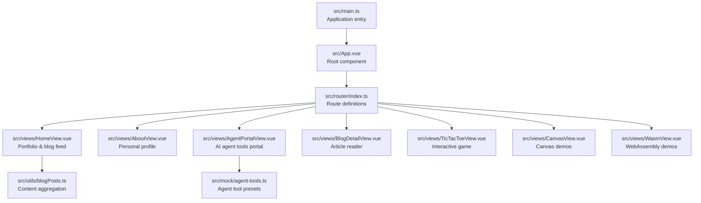
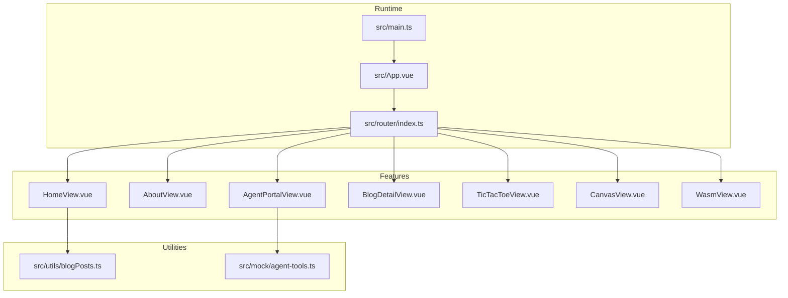
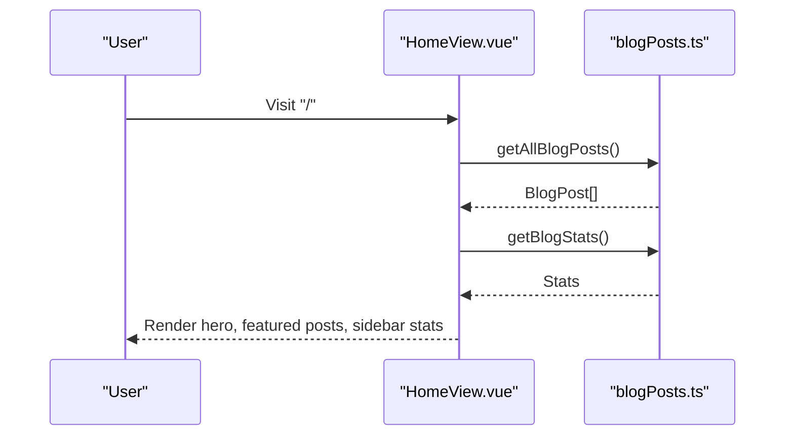
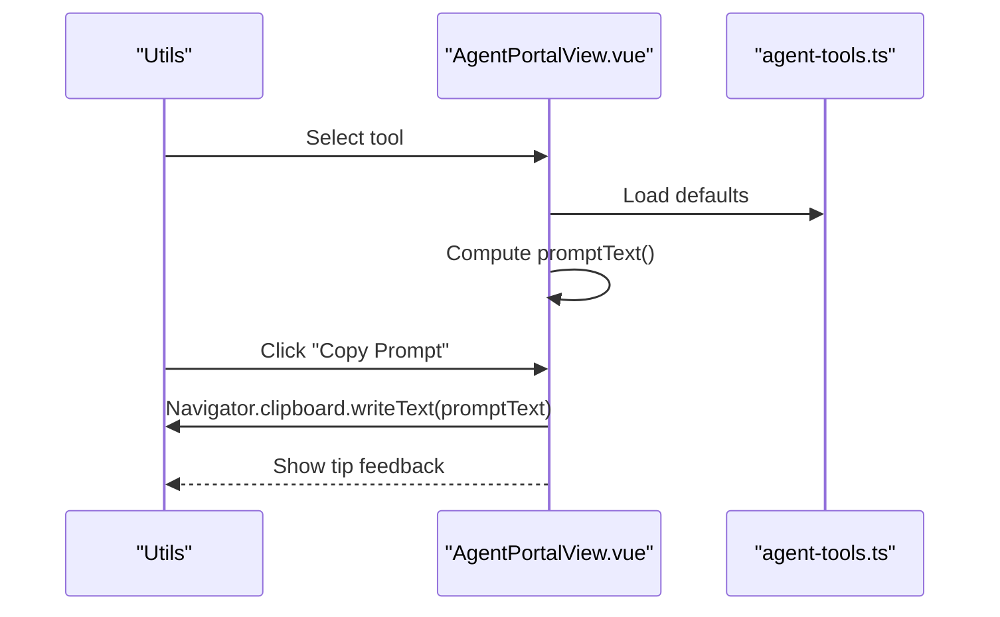
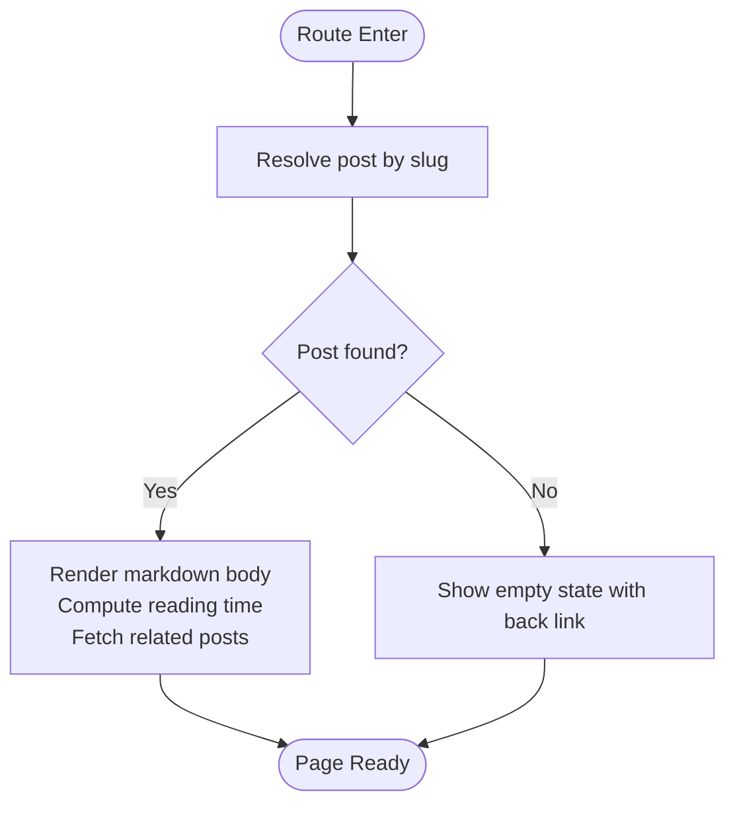
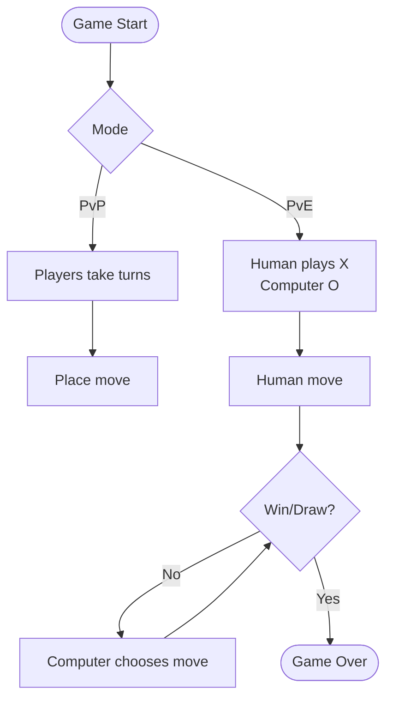
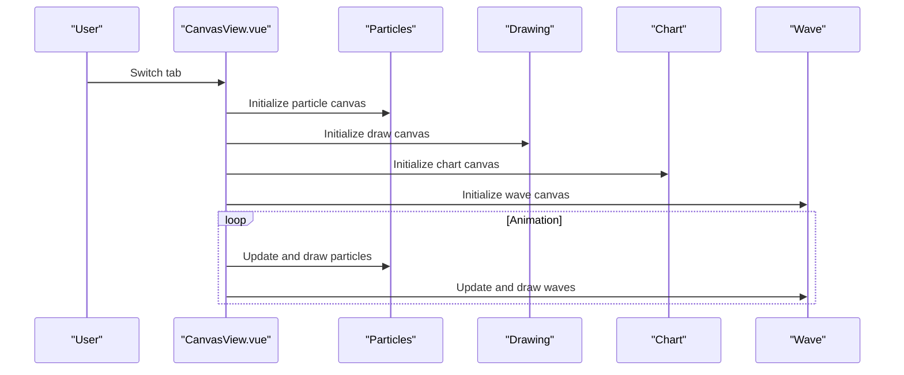
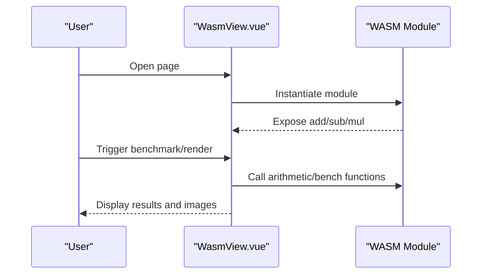
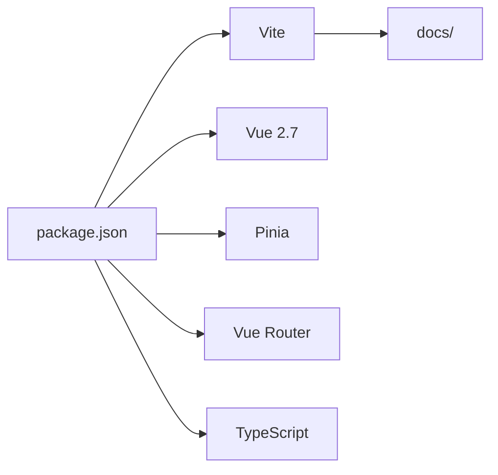

# Project Overview

<cite>
**Referenced Files in This Document**
- [README.md](file://README.md)
- [package.json](file://package.json)
- [vite.config.ts](file://vite.config.ts)
- [src/main.ts](file://src/main.ts)
- [src/App.vue](file://src/App.vue)
- [src/router/index.ts](file://src/router/index.ts)
- [src/views/HomeView.vue](file://src/views/HomeView.vue)
- [src/views/AboutView.vue](file://src/views/AboutView.vue)
- [src/views/AgentPortalView.vue](file://src/views/AgentPortalView.vue)
- [src/views/BlogDetailView.vue](file://src/views/BlogDetailView.vue)
- [src/views/TicTacToeView.vue](file://src/views/TicTacToeView.vue)
- [src/views/CanvasView.vue](file://src/views/CanvasView.vue)
- [src/views/WasmView.vue](file://src/views/WasmView.vue)
- [src/utils/blogPosts.ts](file://src/utils/blogPosts.ts)
- [src/mock/agent-tools.ts](file://src/mock/agent-tools.ts)
</cite>

## Table of Contents
1. [Introduction](#introduction)
2. [Project Structure](#project-structure)
3. [Core Components](#core-components)
4. [Architecture Overview](#architecture-overview)
5. [Detailed Component Analysis](#detailed-component-analysis)
6. [Dependency Analysis](#dependency-analysis)
7. [Performance Considerations](#performance-considerations)
8. [Troubleshooting Guide](#troubleshooting-guide)
9. [Conclusion](#conclusion)

## Introduction
Adminfyy is a multifaceted Vue.js 2.7 application designed as both a personal portfolio website and a technical demonstration platform. It showcases a curated portfolio, a dynamic blog content hub, a design pattern repository, an AI agent tools portal, interactive games, and a documentation hub. The project emphasizes modern frontend practices with TypeScript, Vite, and a component-driven architecture, delivering a cohesive experience for visitors, developers, and contributors.

## Project Structure
The project follows a feature-based layout centered around Vue 2.7, TypeScript, and Vite. Key areas include:
- Application bootstrap and global configuration
- Routing and navigation
- Feature views (portfolio, blog, agent tools, games, demos)
- Utility modules for content aggregation and shared logic
- Documentation pipeline integration

**Diagram sources**
- [src/main.ts:1-16](file://src/main.ts#L1-L16)
- [src/App.vue:1-110](file://src/App.vue#L1-L110)
- [src/router/index.ts:1-65](file://src/router/index.ts#L1-L65)
- [src/views/HomeView.vue:1-648](file://src/views/HomeView.vue#L1-L648)
- [src/views/AboutView.vue:1-143](file://src/views/AboutView.vue#L1-L143)
- [src/views/AgentPortalView.vue:1-239](file://src/views/AgentPortalView.vue#L1-L239)
- [src/views/BlogDetailView.vue:1-530](file://src/views/BlogDetailView.vue#L1-L530)
- [src/views/TicTacToeView.vue:1-181](file://src/views/TicTacToeView.vue#L1-L181)
- [src/views/CanvasView.vue:1-472](file://src/views/CanvasView.vue#L1-L472)
- [src/views/WasmView.vue:1-842](file://src/views/WasmView.vue#L1-L842)
- [src/utils/blogPosts.ts:1-110](file://src/utils/blogPosts.ts#L1-L110)
- [src/mock/agent-tools.ts:1-40](file://src/mock/agent-tools.ts#L1-L40)

**Section sources**
- [src/main.ts:1-16](file://src/main.ts#L1-L16)
- [src/App.vue:1-110](file://src/App.vue#L1-L110)
- [src/router/index.ts:1-65](file://src/router/index.ts#L1-L65)
- [src/views/HomeView.vue:1-648](file://src/views/HomeView.vue#L1-L648)
- [src/views/AboutView.vue:1-143](file://src/views/AboutView.vue#L1-L143)
- [src/views/AgentPortalView.vue:1-239](file://src/views/AgentPortalView.vue#L1-L239)
- [src/views/BlogDetailView.vue:1-530](file://src/views/BlogDetailView.vue#L1-L530)
- [src/views/TicTacToeView.vue:1-181](file://src/views/TicTacToeView.vue#L1-L181)
- [src/views/CanvasView.vue:1-472](file://src/views/CanvasView.vue#L1-L472)
- [src/views/WasmView.vue:1-842](file://src/views/WasmView.vue#L1-L842)
- [src/utils/blogPosts.ts:1-110](file://src/utils/blogPosts.ts#L1-L110)
- [src/mock/agent-tools.ts:1-40](file://src/mock/agent-tools.ts#L1-L40)

## Core Components
Adminfyy’s core components are organized around a central App shell and modular feature views:

- Root application initialization
  - Initializes Vue, Pinia, and registers the router and global styles.
  - Mounts the root App component to the DOM.

- Global layout and navigation
  - Provides a responsive header with brand identity and a dynamic navigation menu derived from route metadata.

- Feature views
  - Portfolio and blog feed: Aggregates content from multiple sources and renders a rich, filterable layout.
  - About page: Presents professional profile, skills, and contact details.
  - Agent tools portal: Interactive prompt builder with tool presets and clipboard integration.
  - Blog detail view: Renders article content with markdown processing and related posts.
  - Games and demos: Tic Tac Toe, Canvas animations, and WebAssembly experiments.

- Utilities and data sources
  - Blog post aggregation from seeded data, VuePress docs, and design pattern files.
  - Agent tool presets for quick prompt generation.

**Section sources**
- [src/main.ts:1-16](file://src/main.ts#L1-L16)
- [src/App.vue:1-110](file://src/App.vue#L1-L110)
- [src/router/index.ts:1-65](file://src/router/index.ts#L1-L65)
- [src/views/HomeView.vue:1-648](file://src/views/HomeView.vue#L1-L648)
- [src/views/AboutView.vue:1-143](file://src/views/AboutView.vue#L1-L143)
- [src/views/AgentPortalView.vue:1-239](file://src/views/AgentPortalView.vue#L1-L239)
- [src/views/BlogDetailView.vue:1-530](file://src/views/BlogDetailView.vue#L1-L530)
- [src/views/TicTacToeView.vue:1-181](file://src/views/TicTacToeView.vue#L1-L181)
- [src/views/CanvasView.vue:1-472](file://src/views/CanvasView.vue#L1-L472)
- [src/views/WasmView.vue:1-842](file://src/views/WasmView.vue#L1-L842)
- [src/utils/blogPosts.ts:1-110](file://src/utils/blogPosts.ts#L1-L110)
- [src/mock/agent-tools.ts:1-40](file://src/mock/agent-tools.ts#L1-L40)

## Architecture Overview
Adminfyy employs a component-based architecture with clear separation of concerns:
- Entry point initializes the Vue runtime, Pinia for state, and the router.
- App.vue defines the global layout and menu generation from route metadata.
- Router/index.ts configures routes with lazy-loaded views and metadata-driven navigation.
- Feature views encapsulate domain-specific UI and logic.
- Utilities provide reusable functions for content aggregation and shared computations.

**Diagram sources**
- [src/main.ts:1-16](file://src/main.ts#L1-L16)
- [src/App.vue:1-110](file://src/App.vue#L1-L110)
- [src/router/index.ts:1-65](file://src/router/index.ts#L1-L65)
- [src/views/HomeView.vue:1-648](file://src/views/HomeView.vue#L1-L648)
- [src/views/AboutView.vue:1-143](file://src/views/AboutView.vue#L1-L143)
- [src/views/AgentPortalView.vue:1-239](file://src/views/AgentPortalView.vue#L1-L239)
- [src/views/BlogDetailView.vue:1-530](file://src/views/BlogDetailView.vue#L1-L530)
- [src/views/TicTacToeView.vue:1-181](file://src/views/TicTacToeView.vue#L1-L181)
- [src/views/CanvasView.vue:1-472](file://src/views/CanvasView.vue#L1-L472)
- [src/views/WasmView.vue:1-842](file://src/views/WasmView.vue#L1-L842)
- [src/utils/blogPosts.ts:1-110](file://src/utils/blogPosts.ts#L1-L110)
- [src/mock/agent-tools.ts:1-40](file://src/mock/agent-tools.ts#L1-L40)

## Detailed Component Analysis

### Portfolio and Blog Hub (HomeView)
- Purpose: Central landing showcasing portfolio highlights, recent articles, and quick statistics.
- Key behaviors:
  - Loads aggregated blog posts from multiple sources (seeded, VuePress docs, pattern files).
  - Computes and displays statistics for content sources.
  - Provides navigation to detailed article pages and the agent tools portal.
- Data flow:
  - Reads from blog aggregation utility and exposes featured and full lists to the template.

**Diagram sources**
- [src/views/HomeView.vue:1-648](file://src/views/HomeView.vue#L1-L648)
- [src/utils/blogPosts.ts:1-110](file://src/utils/blogPosts.ts#L1-L110)

**Section sources**
- [src/views/HomeView.vue:1-648](file://src/views/HomeView.vue#L1-L648)
- [src/utils/blogPosts.ts:1-110](file://src/utils/blogPosts.ts#L1-L110)

### About Page (AboutView)
- Purpose: Professional profile presentation with skills, focus areas, and contact details.
- Structure: Uses grouped chips and bullet lists to communicate expertise and background succinctly.

**Section sources**
- [src/views/AboutView.vue:1-143](file://src/views/AboutView.vue#L1-L143)

### AI Agent Tools Portal (AgentPortalView)
- Purpose: Demonstrates prompt engineering workflows with preset tools and live output generation.
- Key behaviors:
  - Tool selection updates default inputs for goal, context, and constraints.
  - Real-time prompt assembly based on selected tool and inputs.
  - Clipboard integration for copying generated prompts.
- Data flow:
  - Consumes agent tool presets and prompt builders from utilities.

**Diagram sources**
- [src/views/AgentPortalView.vue:1-239](file://src/views/AgentPortalView.vue#L1-L239)
- [src/mock/agent-tools.ts:1-40](file://src/mock/agent-tools.ts#L1-L40)

**Section sources**
- [src/views/AgentPortalView.vue:1-239](file://src/views/AgentPortalView.vue#L1-L239)
- [src/mock/agent-tools.ts:1-40](file://src/mock/agent-tools.ts#L1-L40)

### Blog Detail Reader (BlogDetailView)
- Purpose: Renders individual articles with markdown processing, reading time estimation, and related content.
- Key behaviors:
  - Resolves post by slug from aggregated content.
  - Generates related posts excluding the current article.
  - Renders processed markdown and applies scoped styles for readability.

**Diagram sources**
- [src/views/BlogDetailView.vue:1-530](file://src/views/BlogDetailView.vue#L1-L530)
- [src/utils/blogPosts.ts:1-110](file://src/utils/blogPosts.ts#L1-L110)

**Section sources**
- [src/views/BlogDetailView.vue:1-530](file://src/views/BlogDetailView.vue#L1-L530)
- [src/utils/blogPosts.ts:1-110](file://src/utils/blogPosts.ts#L1-L110)

### Interactive Games (TicTacToeView)
- Purpose: Provides a playable Tic Tac Toe experience with two modes (PvP and PvE).
- Key behaviors:
  - Tracks board state, current player, and win/draw conditions.
  - Implements a simple AI for the PvE mode with prioritized moves.
  - Resets and switches modes cleanly.

**Diagram sources**
- [src/views/TicTacToeView.vue:1-181](file://src/views/TicTacToeView.vue#L1-L181)

**Section sources**
- [src/views/TicTacToeView.vue:1-181](file://src/views/TicTacToeView.vue#L1-L181)

### Canvas Demos (CanvasView)
- Purpose: Demonstrates Canvas API usage across multiple interactive tabs: particle systems, drawing pad, bar charts, and sine wave animations.
- Key behaviors:
  - Initializes canvases per tab and manages animation loops.
  - Supports user interaction (drawing) and parameterized rendering (charts, waves).
  - Cleans up animation frames on unmount.

**Diagram sources**
- [src/views/CanvasView.vue:1-472](file://src/views/CanvasView.vue#L1-L472)

**Section sources**
- [src/views/CanvasView.vue:1-472](file://src/views/CanvasView.vue#L1-L472)

### WebAssembly Demos (WasmView)
- Purpose: Explores WebAssembly fundamentals with arithmetic operations, benchmarks, and visualizations.
- Key behaviors:
  - Dynamically loads a WASM module and exposes arithmetic functions.
  - Benchmarks JavaScript implementations and compares performance.
  - Renders Mandelbrot fractals using Canvas ImageData.

**Diagram sources**
- [src/views/WasmView.vue:1-842](file://src/views/WasmView.vue#L1-L842)

**Section sources**
- [src/views/WasmView.vue:1-842](file://src/views/WasmView.vue#L1-L842)

## Dependency Analysis
- Technology stack
  - Vue.js 2.7 with Vue Router and Pinia for state management.
  - TypeScript for type safety and editor support.
  - Vite for fast development and optimized builds.
- Build and output
  - Vite configuration enables Vue 2 plugin, JSX support, legacy browser polyfills, and builds into the docs directory for static hosting.
- Scripts and tooling
  - npm scripts cover development, building, testing (unit and e2e), linting, and documentation site dev/build.

**Diagram sources**
- [package.json:1-61](file://package.json#L1-L61)
- [vite.config.ts:1-27](file://vite.config.ts#L1-L27)

**Section sources**
- [package.json:1-61](file://package.json#L1-L61)
- [vite.config.ts:1-27](file://vite.config.ts#L1-L27)

## Performance Considerations
- Static build target: The application builds into the docs directory, suitable for static hosting and CDN delivery.
- Legacy compatibility: Vite legacy plugin ensures broader browser support.
- Optimized routing: Lazy-loaded route components reduce initial bundle size.
- Canvas and WASM: Animation loops and image processing are managed with requestAnimationFrame and efficient pixel manipulation to minimize overhead.

## Troubleshooting Guide
- Development server and build
  - Use npm scripts for dev server, production build, and preview.
- Testing
  - Unit tests via Vitest and e2e tests via Cypress are configured; run with dedicated scripts.
- Linting
  - ESLint is configured for Vue and TypeScript; run the lint script to fix issues automatically.

**Section sources**
- [README.md:1-60](file://README.md#L1-L60)
- [package.json:15-27](file://package.json#L15-L27)

## Conclusion
Adminfyy combines a personal portfolio with a technical showcase, leveraging Vue.js 2.7, TypeScript, and Vite to deliver a modern, maintainable, and extensible frontend application. Its modular architecture supports diverse features—from content aggregation and agent tools to interactive games and demos—while maintaining a consistent developer experience and clear pathways for contributors.