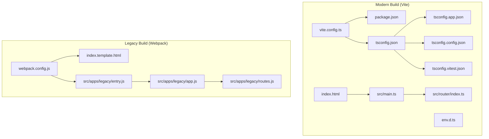
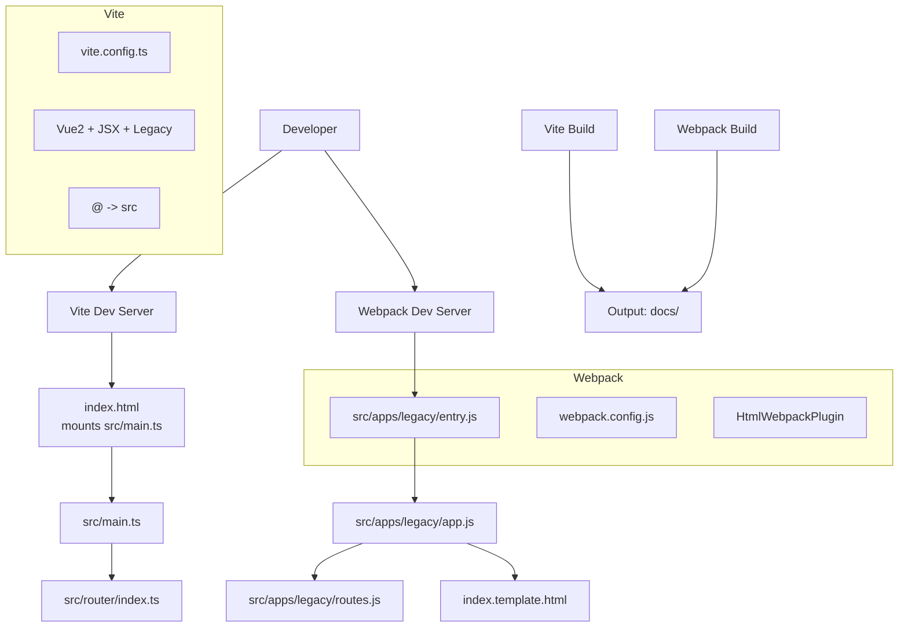
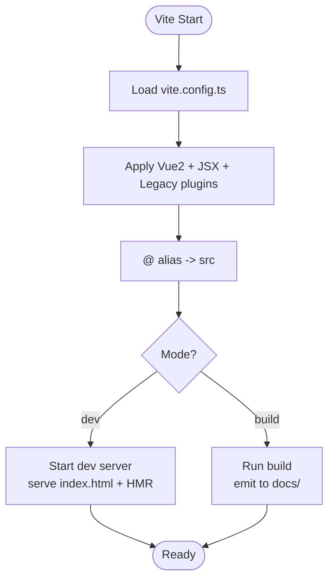
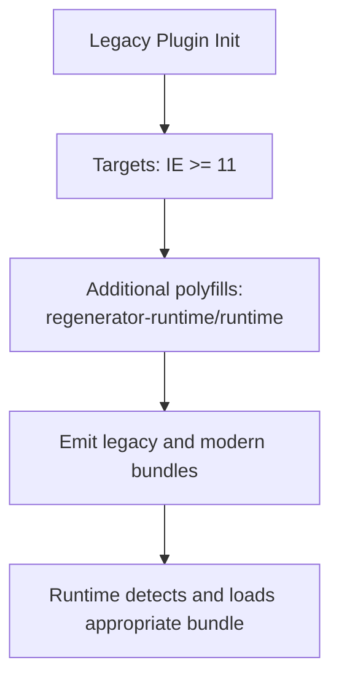
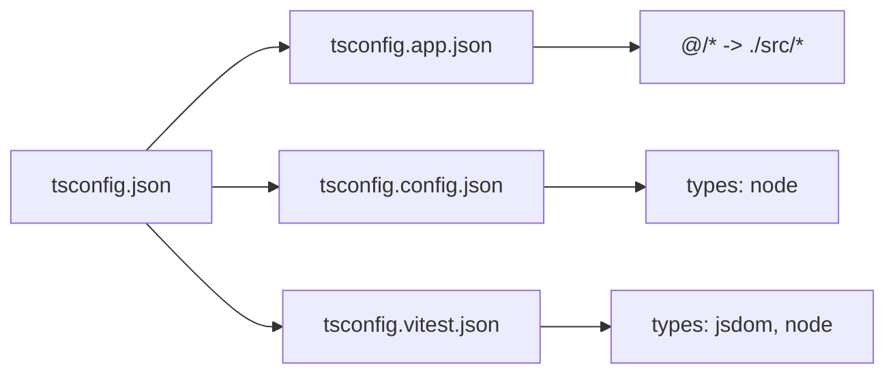
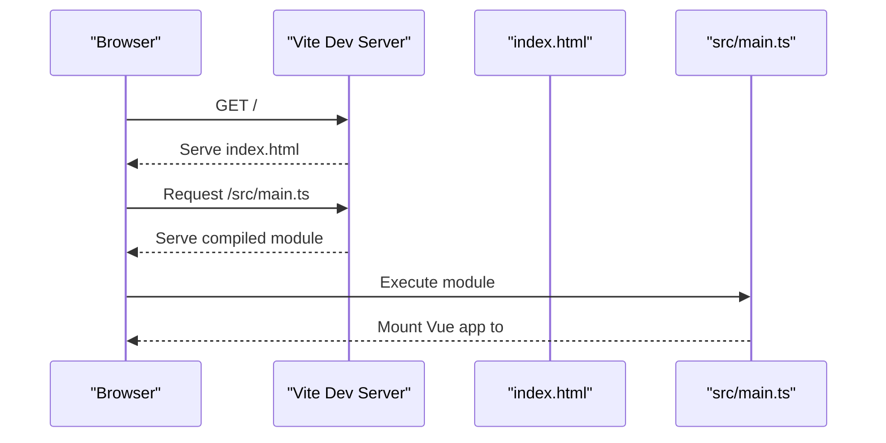
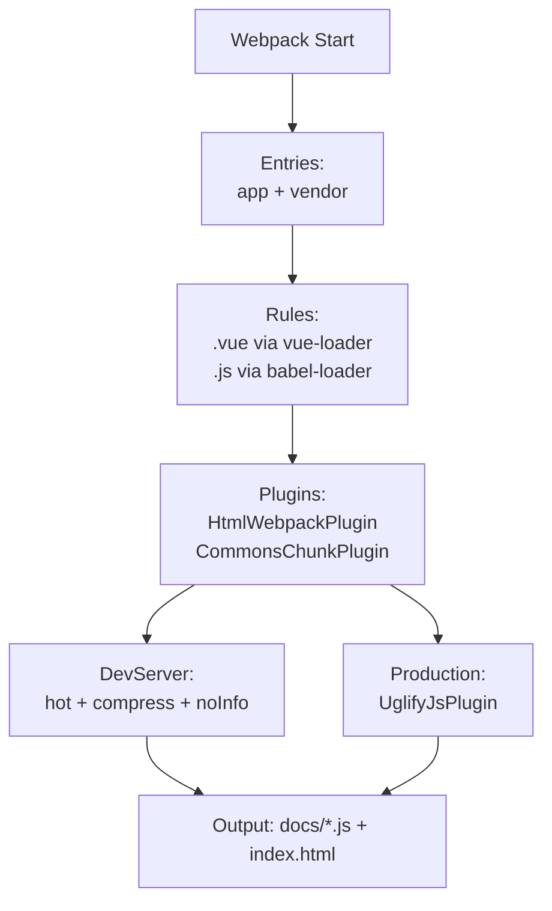
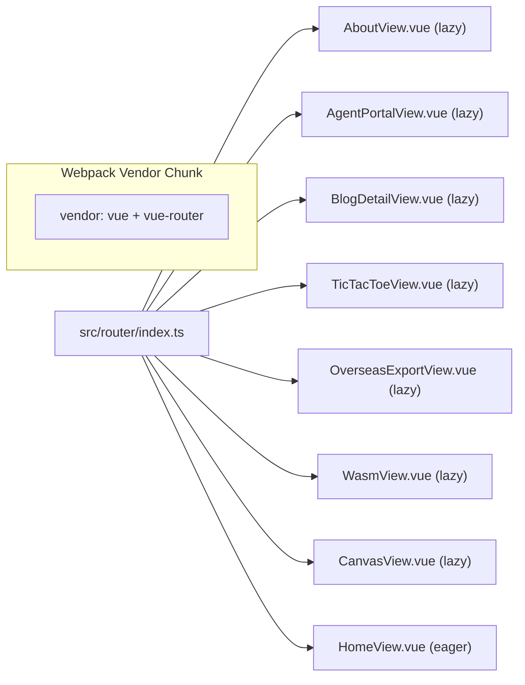
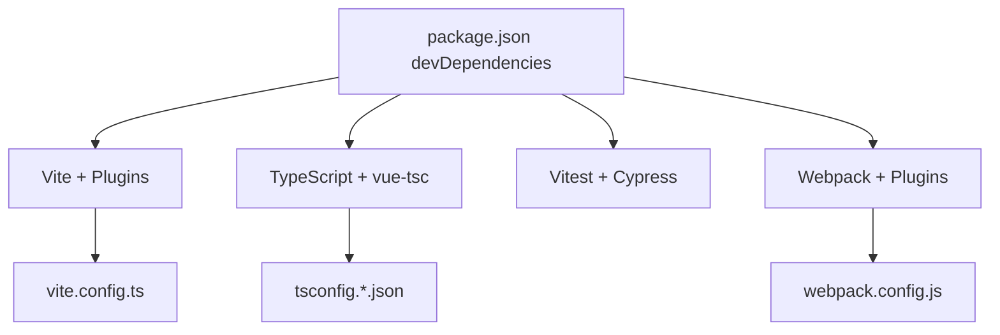

# Build Tooling and Configuration

<cite>
**Referenced Files in This Document**
- [vite.config.ts](file://vite.config.ts)
- [webpack.config.js](file://webpack.config.js)
- [package.json](file://package.json)
- [tsconfig.json](file://tsconfig.json)
- [tsconfig.app.json](file://tsconfig.app.json)
- [tsconfig.config.json](file://tsconfig.config.json)
- [tsconfig.vitest.json](file://tsconfig.vitest.json)
- [env.d.ts](file://env.d.ts)
- [index.html](file://index.html)
- [index.template.html](file://index.template.html)
- [src/main.ts](file://src/main.ts)
- [src/router/index.ts](file://src/router/index.ts)
- [src/App.vue](file://src/App.vue)
- [src/assets/main.css](file://src/assets/main.css)
- [src/views/HomeView.vue](file://src/views/HomeView.vue)
- [src/views/AboutView.vue](file://src/views/AboutView.vue)
- [src/views/AgentPortalView.vue](file://src/views/AgentPortalView.vue)
- [src/views/BlogDetailView.vue](file://src/views/BlogDetailView.vue)
- [src/views/TicTacToeView.vue](file://src/views/TicTacToeView.vue)
- [src/views/OverseasExportView.vue](file://src/views/OverseasExportView.vue)
- [src/views/WasmView.vue](file://src/views/WasmView.vue)
- [src/views/CanvasView.vue](file://src/views/CanvasView.vue)
- [src/apps/legacy/app.js](file://src/apps/legacy/app.js)
- [src/apps/legacy/entry.js](file://src/apps/legacy/entry.js)
- [src/apps/legacy/routes.js](file://src/apps/legacy/routes.js)
- [cypress.config.ts](file://cypress.config.ts)
</cite>

## Table of Contents
1. [Introduction](#introduction)
2. [Project Structure](#project-structure)
3. [Core Components](#core-components)
4. [Architecture Overview](#architecture-overview)
5. [Detailed Component Analysis](#detailed-component-analysis)
6. [Dependency Analysis](#dependency-analysis)
7. [Performance Considerations](#performance-considerations)
8. [Troubleshooting Guide](#troubleshooting-guide)
9. [Conclusion](#conclusion)
10. [Appendices](#appendices)

## Introduction
This document explains the build tooling infrastructure for the project, focusing on the current Vite-based setup and the legacy Webpack configuration retained for backward compatibility. It covers the Vite build process, plugin configuration, asset handling, development server setup, legacy browser support via @vitejs/plugin-legacy, TypeScript compilation and path mapping, code splitting strategies, environment-specific configurations, production optimizations, and deployment preparation. It also documents the npm script commands and outlines migration strategies from Webpack to Vite.

## Project Structure
The build system centers around two primary build tools:
- Vite: Used for modern development and production builds, with legacy browser support enabled.
- Webpack: Retained for a legacy application entry under src/apps/legacy/, with a dedicated HTML template and separate entry.

Key configuration and entry points:
- Vite configuration defines plugins, path aliases, and output directory.
- TypeScript configurations split by application, config, and test environments.
- HTML templates serve as entry points for both modern and legacy builds.
- Application entry points mount Vue 2 applications and configure routing.

**Diagram sources**
- [vite.config.ts:1-27](file://vite.config.ts#L1-L27)
- [package.json:15-27](file://package.json#L15-L27)
- [tsconfig.json:1-15](file://tsconfig.json#L1-L15)
- [tsconfig.app.json:1-13](file://tsconfig.app.json#L1-L13)
- [tsconfig.config.json:1-9](file://tsconfig.config.json#L1-L9)
- [tsconfig.vitest.json:1-10](file://tsconfig.vitest.json#L1-L10)
- [env.d.ts:1-2](file://env.d.ts#L1-L2)
- [index.html:1-14](file://index.html#L1-L14)
- [src/main.ts:1-16](file://src/main.ts#L1-L16)
- [src/router/index.ts:1-65](file://src/router/index.ts#L1-L65)
- [webpack.config.js:1-61](file://webpack.config.js#L1-L61)
- [index.template.html:1-13](file://index.template.html#L1-L13)
- [src/apps/legacy/entry.js:1-2](file://src/apps/legacy/entry.js#L1-L2)
- [src/apps/legacy/app.js:1-13](file://src/apps/legacy/app.js#L1-L13)
- [src/apps/legacy/routes.js](file://src/apps/legacy/routes.js)

**Section sources**
- [vite.config.ts:1-27](file://vite.config.ts#L1-L27)
- [webpack.config.js:1-61](file://webpack.config.js#L1-L61)
- [package.json:15-27](file://package.json#L15-L27)
- [tsconfig.json:1-15](file://tsconfig.json#L1-L15)
- [tsconfig.app.json:1-13](file://tsconfig.app.json#L1-L13)
- [tsconfig.config.json:1-9](file://tsconfig.config.json#L1-L9)
- [tsconfig.vitest.json:1-10](file://tsconfig.vitest.json#L1-L10)
- [env.d.ts:1-2](file://env.d.ts#L1-L2)
- [index.html:1-14](file://index.html#L1-L14)
- [index.template.html:1-13](file://index.template.html#L1-L13)
- [src/main.ts:1-16](file://src/main.ts#L1-L16)
- [src/router/index.ts:1-65](file://src/router/index.ts#L1-L65)
- [src/apps/legacy/entry.js:1-2](file://src/apps/legacy/entry.js#L1-L2)
- [src/apps/legacy/app.js:1-13](file://src/apps/legacy/app.js#L1-L13)

## Core Components
- Vite configuration
  - Plugins: Vue 2, JSX, and legacy support for IE 11+ with additional polyfills.
  - Path aliasing for @ pointing to src.
  - Output directory set to docs for static hosting.
- TypeScript configuration
  - Root references three tsconfig files: app, config, and vitest.
  - App tsconfig extends web defaults, includes env.d.ts, and sets path mapping.
  - Config tsconfig enables Node types for Vite/Vitest configs.
  - Vitest tsconfig extends app with JSDOM and Node types.
- HTML entry points
  - Modern: index.html mounts src/main.ts and uses Vite’s module runtime.
  - Legacy: index.template.html is consumed by HtmlWebpackPlugin in Webpack.
- Scripts
  - Development: vite dev server.
  - Build: type-check followed by vite build; preview for local testing.
  - Testing: unit tests with Vitest and E2E with Cypress against the preview server.

**Section sources**
- [vite.config.ts:9-26](file://vite.config.ts#L9-L26)
- [tsconfig.json:1-15](file://tsconfig.json#L1-L15)
- [tsconfig.app.json:1-13](file://tsconfig.app.json#L1-L13)
- [tsconfig.config.json:1-9](file://tsconfig.config.json#L1-L9)
- [tsconfig.vitest.json:1-10](file://tsconfig.vitest.json#L1-L10)
- [env.d.ts:1-2](file://env.d.ts#L1-L2)
- [index.html:11](file://index.html#L11)
- [package.json:15-27](file://package.json#L15-L27)

## Architecture Overview
The build architecture supports dual modes:
- Modern mode: Vite compiles TypeScript, resolves aliases, applies Vue 2 and JSX transforms, injects legacy polyfills for older browsers, and emits assets to docs.
- Legacy mode: Webpack bundles a separate Vue 2 SPA with a dedicated entry and HTML template, targeting older environments.

**Diagram sources**
- [vite.config.ts:9-26](file://vite.config.ts#L9-L26)
- [index.html:11](file://index.html#L11)
- [src/main.ts:1-16](file://src/main.ts#L1-L16)
- [src/router/index.ts:1-65](file://src/router/index.ts#L1-L65)
- [webpack.config.js:31-40](file://webpack.config.js#L31-L40)
- [index.template.html:1-13](file://index.template.html#L1-L13)
- [src/apps/legacy/entry.js:1-2](file://src/apps/legacy/entry.js#L1-L2)
- [src/apps/legacy/app.js:1-13](file://src/apps/legacy/app.js#L1-L13)

## Detailed Component Analysis

### Vite Configuration and Build Process
- Plugins
  - Vue 2 plugin enables SFC compilation and template transforms.
  - Vue 2 JSX plugin supports JSX/TSX in Vue 2 projects.
  - Legacy plugin transpiles and polyfills for IE 11+ and injects additional polyfills.
- Path aliasing
  - @ resolves to src for concise imports across the codebase.
- Output
  - Build emits to docs, suitable for static hosting.
- Development server
  - Vite dev server serves the modern SPA with fast HMR and module-based loading.

**Diagram sources**
- [vite.config.ts:9-26](file://vite.config.ts#L9-L26)

**Section sources**
- [vite.config.ts:9-26](file://vite.config.ts#L9-L26)

### Legacy Browser Support and Polyfills (@vitejs/plugin-legacy)
- Targets
  - IE >= 11 is supported through the legacy plugin.
- Additional polyfills
  - regenerator-runtime/runtime is included to enable async/await in legacy environments.
- Effect
  - Generates dual builds: modern and legacy chunks, ensuring compatibility while preserving performance for modern browsers.

**Diagram sources**
- [vite.config.ts:13-16](file://vite.config.ts#L13-L16)

**Section sources**
- [vite.config.ts:13-16](file://vite.config.ts#L13-L16)

### TypeScript Compilation and Path Mapping
- Root configuration
  - tsconfig.json aggregates references to app, config, and vitest configurations.
- App configuration
  - Extends web defaults, includes env.d.ts and Vue files, and sets composite to true.
  - Path mapping @/* to ./src/* for clean imports.
- Config configuration
  - Enables Node types for Vite/Vitest configuration files.
- Vitest configuration
  - Extends app configuration and adds JSDOM and Node types for unit tests.

**Diagram sources**
- [tsconfig.json:1-15](file://tsconfig.json#L1-L15)
- [tsconfig.app.json:5-11](file://tsconfig.app.json#L5-L11)
- [tsconfig.config.json:4-7](file://tsconfig.config.json#L4-L7)
- [tsconfig.vitest.json:4-8](file://tsconfig.vitest.json#L4-L8)

**Section sources**
- [tsconfig.json:1-15](file://tsconfig.json#L1-L15)
- [tsconfig.app.json:1-13](file://tsconfig.app.json#L1-L13)
- [tsconfig.config.json:1-9](file://tsconfig.config.json#L1-L9)
- [tsconfig.vitest.json:1-10](file://tsconfig.vitest.json#L1-L10)
- [env.d.ts:1-2](file://env.d.ts#L1-L2)

### Asset Handling and Development Server Setup
- HTML entry
  - index.html mounts the modern SPA via a module script tag.
- Assets
  - Global CSS is imported in the main entry; Vite handles CSS extraction and HMR during development.
- Dev server
  - Vite dev server serves the SPA with hot module replacement and fast refresh.

**Diagram sources**
- [index.html:11](file://index.html#L11)
- [src/main.ts:1-16](file://src/main.ts#L1-L16)

**Section sources**
- [index.html:11](file://index.html#L11)
- [src/main.ts:1-16](file://src/main.ts#L1-L16)

### Legacy Webpack Setup
- Entry and output
  - Multi-entry: app and vendor chunks; hashed filenames in production.
- Loaders
  - vue-loader for .vue files and babel-loader for .js files.
- Plugins
  - HtmlWebpackPlugin injects the template into index.html.
  - CommonsChunkPlugin extracts shared dependencies into a vendor chunk.
- Dev server
  - Compression, hot reloading, and eval source maps for fast iteration.
- Production
  - UglifyJS minification with dead code elimination and warnings disabled.

**Diagram sources**
- [webpack.config.js:5-47](file://webpack.config.js#L5-L47)
- [index.template.html:1-13](file://index.template.html#L1-L13)

**Section sources**
- [webpack.config.js:1-61](file://webpack.config.js#L1-L61)
- [index.template.html:1-13](file://index.template.html#L1-L13)

### Code Splitting Strategies
- Route-based code splitting
  - Lazy-loading views (e.g., About, AgentPortal, BlogDetail, TicTacToe, OverseasExport, WASM, Canvas) creates separate chunks per route.
- Vendor chunking
  - Webpack separates vendor libraries (vue, vue-router) into a common chunk to improve caching.
- Impact
  - Reduces initial bundle size and improves load performance by deferring non-critical code until routes are visited.

**Diagram sources**
- [src/router/index.ts:20-61](file://src/router/index.ts#L20-L61)
- [webpack.config.js:36-39](file://webpack.config.js#L36-L39)

**Section sources**
- [src/router/index.ts:20-61](file://src/router/index.ts#L20-L61)
- [webpack.config.js:36-39](file://webpack.config.js#L36-L39)

### Environment-Specific Configurations and Production Optimizations
- Vite
  - Output directory configured to docs for static hosting.
  - Legacy plugin ensures cross-browser compatibility.
- Webpack
  - Production minification via UglifyJS.
  - Hashed filenames for cache busting.
- Type checking
  - Separate script runs vue-tsc for type checking without emitting JS.
- Preview
  - vite preview starts a local static server for production-like testing.

**Section sources**
- [vite.config.ts:23-25](file://vite.config.ts#L23-L25)
- [webpack.config.js:49-60](file://webpack.config.js#L49-L60)
- [package.json:24-25](file://package.json#L24-L25)
- [package.json:20](file://package.json#L20)

### Deployment Preparation
- Output location
  - Both Vite and Webpack emit to docs, enabling straightforward static hosting deployment.
- Preview
  - Use vite preview to validate production build locally before deployment.

**Section sources**
- [vite.config.ts:24](file://vite.config.ts#L24)
- [webpack.config.js:12](file://webpack.config.js#L12)
- [package.json:20](file://package.json#L20)

### Transition from Webpack to Vite and Migration Strategies
- Migration steps
  - Replace Webpack loaders with Vite plugins (vue, jsx, legacy).
  - Align path aliases and TypeScript configuration with Vite’s expectations.
  - Migrate HTML templating to index.html and remove HtmlWebpackPlugin where applicable.
  - Adopt Vite’s dev server and HMR for faster iteration.
- Performance comparison
  - Vite leverages native ES modules and Rollup for bundling, generally offering faster cold start and rebuild times compared to Webpack.
  - Legacy plugin maintains IE 11+ support; consider gradual removal of legacy targets as adoption increases.
- Validation
  - Use vite preview and Cypress E2E tests to verify parity with the previous Webpack build.

[No sources needed since this section provides general guidance]

### npm Script Commands and Purposes
- dev: Starts Vite dev server for the modern SPA.
- build: Runs type-check first, then vite build.
- build-only: Executes vite build directly.
- preview: Serves the production build locally on port 4173.
- test:unit: Runs unit tests with Vitest in jsdom environment.
- test:e2e: Opens Cypress GUI against the preview server.
- test:e2e:ci: Runs Cypress in CI against the preview server.
- doc:dev/doc:build: Delegates documentation site builds to the vdocs workspace.

**Section sources**
- [package.json:15-27](file://package.json#L15-L27)

## Dependency Analysis
- Vite plugins
  - @vitejs/plugin-vue2, @vitejs/plugin-vue2-jsx, @vitejs/plugin-legacy are declared in devDependencies and applied in vite.config.ts.
- TypeScript ecosystem
  - vue-tsc, typescript, and @vue/tsconfig provide type checking and configuration inheritance.
- Testing
  - vitest, jsdom, @vue/test-utils, and cypress integrate with the build pipeline for unit and E2E testing.
- Legacy Webpack
  - vue-loader, babel-loader, html-webpack-plugin, and uglifyjs-webpack-plugin handle the legacy SPA build.

**Diagram sources**
- [package.json:33-59](file://package.json#L33-L59)
- [vite.config.ts:4-6](file://vite.config.ts#L4-L6)
- [webpack.config.js:3,15-29](file://webpack.config.js#L3,L15-L29)
- [tsconfig.json:1-15](file://tsconfig.json#L1-L15)

**Section sources**
- [package.json:33-59](file://package.json#L33-L59)
- [vite.config.ts:4-6](file://vite.config.ts#L4-L6)
- [webpack.config.js:3,15-29](file://webpack.config.js#L3,L15-L29)
- [tsconfig.json:1-15](file://tsconfig.json#L1-L15)

## Performance Considerations
- Code splitting
  - Route-based lazy loading reduces initial payload and improves perceived performance.
- Legacy vs modern bundles
  - Legacy plugin increases total bundle size slightly but ensures compatibility; consider phasing out legacy targets.
- Minification and hashing
  - Webpack’s UglifyJS and hashed filenames improve caching and reduce transfer size.
- Dev server speed
  - Vite’s native ES modules and HMR significantly reduce cold start and rebuild times compared to Webpack.

[No sources needed since this section provides general guidance]

## Troubleshooting Guide
- Legacy polyfills not applied
  - Verify targets and additionalLegacyPolyfills in the legacy plugin configuration.
- Path alias resolution errors
  - Ensure @ alias maps to src in both Vite config and tsconfig app configuration.
- Type checking failures
  - Run the type-check script independently to isolate issues; confirm tsconfig references and composite settings.
- E2E tests failing against preview
  - Confirm Cypress base URL matches the preview server address and port.
- Webpack build artifacts missing
  - Check HtmlWebpackPlugin template path and output path configuration.

**Section sources**
- [vite.config.ts:13-16](file://vite.config.ts#L13-L16)
- [tsconfig.app.json:8-10](file://tsconfig.app.json#L8-L10)
- [package.json:24-25](file://package.json#L24-L25)
- [cypress.config.ts:6](file://cypress.config.ts#L6)
- [webpack.config.js:11-14](file://webpack.config.js#L11-L14)

## Conclusion
The project employs a dual build strategy: Vite for modern development and production with robust legacy browser support, and Webpack for a legacy Vue 2 SPA. Vite’s plugin ecosystem, TypeScript configuration, and code splitting align with contemporary best practices, while the legacy plugin ensures broad compatibility. The npm scripts streamline development, testing, and deployment, and the output directory is optimized for static hosting. As browser support evolves, consider gradually reducing reliance on the legacy plugin and consolidating build tooling to Vite for long-term maintainability.

## Appendices
- Example entry points and routing
  - Modern SPA mounts in src/main.ts and routes are defined in src/router/index.ts.
  - Legacy SPA is bootstrapped via src/apps/legacy/entry.js and src/apps/legacy/app.js with its own route configuration.

**Section sources**
- [src/main.ts:1-16](file://src/main.ts#L1-L16)
- [src/router/index.ts:1-65](file://src/router/index.ts#L1-L65)
- [src/apps/legacy/entry.js:1-2](file://src/apps/legacy/entry.js#L1-L2)
- [src/apps/legacy/app.js:1-13](file://src/apps/legacy/app.js#L1-L13)
- [src/apps/legacy/routes.js](file://src/apps/legacy/routes.js)