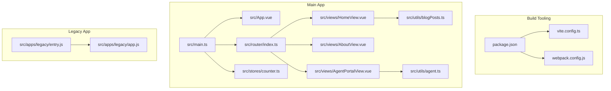
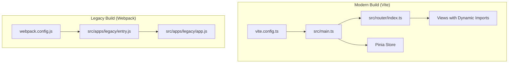
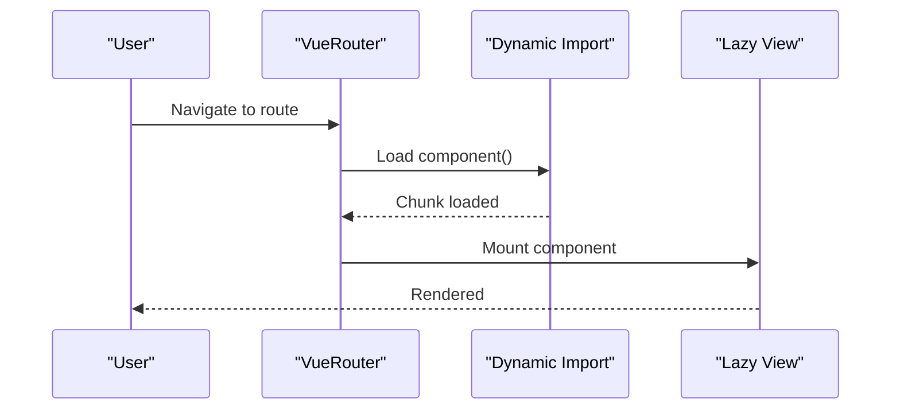
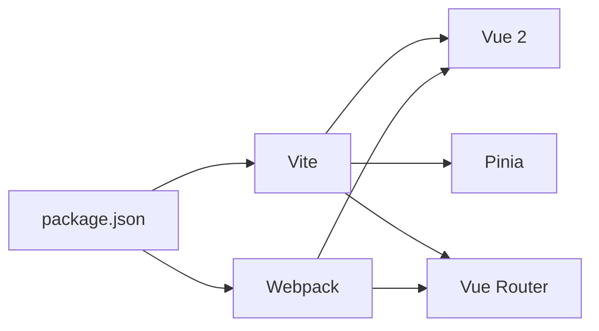

# Performance Optimization and Best Practices

<cite>
**Referenced Files in This Document**
- [vite.config.ts](file://vite.config.ts)
- [package.json](file://package.json)
- [webpack.config.js](file://webpack.config.js)
- [src/main.ts](file://src/main.ts)
- [src/App.vue](file://src/App.vue)
- [src/router/index.ts](file://src/router/index.ts)
- [src/stores/counter.ts](file://src/stores/counter.ts)
- [src/views/HomeView.vue](file://src/views/HomeView.vue)
- [src/views/AboutView.vue](file://src/views/AboutView.vue)
- [src/views/AgentPortalView.vue](file://src/views/AgentPortalView.vue)
- [src/utils/blogPosts.ts](file://src/utils/blogPosts.ts)
- [src/utils/agent.ts](file://src/utils/agent.ts)
- [src/apps/legacy/app.js](file://src/apps/legacy/app.js)
- [src/apps/legacy/entry.js](file://src/apps/legacy/entry.js)
</cite>

## Table of Contents
1. [Introduction](#introduction)
2. [Project Structure](#project-structure)
3. [Core Components](#core-components)
4. [Architecture Overview](#architecture-overview)
5. [Detailed Component Analysis](#detailed-component-analysis)
6. [Dependency Analysis](#dependency-analysis)
7. [Performance Considerations](#performance-considerations)
8. [Troubleshooting Guide](#troubleshooting-guide)
9. [Conclusion](#conclusion)
10. [Appendices](#appendices)

## Introduction
This document presents a comprehensive guide to performance optimization and best practices implemented in the application. It covers build-time optimizations via Vite and legacy Webpack, runtime performance patterns in Vue 2, code splitting and lazy loading strategies, bundle analysis and compression, profiling and monitoring approaches, and long-running application considerations. The goal is to help developers understand how current configurations and code patterns contribute to performance and where further improvements can be made.

## Project Structure
The project combines modern Vite tooling with a legacy Webpack build for a separate legacy application entry. The main application uses Vue 2 with Pinia for state management and Vue Router for navigation. Views leverage dynamic imports for code splitting, while utility modules demonstrate static imports and build-time globbing.

**Diagram sources**
- [vite.config.ts:1-27](file://vite.config.ts#L1-L27)
- [package.json:1-61](file://package.json#L1-L61)
- [webpack.config.js:1-61](file://webpack.config.js#L1-L61)
- [src/main.ts:1-16](file://src/main.ts#L1-L16)
- [src/App.vue:1-110](file://src/App.vue#L1-L110)
- [src/router/index.ts:1-65](file://src/router/index.ts#L1-L65)
- [src/stores/counter.ts:1-17](file://src/stores/counter.ts#L1-L17)
- [src/views/HomeView.vue:1-648](file://src/views/HomeView.vue#L1-L648)
- [src/views/AboutView.vue:1-143](file://src/views/AboutView.vue#L1-L143)
- [src/views/AgentPortalView.vue:1-239](file://src/views/AgentPortalView.vue#L1-L239)
- [src/utils/blogPosts.ts:1-110](file://src/utils/blogPosts.ts#L1-L110)
- [src/utils/agent.ts:1-47](file://src/utils/agent.ts#L1-L47)
- [src/apps/legacy/entry.js:1-2](file://src/apps/legacy/entry.js#L1-L2)
- [src/apps/legacy/app.js:1-13](file://src/apps/legacy/app.js#L1-L13)

**Section sources**
- [vite.config.ts:1-27](file://vite.config.ts#L1-L27)
- [package.json:15-27](file://package.json#L15-L27)
- [webpack.config.js:1-61](file://webpack.config.js#L1-L61)
- [src/main.ts:1-16](file://src/main.ts#L1-L16)
- [src/App.vue:1-110](file://src/App.vue#L1-L110)
- [src/router/index.ts:1-65](file://src/router/index.ts#L1-L65)
- [src/stores/counter.ts:1-17](file://src/stores/counter.ts#L1-L17)
- [src/views/HomeView.vue:1-648](file://src/views/HomeView.vue#L1-L648)
- [src/views/AboutView.vue:1-143](file://src/views/AboutView.vue#L1-L143)
- [src/views/AgentPortalView.vue:1-239](file://src/views/AgentPortalView.vue#L1-L239)
- [src/utils/blogPosts.ts:1-110](file://src/utils/blogPosts.ts#L1-L110)
- [src/utils/agent.ts:1-47](file://src/utils/agent.ts#L1-L47)
- [src/apps/legacy/entry.js:1-2](file://src/apps/legacy/entry.js#L1-L2)
- [src/apps/legacy/app.js:1-13](file://src/apps/legacy/app.js#L1-L13)

## Core Components
- Build tooling: Vite configuration enables Vue 2/JSX plugins and legacy polyfills; outputs to docs for static hosting.
- Application bootstrap: Vue 2 with Pinia plugin initialization and router mounting.
- Routing: History mode with dynamic imports for route-level code splitting.
- State management: Pinia store with minimal reactive state and getters/actions.
- Views: Composition API usage with script setup; heavy client-side rendering in HomeView; interactive editor in AgentPortalView.
- Utilities: Static imports and build-time globbing for content aggregation.

Key performance-relevant observations:
- Route-level code splitting is implemented via dynamic imports.
- Legacy Webpack build exists alongside Vite, targeting docs output.
- Pinia is used for centralized state management in the modern app.
- Utility modules use import.meta.glob with eager loading for build-time content ingestion.

**Section sources**
- [vite.config.ts:9-26](file://vite.config.ts#L9-L26)
- [src/main.ts:9-15](file://src/main.ts#L9-L15)
- [src/router/index.ts:20-41](file://src/router/index.ts#L20-L41)
- [src/stores/counter.ts:1-17](file://src/stores/counter.ts#L1-L17)
- [src/utils/blogPosts.ts:13-21](file://src/utils/blogPosts.ts#L13-L21)

## Architecture Overview
The application follows a dual-build architecture:
- Modern Vite build for the main SPA using Vue 2, Pinia, and Vue Router.
- Legacy Webpack build for a separate legacy app entry, also outputting to docs.

**Diagram sources**
- [vite.config.ts:1-27](file://vite.config.ts#L1-L27)
- [webpack.config.js:1-61](file://webpack.config.js#L1-L61)
- [src/main.ts:1-16](file://src/main.ts#L1-L16)
- [src/router/index.ts:1-65](file://src/router/index.ts#L1-L65)
- [src/apps/legacy/entry.js:1-2](file://src/apps/legacy/entry.js#L1-L2)
- [src/apps/legacy/app.js:1-13](file://src/apps/legacy/app.js#L1-L13)

## Detailed Component Analysis

### Vite Build Configuration and Plugins
- Plugins:
  - Vue 2 and JSX plugins enable SFC compilation and JSX support.
  - Legacy plugin targets IE 11 with regenerator runtime polyfill.
- Resolve alias: '@' mapped to src for concise imports.
- Build output: outDir set to docs for static hosting.

Optimization implications:
- Using legacy plugin adds polyfills and compatibility shims, increasing bundle size but ensuring IE 11 support.
- Alias reduces path complexity and aids bundler caching.

**Section sources**
- [vite.config.ts:10-26](file://vite.config.ts#L10-L26)

### Package Scripts and Dev Dependencies
- Scripts include dev, build, preview, unit tests, E2E testing, and doc builds.
- Dev dependencies include Vite, Vue 2 plugins, Terser, ESLint, Vitest, Cypress, and VuePress.

Observations:
- No explicit Vite build analyser or Rollup plugins configured.
- Terser present; production minification likely handled by Vite’s default pipeline.

**Section sources**
- [package.json:15-27](file://package.json#L15-L27)
- [package.json:33-59](file://package.json#L33-L59)

### Legacy Webpack Build
- Targets web, entry app plus vendor chunk for vue and vue-router.
- Uses HtmlWebpackPlugin and CommonsChunkPlugin.
- Dev server enabled with hot:true and eval devtool.
- Production uses UglifyJsPlugin with dead_code and unused removal.

Implications:
- Ensures vendor stability via dedicated chunk.
- Hot reloading during development.
- Minification in production via UglifyJsPlugin.

**Section sources**
- [webpack.config.js:5-47](file://webpack.config.js#L5-L47)
- [webpack.config.js:49-60](file://webpack.config.js#L49-L60)

### Application Bootstrap and State Management
- Vue.use(PiniaVuePlugin) initializes Pinia.
- createPinia() instantiated and passed to Vue instance.
- Router mounted with render function.

Performance notes:
- Centralized state via Pinia avoids prop drilling and supports granular updates.
- Render function mount is straightforward and predictable.

**Section sources**
- [src/main.ts:9-15](file://src/main.ts#L9-L15)
- [src/stores/counter.ts:1-17](file://src/stores/counter.ts#L1-L17)

### Routing and Code Splitting
- Route definitions use dynamic imports for About, Agent Portal, Blog Detail, Tic Tac Toe, Overseas Export, WASM, and Canvas views.
- Comment indicates separate chunks per route.

Impact:
- Reduces initial bundle size by deferring non-critical views.
- Improves TTI and initial load performance.

**Diagram sources**
- [src/router/index.ts:20-41](file://src/router/index.ts#L20-L41)

**Section sources**
- [src/router/index.ts:20-41](file://src/router/index.ts#L20-L41)

### View Components and Rendering Patterns
- HomeView.vue:
  - Uses script setup with composition API.
  - Loads blog posts and stats statically; renders large lists.
  - Animation delays on list items.
- AboutView.vue:
  - Static composition data; simple layout.
- AgentPortalView.vue:
  - Reactive inputs with computed and watchers; clipboard API usage.

Performance considerations:
- Large DOM lists in HomeView can increase layout and paint costs; consider virtualization for very large datasets.
- Computed properties reduce redundant recalculations.
- Clipboard API usage is asynchronous and gated behind capability checks.

**Section sources**
- [src/views/HomeView.vue:1-648](file://src/views/HomeView.vue#L1-L648)
- [src/views/AboutView.vue:1-143](file://src/views/AboutView.vue#L1-L143)
- [src/views/AgentPortalView.vue:1-239](file://src/views/AgentPortalView.vue#L1-L239)

### Utility Modules and Build-Time Content Ingestion
- blogPosts.ts:
  - Uses import.meta.glob with eager: true to ingest Markdown and pattern files at build time.
  - Normalizes titles, strips markdown, computes excerpts, and constructs slugs.
- agent.ts:
  - Pure functions building prompts from structured inputs.

Performance implications:
- Eager globbing increases initial build time and bundle size; beneficial for static content sites.
- Pure functions are cacheable and side-effect free, aiding predictability.

**Section sources**
- [src/utils/blogPosts.ts:13-21](file://src/utils/blogPosts.ts#L13-L21)
- [src/utils/blogPosts.ts:23-54](file://src/utils/blogPosts.ts#L23-L54)
- [src/utils/agent.ts:1-47](file://src/utils/agent.ts#L1-L47)

### Legacy Application Entry
- Separate entry and app wiring for legacy app targeting docs output.
- Uses older Vue Router API and extends Vue options.

Considerations:
- Maintaining two build systems increases complexity; consolidate where feasible.
- Legacy app output aligned with modern docs output simplifies deployment.

**Section sources**
- [src/apps/legacy/entry.js:1-2](file://src/apps/legacy/entry.js#L1-L2)
- [src/apps/legacy/app.js:1-13](file://src/apps/legacy/app.js#L1-L13)

## Dependency Analysis
- Runtime dependencies: Vue 2.7, Vue Router 3.x, Pinia.
- Dev dependencies: Vite, Vue 2 plugins, Terser, ESLint, Vitest, Cypress, VuePress.
- Build outputs:
  - Vite: docs directory.
  - Webpack: docs directory.

Coupling and cohesion:
- Router and views are loosely coupled via dynamic imports.
- Utilities are cohesive and self-contained.

Potential circular dependencies:
- None observed in the analyzed files.

External integrations:
- Legacy plugin for browser compatibility.
- HTML template injection via HtmlWebpackPlugin.

**Diagram sources**
- [package.json:28-59](file://package.json#L28-L59)
- [vite.config.ts:10-17](file://vite.config.ts#L10-L17)
- [webpack.config.js:5-47](file://webpack.config.js#L5-L47)

**Section sources**
- [package.json:28-59](file://package.json#L28-L59)
- [vite.config.ts:10-17](file://vite.config.ts#L10-L17)
- [webpack.config.js:5-47](file://webpack.config.js#L5-L47)

## Performance Considerations

### Build-Time Optimizations
- Vite plugins:
  - Vue 2 and JSX plugins enable SFC compilation and JSX support.
  - Legacy plugin ensures IE 11 compatibility with polyfills.
- Output directory:
  - Both Vite and Webpack output to docs for static hosting.

Recommendations:
- Enable Vite’s built-in analyzer plugin to inspect bundle composition.
- Consider enabling Terser via Vite’s esbuildMinify option or a dedicated plugin for advanced minification.
- Evaluate removing legacy plugin if IE 11 support is not required.

**Section sources**
- [vite.config.ts:10-26](file://vite.config.ts#L10-L26)
- [package.json:52-54](file://package.json#L52-L54)

### Code Splitting and Lazy Loading
- Implemented via dynamic imports in router definitions for multiple views.
- Benefits: smaller initial payload, improved TTI.

Recommendations:
- Continue using dynamic imports for non-critical routes.
- Consider grouping related routes into shared chunks if there are frequent cross-route navigations.

**Section sources**
- [src/router/index.ts:20-41](file://src/router/index.ts#L20-L41)

### Asset Optimization
- Current configuration does not explicitly configure asset inlining limits or image optimization plugins.
- Consider adding Vite plugins for asset optimization and compression.

Recommendations:
- Add plugins for image optimization and CSS/JS compression.
- Configure asset inlining thresholds appropriate for the site’s traffic profile.

**Section sources**
- [vite.config.ts:23-26](file://vite.config.ts#L23-L26)

### Vue-Specific Optimizations
- Composition API usage:
  - Computed properties and watchers in AgentPortalView reduce unnecessary recomputations.
- Reactive patterns:
  - Minimal reactive state in Pinia store keeps updates lightweight.

Recommendations:
- For large lists, consider virtual scrolling libraries to limit DOM nodes.
- Use shallowReactive/shallowRef for large immutable structures to avoid deep reactivity overhead.
- Keep components granular and avoid excessive nested reactivity.

**Section sources**
- [src/views/AgentPortalView.vue:15-21](file://src/views/AgentPortalView.vue#L15-L21)
- [src/stores/counter.ts:1-17](file://src/stores/counter.ts#L1-L17)

### Bundle Size Analysis and Dependency Optimization
- Current scripts do not include a dedicated analyzer.
- Consider integrating a Vite analyzer plugin to visualize dependencies and identify bloat.

Recommendations:
- Run analyzer post-build to identify large dependencies.
- Prefer tree-shaking-friendly libraries and use named exports.
- Remove unused dependencies and deduplicate where possible.

**Section sources**
- [package.json:15-27](file://package.json#L15-L27)

### Memory Management and Long-Running Applications
- Avoid global mutable state; Pinia centralizes state with clear boundaries.
- Limit DOM node count in long-lived views; virtualize or paginate large lists.
- Debounce or throttle event handlers (e.g., resize, scroll) to prevent excessive reflows.

Recommendations:
- Monitor memory usage with browser devtools and address leaks promptly.
- Use WeakMap/WeakSet for caches keyed by DOM nodes to allow GC.

**Section sources**
- [src/views/HomeView.vue:77-96](file://src/views/HomeView.vue#L77-L96)
- [src/views/AgentPortalView.vue:47-58](file://src/views/AgentPortalView.vue#L47-L58)

### Profiling Methodologies and Monitoring
- Use browser devtools Performance and Memory panels for profiling.
- Measure FCP/LCP/INP metrics in real-world conditions.
- Set up logging for slow route transitions and heavy computations.

Recommendations:
- Instrument dynamic imports to track chunk load times.
- Track hydration and mount timings for large views.

**Section sources**
- [src/router/index.ts:20-41](file://src/router/index.ts#L20-L41)

### Architectural Trade-offs
- Dual build systems (Vite + Webpack):
  - Pros: Supports legacy app and modern app concurrently.
  - Cons: Increased maintenance and build complexity.
- Legacy plugin:
  - Pros: Broader browser support.
  - Cons: Larger bundle size and slower compile times.

Recommendations:
- Consolidate to a single modern build system if feasible.
- Remove legacy plugin if IE 11 is not required.

**Section sources**
- [vite.config.ts:13-17](file://vite.config.ts#L13-L17)
- [webpack.config.js:5-47](file://webpack.config.js#L5-L47)

## Troubleshooting Guide
- Slow initial load:
  - Verify dynamic imports are effective and chunks are not oversized.
  - Check for eager globs that inflate the initial bundle.
- Excessive memory usage:
  - Audit large lists and consider virtualization.
  - Ensure computed properties and watchers are not causing unintended recomputations.
- Legacy app conflicts:
  - Confirm separate entries and outputs do not overwrite each other.
  - Validate that the legacy plugin is only needed if IE 11 support is required.

**Section sources**
- [src/router/index.ts:20-41](file://src/router/index.ts#L20-L41)
- [src/utils/blogPosts.ts:13-21](file://src/utils/blogPosts.ts#L13-L21)
- [webpack.config.js:5-47](file://webpack.config.js#L5-L47)

## Conclusion
The application leverages modern build tooling with Vite and Vue 2, employs route-level code splitting, and uses Pinia for state management. While the current configuration provides a solid foundation, further optimizations can be achieved by integrating bundle analysis, enhancing asset optimization, virtualizing large lists, and consolidating build systems where possible. Adopting robust profiling and monitoring practices will ensure sustained performance as the application evolves.

## Appendices
- Build outputs:
  - Vite: docs directory.
  - Webpack: docs directory.
- Scripts:
  - dev, build, preview, test:unit, test:e2e, test:e2e:ci, build-only, type-check, lint.

**Section sources**
- [vite.config.ts:23-26](file://vite.config.ts#L23-L26)
- [webpack.config.js:11-14](file://webpack.config.js#L11-L14)
- [package.json:15-27](file://package.json#L15-L27)