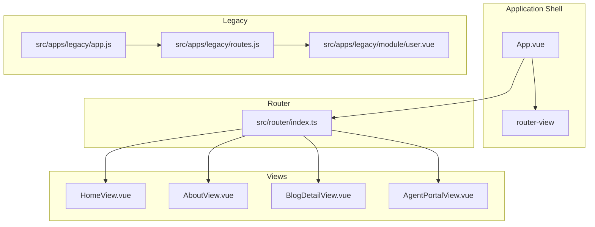
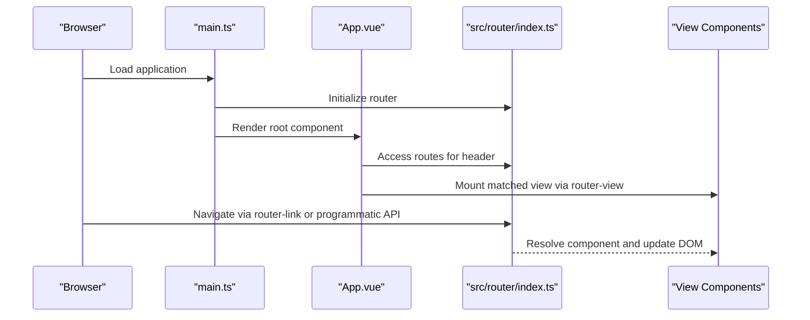
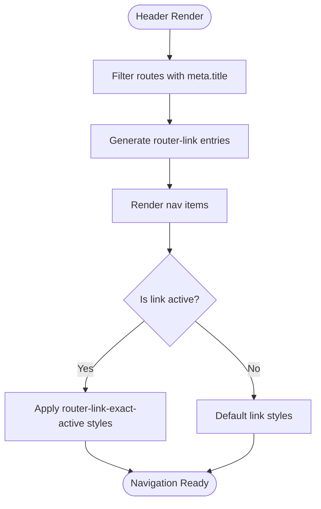
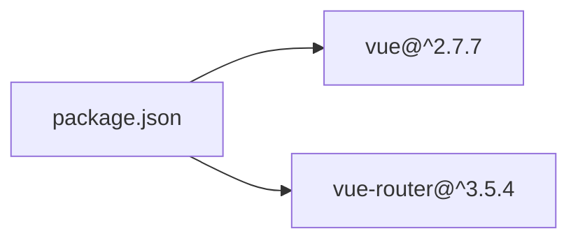

# Routing System and Navigation

<cite>
**Referenced Files in This Document**
- [index.ts](file://src/router/index.ts)
- [App.vue](file://src/App.vue)
- [main.ts](file://src/main.ts)
- [HomeView.vue](file://src/views/HomeView.vue)
- [AboutView.vue](file://src/views/AboutView.vue)
- [BlogDetailView.vue](file://src/views/BlogDetailView.vue)
- [AgentPortalView.vue](file://src/views/AgentPortalView.vue)
- [blogPosts.ts](file://src/utils/blogPosts.ts)
- [index.html](file://index.html)
- [routes.js](file://src/apps/legacy/routes.js)
- [app.js](file://src/apps/legacy/app.js)
- [user.vue](file://src/apps/legacy/module/user.vue)
- [package.json](file://package.json)
</cite>

## Table of Contents
1. [Introduction](#introduction)
2. [Project Structure](#project-structure)
3. [Core Components](#core-components)
4. [Architecture Overview](#architecture-overview)
5. [Detailed Component Analysis](#detailed-component-analysis)
6. [Dependency Analysis](#dependency-analysis)
7. [Performance Considerations](#performance-considerations)
8. [Troubleshooting Guide](#troubleshooting-guide)
9. [Conclusion](#conclusion)
10. [Appendices](#appendices)

## Introduction
This document explains the Vue Router implementation and navigation system used in the project. It covers route configuration (including lazy loading and history mode), meta data usage, navigation via router-link and programmatic navigation, route parameters and query handling, integration with the header navigation component, active link highlighting, nested routes, route transitions, breadcrumbs, SEO considerations, meta tag management, accessibility features, and the relationship between routes and view components.

## Project Structure
The routing system centers around a single router instance configured with multiple routes. Views are organized under a dedicated folder and integrated into the application shell via router-view. Legacy routing exists alongside the modern setup for compatibility.

**Diagram sources**
- [index.ts:1-65](file://src/router/index.ts#L1-L65)
- [App.vue:1-110](file://src/App.vue#L1-L110)
- [routes.js:1-21](file://src/apps/legacy/routes.js#L1-L21)
- [app.js:1-13](file://src/apps/legacy/app.js#L1-L13)

**Section sources**
- [index.ts:1-65](file://src/router/index.ts#L1-L65)
- [App.vue:1-110](file://src/App.vue#L1-L110)
- [routes.js:1-21](file://src/apps/legacy/routes.js#L1-L21)
- [app.js:1-13](file://src/apps/legacy/app.js#L1-L13)

## Core Components
- Router instance: Configured with history mode, base URL, and a set of routes. Routes include static and lazy-loaded components, and several with meta data for navigation labeling.
- Header navigation: Dynamically renders links from routes that declare meta.title.
- Programmatic navigation: Used in views to navigate to other routes (e.g., back links).
- Route parameters: A dynamic segment is used for blog detail pages.
- Meta data: Used to label navigation items and drive header rendering.

Key implementation references:
- Router creation and routes: [index.ts:7-62](file://src/router/index.ts#L7-L62)
- Header menu generation from meta.title: [App.vue:36-42](file://src/App.vue#L36-L42)
- Programmatic navigation in views: [HomeView.vue:20-27](file://src/views/HomeView.vue#L20-L27), [BlogDetailView.vue](file://src/views/BlogDetailView.vue#L38-L40, file://src/views/BlogDetailView.vue#L65)

**Section sources**
- [index.ts:7-62](file://src/router/index.ts#L7-L62)
- [App.vue:36-42](file://src/App.vue#L36-L42)
- [HomeView.vue:20-27](file://src/views/HomeView.vue#L20-L27)
- [BlogDetailView.vue:38-40](file://src/views/BlogDetailView.vue#L38-L40)

## Architecture Overview
The application initializes Vue, registers Pinia, and mounts the root component with the router. The App component hosts the header navigation and router-view. The router instance defines routes that map URLs to view components, enabling declarative navigation and lazy loading.

**Diagram sources**
- [main.ts:1-16](file://src/main.ts#L1-L16)
- [App.vue:1-110](file://src/App.vue#L1-L110)
- [index.ts:1-65](file://src/router/index.ts#L1-L65)

**Section sources**
- [main.ts:1-16](file://src/main.ts#L1-L16)
- [App.vue:1-110](file://src/App.vue#L1-L110)
- [index.ts:1-65](file://src/router/index.ts#L1-L65)

## Detailed Component Analysis

### Router Configuration and Lazy Loading
- History mode: The router uses history mode with a base URL derived from the environment.
- Route definitions: Static and lazy-loaded components are mixed. Lazy-loaded routes improve initial load performance by splitting bundles.
- Meta data: Several routes include meta.title to power the header navigation.

Implementation highlights:
- Router initialization and history mode: [index.ts:7-10](file://src/router/index.ts#L7-L10)
- Example lazy-loaded route: [index.ts](file://src/router/index.ts#L23)
- Example static route with meta.title: [index.ts:14-16](file://src/router/index.ts#L14-L16)

**Section sources**
- [index.ts:7-10](file://src/router/index.ts#L7-L10)
- [index.ts:14-16](file://src/router/index.ts#L14-L16)
- [index.ts](file://src/router/index.ts#L23)

### Navigation Guards
- No global or route-specific navigation guards are present in the analyzed files. Authentication or permission checks would typically be implemented here if required.

**Section sources**
- [index.ts:1-65](file://src/router/index.ts#L1-L65)

### Route-Based Component Loading
- Dynamic imports are used for lazy-loading view components. This enables code splitting and reduces the initial bundle size.
- The router resolves the component function when the route is visited.

References:
- Lazy-loaded About route: [index.ts](file://src/router/index.ts#L23)
- Lazy-loaded Agent Portal route: [index.ts](file://src/router/index.ts#L29)
- Lazy-loaded Blog Detail route: [index.ts](file://src/router/index.ts#L35)
- Lazy-loaded Tic Tac Toe route: [index.ts](file://src/router/index.ts#L40)
- Lazy-loaded Overseas Export route: [index.ts](file://src/router/index.ts#L46)
- Lazy-loaded WASM route: [index.ts](file://src/router/index.ts#L52)
- Lazy-loaded Canvas route: [index.ts](file://src/router/index.ts#L58)

**Section sources**
- [index.ts](file://src/router/index.ts#L23)
- [index.ts](file://src/router/index.ts#L29)
- [index.ts](file://src/router/index.ts#L35)
- [index.ts](file://src/router/index.ts#L40)
- [index.ts](file://src/router/index.ts#L46)
- [index.ts](file://src/router/index.ts#L52)
- [index.ts](file://src/router/index.ts#L58)

### Programmatic Navigation
- Programmatic navigation is used within views to move between routes. Examples include navigating back to the home page or to a blog detail page.
- References:
  - Back link in Blog Detail view: [BlogDetailView.vue:38-40](file://src/views/BlogDetailView.vue#L38-L40)
  - Back link to home in Blog Detail view: [BlogDetailView.vue](file://src/views/BlogDetailView.vue#L65)
  - Navigation from Home view to About: [HomeView.vue:20-23](file://src/views/HomeView.vue#L20-L23)
  - Navigation from Home view to Agent Portal: [HomeView.vue:24-27](file://src/views/HomeView.vue#L24-L27)

**Section sources**
- [BlogDetailView.vue:38-40](file://src/views/BlogDetailView.vue#L38-L40)
- [BlogDetailView.vue](file://src/views/BlogDetailView.vue#L65)
- [HomeView.vue:20-27](file://src/views/HomeView.vue#L20-L27)

### Route Parameters and Query Strings
- Route parameters: The blog detail route uses a dynamic segment for the slug, enabling per-post routing.
  - Definition: [index.ts:33-36](file://src/router/index.ts#L33-L36)
  - Usage in Blog Detail view: [BlogDetailView.vue:10-12](file://src/views/BlogDetailView.vue#L10-L12)
- Query strings: Not used in the analyzed files. If needed, they can be accessed via $route.query in components.

**Section sources**
- [index.ts:33-36](file://src/router/index.ts#L33-L36)
- [BlogDetailView.vue:10-12](file://src/views/BlogDetailView.vue#L10-L12)

### Header Navigation Integration and Active Link Highlighting
- Header menu generation: The header computes menu items by filtering routes that include meta.title.
  - Computed property: [App.vue:36-42](file://src/App.vue#L36-L42)
- Active link highlighting: Uses the built-in router-link-exact-active class to style the currently active link.
  - Styles: [App.vue:73-82](file://src/App.vue#L73-L82)

**Diagram sources**
- [App.vue:36-42](file://src/App.vue#L36-L42)
- [App.vue:73-82](file://src/App.vue#L73-L82)

**Section sources**
- [App.vue:36-42](file://src/App.vue#L36-L42)
- [App.vue:73-82](file://src/App.vue#L73-L82)

### Nested Routes
- No nested routes are defined in the analyzed files. Child routes and layouts are not present in the current router configuration.

**Section sources**
- [index.ts:10-62](file://src/router/index.ts#L10-L62)

### Route Transitions
- No explicit route transition animations are defined in the analyzed files. The views themselves apply local animations (e.g., fade-in effects), but there is no global transition component configured in the router.

**Section sources**
- [HomeView.vue:148-157](file://src/views/HomeView.vue#L148-L157)
- [BlogDetailView.vue:97-106](file://src/views/BlogDetailView.vue#L97-L106)

### Breadcrumb Implementation
- No breadcrumb component or logic is implemented in the analyzed files. Breadcrumbs could be added by computing path segments from $route.matched or by maintaining a breadcrumb array in each view.

**Section sources**
- [index.ts:1-65](file://src/router/index.ts#L1-L65)

### SEO Considerations and Meta Tag Management
- Base title: The HTML head includes a default title element.
  - Reference: [index.html](file://index.html#L7)
- Meta tags: No dynamic meta tags are managed in the analyzed files. For improved SEO, consider adding a plugin or lifecycle hooks to update document.title and meta description based on route meta or view data.
- History mode: The router uses history mode, which is SEO-friendly for client-side applications.

**Section sources**
- [index.html](file://index.html#L7)
- [index.ts](file://src/router/index.ts#L8)

### Accessibility Features in Navigation
- The header navigation uses semantic anchor elements generated by router-link. Ensure that labels (meta.title) are descriptive and that keyboard navigation is supported by default browser behavior.
- Consider adding ARIA attributes or roles if needed for advanced accessibility scenarios.

**Section sources**
- [App.vue:18-24](file://src/App.vue#L18-L24)

### Relationship Between Routes and View Components
- Each route maps to a specific view component. Some views are statically imported (e.g., HomeView), while others are dynamically imported for lazy loading (e.g., AboutView, AgentPortalView).
- The App component’s header reads route meta to populate navigation labels, ensuring consistency between navigation and route definitions.

References:
- Static route to HomeView: [index.ts:14-16](file://src/router/index.ts#L14-L16)
- Lazy-loaded route to AboutView: [index.ts](file://src/router/index.ts#L23)
- Lazy-loaded route to AgentPortalView: [index.ts](file://src/router/index.ts#L29)
- Lazy-loaded route to BlogDetailView: [index.ts](file://src/router/index.ts#L35)
- Lazy-loaded route to TicTacToeView: [index.ts](file://src/router/index.ts#L40)
- Lazy-loaded route to OverseasExportView: [index.ts](file://src/router/index.ts#L46)
- Lazy-loaded route to WasmView: [index.ts](file://src/router/index.ts#L52)
- Lazy-loaded route to CanvasView: [index.ts](file://src/router/index.ts#L58)

**Section sources**
- [index.ts:14-16](file://src/router/index.ts#L14-L16)
- [index.ts](file://src/router/index.ts#L23)
- [index.ts](file://src/router/index.ts#L29)
- [index.ts](file://src/router/index.ts#L35)
- [index.ts](file://src/router/index.ts#L40)
- [index.ts](file://src/router/index.ts#L46)
- [index.ts](file://src/router/index.ts#L52)
- [index.ts](file://src/router/index.ts#L58)

## Dependency Analysis
The application depends on Vue 2 and vue-router 3.x. The router instance is registered during application bootstrap and injected into the root component.

**Diagram sources**
- [package.json:28-32](file://package.json#L28-L32)

**Section sources**
- [package.json:28-32](file://package.json#L28-L32)

## Performance Considerations
- Lazy loading: Dynamic imports are used for most routes, reducing initial bundle size and improving load performance.
- History mode: Enables clean URLs and avoids hash fragments, contributing to better perceived performance and SEO.
- Local animations: Views apply subtle animations; keep transitions lightweight to avoid jank.

[No sources needed since this section provides general guidance]

## Troubleshooting Guide
- Navigation does not update active state:
  - Verify router-link-exact-active styles are applied and route paths match exactly.
  - Confirm meta.title is present for routes included in the header filter.
  - References: [App.vue:36-42](file://src/App.vue#L36-L42), [App.vue:73-82](file://src/App.vue#L73-L82)
- Route parameter not found:
  - Ensure the route definition includes the dynamic segment and the component accesses $route.params.
  - References: [index.ts:33-36](file://src/router/index.ts#L33-L36), [BlogDetailView.vue:10-12](file://src/views/BlogDetailView.vue#L10-L12)
- Blank screen after navigation:
  - Confirm the component is exported correctly and the route path matches the intended destination.
  - References: [index.ts:10-62](file://src/router/index.ts#L10-L62)
- Legacy routes not working:
  - Legacy setup uses a separate app and routes file. Ensure the legacy app is initialized and mounted.
  - References: [routes.js:1-21](file://src/apps/legacy/routes.js#L1-L21), [app.js:1-13](file://src/apps/legacy/app.js#L1-L13)

**Section sources**
- [App.vue:36-42](file://src/App.vue#L36-L42)
- [App.vue:73-82](file://src/App.vue#L73-L82)
- [index.ts:33-36](file://src/router/index.ts#L33-L36)
- [BlogDetailView.vue:10-12](file://src/views/BlogDetailView.vue#L10-L12)
- [index.ts:10-62](file://src/router/index.ts#L10-L62)
- [routes.js:1-21](file://src/apps/legacy/routes.js#L1-L21)
- [app.js:1-13](file://src/apps/legacy/app.js#L1-L13)

## Conclusion
The routing system leverages Vue Router 3 with history mode, lazy-loaded components, and meta-driven navigation. The header integrates seamlessly with route definitions, and programmatic navigation is used within views. While SEO and transitions are not explicitly configured in the analyzed files, the foundation supports easy extension for meta tag management, route transitions, and breadcrumbs.

[No sources needed since this section summarizes without analyzing specific files]

## Appendices
- Legacy routing setup:
  - Legacy routes file: [routes.js:1-21](file://src/apps/legacy/routes.js#L1-L21)
  - Legacy app initialization: [app.js:1-13](file://src/apps/legacy/app.js#L1-L13)
  - Example legacy component using route params: [user.vue:1-13](file://src/apps/legacy/module/user.vue#L1-L13)

**Section sources**
- [routes.js:1-21](file://src/apps/legacy/routes.js#L1-L21)
- [app.js:1-13](file://src/apps/legacy/app.js#L1-L13)
- [user.vue:1-13](file://src/apps/legacy/module/user.vue#L1-L13)