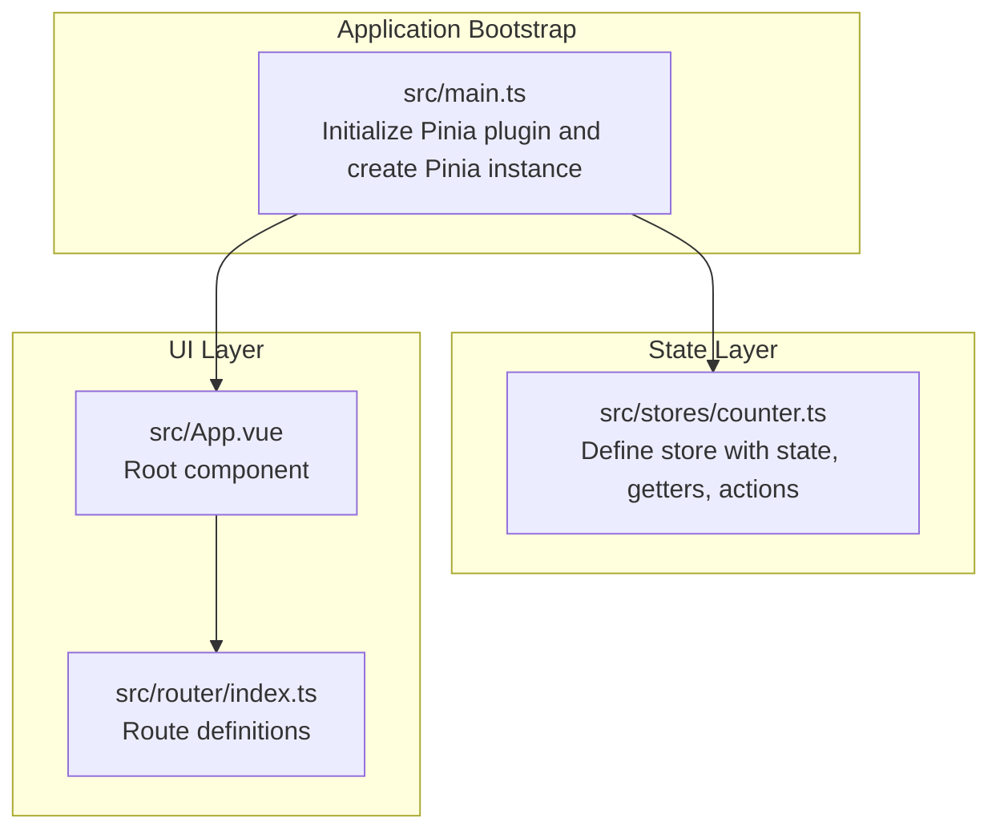
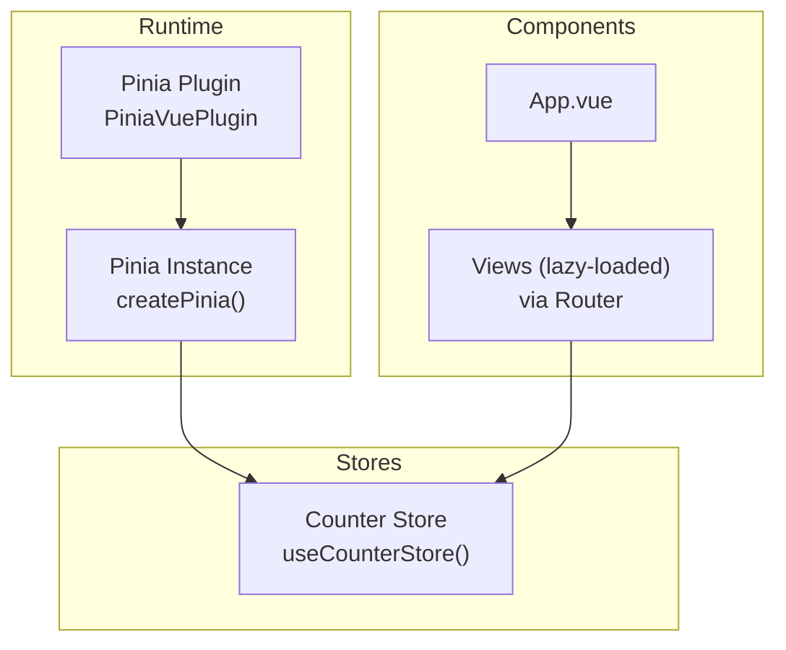
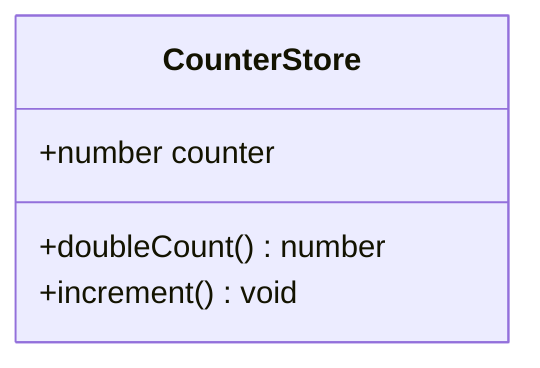
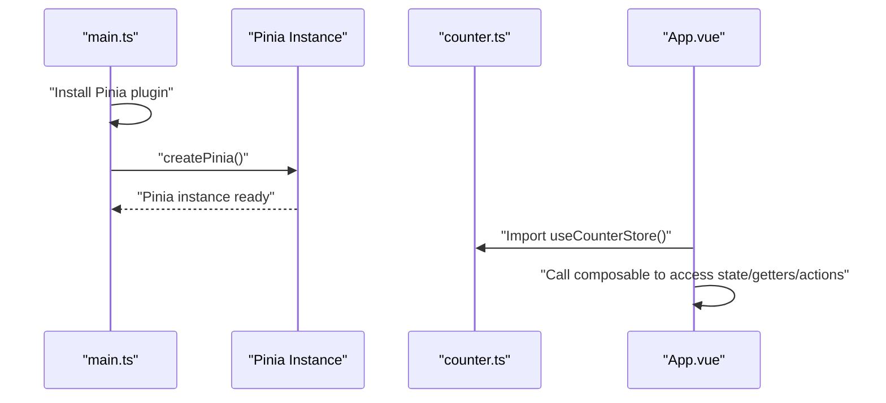
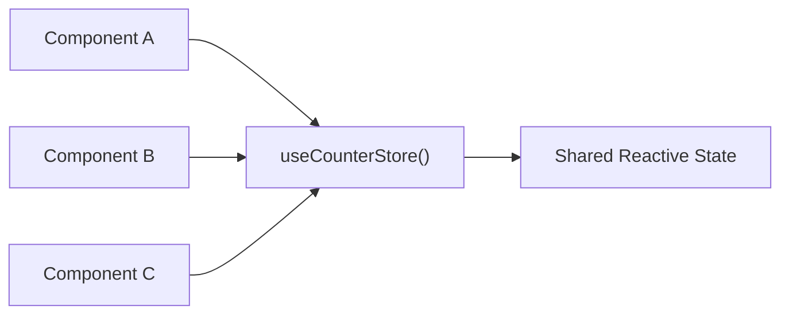
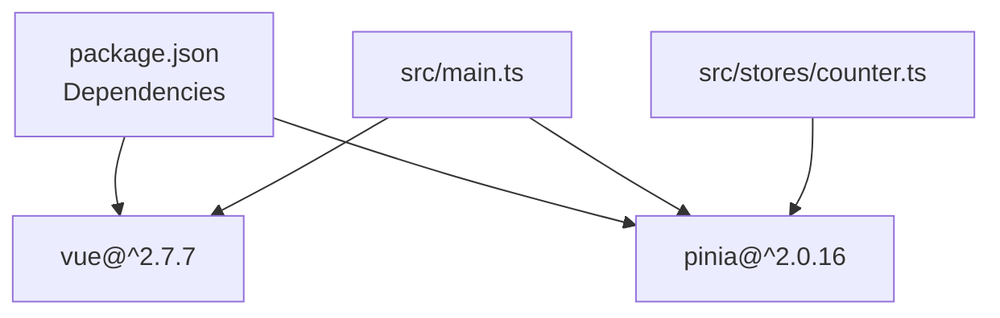

# State Management with Pinia

<cite>
**Referenced Files in This Document**
- [counter.ts](file://src/stores/counter.ts)
- [main.ts](file://src/main.ts)
- [package.json](file://package.json)
- [index.ts](file://src/router/index.ts)
- [App.vue](file://src/App.vue)
</cite>

## Table of Contents
1. [Introduction](#introduction)
2. [Project Structure](#project-structure)
3. [Core Components](#core-components)
4. [Architecture Overview](#architecture-overview)
5. [Detailed Component Analysis](#detailed-component-analysis)
6. [Dependency Analysis](#dependency-analysis)
7. [Performance Considerations](#performance-considerations)
8. [Troubleshooting Guide](#troubleshooting-guide)
9. [Conclusion](#conclusion)

## Introduction
This document explains the Pinia state management implementation in the Vue.js application. It covers store creation, reactive state definition, getters, and actions. It documents the counter store as a practical example, describes integration with Vue components via composable usage, and outlines state persistence strategies, store composition patterns, and cross-component state sharing. Best practices for organization, naming conventions, and performance are included, along with debugging techniques using Vue DevTools and state inspection.

## Project Structure
The state management setup centers around a single store definition and the application bootstrap that initializes Pinia. The store is located under a dedicated folder for stores, while the application mounts Pinia globally during initialization.

**Diagram sources**
- [main.ts](file://src/main.ts)
- [counter.ts](file://src/stores/counter.ts)
- [App.vue](file://src/App.vue)
- [index.ts](file://src/router/index.ts)

**Section sources**
- [main.ts](file://src/main.ts)
- [counter.ts](file://src/stores/counter.ts)
- [App.vue](file://src/App.vue)
- [index.ts](file://src/router/index.ts)

## Core Components
- Store definition: The counter store is created with an identifier, reactive state, getters, and actions. It exposes a composable for consumption in components.
- Application bootstrap: The application installs the Pinia plugin and mounts a Pinia instance so that stores are globally available.

Key characteristics:
- Reactive state: The store defines a numeric counter property initialized to zero.
- Getters: Provides a derived value computed from the current state.
- Actions: Defines a method to mutate the state reactively.
- Composable usage: Consumers import the composable exported by the store to access state, getters, and actions.

**Section sources**
- [counter.ts](file://src/stores/counter.ts)
- [main.ts](file://src/main.ts)

## Architecture Overview
The application integrates Pinia at the root level and exposes stores globally. Components consume stores through the composable returned by the store definition. There is no explicit persistence layer configured in the provided files; persistence would be introduced via plugins or manual synchronization outside the current scope.

**Diagram sources**
- [main.ts](file://src/main.ts)
- [counter.ts](file://src/stores/counter.ts)
- [App.vue](file://src/App.vue)
- [index.ts](file://src/router/index.ts)

## Detailed Component Analysis

### Counter Store Analysis
The counter store demonstrates the minimal yet complete Pinia store pattern:
- Identifier: A unique store id is set for identification.
- State: A function returning an object containing reactive properties.
- Getters: A getter computes a derived value based on the current state.
- Actions: An action mutates the state reactively.

**Diagram sources**
- [counter.ts](file://src/stores/counter.ts)

Implementation highlights:
- State property: A single numeric property representing the count.
- Getter: A computed-like accessor deriving a value from state.
- Action: A method that updates the state property.

Usage pattern:
- Consumers import the composable from the store file and use it inside components to read state, getters, and call actions.

**Section sources**
- [counter.ts](file://src/stores/counter.ts)

### Store Creation and Integration Flow
The application initializes Pinia and makes stores globally available. Components can then import and use the store composable.

**Diagram sources**
- [main.ts](file://src/main.ts)
- [counter.ts](file://src/stores/counter.ts)
- [App.vue](file://src/App.vue)

**Section sources**
- [main.ts](file://src/main.ts)
- [counter.ts](file://src/stores/counter.ts)
- [App.vue](file://src/App.vue)

### Cross-Component State Sharing
Cross-component sharing is achieved by importing the same store composable in different components. Because the store is created at the application root and registered with Pinia, all components share the same store instance and reactive state.

[No sources needed since this diagram shows conceptual workflow, not actual code structure]

### State Persistence Strategies
The current implementation does not include persistence. To persist state:
- Use a Pinia persistence plugin compatible with the runtime environment.
- Manually sync state to storage (e.g., local/session storage) and hydrate on app start.
- Consider selective persistence for specific state branches to optimize performance.

[No sources needed since this section provides general guidance]

### Store Composition Patterns
- Single-purpose stores: Keep stores focused on a single domain (e.g., counter).
- Modular composition: Split large stores into smaller, cohesive units and compose them in views or services.
- Shared composables: Expose derived helpers alongside the store composable for common computations.

[No sources needed since this section provides general guidance]

## Dependency Analysis
The application depends on Vue 2.x and Pinia. The store relies on Pinia’s defineStore API to define state, getters, and actions. The router is present but not directly coupled to the store in the provided files.

**Diagram sources**
- [package.json](file://package.json)
- [main.ts](file://src/main.ts)
- [counter.ts](file://src/stores/counter.ts)

**Section sources**
- [package.json](file://package.json)
- [main.ts](file://src/main.ts)
- [counter.ts](file://src/stores/counter.ts)

## Performance Considerations
- Keep state flat and avoid deeply nested structures to reduce reactivity overhead.
- Use getters for derived data to minimize recomputation and leverage caching semantics.
- Batch state updates within actions to reduce unnecessary renders.
- Avoid storing large transient objects in the store; prefer lightweight references.
- Use lazy-loaded views to defer heavy store usage until needed.

[No sources needed since this section provides general guidance]

## Troubleshooting Guide
- Enable Vue DevTools to inspect the Pinia store state, actions, and getters in real time.
- Use the DevTools timeline to observe mutations and track down unexpected state changes.
- Add logging inside actions to trace state transitions during development.
- Verify that the Pinia plugin is installed and the Pinia instance is mounted in the application root.

[No sources needed since this section provides general guidance]

## Conclusion
The application implements a minimal yet effective Pinia setup with a single counter store. The composable pattern enables straightforward integration in components, and the global Pinia instance ensures consistent state access across the app. Extending the system involves adding more stores, applying persistence strategies, and following best practices for organization and performance. Debugging is facilitated by Vue DevTools, which provides powerful state inspection capabilities.