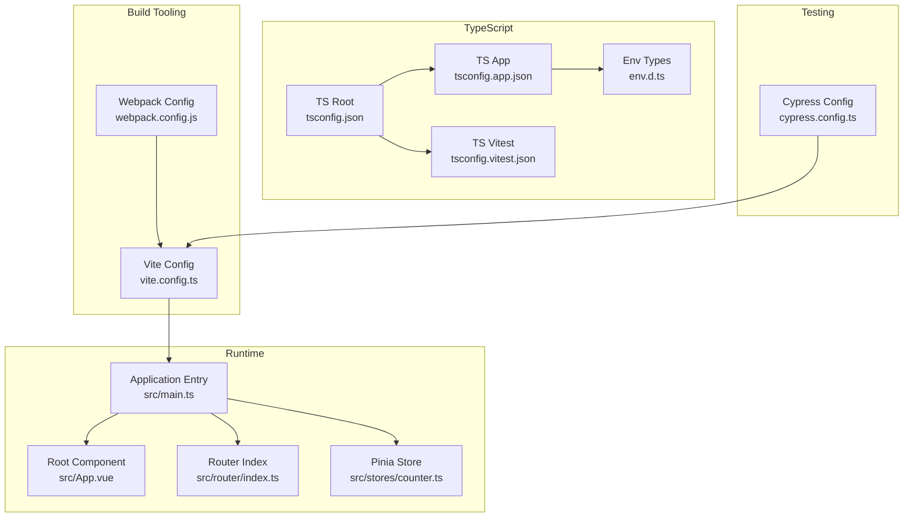
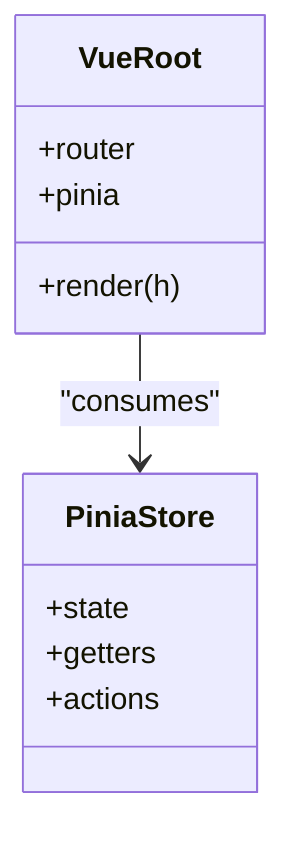
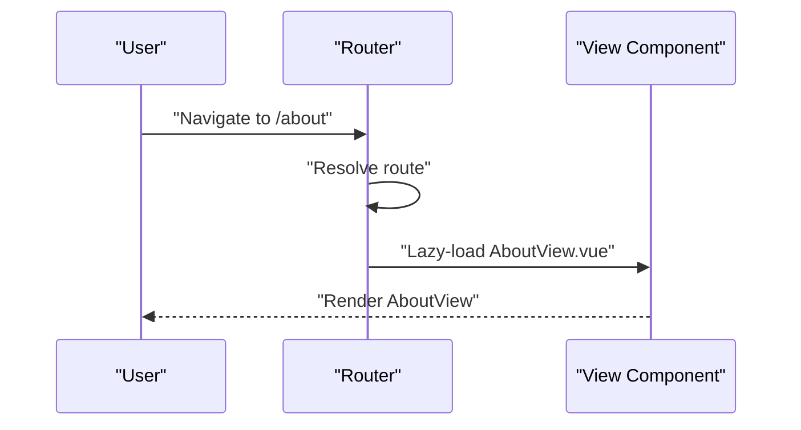
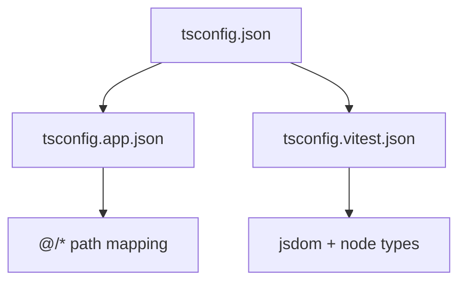
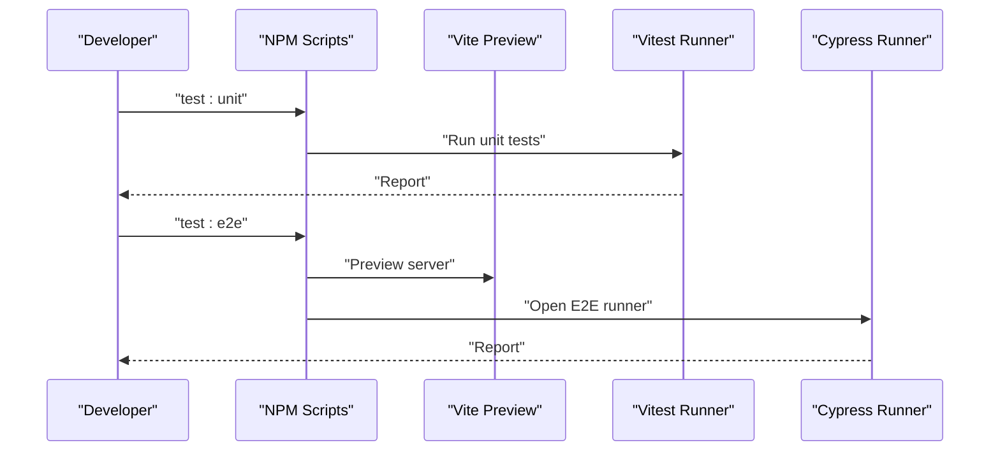
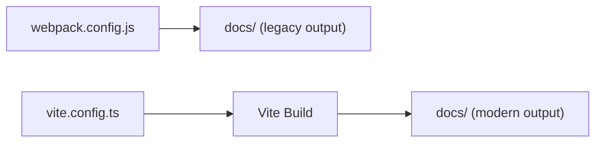
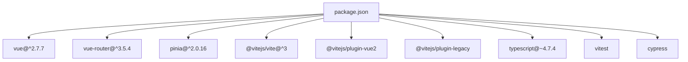

# Technical Implementation

<cite>
**Referenced Files in This Document**
- [package.json](file://package.json)
- [vite.config.ts](file://vite.config.ts)
- [webpack.config.js](file://webpack.config.js)
- [src/main.ts](file://src/main.ts)
- [src/App.vue](file://src/App.vue)
- [src/router/index.ts](file://src/router/index.ts)
- [src/stores/counter.ts](file://src/stores/counter.ts)
- [tsconfig.json](file://tsconfig.json)
- [tsconfig.app.json](file://tsconfig.app.json)
- [tsconfig.vitest.json](file://tsconfig.vitest.json)
- [env.d.ts](file://env.d.ts)
- [cypress.config.ts](file://cypress.config.ts)
- [src/components/HelloWorld.vue](file://src/components/HelloWorld.vue)
- [src/views/HomeView.vue](file://src/views/HomeView.vue)
- [src/views/AboutView.vue](file://src/views/AboutView.vue)
</cite>

## Table of Contents
1. [Introduction](#introduction)
2. [Project Structure](#project-structure)
3. [Core Components](#core-components)
4. [Architecture Overview](#architecture-overview)
5. [Detailed Component Analysis](#detailed-component-analysis)
6. [Dependency Analysis](#dependency-analysis)
7. [Performance Considerations](#performance-considerations)
8. [Troubleshooting Guide](#troubleshooting-guide)
9. [Conclusion](#conclusion)
10. [Appendices](#appendices)

## Introduction
This document provides comprehensive technical implementation details for a Vue.js 2.x application integrated with Pinia for state management, Vue Router for navigation, and Vite as the modern build toolchain. It covers TypeScript integration patterns, type safety, Vite configuration (including legacy browser support, asset handling, and development server setup), component architecture and lifecycle management, performance optimization and code splitting, and testing integration with Vitest and Cypress. It also documents the migration from Webpack to Vite and the rationale behind modern build tooling choices.

## Project Structure
The project follows a conventional Vue 2 application layout with a focus on modularization and separation of concerns:
- Application bootstrap and global plugins are initialized in the main entry.
- Routing is configured with Vue Router and leverages dynamic imports for code splitting.
- State management is handled via Pinia stores.
- TypeScript configuration is split across app, config, and test-specific tsconfigs.
- Testing is supported by Vitest (unit) and Cypress (E2E), orchestrated via npm scripts.
- Legacy Webpack configuration remains for historical artifacts and dual hosting scenarios.



**Diagram sources**
- [vite.config.ts](file://vite.config.ts)
- [webpack.config.js](file://webpack.config.js)
- [src/main.ts](file://src/main.ts)
- [src/App.vue](file://src/App.vue)
- [src/router/index.ts](file://src/router/index.ts)
- [src/stores/counter.ts](file://src/stores/counter.ts)
- [tsconfig.json](file://tsconfig.json)
- [tsconfig.app.json](file://tsconfig.app.json)
- [tsconfig.vitest.json](file://tsconfig.vitest.json)
- [env.d.ts](file://env.d.ts)
- [cypress.config.ts](file://cypress.config.ts)

**Section sources**
- [package.json](file://package.json)
- [vite.config.ts](file://vite.config.ts)
- [webpack.config.js](file://webpack.config.js)
- [src/main.ts](file://src/main.ts)
- [src/App.vue](file://src/App.vue)
- [src/router/index.ts](file://src/router/index.ts)
- [src/stores/counter.ts](file://src/stores/counter.ts)
- [tsconfig.json](file://tsconfig.json)
- [tsconfig.app.json](file://tsconfig.app.json)
- [tsconfig.vitest.json](file://tsconfig.vitest.json)
- [env.d.ts](file://env.d.ts)
- [cypress.config.ts](file://cypress.config.ts)

## Core Components
- Application entry initializes Vue, registers Pinia, and mounts the root component.
- Router defines history mode with meta-driven navigation and lazy-loaded views for code splitting.
- Pinia store demonstrates typed store definition with state, getters, and actions.
- TypeScript configuration enforces strictness and path mapping for a scalable codebase.
- Testing stack integrates Vitest for unit tests and Cypress for E2E, with a script orchestrating a preview server.

Key implementation references:
- Application bootstrap and plugin registration: [src/main.ts](file://src/main.ts)
- Router configuration and lazy loading: [src/router/index.ts](file://src/router/index.ts)
- Pinia store definition: [src/stores/counter.ts](file://src/stores/counter.ts)
- TypeScript project references and path mapping: [tsconfig.json](file://tsconfig.json), [tsconfig.app.json](file://tsconfig.app.json), [tsconfig.vitest.json](file://tsconfig.vitest.json), [env.d.ts](file://env.d.ts)
- Test scripts and Cypress config: [package.json](file://package.json), [cypress.config.ts](file://cypress.config.ts)

**Section sources**
- [src/main.ts](file://src/main.ts)
- [src/router/index.ts](file://src/router/index.ts)
- [src/stores/counter.ts](file://src/stores/counter.ts)
- [tsconfig.json](file://tsconfig.json)
- [tsconfig.app.json](file://tsconfig.app.json)
- [tsconfig.vitest.json](file://tsconfig.vitest.json)
- [env.d.ts](file://env.d.ts)
- [package.json](file://package.json)
- [cypress.config.ts](file://cypress.config.ts)

## Architecture Overview
The runtime architecture centers on Vue 2 with Pinia and Vue Router, while Vite handles development and production builds. Legacy Webpack configuration supports historical deployments and dual hosting.

```mermaid
graph TB
Browser["Browser"]
DevServer["Vite Dev Server"]
Build["Vite Build"]
OutDocs["Output: docs/<assets>"]
Browser < --> DevServer
DevServer --> |serve| Browser
Build --> |emit| OutDocs
Browser --> |HTTP| OutDocs
```

**Diagram sources**
- [vite.config.ts](file://vite.config.ts)
- [package.json](file://package.json)

**Section sources**
- [vite.config.ts](file://vite.config.ts)
- [package.json](file://package.json)

## Detailed Component Analysis

### Vue 2 + Pinia Integration
- Pinia is installed and registered globally via the PiniaVuePlugin.
- A root-level Pinia instance is created and passed to the Vue root.
- A minimal counter store illustrates state, getters, and actions.



**Diagram sources**
- [src/main.ts](file://src/main.ts)
- [src/stores/counter.ts](file://src/stores/counter.ts)

**Section sources**
- [src/main.ts](file://src/main.ts)
- [src/stores/counter.ts](file://src/stores/counter.ts)

### Routing and Code Splitting
- History mode with BASE_URL base.
- Route-level lazy loading using dynamic imports to produce separate chunks per route.
- Navigation menu computed from routes with meta titles.



**Diagram sources**
- [src/router/index.ts](file://src/router/index.ts)
- [src/views/AboutView.vue](file://src/views/AboutView.vue)

**Section sources**
- [src/router/index.ts](file://src/router/index.ts)
- [src/App.vue](file://src/App.vue)

### TypeScript Integration and Type Safety
- Project references organize app, config, and vitest tsconfigs.
- Path mapping @/* resolves to src/.
- Environment types include Vite client types.
- Vitest tsconfig extends app tsconfig and adds jsdom and node types.



**Diagram sources**
- [tsconfig.json](file://tsconfig.json)
- [tsconfig.app.json](file://tsconfig.app.json)
- [tsconfig.vitest.json](file://tsconfig.vitest.json)
- [env.d.ts](file://env.d.ts)

**Section sources**
- [tsconfig.json](file://tsconfig.json)
- [tsconfig.app.json](file://tsconfig.app.json)
- [tsconfig.vitest.json](file://tsconfig.vitest.json)
- [env.d.ts](file://env.d.ts)

### Component Architecture Patterns and Lifecycle Management
- Composition API with <script setup> and TypeScript props for functional components.
- Reactive data and composition functions in views demonstrate reactive patterns.
- Scoped styles and responsive layouts reinforce component encapsulation.

Examples:
- Functional component with typed props: [src/components/HelloWorld.vue](file://src/components/HelloWorld.vue)
- View with reactive composition and scoped styles: [src/views/HomeView.vue](file://src/views/HomeView.vue)
- Static typed view showcasing composition and scoped styles: [src/views/AboutView.vue](file://src/views/AboutView.vue)

**Section sources**
- [src/components/HelloWorld.vue](file://src/components/HelloWorld.vue)
- [src/views/HomeView.vue](file://src/views/HomeView.vue)
- [src/views/AboutView.vue](file://src/views/AboutView.vue)

### Testing Integration (Vitest + Cypress)
- Unit tests with Vitest using jsdom environment.
- E2E tests with Cypress against the Vite preview server.
- Scripts orchestrate a preview server and run Cypress suites.



**Diagram sources**
- [package.json](file://package.json)
- [cypress.config.ts](file://cypress.config.ts)

**Section sources**
- [package.json](file://package.json)
- [cypress.config.ts](file://cypress.config.ts)

### Migration from Webpack to Vite and Modern Build Tooling
- Webpack configuration supports legacy builds and HTML templating.
- Vite replaces Webpack for faster dev server, optimized HMR, and modern bundling.
- Legacy Webpack remains for historical artifacts and dual hosting scenarios.



**Diagram sources**
- [webpack.config.js](file://webpack.config.js)
- [vite.config.ts](file://vite.config.ts)

**Section sources**
- [webpack.config.js](file://webpack.config.js)
- [vite.config.ts](file://vite.config.ts)

## Dependency Analysis
- Runtime dependencies include Vue 2, Vue Router 3, and Pinia.
- Dev dependencies include Vite, Vue 2 plugin, JSX plugin, legacy polyfills, TypeScript tooling, ESLint, Vitest, and Cypress.
- Scripts coordinate type checking, building, previewing, linting, unit testing, and E2E testing.



**Diagram sources**
- [package.json](file://package.json)

**Section sources**
- [package.json](file://package.json)

## Performance Considerations
- Code splitting: Routes are lazily loaded to minimize initial bundle size.
- Legacy browser support: Vite legacy plugin targets IE 11+ with polyfills.
- Asset handling: Vite manages static assets and emits them under docs/.
- Development server: Fast HMR and optimized dev experience.
- Bundle analysis: Use Vite’s built-in reporter or external tools to inspect bundle composition.

Recommendations:
- Keep dynamic imports for infrequently accessed routes.
- Audit third-party dependencies and enable tree-shaking.
- Monitor chunk sizes and split vendor code when appropriate.
- Leverage CSS scoping and component-level styles to avoid global bloat.

**Section sources**
- [src/router/index.ts](file://src/router/index.ts)
- [vite.config.ts](file://vite.config.ts)
- [package.json](file://package.json)

## Troubleshooting Guide
Common areas to check:
- TypeScript errors: Run type checks via the dedicated script and review tsconfig references.
- Vite preview port conflicts: Adjust preview port in scripts if 4173 is in use.
- Cypress base URL mismatch: Ensure Cypress config matches Vite preview URL.
- Legacy polyfills: Confirm regenerator-runtime is included for older browsers.
- Alias resolution: Verify @ alias resolves to src/ in Vite and tsconfig.

Actions:
- Re-run type checks and fix reported issues.
- Clear node_modules/.vite cache if dev server behaves unexpectedly.
- Validate environment variables and BASE_URL usage in router.

**Section sources**
- [package.json](file://package.json)
- [cypress.config.ts](file://cypress.config.ts)
- [vite.config.ts](file://vite.config.ts)
- [tsconfig.app.json](file://tsconfig.app.json)

## Conclusion
This project demonstrates a modernized Vue 2 application leveraging Vite for development and production, Pinia for state management, Vue Router for navigation, and a robust TypeScript configuration. The migration from Webpack to Vite improves developer productivity and build performance, while legacy Webpack remains available for historical deployments. Testing is integrated with Vitest and Cypress, and performance is addressed through code splitting and legacy polyfills. The architecture supports scalability and maintainability through modular components, typed configurations, and clear separation of concerns.

## Appendices
- Example component files for reference:
  - [src/components/HelloWorld.vue](file://src/components/HelloWorld.vue)
  - [src/views/HomeView.vue](file://src/views/HomeView.vue)
  - [src/views/AboutView.vue](file://src/views/AboutView.vue)