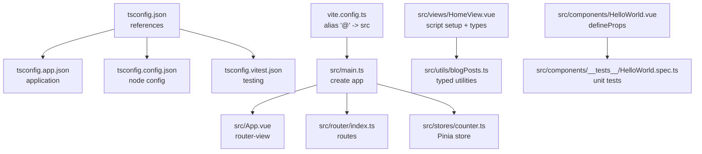
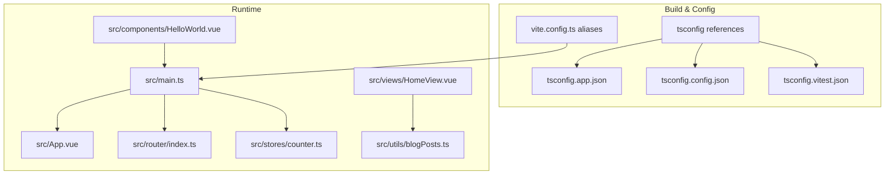
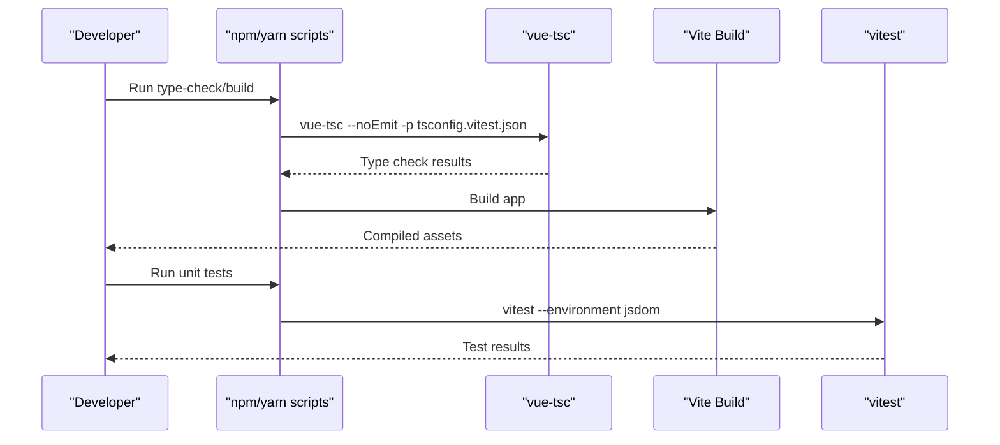
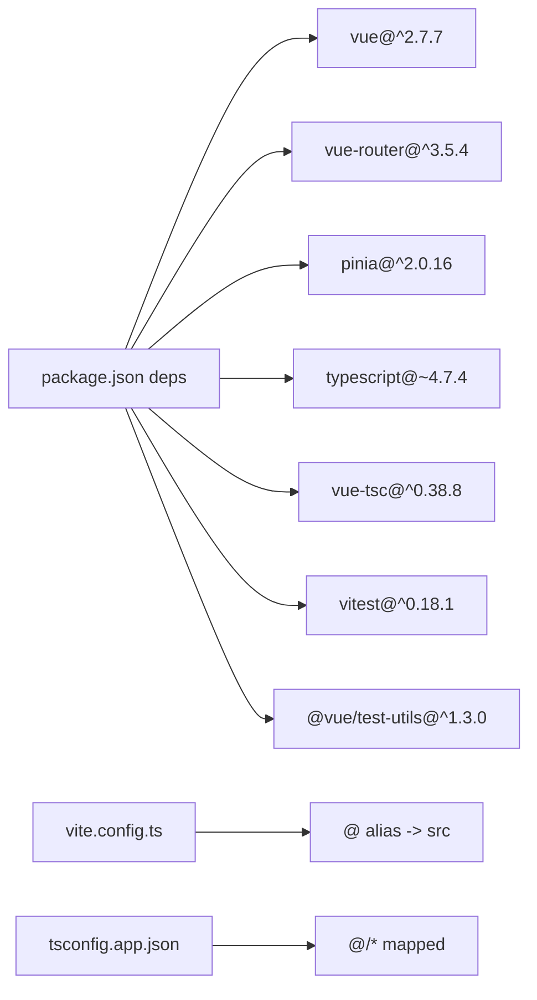

# TypeScript Integration and Type Safety

<cite>
**Referenced Files in This Document**
- [tsconfig.json](file://tsconfig.json)
- [tsconfig.app.json](file://tsconfig.app.json)
- [tsconfig.config.json](file://tsconfig.config.json)
- [tsconfig.vitest.json](file://tsconfig.vitest.json)
- [env.d.ts](file://env.d.ts)
- [package.json](file://package.json)
- [vite.config.ts](file://vite.config.ts)
- [src/main.ts](file://src/main.ts)
- [src/App.vue](file://src/App.vue)
- [src/router/index.ts](file://src/router/index.ts)
- [src/stores/counter.ts](file://src/stores/counter.ts)
- [src/views/HomeView.vue](file://src/views/HomeView.vue)
- [src/components/HelloWorld.vue](file://src/components/HelloWorld.vue)
- [src/utils/blogPosts.ts](file://src/utils/blogPosts.ts)
- [src/components/__tests__/HelloWorld.spec.ts](file://src/components/__tests__/HelloWorld.spec.ts)
</cite>

## Table of Contents
1. [Introduction](#introduction)
2. [Project Structure](#project-structure)
3. [Core Components](#core-components)
4. [Architecture Overview](#architecture-overview)
5. [Detailed Component Analysis](#detailed-component-analysis)
6. [Dependency Analysis](#dependency-analysis)
7. [Performance Considerations](#performance-considerations)
8. [Troubleshooting Guide](#troubleshooting-guide)
9. [Conclusion](#conclusion)
10. [Appendices](#appendices)

## Introduction
This document explains how TypeScript is integrated across the Vue.js application, focusing on type definitions, interface declarations, and type-safe component implementation. It covers Vue-specific TypeScript patterns such as component props typing, store type safety, and router integration. It also documents the tsconfig configuration, path mapping, and compiler options, along with practical examples of typed stores, typed routing, and component prop validation. Finally, it addresses common TypeScript-Vue integration challenges and highlights development experience improvements and IDE support benefits.

## Project Structure
The project uses a multi-project tsconfig setup with references for application, config, and test environments. Path aliases are configured via Vite and tsconfig to simplify imports. The application initializes Pinia and Vue Router, while Vue 2 Single File Components (SFCs) leverage script setup blocks for type-safe composition.

**Diagram sources**
- [tsconfig.json:1-15](file://tsconfig.json#L1-L15)
- [tsconfig.app.json:1-13](file://tsconfig.app.json#L1-L13)
- [tsconfig.config.json:1-9](file://tsconfig.config.json#L1-L9)
- [tsconfig.vitest.json:1-10](file://tsconfig.vitest.json#L1-L10)
- [vite.config.ts:18-22](file://vite.config.ts#L18-L22)
- [src/main.ts:1-16](file://src/main.ts#L1-L16)
- [src/App.vue:1-110](file://src/App.vue#L1-L110)
- [src/router/index.ts:1-65](file://src/router/index.ts#L1-L65)
- [src/stores/counter.ts:1-17](file://src/stores/counter.ts#L1-L17)
- [src/views/HomeView.vue:1-648](file://src/views/HomeView.vue#L1-L648)
- [src/utils/blogPosts.ts:1-110](file://src/utils/blogPosts.ts#L1-L110)
- [src/components/HelloWorld.vue:1-42](file://src/components/HelloWorld.vue#L1-L42)
- [src/components/__tests__/HelloWorld.spec.ts:1-12](file://src/components/__tests__/HelloWorld.spec.ts#L1-L12)

**Section sources**
- [tsconfig.json:1-15](file://tsconfig.json#L1-L15)
- [tsconfig.app.json:1-13](file://tsconfig.app.json#L1-L13)
- [tsconfig.config.json:1-9](file://tsconfig.config.json#L1-L9)
- [tsconfig.vitest.json:1-10](file://tsconfig.vitest.json#L1-L10)
- [vite.config.ts:18-22](file://vite.config.ts#L18-L22)
- [env.d.ts:1-2](file://env.d.ts#L1-L2)

## Core Components
- Application bootstrap initializes Pinia and Vue Router, enabling type-safe state and navigation.
- Router configuration defines static routes with metadata for UI rendering.
- Pinia store uses defineStore for strongly typed state, getters, and actions.
- Utility modules export typed interfaces and functions for domain data.
- SFCs use script setup with TypeScript to declare props and infer types from imported modules.

Key implementation references:
- Application initialization and plugin registration: [src/main.ts:1-16](file://src/main.ts#L1-L16)
- Router definition and route metadata: [src/router/index.ts:1-65](file://src/router/index.ts#L1-L65)
- Store definition with typed state/getters/actions: [src/stores/counter.ts:1-17](file://src/stores/counter.ts#L1-L17)
- Typed utility interfaces and functions: [src/utils/blogPosts.ts:1-110](file://src/utils/blogPosts.ts#L1-L110)
- Component props typing with script setup: [src/components/HelloWorld.vue:1-42](file://src/components/HelloWorld.vue#L1-L42)
- View-level typed usage of utilities: [src/views/HomeView.vue:1-648](file://src/views/HomeView.vue#L1-L648)

**Section sources**
- [src/main.ts:1-16](file://src/main.ts#L1-L16)
- [src/router/index.ts:1-65](file://src/router/index.ts#L1-L65)
- [src/stores/counter.ts:1-17](file://src/stores/counter.ts#L1-L17)
- [src/utils/blogPosts.ts:1-110](file://src/utils/blogPosts.ts#L1-L110)
- [src/components/HelloWorld.vue:1-42](file://src/components/HelloWorld.vue#L1-L42)
- [src/views/HomeView.vue:1-648](file://src/views/HomeView.vue#L1-L648)

## Architecture Overview
The architecture integrates TypeScript across build-time, runtime, and testing layers. Build-time type checking is performed via vue-tsc and tsconfig references. Runtime relies on Vue 2 SFCs with script setup, Pinia for state, and Vue Router for navigation. Path aliases unify imports and improve maintainability.

**Diagram sources**
- [tsconfig.json:1-15](file://tsconfig.json#L1-L15)
- [tsconfig.app.json:1-13](file://tsconfig.app.json#L1-L13)
- [tsconfig.config.json:1-9](file://tsconfig.config.json#L1-L9)
- [tsconfig.vitest.json:1-10](file://tsconfig.vitest.json#L1-L10)
- [vite.config.ts:18-22](file://vite.config.ts#L18-L22)
- [src/main.ts:1-16](file://src/main.ts#L1-L16)
- [src/App.vue:1-110](file://src/App.vue#L1-L110)
- [src/router/index.ts:1-65](file://src/router/index.ts#L1-L65)
- [src/stores/counter.ts:1-17](file://src/stores/counter.ts#L1-L17)
- [src/views/HomeView.vue:1-648](file://src/views/HomeView.vue#L1-L648)
- [src/utils/blogPosts.ts:1-110](file://src/utils/blogPosts.ts#L1-L110)
- [src/components/HelloWorld.vue:1-42](file://src/components/HelloWorld.vue#L1-L42)

## Detailed Component Analysis

### TypeScript Configuration and Path Mapping
- Multi-project tsconfig references centralize type checking across app, config, and test projects.
- tsconfig.app.json extends @vue/tsconfig defaults, includes Vue files, excludes tests, enables composite builds, and sets baseUrl and path mapping for @ alias.
- tsconfig.config.json configures Node types for build scripts and tooling.
- tsconfig.vitest.json extends app config and adds jsdom for unit tests.
- vite.config.ts aliases '@' to the src directory, aligning with tsconfig paths for seamless IDE resolution.

Practical implications:
- Consistent strictness and module resolution across the monorepo-like setup.
- Seamless IDE support for imports using @/ prefixes.
- Separate type-checking environments for app vs. config vs. tests.

**Section sources**
- [tsconfig.json:1-15](file://tsconfig.json#L1-L15)
- [tsconfig.app.json:1-13](file://tsconfig.app.json#L1-L13)
- [tsconfig.config.json:1-9](file://tsconfig.config.json#L1-L9)
- [tsconfig.vitest.json:1-10](file://tsconfig.vitest.json#L1-L10)
- [vite.config.ts:18-22](file://vite.config.ts#L18-L22)

### Type-Safe Application Bootstrap
- Pinia plugin is registered via Vue.use(PiniaVuePlugin) and a Pinia instance is created during app initialization.
- Router is passed to the Vue instance alongside the root App component.

Benefits:
- Centralized DI for state and routing.
- Clear separation of concerns and predictable initialization order.

**Section sources**
- [src/main.ts:1-16](file://src/main.ts#L1-L16)

### Router Types and Route Metadata
- Routes are defined with static metadata such as title, enabling type-safe UI rendering.
- The root App.vue computes visible menu items from router.options.routes using filter and meta checks.

Considerations:
- Since Vue Router v3 is used, ensure metadata types are respected at runtime.
- For stricter typing, consider migrating to Vue Router v4 with typed route records or augmenting types via module declaration.

**Section sources**
- [src/router/index.ts:1-65](file://src/router/index.ts#L1-L65)
- [src/App.vue:32-43](file://src/App.vue#L32-L43)

### Pinia Store Type Safety
- The store is defined using defineStore with explicit state, getters, and actions.
- TypeScript infers getter and action signatures from the store definition, ensuring type-safe usage across components.

Recommendations:
- Use defineStore consistently to enable autocompletion and refactoring support.
- For complex stores, split into modules and export typed composable helpers.

**Section sources**
- [src/stores/counter.ts:1-17](file://src/stores/counter.ts#L1-L17)

### Typed Utilities and Domain Interfaces
- The blogPosts utility exports a typed BlogPost interface and functions returning typed arrays and objects.
- Functions like getAllBlogPosts, getBlogPostBySlug, and getBlogStats return precise types, enabling safe consumption in views.

Usage example references:
- Importing and consuming typed data in HomeView: [src/views/HomeView.vue:1-8](file://src/views/HomeView.vue#L1-L8)
- Defining the BlogPost interface: [src/utils/blogPosts.ts:3-11](file://src/utils/blogPosts.ts#L3-L11)

**Section sources**
- [src/utils/blogPosts.ts:1-110](file://src/utils/blogPosts.ts#L1-L110)
- [src/views/HomeView.vue:1-8](file://src/views/HomeView.vue#L1-L8)

### Component Props Typing with script setup
- HelloWorld.vue demonstrates defineProps with a generic constraint for message prop, enabling compile-time validation and IDE IntelliSense.
- The template consumes the prop directly with confidence in type safety.

Best practices:
- Prefer script setup with defineProps<T>() for concise and strongly typed props.
- Use optional props and default values when appropriate to avoid undefined checks.

**Section sources**
- [src/components/HelloWorld.vue:1-5](file://src/components/HelloWorld.vue#L1-L5)

### View-Level Type Inference
- HomeView.vue uses script setup with TypeScript to import typed utilities and infer variable types from function returns.
- This reduces manual type annotations while maintaining strong type guarantees.

Example references:
- Importing typed utilities and inferring types: [src/views/HomeView.vue:1-8](file://src/views/HomeView.vue#L1-L8)

**Section sources**
- [src/views/HomeView.vue:1-8](file://src/views/HomeView.vue#L1-L8)

### Unit Testing with TypeScript
- The unit test suite runs under jsdom with vitest and uses @vue/test-utils to mount components.
- Props are passed via propsData to ensure component renders with typed props.

Example references:
- Mounting typed component with props: [src/components/__tests__/HelloWorld.spec.ts:8](file://src/components/__tests__/HelloWorld.spec.ts#L8)

**Section sources**
- [src/components/__tests__/HelloWorld.spec.ts:1-12](file://src/components/__tests__/HelloWorld.spec.ts#L1-L12)

### Sequence: Type Checking and Build Pipeline

**Diagram sources**
- [package.json:25](file://package.json#L25)
- [tsconfig.vitest.json:1-10](file://tsconfig.vitest.json#L1-L10)
- [vite.config.ts:1-27](file://vite.config.ts#L1-L27)
- [src/components/__tests__/HelloWorld.spec.ts:1-12](file://src/components/__tests__/HelloWorld.spec.ts#L1-L12)

## Dependency Analysis
- Application dependencies include Vue 2, Vue Router 3, and Pinia 2.
- Development dependencies include TypeScript, vue-tsc, ESLint with TypeScript support, and testing frameworks.
- Path mapping is synchronized between Vite and tsconfig to prevent import mismatches.

**Diagram sources**
- [package.json:28-59](file://package.json#L28-L59)
- [vite.config.ts:18-22](file://vite.config.ts#L18-L22)
- [tsconfig.app.json:8-10](file://tsconfig.app.json#L8-L10)

**Section sources**
- [package.json:28-59](file://package.json#L28-L59)
- [vite.config.ts:18-22](file://vite.config.ts#L18-L22)
- [tsconfig.app.json:8-10](file://tsconfig.app.json#L8-L10)

## Performance Considerations
- Using composite builds in tsconfig improves incremental type checking across projects.
- Keeping path mapping aligned between Vite and tsconfig avoids unnecessary module resolution overhead.
- Prefer defineStore for Pinia to benefit from optimized runtime and better tree-shaking.

## Troubleshooting Guide
Common issues and resolutions:
- Import alias mismatch: Ensure '@' alias is defined in both vite.config.ts and tsconfig.app.json paths.
- Missing DOM types in tests: Add jsdom to tsconfig.vitest.json types and run vitest with jsdom environment.
- Vue Router metadata access: Verify route meta fields are present at runtime; consider adding runtime guards when accessing meta.
- Prop type errors in components: Use defineProps<T>() to enforce prop types and avoid runtime coercion.

Relevant references:
- Path alias configuration: [vite.config.ts:18-22](file://vite.config.ts#L18-L22), [tsconfig.app.json:8-10](file://tsconfig.app.json#L8-L10)
- Test environment types: [tsconfig.vitest.json:7](file://tsconfig.vitest.json#L7)
- Router metadata usage: [src/App.vue:38-41](file://src/App.vue#L38-L41)
- Component props typing: [src/components/HelloWorld.vue:2-4](file://src/components/HelloWorld.vue#L2-L4)

**Section sources**
- [vite.config.ts:18-22](file://vite.config.ts#L18-L22)
- [tsconfig.app.json:8-10](file://tsconfig.app.json#L8-L10)
- [tsconfig.vitest.json:7](file://tsconfig.vitest.json#L7)
- [src/App.vue:38-41](file://src/App.vue#L38-L41)
- [src/components/HelloWorld.vue:2-4](file://src/components/HelloWorld.vue#L2-L4)

## Conclusion
The project establishes a robust TypeScript integration for a Vue 2 application by leveraging multi-project tsconfig, path mapping, and script setup blocks. Pinia stores and typed utilities provide strong runtime guarantees, while unit tests under jsdom validate component behavior. Aligning Vite and tsconfig configurations ensures consistent IDE support and efficient type checking.

## Appendices

### Practical Examples Index
- Typed store definition: [src/stores/counter.ts:1-17](file://src/stores/counter.ts#L1-L17)
- Component props typing: [src/components/HelloWorld.vue:1-5](file://src/components/HelloWorld.vue#L1-L5)
- View-level typed usage: [src/views/HomeView.vue:1-8](file://src/views/HomeView.vue#L1-L8)
- Router metadata filtering: [src/App.vue:38-41](file://src/App.vue#L38-L41)
- Unit test with typed props: [src/components/__tests__/HelloWorld.spec.ts:8](file://src/components/__tests__/HelloWorld.spec.ts#L8)