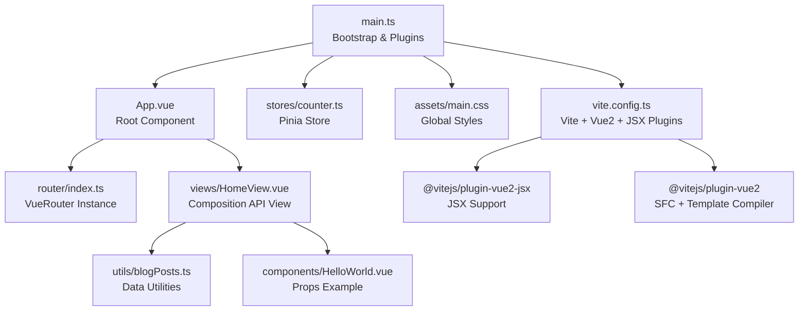
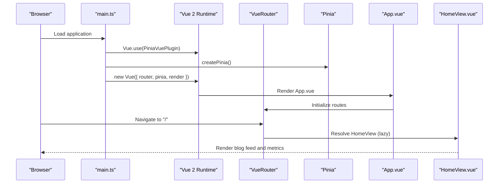
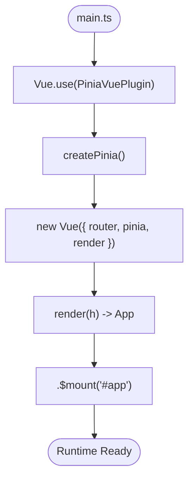
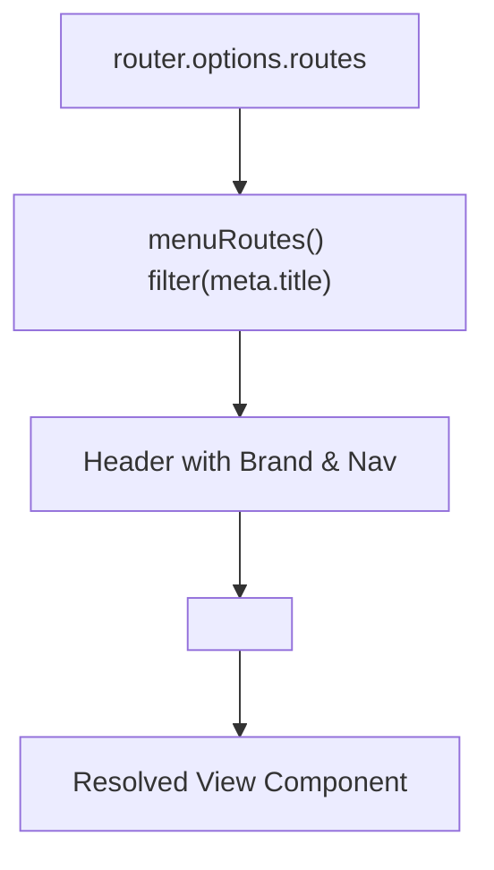
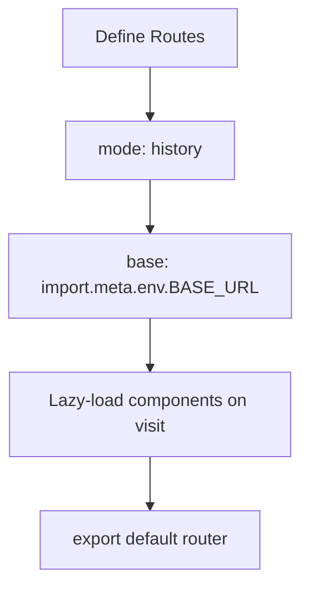
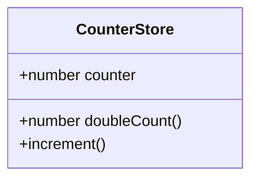
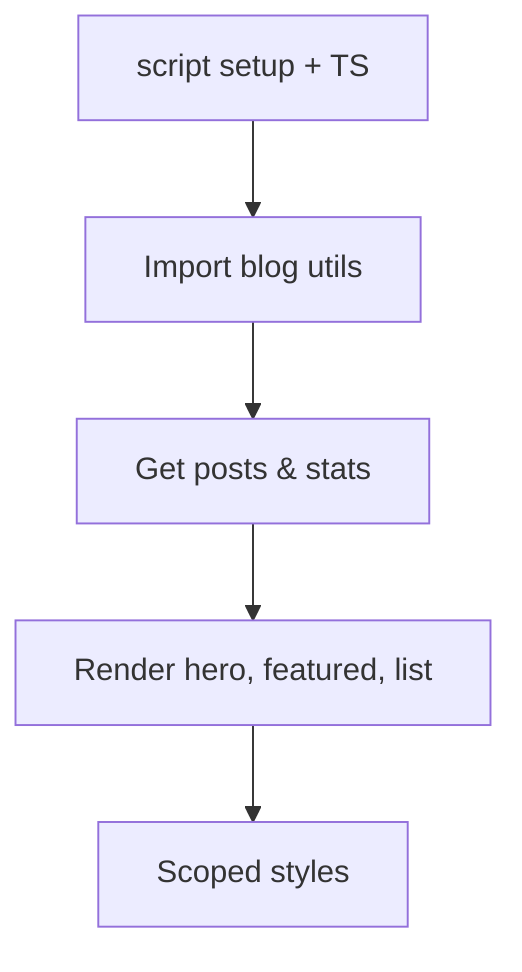
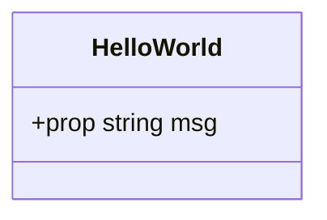
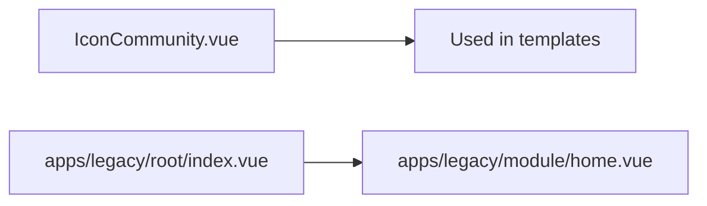
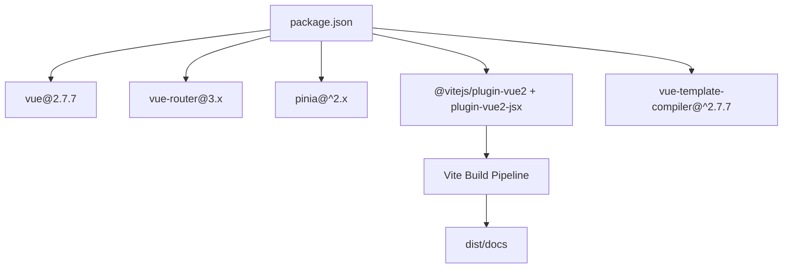

# Vue.js Framework Integration

<cite>
**Referenced Files in This Document**
- [main.ts](file://src/main.ts)
- [App.vue](file://src/App.vue)
- [router/index.ts](file://src/router/index.ts)
- [stores/counter.ts](file://src/stores/counter.ts)
- [views/HomeView.vue](file://src/views/HomeView.vue)
- [components/HelloWorld.vue](file://src/components/HelloWorld.vue)
- [assets/main.css](file://src/assets/main.css)
- [utils/blogPosts.ts](file://src/utils/blogPosts.ts)
- [components/icons/IconCommunity.vue](file://src/components/icons/IconCommunity.vue)
- [apps/legacy/root/index.vue](file://src/apps/legacy/root/index.vue)
- [apps/legacy/module/home.vue](file://src/apps/legacy/module/home.vue)
- [package.json](file://package.json)
- [vite.config.ts](file://vite.config.ts)
- [tsconfig.app.json](file://tsconfig.app.json)
</cite>

## Table of Contents
1. [Introduction](#introduction)
2. [Project Structure](#project-structure)
3. [Core Components](#core-components)
4. [Architecture Overview](#architecture-overview)
5. [Detailed Component Analysis](#detailed-component-analysis)
6. [Dependency Analysis](#dependency-analysis)
7. [Performance Considerations](#performance-considerations)
8. [Troubleshooting Guide](#troubleshooting-guide)
9. [Conclusion](#conclusion)
10. [Appendices](#appendices)

## Introduction
This document explains how Vue 2.7.7 is integrated into the adminfyy application, focusing on JSX support via @vitejs/plugin-vue2-jsx, template compilation with vue-template-compiler, and the Single File Component (SFC) architecture. It covers global application initialization, component composition patterns, routing, state management with Pinia, and practical examples of props, events, slots, reactivity, and performance optimization. It also outlines debugging strategies and DevTools integration.

## Project Structure
The application follows a classic Vue 2.x structure with Vite as the build tool. Key areas:
- Application bootstrap and global CSS imports in main.ts
- Root component App.vue orchestrating header navigation and router-view
- Routing configured in router/index.ts with lazy-loaded views
- State management via Pinia stores in stores/
- Views implemented as SFCs with Composition API (script setup) and scoped styles
- Utility modules under utils/ for data processing
- Legacy Vue 2 components under apps/legacy/

**Diagram sources**
- [main.ts:1-16](file://src/main.ts#L1-L16)
- [App.vue:1-110](file://src/App.vue#L1-L110)
- [router/index.ts:1-65](file://src/router/index.ts#L1-L65)
- [stores/counter.ts:1-17](file://src/stores/counter.ts#L1-L17)
- [views/HomeView.vue:1-648](file://src/views/HomeView.vue#L1-L648)
- [utils/blogPosts.ts:1-110](file://src/utils/blogPosts.ts#L1-L110)
- [components/HelloWorld.vue:1-42](file://src/components/HelloWorld.vue#L1-L42)
- [assets/main.css:1-43](file://src/assets/main.css#L1-L43)
- [vite.config.ts:1-27](file://vite.config.ts#L1-L27)

**Section sources**
- [main.ts:1-16](file://src/main.ts#L1-L16)
- [App.vue:1-110](file://src/App.vue#L1-L110)
- [router/index.ts:1-65](file://src/router/index.ts#L1-L65)
- [stores/counter.ts:1-17](file://src/stores/counter.ts#L1-L17)
- [views/HomeView.vue:1-648](file://src/views/HomeView.vue#L1-L648)
- [utils/blogPosts.ts:1-110](file://src/utils/blogPosts.ts#L1-L110)
- [components/HelloWorld.vue:1-42](file://src/components/HelloWorld.vue#L1-L42)
- [assets/main.css:1-43](file://src/assets/main.css#L1-L43)
- [vite.config.ts:1-27](file://vite.config.ts#L1-L27)

## Core Components
- Global initialization in main.ts:
  - Registers Pinia via PiniaVuePlugin
  - Creates a Vue 2 instance with router and Pinia
  - Renders App.vue and mounts to #app
  - Imports global CSS for base layout and scrollbars
- Root component App.vue:
  - Uses router-link to dynamically compute menu items from router options
  - Renders router-view for nested views
  - Scoped styles for responsive header and navigation
- Router configuration:
  - History mode with BASE_URL base
  - Lazy-loaded views for code splitting
  - Meta titles for navigation labels
- Pinia store:
  - Counter store with state, getter, and action
- Views and components:
  - HomeView.vue uses script setup with TypeScript and scoped styles
  - HelloWorld.vue demonstrates typed props and scoped styles
  - IconCommunity.vue is a reusable SVG icon component
- Utilities:
  - blogPosts.ts processes Markdown and seed data into BlogPost records

**Section sources**
- [main.ts:1-16](file://src/main.ts#L1-L16)
- [App.vue:1-110](file://src/App.vue#L1-L110)
- [router/index.ts:1-65](file://src/router/index.ts#L1-L65)
- [stores/counter.ts:1-17](file://src/stores/counter.ts#L1-L17)
- [views/HomeView.vue:1-648](file://src/views/HomeView.vue#L1-L648)
- [components/HelloWorld.vue:1-42](file://src/components/HelloWorld.vue#L1-L42)
- [components/icons/IconCommunity.vue:1-8](file://src/components/icons/IconCommunity.vue#L1-L8)
- [utils/blogPosts.ts:1-110](file://src/utils/blogPosts.ts#L1-L110)

## Architecture Overview
The runtime architecture ties together the bootstrapper, router, store, and views. The build pipeline leverages Vite with Vue 2 plugins for SFC compilation and JSX support.

**Diagram sources**
- [main.ts:1-16](file://src/main.ts#L1-L16)
- [App.vue:1-110](file://src/App.vue#L1-L110)
- [router/index.ts:1-65](file://src/router/index.ts#L1-L65)
- [views/HomeView.vue:1-648](file://src/views/HomeView.vue#L1-L648)

## Detailed Component Analysis

### Global Initialization and Plugin Registration
- Vue.use(PiniaVuePlugin) enables Pinia integration in Vue 2
- createPinia() initializes the store container
- The Vue instance receives router and pinia options
- render(h) returns the root App component
- Mounts to #app element

**Diagram sources**
- [main.ts:1-16](file://src/main.ts#L1-L16)

**Section sources**
- [main.ts:1-16](file://src/main.ts#L1-L16)

### Root Component and Navigation
- App.vue computes menuRoutes from router.options.routes using meta.title
- Renders a responsive header with brand and navigation links
- Uses router-view to render matched views

**Diagram sources**
- [App.vue:32-44](file://src/App.vue#L32-L44)
- [router/index.ts:10-25](file://src/router/index.ts#L10-L25)

**Section sources**
- [App.vue:1-110](file://src/App.vue#L1-L110)
- [router/index.ts:1-65](file://src/router/index.ts#L1-L65)

### Routing and Lazy Loading
- History mode with dynamic base from import.meta.env.BASE_URL
- Route definitions include lazy-loaded components for code splitting
- Meta fields provide navigation labels

**Diagram sources**
- [router/index.ts:7-62](file://src/router/index.ts#L7-L62)

**Section sources**
- [router/index.ts:1-65](file://src/router/index.ts#L1-L65)

### State Management with Pinia
- Pinia store defines state, getters, and actions
- Composition-style store definition with defineStore
- Increment action updates reactive counter
- Getter doubles the current count

**Diagram sources**
- [stores/counter.ts:1-17](file://src/stores/counter.ts#L1-L17)

**Section sources**
- [stores/counter.ts:1-17](file://src/stores/counter.ts#L1-L17)

### Views and Composition API
- HomeView.vue uses script setup with TypeScript
- Imports utilities to fetch posts and stats
- Uses v-for with keys and router-link for navigation
- Scoped styles encapsulate component-specific CSS

**Diagram sources**
- [views/HomeView.vue:1-138](file://src/views/HomeView.vue#L1-L138)
- [utils/blogPosts.ts:94-110](file://src/utils/blogPosts.ts#L94-L110)

**Section sources**
- [views/HomeView.vue:1-648](file://src/views/HomeView.vue#L1-L648)
- [utils/blogPosts.ts:1-110](file://src/utils/blogPosts.ts#L1-L110)

### Props, Events, and Slots
- HelloWorld.vue demonstrates typed props via script setup
- Props are declared with TypeScript interface-like syntax
- No explicit events/slots shown in this component; typical usage would involve emits and slot directives in other components

**Diagram sources**
- [components/HelloWorld.vue:1-42](file://src/components/HelloWorld.vue#L1-L42)

**Section sources**
- [components/HelloWorld.vue:1-42](file://src/components/HelloWorld.vue#L1-L42)

### Reusable Icons and Legacy Components
- IconCommunity.vue is a presentational SVG component suitable for reuse
- Legacy components under apps/legacy demonstrate older Vue 2 patterns (data(), local components)

**Diagram sources**
- [components/icons/IconCommunity.vue:1-8](file://src/components/icons/IconCommunity.vue#L1-L8)
- [apps/legacy/root/index.vue:1-55](file://src/apps/legacy/root/index.vue#L1-L55)
- [apps/legacy/module/home.vue:1-32](file://src/apps/legacy/module/home.vue#L1-L32)

**Section sources**
- [components/icons/IconCommunity.vue:1-8](file://src/components/icons/IconCommunity.vue#L1-L8)
- [apps/legacy/root/index.vue:1-55](file://src/apps/legacy/root/index.vue#L1-L55)
- [apps/legacy/module/home.vue:1-32](file://src/apps/legacy/module/home.vue#L1-L32)

## Dependency Analysis
- Build-time dependencies:
  - @vitejs/plugin-vue2 for SFC compilation
  - @vitejs/plugin-vue2-jsx for JSX support
  - vue-template-compiler for template compilation
  - vue 2.7.7 and vue-router 3.x
  - Pinia 2.x for state management
- Runtime dependencies:
  - Vue instance created in main.ts
  - Router registered globally
  - Pinia store registered globally

**Diagram sources**
- [package.json:28-59](file://package.json#L28-L59)
- [vite.config.ts:10-17](file://vite.config.ts#L10-L17)

**Section sources**
- [package.json:28-59](file://package.json#L28-L59)
- [vite.config.ts:1-27](file://vite.config.ts#L1-L27)

## Performance Considerations
- Code splitting:
  - Lazy-load route components to reduce initial bundle size
- Rendering:
  - Use v-for with stable keys to minimize DOM churn
  - Prefer shallow rendering for static parts
- State:
  - Keep stores granular; avoid unnecessary re-computation in getters
- Assets:
  - Scoped styles limit CSS scope; ensure minimal duplication
- Build:
  - Vite’s dev server and optimized production builds improve iteration speed
  - Legacy plugin included for IE11 compatibility

[No sources needed since this section provides general guidance]

## Troubleshooting Guide
- Vue DevTools:
  - Install the official browser extension for Vue 2
  - Verify the Vue tab appears in DevTools when the app is running
- Template compilation errors:
  - Ensure vue-template-compiler matches Vue version
  - Confirm SFC templates are processed by @vitejs/plugin-vue2
- JSX issues:
  - Verify @vitejs/plugin-vue2-jsx is enabled
  - Use proper JSX syntax and ensure Vite resolves aliases (@)
- Routing problems:
  - Check router mode and base URL
  - Confirm lazy-loaded components resolve correctly
- Global styles:
  - Ensure assets/main.css is imported in main.ts
  - Verify CSS variables and scoped styles do not conflict

**Section sources**
- [main.ts:7](file://src/main.ts#L7)
- [package.json:56](file://package.json#L56)
- [vite.config.ts:10-17](file://vite.config.ts#L10-L17)

## Conclusion
The adminfyy application integrates Vue 2.7.7 with modern tooling via Vite, enabling SFC development, Composition API usage, and JSX support. The architecture emphasizes modular routing, centralized state via Pinia, and reusable components. Following the patterns documented here ensures maintainable, performant, and debuggable Vue applications.

[No sources needed since this section summarizes without analyzing specific files]

## Appendices

### JSX Support Setup
- Vite plugins enable JSX in Vue 2 SFCs and standalone JSX components
- Configure aliases and build output directory in vite.config.ts

**Section sources**
- [vite.config.ts:1-27](file://vite.config.ts#L1-L27)
- [package.json:38-39](file://package.json#L38-L39)

### TypeScript Path Mapping
- tsconfig.app.json sets up path aliases for @/*
- Includes Vue files and excludes tests

**Section sources**
- [tsconfig.app.json:1-13](file://tsconfig.app.json#L1-L13)