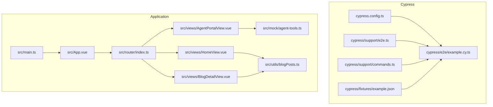
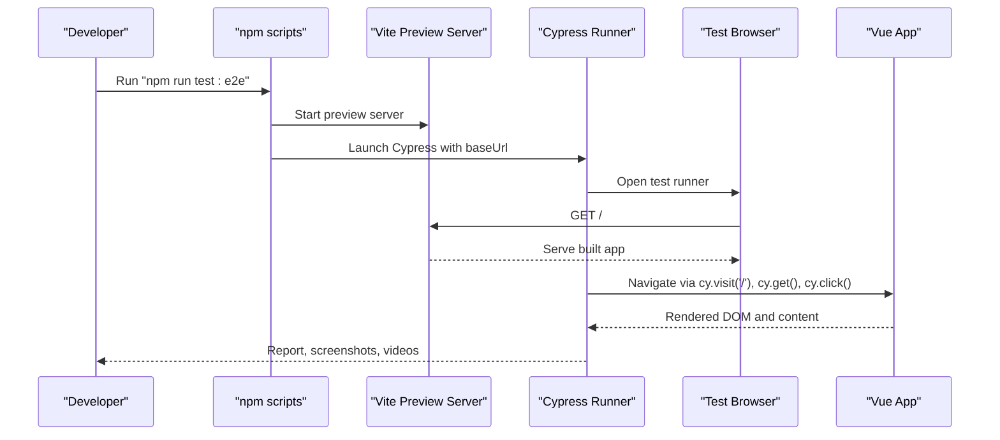
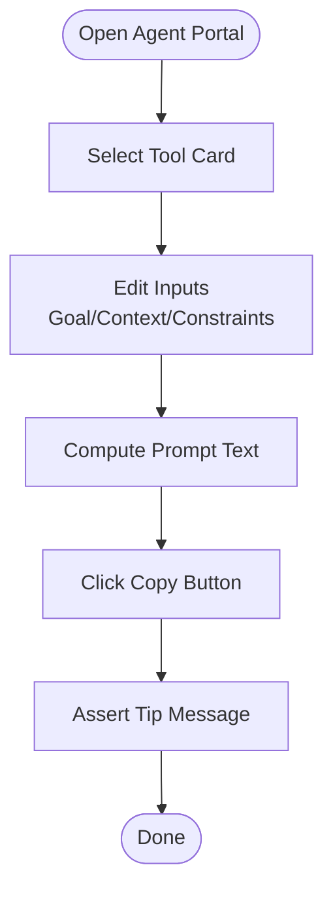
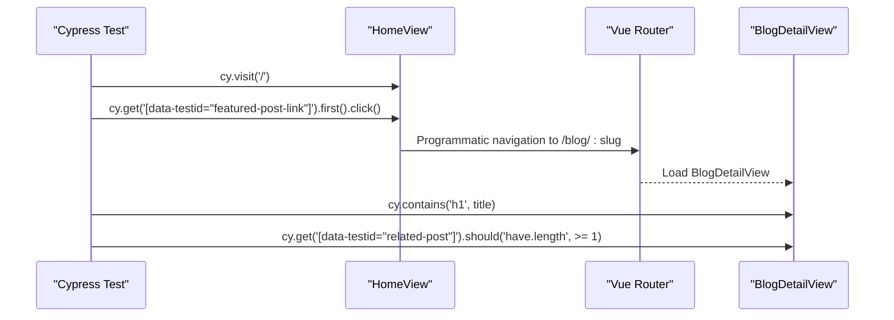
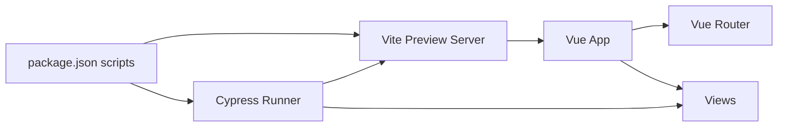

# End-to-End Testing with Cypress

<cite>
**Referenced Files in This Document**
- [cypress.config.ts](file://cypress.config.ts)
- [e2e.ts](file://cypress/support/e2e.ts)
- [commands.ts](file://cypress/support/commands.ts)
- [example.cy.ts](file://cypress/e2e/example.cy.ts)
- [example.json](file://cypress/fixtures/example.json)
- [package.json](file://package.json)
- [App.vue](file://src/App.vue)
- [main.ts](file://src/main.ts)
- [HomeView.vue](file://src/views/HomeView.vue)
- [AgentPortalView.vue](file://src/views/AgentPortalView.vue)
- [BlogDetailView.vue](file://src/views/BlogDetailView.vue)
- [router/index.ts](file://src/router/index.ts)
- [agent-tools.ts](file://src/mock/agent-tools.ts)
- [blogPosts.ts](file://src/utils/blogPosts.ts)
</cite>

## Table of Contents
1. [Introduction](#introduction)
2. [Project Structure](#project-structure)
3. [Core Components](#core-components)
4. [Architecture Overview](#architecture-overview)
5. [Detailed Component Analysis](#detailed-component-analysis)
6. [Dependency Analysis](#dependency-analysis)
7. [Performance Considerations](#performance-considerations)
8. [Troubleshooting Guide](#troubleshooting-guide)
9. [Conclusion](#conclusion)
10. [Appendices](#appendices)

## Introduction
This document explains how to implement end-to-end (E2E) testing using the Cypress framework for a Vue 2 application. It covers Cypress configuration, test environment initialization, page-object-like patterns, user interaction simulation, navigation testing, and form submission validation. It also documents strategies for complex workflows such as the Agent Portal, blog navigation, and interactive applications. Guidance is included for responsive design testing, browser compatibility, cross-platform functionality, best practices for reliability, element selection strategies, asynchronous operation handling, fixture usage, custom commands, and test data management. Practical examples demonstrate navigation flows, content loading scenarios, and UI interactions. Finally, it explains debugging techniques, video recording, and screenshot capture for test analysis.

## Project Structure
The project integrates Cypress under the cypress/ directory with TypeScript support. The Vue application is structured with views, router, mocks, and utilities. The E2E tests target the Vite preview server launched during CI or local runs.

**Diagram sources**
- [cypress.config.ts:1-9](file://cypress.config.ts#L1-L9)
- [e2e.ts:1-21](file://cypress/support/e2e.ts#L1-L21)
- [commands.ts:1-38](file://cypress/support/commands.ts#L1-L38)
- [example.cy.ts:1-9](file://cypress/e2e/example.cy.ts#L1-L9)
- [example.json:1-6](file://cypress/fixtures/example.json#L1-L6)
- [main.ts:1-16](file://src/main.ts#L1-L16)
- [App.vue:1-110](file://src/App.vue#L1-L110)
- [router/index.ts:1-65](file://src/router/index.ts#L1-L65)
- [HomeView.vue:1-648](file://src/views/HomeView.vue#L1-L648)
- [AgentPortalView.vue:1-239](file://src/views/AgentPortalView.vue#L1-L239)
- [BlogDetailView.vue:1-530](file://src/views/BlogDetailView.vue#L1-L530)
- [agent-tools.ts:1-40](file://src/mock/agent-tools.ts#L1-L40)
- [blogPosts.ts:1-110](file://src/utils/blogPosts.ts#L1-L110)

**Section sources**
- [cypress.config.ts:1-9](file://cypress.config.ts#L1-L9)
- [e2e.ts:1-21](file://cypress/support/e2e.ts#L1-L21)
- [commands.ts:1-38](file://cypress/support/commands.ts#L1-L38)
- [example.cy.ts:1-9](file://cypress/e2e/example.cy.ts#L1-L9)
- [example.json:1-6](file://cypress/fixtures/example.json#L1-L6)
- [main.ts:1-16](file://src/main.ts#L1-L16)
- [App.vue:1-110](file://src/App.vue#L1-L110)
- [router/index.ts:1-65](file://src/router/index.ts#L1-L65)
- [HomeView.vue:1-648](file://src/views/HomeView.vue#L1-L648)
- [AgentPortalView.vue:1-239](file://src/views/AgentPortalView.vue#L1-L239)
- [BlogDetailView.vue:1-530](file://src/views/BlogDetailView.vue#L1-L530)
- [agent-tools.ts:1-40](file://src/mock/agent-tools.ts#L1-L40)
- [blogPosts.ts:1-110](file://src/utils/blogPosts.ts#L1-L110)

## Core Components
- Cypress configuration defines the spec pattern and base URL for the preview server.
- Support files load custom commands and global behaviors before tests.
- Example test demonstrates visiting the root route and asserting content.
- Fixtures provide mock data for requests or test inputs.
- Application entry initializes Vue, router, and Pinia.
- Views expose navigable pages and interactive components for testing.

Key responsibilities:
- cypress.config.ts: Configure e2e baseUrl and spec discovery.
- cypress/support/e2e.ts: Import custom commands globally.
- cypress/support/commands.ts: Define reusable commands and overwrite defaults.
- cypress/e2e/example.cy.ts: Basic smoke test against the preview server.
- cypress/fixtures/example.json: Sample fixture data.
- src/main.ts: Mounts the Vue app with router and Pinia.
- src/router/index.ts: Declares routes used by E2E tests.
- src/views/*: Pages to navigate and validate.
- src/mock/agent-tools.ts: Static tool definitions for Agent Portal.
- src/utils/blogPosts.ts: Aggregates content for Home and Blog Detail.

**Section sources**
- [cypress.config.ts:1-9](file://cypress.config.ts#L1-L9)
- [e2e.ts:1-21](file://cypress/support/e2e.ts#L1-L21)
- [commands.ts:1-38](file://cypress/support/commands.ts#L1-L38)
- [example.cy.ts:1-9](file://cypress/e2e/example.cy.ts#L1-L9)
- [example.json:1-6](file://cypress/fixtures/example.json#L1-L6)
- [main.ts:1-16](file://src/main.ts#L1-L16)
- [router/index.ts:1-65](file://src/router/index.ts#L1-L65)
- [agent-tools.ts:1-40](file://src/mock/agent-tools.ts#L1-L40)
- [blogPosts.ts:1-110](file://src/utils/blogPosts.ts#L1-L110)

## Architecture Overview
The E2E pipeline starts the Vite preview server, launches Cypress, and executes tests against the running application. Tests navigate routes, interact with components, and assert content derived from static fixtures and dynamic utilities.

**Diagram sources**
- [package.json:15-27](file://package.json#L15-L27)
- [cypress.config.ts:1-9](file://cypress.config.ts#L1-L9)

**Section sources**
- [package.json:15-27](file://package.json#L15-L27)
- [cypress.config.ts:1-9](file://cypress.config.ts#L1-L9)

## Detailed Component Analysis

### Cypress Configuration and Environment Initialization
- Base URL is set to the Vite preview port, ensuring tests run against the built app.
- Spec pattern matches TypeScript/JavaScript files under cypress/e2e.
- Global support loads custom commands before tests execute.

Best practices:
- Keep baseUrl aligned with the preview script.
- Use environment variables for overrides in CI.
- Centralize global behaviors in support/e2e.ts.

**Section sources**
- [cypress.config.ts:1-9](file://cypress.config.ts#L1-L9)
- [e2e.ts:1-21](file://cypress/support/e2e.ts#L1-L21)

### Page Object Patterns and Navigation Testing
Recommended approach:
- Encapsulate selectors and actions per view in a page object file under cypress/e2e/<page>.page.ts.
- Expose methods like visit(), navigateToBlogDetail(slug), and assertContentLoaded().
- Reuse these methods across tests to reduce duplication and improve maintainability.

Example navigation targets:
- Home: "/"
- About: "/about"
- Agent Portal: "/agent-portal"
- Blog Detail: "/blog/:slug"
- Tic Tac Toe: "/tic-tac-toe"
- Overseas Export: "/overseas-export"
- WASM: "/wasm"
- Canvas: "/canvas"

Validation points:
- Header links and active states.
- Route transitions and loading states.
- Content availability after hydration.

**Section sources**
- [router/index.ts:1-65](file://src/router/index.ts#L1-L65)
- [HomeView.vue:1-648](file://src/views/HomeView.vue#L1-L648)
- [BlogDetailView.vue:1-530](file://src/views/BlogDetailView.vue#L1-L530)
- [AgentPortalView.vue:1-239](file://src/views/AgentPortalView.vue#L1-L239)

### User Interaction Simulation and Form Submission Validation
Agent Portal interactions:
- Select tool cards and assert active state.
- Edit textarea inputs (Goal, Context, Constraints).
- Compute and assert prompt output text.
- Trigger copy action and assert feedback tip.

Home page interactions:
- Click hero buttons to navigate to About or Agent Portal.
- Assert featured posts and excerpts.
- Expand content previews and assert content rendering.

Blog Detail interactions:
- Navigate from Home to a specific slug.
- Assert metadata, reading time, and rendered markdown.
- Validate related posts rendering.

Form submission validation:
- Use cy.get() to target inputs and textarea.
- Use cy.type() for text input and cy.click() for selections.
- Assert DOM changes and computed values.

**Diagram sources**
- [AgentPortalView.vue:1-239](file://src/views/AgentPortalView.vue#L1-L239)
- [agent-tools.ts:1-40](file://src/mock/agent-tools.ts#L1-L40)

**Section sources**
- [AgentPortalView.vue:1-239](file://src/views/AgentPortalView.vue#L1-L239)
- [agent-tools.ts:1-40](file://src/mock/agent-tools.ts#L1-L40)
- [HomeView.vue:1-648](file://src/views/HomeView.vue#L1-L648)
- [BlogDetailView.vue:1-530](file://src/views/BlogDetailView.vue#L1-L530)

### Complex Workflows: Agent Portal, Blog Navigation, Interactive Applications
Agent Portal workflow:
- Initialize with default tool and inputs.
- Switch tools to update default inputs.
- Build prompts and copy to clipboard.
- Validate UI feedback messages.

Blog navigation workflow:
- Load Home, discover featured posts.
- Navigate to a specific blog detail by slug.
- Verify metadata, reading time, and related posts.

Interactive applications:
- Use cy.intercept() to stub network requests if needed.
- Wait for hydration and content rendering using cy.contains() or custom aliases.
- Assert state changes after user actions.

**Diagram sources**
- [HomeView.vue:1-648](file://src/views/HomeView.vue#L1-L648)
- [BlogDetailView.vue:1-530](file://src/views/BlogDetailView.vue#L1-L530)
- [router/index.ts:1-65](file://src/router/index.ts#L1-L65)

**Section sources**
- [HomeView.vue:1-648](file://src/views/HomeView.vue#L1-L648)
- [BlogDetailView.vue:1-530](file://src/views/BlogDetailView.vue#L1-L530)
- [router/index.ts:1-65](file://src/router/index.ts#L1-L65)

### Responsive Design, Browser Compatibility, and Cross-Platform Functionality
Testing responsive behavior:
- Resize viewport using cy.viewport(width, height) before assertions.
- Validate layout grids, button wrapping, and typography scaling.
- Compare snapshots across breakpoints.

Cross-browser and platform:
- Configure browsers in cypress.config.ts for Electron, Chrome, Firefox.
- Use cy.screenshot() strategically to capture differences across platforms.
- Record videos for visual regression analysis.

**Section sources**
- [cypress.config.ts:1-9](file://cypress.config.ts#L1-L9)
- [HomeView.vue:615-646](file://src/views/HomeView.vue#L615-L646)
- [BlogDetailView.vue:510-528](file://src/views/BlogDetailView.vue#L510-L528)

### Element Selection Strategies and Asynchronous Operation Handling
Selection strategies:
- Prefer data-testid attributes for deterministic selectors.
- Combine cy.get() with cy.contains() for nested content.
- Use cy.root() and subject chaining to scope queries.

Asynchronous handling:
- Wait for hydration and content rendering using cy.contains() or custom aliases.
- Use cy.wait() sparingly; prefer cy.get('[data-cy=ready])').
- Stub network requests with cy.intercept() when appropriate.

**Section sources**
- [HomeView.vue:1-648](file://src/views/HomeView.vue#L1-L648)
- [BlogDetailView.vue:1-530](file://src/views/BlogDetailView.vue#L1-L530)

### Fixture Usage and Test Data Management
Fixtures:
- Store static JSON data under cypress/fixtures/.
- Use cy.fixture() to load data and cy.intercept() to mock endpoints.
- Parameterize tests with different fixture sets.

Mock data:
- Leverage src/mock/* for static tool definitions.
- Use src/utils/* for computed content aggregation.

**Section sources**
- [example.json:1-6](file://cypress/fixtures/example.json#L1-L6)
- [agent-tools.ts:1-40](file://src/mock/agent-tools.ts#L1-L40)
- [blogPosts.ts:1-110](file://src/utils/blogPosts.ts#L1-L110)

### Custom Commands Implementation
Custom commands:
- Add commands in cypress/support/commands.ts.
- Overwrite visit() to inject cookies or interceptors if needed.
- Export typed Chainable interfaces for IntelliSense.

Examples:
- cy.login(email, password) for authentication flows.
- cy.copyPrompt() for Agent Portal interactions.
- cy.waitForHydration() for SPA readiness.

**Section sources**
- [commands.ts:1-38](file://cypress/support/commands.ts#L1-L38)

### Practical Examples: Navigation Flows, Content Loading, UI Interactions
Navigation flows:
- cy.visit('/') then cy.contains('h1', 'You did it!') for basic smoke test.
- cy.get('nav a[href="/agent-portal"]').click() to navigate to Agent Portal.

Content loading:
- cy.contains('h1', '用代码探索世界') after navigating to Home.
- cy.get('[data-testid="post-card"]').should('be.visible') on Home.

UI interactions:
- cy.get('[data-testid="tool-card"]').eq(0).click() to select a tool.
- cy.get('textarea').first().clear().type('New goal') to edit inputs.

**Section sources**
- [example.cy.ts:1-9](file://cypress/e2e/example.cy.ts#L1-L9)
- [HomeView.vue:1-648](file://src/views/HomeView.vue#L1-L648)
- [AgentPortalView.vue:1-239](file://src/views/AgentPortalView.vue#L1-L239)

### Debugging Techniques, Video Recording, and Screenshot Capture
Debugging:
- Use cy.debug() to pause execution and inspect the DOM.
- Inspect element state with cy.get().should('have.class', 'active').
- Log values with cy.wrap() and cy.log().

Video and screenshots:
- Videos are recorded by default; configure retention and quality in cypress.config.ts.
- Use cy.screenshot() to capture critical states for reports.

**Section sources**
- [cypress.config.ts:1-9](file://cypress.config.ts#L1-L9)
- [example.cy.ts:1-9](file://cypress/e2e/example.cy.ts#L1-L9)

## Dependency Analysis
Cypress depends on the preview server and the Vue application’s routing and views. The npm scripts orchestrate server startup and Cypress execution.

**Diagram sources**
- [package.json:15-27](file://package.json#L15-L27)
- [cypress.config.ts:1-9](file://cypress.config.ts#L1-L9)
- [router/index.ts:1-65](file://src/router/index.ts#L1-L65)

**Section sources**
- [package.json:15-27](file://package.json#L15-L27)
- [cypress.config.ts:1-9](file://cypress.config.ts#L1-L9)
- [router/index.ts:1-65](file://src/router/index.ts#L1-L65)

## Performance Considerations
- Minimize DOM queries by caching cy.get() results.
- Use cy.contains() judiciously; prefer targeted selectors.
- Avoid excessive cy.wait(); rely on readiness checks.
- Parallelize independent suites in CI for speed.

## Troubleshooting Guide
Common issues and resolutions:
- Tests fail to load: Ensure baseUrl matches the preview server port.
- Stale content: Clear browser cache or reload the page with cy.reload(true).
- Timing issues: Add explicit waits or use cy.contains() to detect hydration.
- Selector flakiness: Use data-testid attributes consistently.

**Section sources**
- [cypress.config.ts:1-9](file://cypress.config.ts#L1-L9)
- [example.cy.ts:1-9](file://cypress/e2e/example.cy.ts#L1-L9)

## Conclusion
Cypress provides a robust framework for E2E testing of this Vue application. By configuring the preview server, structuring page objects, simulating user interactions, and validating content across routes, teams can ensure reliable and maintainable tests. Incorporating responsive testing, custom commands, fixtures, and strong debugging practices yields high-quality coverage for navigation, forms, and interactive components.

## Appendices
- Example test scaffold: [example.cy.ts:1-9](file://cypress/e2e/example.cy.ts#L1-L9)
- Application entry: [main.ts:1-16](file://src/main.ts#L1-L16)
- Routes: [router/index.ts:1-65](file://src/router/index.ts#L1-L65)
- Agent tools: [agent-tools.ts:1-40](file://src/mock/agent-tools.ts#L1-L40)
- Blog utilities: [blogPosts.ts:1-110](file://src/utils/blogPosts.ts#L1-L110)