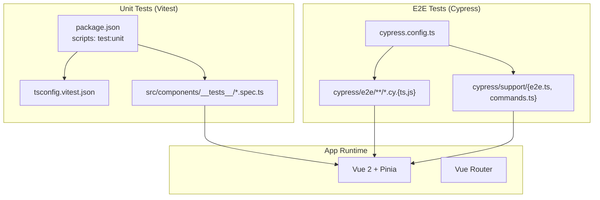
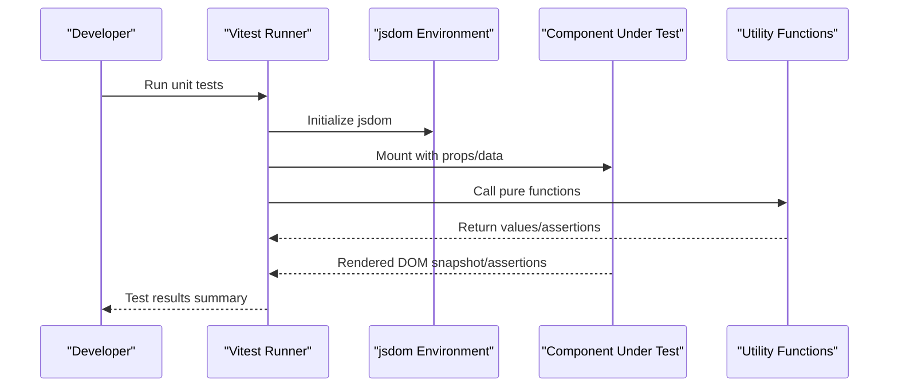
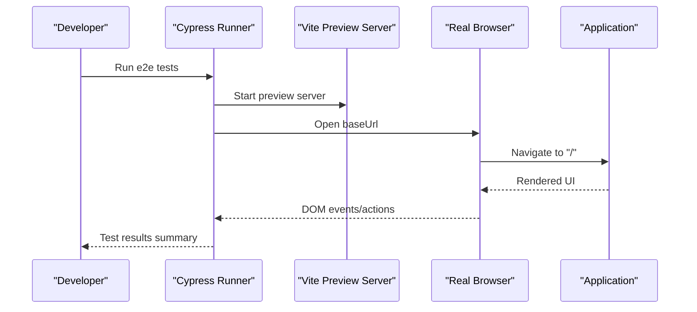
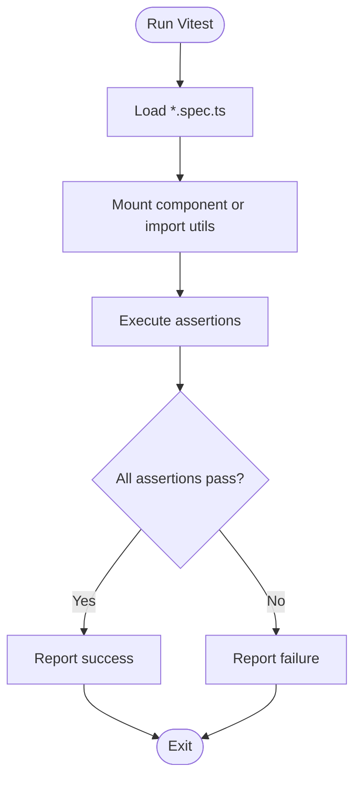
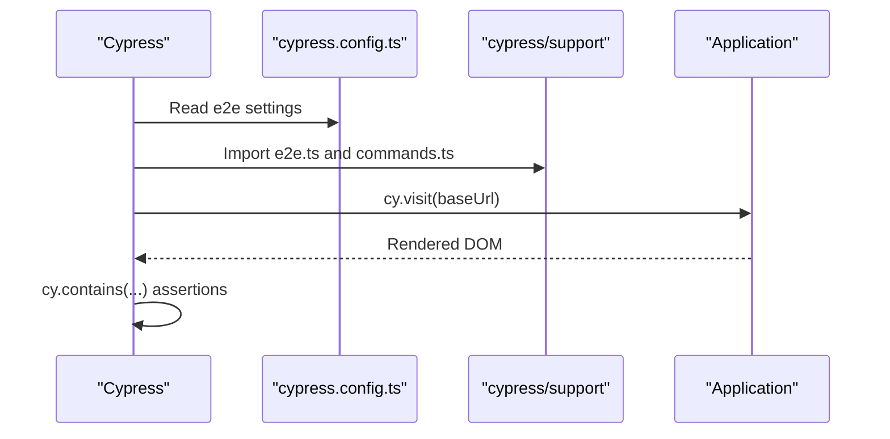
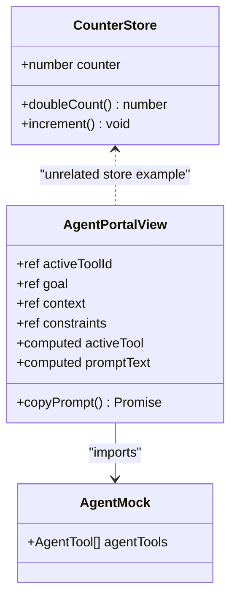
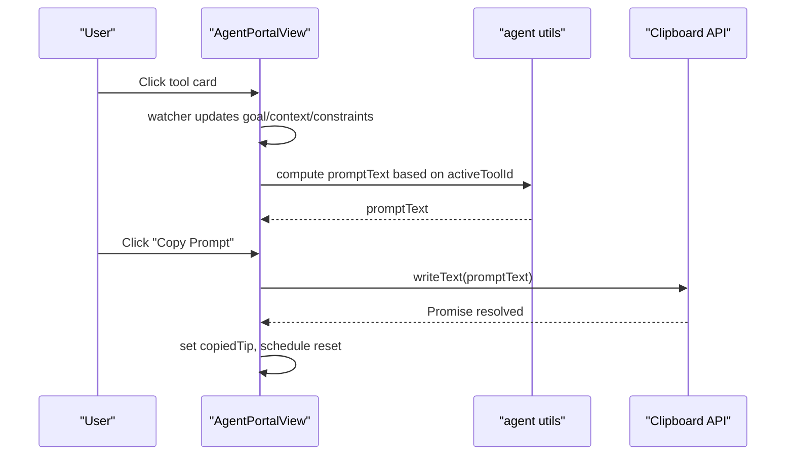
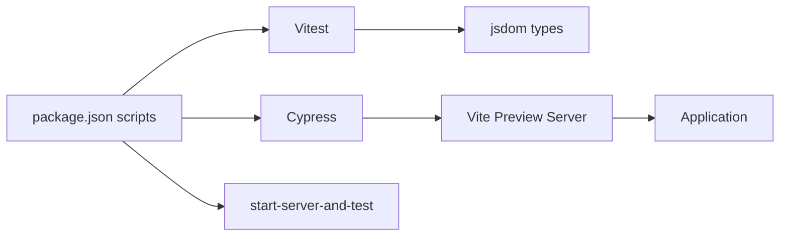

# Testing Strategy

<cite>
**Referenced Files in This Document**
- [package.json](file://package.json)
- [vite.config.ts](file://vite.config.ts)
- [cypress.config.ts](file://cypress.config.ts)
- [tsconfig.vitest.json](file://tsconfig.vitest.json)
- [HelloWorld.spec.ts](file://src/components/__tests__/HelloWorld.spec.ts)
- [agent.spec.ts](file://src/components/__tests__/agent.spec.ts)
- [canvas.spec.ts](file://src/components/__tests__/canvas.spec.ts)
- [example.cy.ts](file://cypress/e2e/example.cy.ts)
- [e2e.ts](file://cypress/support/e2e.ts)
- [commands.ts](file://cypress/support/commands.ts)
- [agent.ts](file://src/utils/agent.ts)
- [canvas.ts](file://src/utils/canvas.ts)
- [HelloWorld.vue](file://src/components/HelloWorld.vue)
- [AgentPortalView.vue](file://src/views/AgentPortalView.vue)
- [agent-tools.ts](file://src/mock/agent-tools.ts)
- [counter.ts](file://src/stores/counter.ts)
</cite>

## Table of Contents
1. [Introduction](#introduction)
2. [Project Structure](#project-structure)
3. [Core Components](#core-components)
4. [Architecture Overview](#architecture-overview)
5. [Detailed Component Analysis](#detailed-component-analysis)
6. [Dependency Analysis](#dependency-analysis)
7. [Performance Considerations](#performance-considerations)
8. [Troubleshooting Guide](#troubleshooting-guide)
9. [Conclusion](#conclusion)
10. [Appendices](#appendices)

## Introduction
This document outlines the dual testing strategy used in the project: Vitest for unit testing and Cypress for end-to-end (e2e) testing. It explains configuration, component testing patterns, assertion strategies, and best practices for Vue.js components, async scenarios, and Pinia state. It also covers test organization, naming conventions, CI integration, and how unit and e2e tests collaborate in the overall quality assurance strategy.

## Project Structure
The testing stack is organized under dedicated folders and configured via scripts and configuration files:
- Unit tests live alongside components under src/components/__tests__ and use Vitest with jsdom.
- E2E tests live under cypress/e2e and use Cypress with a local preview server.
- Configuration files define environments, TypeScript settings, and e2e behavior.

**Diagram sources**
- [package.json:21-23](file://package.json#L21-L23)
- [tsconfig.vitest.json:1-10](file://tsconfig.vitest.json#L1-L10)
- [cypress.config.ts:1-9](file://cypress.config.ts#L1-L9)
- [HelloWorld.spec.ts:1-12](file://src/components/__tests__/HelloWorld.spec.ts#L1-L12)
- [example.cy.ts:1-9](file://cypress/e2e/example.cy.ts#L1-L9)

**Section sources**
- [package.json:15-26](file://package.json#L15-L26)
- [tsconfig.vitest.json:1-10](file://tsconfig.vitest.json#L1-L10)
- [cypress.config.ts:1-9](file://cypress.config.ts#L1-L9)

## Core Components
- Vitest configuration and environment:
  - Scripts define unit test execution with jsdom.
  - tsconfig.vitest.json extends app tsconfig and adds jsdom and node types for isolated unit tests.
- Cypress configuration:
  - e2e spec pattern and base URL pointing to the Vite preview server.
  - Support files load commands and global setup for e2e runs.
- Example unit tests:
  - Component mounting and prop assertions.
  - Utility function tests with deterministic expectations.
  - Canvas utilities tested with mock contexts and assertions on method calls.
- Example e2e test:
  - Visits the root and asserts on rendered content.

**Section sources**
- [package.json:21-23](file://package.json#L21-L23)
- [tsconfig.vitest.json:4-8](file://tsconfig.vitest.json#L4-L8)
- [HelloWorld.spec.ts:1-12](file://src/components/__tests__/HelloWorld.spec.ts#L1-L12)
- [agent.spec.ts:1-36](file://src/components/__tests__/agent.spec.ts#L1-L36)
- [canvas.spec.ts:1-131](file://src/components/__tests__/canvas.spec.ts#L1-L131)
- [example.cy.ts:1-9](file://cypress/e2e/example.cy.ts#L1-L9)
- [e2e.ts:16-17](file://cypress/support/e2e.ts#L16-L17)
- [commands.ts:1-38](file://cypress/support/commands.ts#L1-L38)

## Architecture Overview
The testing architecture separates concerns:
- Unit tests validate pure functions, component rendering, and small units in isolation using jsdom.
- E2E tests validate real user journeys against the built/preview application.

**Diagram sources**
- [package.json:21](file://package.json#L21)
- [tsconfig.vitest.json:7-8](file://tsconfig.vitest.json#L7-L8)
- [HelloWorld.spec.ts:7-10](file://src/components/__tests__/HelloWorld.spec.ts#L7-L10)
- [agent.spec.ts:6-14](file://src/components/__tests__/agent.spec.ts#L6-L14)

**Diagram sources**
- [package.json:22-23](file://package.json#L22-L23)
- [cypress.config.ts:4-7](file://cypress.config.ts#L4-L7)
- [example.cy.ts:4-7](file://cypress/e2e/example.cy.ts#L4-L7)

## Detailed Component Analysis

### Unit Testing with Vitest
- Component rendering tests:
  - Mount components with props and assert rendered text/content.
  - Example: render verification for a simple component.
- Pure function tests:
  - Validate deterministic outputs for utility functions.
  - Example: prompt builders produce expected substrings for given inputs.
- Canvas utilities tests:
  - Mock CanvasRenderingContext2D and assert method calls.
  - Validate particle creation, updates, and drawing routines.

**Diagram sources**
- [HelloWorld.spec.ts:6-11](file://src/components/__tests__/HelloWorld.spec.ts#L6-L11)
- [agent.spec.ts:5-35](file://src/components/__tests__/agent.spec.ts#L5-L35)
- [canvas.spec.ts:22-129](file://src/components/__tests__/canvas.spec.ts#L22-L129)

**Section sources**
- [HelloWorld.spec.ts:1-12](file://src/components/__tests__/HelloWorld.spec.ts#L1-L12)
- [agent.spec.ts:1-36](file://src/components/__tests__/agent.spec.ts#L1-L36)
- [canvas.spec.ts:1-131](file://src/components/__tests__/canvas.spec.ts#L1-L131)

### E2E Testing with Cypress
- Configuration:
  - Base URL points to the Vite preview server.
  - Spec pattern matches e2e test files.
- Support:
  - Global commands and e2e bootstrap are imported.
- Example:
  - Visit root and assert presence of expected text.

**Diagram sources**
- [cypress.config.ts:4-7](file://cypress.config.ts#L4-L7)
- [e2e.ts:16-17](file://cypress/support/e2e.ts#L16-L17)
- [commands.ts:14-26](file://cypress/support/commands.ts#L14-L26)
- [example.cy.ts:4-7](file://cypress/e2e/example.cy.ts#L4-L7)

**Section sources**
- [cypress.config.ts:1-9](file://cypress.config.ts#L1-L9)
- [e2e.ts:16-17](file://cypress/support/e2e.ts#L16-L17)
- [commands.ts:1-38](file://cypress/support/commands.ts#L1-L38)
- [example.cy.ts:1-9](file://cypress/e2e/example.cy.ts#L1-L9)

### Testing Patterns and Best Practices
- Component testing patterns:
  - Use mount with propsData or reactive refs to simulate component inputs.
  - Assert text content, attributes, and class toggles.
  - Example: render verification for a component with a message prop.
- Assertion strategies:
  - Prefer semantic assertions (contains/includes) for text.
  - Validate computed outputs and reactive behavior via mounted wrapper state.
- Async testing:
  - For async operations, await promises and assert state transitions.
  - Example: clipboard write and tip visibility after a click action.
- Mock data usage:
  - Use mock data modules to supply controlled inputs for components and utilities.
  - Example: agent tools mock for portal view inputs.
- State management (Pinia):
  - Test getters and actions by importing the store and invoking actions.
  - Example: increment action and derived doubleCount getter.

**Diagram sources**
- [counter.ts:1-17](file://src/stores/counter.ts#L1-L17)
- [AgentPortalView.vue:1-239](file://src/views/AgentPortalView.vue#L1-L239)
- [agent-tools.ts:1-40](file://src/mock/agent-tools.ts#L1-L40)

**Section sources**
- [HelloWorld.vue:1-42](file://src/components/HelloWorld.vue#L1-L42)
- [AgentPortalView.vue:47-58](file://src/views/AgentPortalView.vue#L47-L58)
- [agent-tools.ts:11-39](file://src/mock/agent-tools.ts#L11-L39)
- [counter.ts:1-17](file://src/stores/counter.ts#L1-L17)

### Complex Interactions and State Management Scenarios
- Tool selection and reactive prompt generation:
  - Selecting a tool updates goal/context/constraints via watchers.
  - Computed prompt text switches based on active tool.
- Clipboard interaction:
  - Click triggers async copy operation and a temporary tip.
- Canvas interactions:
  - Particle system lifecycle validated with mocks for drawing APIs.

**Diagram sources**
- [AgentPortalView.vue:13-45](file://src/views/AgentPortalView.vue#L13-L45)
- [AgentPortalView.vue:47-58](file://src/views/AgentPortalView.vue#L47-L58)
- [agent.ts:9-46](file://src/utils/agent.ts#L9-L46)

**Section sources**
- [AgentPortalView.vue:1-239](file://src/views/AgentPortalView.vue#L1-L239)
- [agent.ts:1-47](file://src/utils/agent.ts#L1-L47)
- [canvas.spec.ts:78-129](file://src/components/__tests__/canvas.spec.ts#L78-L129)

## Dependency Analysis
- Unit test dependencies:
  - Vitest and jsdom types enable DOM-like assertions without a browser.
  - @vue/test-utils mounts Vue components for unit tests.
- E2E dependencies:
  - Cypress orchestrates browser automation and assertions.
  - start-server-and-test launches the preview server and runs Cypress specs.
- Build and preview:
  - Vite preview serves the app locally for e2e tests.

**Diagram sources**
- [package.json:21-23](file://package.json#L21-L23)
- [tsconfig.vitest.json:7-8](file://tsconfig.vitest.json#L7-L8)
- [cypress.config.ts:6](file://cypress.config.ts#L6)

**Section sources**
- [package.json:21-23](file://package.json#L21-L23)
- [tsconfig.vitest.json:1-10](file://tsconfig.vitest.json#L1-L10)
- [cypress.config.ts:1-9](file://cypress.config.ts#L1-L9)

## Performance Considerations
- Prefer unit tests for fast feedback loops on pure logic and small component units.
- Keep e2e tests focused and minimal to reduce flakiness and runtime.
- Use deterministic mocks for external APIs (e.g., clipboard) to avoid timing issues.
- Avoid heavy DOM queries in e2e; prefer semantic selectors and stable test IDs.

## Troubleshooting Guide
- Unit test environment issues:
  - Ensure jsdom types are present in the Vitest tsconfig.
  - Verify component imports resolve correctly with the project alias.
- E2E test failures:
  - Confirm the preview server is reachable at the configured base URL.
  - Check that e2e spec pattern matches test file extensions.
  - Add custom commands in commands.ts for reusable actions.
- Async assertions:
  - For clipboard and timers, await promises and use timeouts appropriately.
- Mock data:
  - Centralize mock data in a single module to keep tests maintainable.

**Section sources**
- [tsconfig.vitest.json:4-8](file://tsconfig.vitest.json#L4-L8)
- [cypress.config.ts:5-7](file://cypress.config.ts#L5-L7)
- [commands.ts:14-26](file://cypress/support/commands.ts#L14-L26)
- [AgentPortalView.vue:47-58](file://src/views/AgentPortalView.vue#L47-L58)
- [agent-tools.ts:11-39](file://src/mock/agent-tools.ts#L11-L39)

## Conclusion
The project employs a pragmatic dual testing strategy: Vitest for rapid, isolated unit tests and Cypress for realistic end-to-end validations. By combining deterministic mocks, semantic assertions, and careful test organization, the suite ensures correctness across component rendering, utility logic, and user workflows. Continuous integration can leverage the provided scripts to automate both unit and e2e checks against the preview server.

## Appendices
- Test organization and naming conventions:
  - Place unit tests adjacent to components under src/components/__tests__/ComponentName.spec.ts.
  - Name e2e tests with a .cy.ts suffix under cypress/e2e/<route-or-feature>.cy.ts.
  - Use descriptive describe/it blocks and focus on behavioral assertions.
- Continuous integration:
  - Use the provided scripts to run unit tests and e2e tests in CI.
  - For headless e2e runs, use the ci script variant.

**Section sources**
- [package.json:21-23](file://package.json#L21-L23)
- [HelloWorld.spec.ts:6-11](file://src/components/__tests__/HelloWorld.spec.ts#L6-L11)
- [example.cy.ts:4-7](file://cypress/e2e/example.cy.ts#L4-L7)