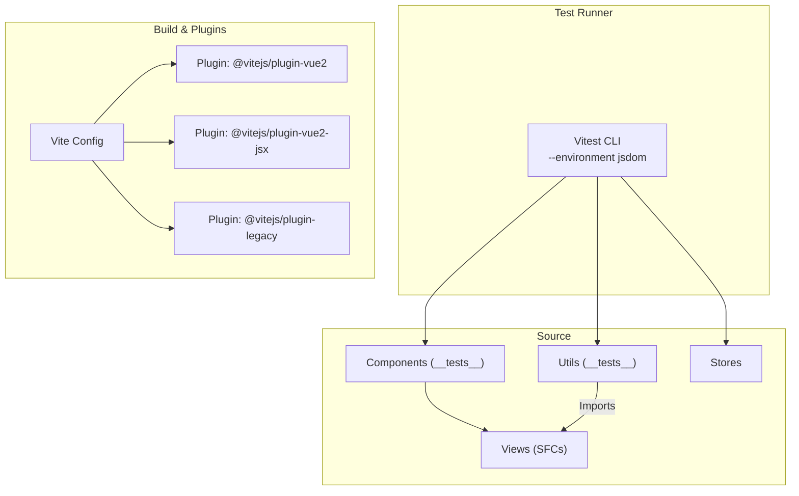
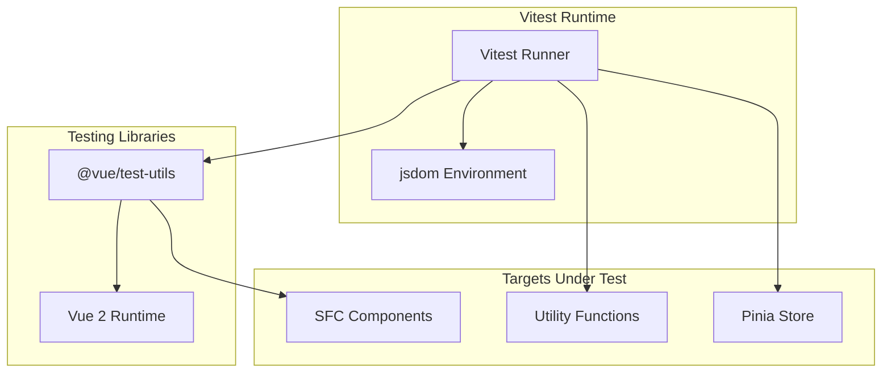
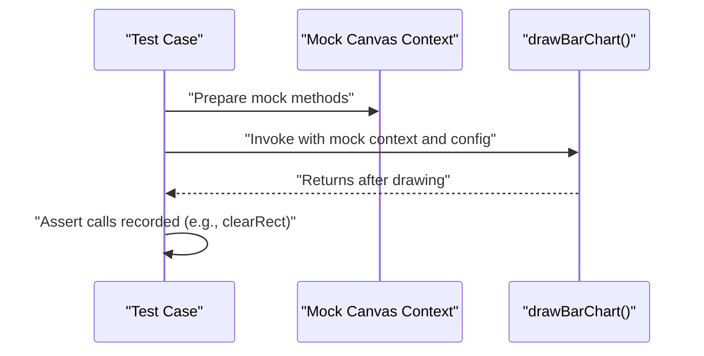
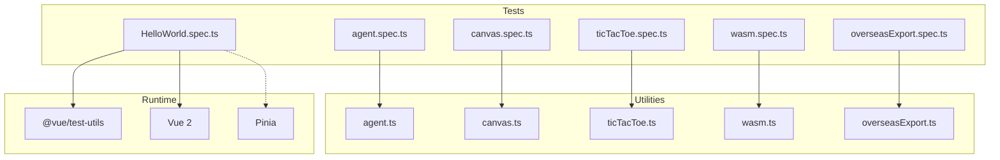

# Unit Testing with Vitest

<cite>
**Referenced Files in This Document**
- [package.json](file://package.json)
- [vite.config.ts](file://vite.config.ts)
- [tsconfig.vitest.json](file://tsconfig.vitest.json)
- [HelloWorld.spec.ts](file://src/components/__tests__/HelloWorld.spec.ts)
- [agent.spec.ts](file://src/components/__tests__/agent.spec.ts)
- [canvas.spec.ts](file://src/components/__tests__/canvas.spec.ts)
- [ticTacToe.spec.ts](file://src/components/__tests__/ticTacToe.spec.ts)
- [wasm.spec.ts](file://src/components/__tests__/wasm.spec.ts)
- [overseasExport.spec.ts](file://src/components/__tests__/overseasExport.spec.ts)
- [HelloWorld.vue](file://src/components/HelloWorld.vue)
- [agent.ts](file://src/utils/agent.ts)
- [canvas.ts](file://src/utils/canvas.ts)
- [ticTacToe.ts](file://src/utils/ticTacToe.ts)
- [wasm.ts](file://src/utils/wasm.ts)
- [agent-tools.ts](file://src/mock/agent-tools.ts)
- [counter.ts](file://src/stores/counter.ts)
</cite>

## Table of Contents
1. [Introduction](#introduction)
2. [Project Structure](#project-structure)
3. [Core Components](#core-components)
4. [Architecture Overview](#architecture-overview)
5. [Detailed Component Analysis](#detailed-component-analysis)
6. [Dependency Analysis](#dependency-analysis)
7. [Performance Considerations](#performance-considerations)
8. [Troubleshooting Guide](#troubleshooting-guide)
9. [Conclusion](#conclusion)
10. [Appendices](#appendices)

## Introduction
This document explains how unit tests are implemented using the Vitest framework in this project. It covers test configuration, component testing patterns, assertion strategies, and best practices for Vue Single File Components (SFCs), utility functions, and state management modules. Practical examples are drawn from the existing test suite, including agent prompts, canvas operations, game logic, and WASM utilities. Guidance is also provided on setup and teardown, test isolation, and debugging strategies.

## Project Structure
The project integrates Vitest with Vite and Vue 2. Tests are colocated under a dedicated folder alongside components and utilities. The test environment leverages jsdom via Vitest’s configuration, enabling DOM APIs for component and utility tests.

**Diagram sources**
- [package.json:21](file://package.json#L21)
- [vite.config.ts:10-17](file://vite.config.ts#L10-L17)

**Section sources**
- [package.json:15-27](file://package.json#L15-L27)
- [vite.config.ts:1-27](file://vite.config.ts#L1-L27)

## Core Components
- Test runner and environment: Vitest runs with jsdom to simulate a browser-like DOM environment suitable for Vue component tests and canvas utilities.
- TypeScript configuration for tests: A separate TS config extends the app configuration and adds jsdom and node types for test compilation.
- Component tests: Use @vue/test-utils to mount SFCs and assert rendered output and behavior.
- Utility tests: Cover pure functions and canvas rendering helpers with deterministic assertions and mocks.
- State management tests: Pinia store logic is tested directly by importing the store definition and invoking state/getter/action functions.

Key test scripts and environment:
- Unit test script invokes Vitest with jsdom.
- TypeScript type checking for tests uses a dedicated tsconfig that includes jsdom types.

**Section sources**
- [package.json:21](file://package.json#L21)
- [tsconfig.vitest.json:1-10](file://tsconfig.vitest.json#L1-L10)

## Architecture Overview
The testing architecture centers on Vitest as the orchestrator, with jsdom providing DOM simulation. Component tests rely on @vue/test-utils to mount SFCs, while utility tests validate pure functions and canvas rendering. State management tests exercise Pinia store logic directly.

**Diagram sources**
- [package.json:21](file://package.json#L21)
- [HelloWorld.spec.ts:3](file://src/components/__tests__/HelloWorld.spec.ts#L3)
- [canvas.spec.ts:1](file://src/components/__tests__/canvas.spec.ts#L1)

## Detailed Component Analysis

### Component Testing Patterns with Vue SFCs
- Mounting and asserting rendered text/content using @vue/test-utils.
- Passing props to SFCs and verifying text inclusion or element presence.
- Example: Rendering a message prop in a HelloWorld component and asserting its presence.

Best practices:
- Keep tests focused on a single concern per test case.
- Prefer shallow mounting for isolated component logic; deep mount when component composition matters.
- Use deterministic props and avoid relying on randomization in tests.

**Section sources**
- [HelloWorld.spec.ts:1-12](file://src/components/__tests__/HelloWorld.spec.ts#L1-L12)
- [HelloWorld.vue:1-42](file://src/components/HelloWorld.vue#L1-L42)

### Utility Functions Testing
- Pure function tests: Validate deterministic outputs for given inputs.
- Canvas utilities: Mock CanvasRenderingContext2D to assert method calls and rendering behavior.
- Game logic: Validate state transitions and decision-making logic for a classic game.

Examples:
- Agent prompt builders: Assert constructed prompt content includes expected markers and substitutions.
- Canvas particle system: Verify particle creation, boundary bouncing, and chart rendering calls.
- Tic-Tac-Toe engine: Validate win detection, draw conditions, and computer move prioritization.

Mocking strategies:
- For canvas functions, construct a minimal mock context with stubbed methods and track call sequences.
- For complex data structures, use representative fixtures or generated configs to drive assertions.

**Section sources**
- [agent.spec.ts:1-36](file://src/components/__tests__/agent.spec.ts#L1-L36)
- [agent.ts:1-47](file://src/utils/agent.ts#L1-L47)
- [canvas.spec.ts:1-131](file://src/components/__tests__/canvas.spec.ts#L1-L131)
- [canvas.ts:1-204](file://src/utils/canvas.ts#L1-L204)
- [ticTacToe.spec.ts:1-32](file://src/components/__tests__/ticTacToe.spec.ts#L1-L32)
- [ticTacToe.ts:1-55](file://src/utils/ticTacToe.ts#L1-L55)

### State Management Modules (Pinia)
- Directly import and test store logic by invoking state, getters, and actions.
- Isolate tests from external dependencies by importing the store definition and calling functions directly.
- Keep tests deterministic by controlling initial state and avoiding side effects.

Example patterns:
- Access store state and getters.
- Invoke actions and assert resulting state changes.

**Section sources**
- [counter.ts:1-17](file://src/stores/counter.ts#L1-L17)

### WASM Utilities Testing
- Validate numeric outputs for mathematical functions and ensure array shapes/types match expectations.
- For Mandelbrot computations, assert array length and membership of specific indices based on known properties.
- Compare iterative and recursive implementations to ensure functional parity for small inputs.

Mocking and async handling:
- WASM instantiation is asynchronous; tests handle async via async/await patterns.
- Use typed arrays and numeric assertions to validate correctness.

**Section sources**
- [wasm.spec.ts:1-97](file://src/components/__tests__/wasm.spec.ts#L1-L97)
- [wasm.ts:1-163](file://src/utils/wasm.ts#L1-L163)

### International Trade Utilities Testing
- Validate financial calculations and guard clauses for invalid inputs.
- Build domain-specific checklists and assert inclusion of expected items.

**Section sources**
- [overseasExport.spec.ts:1-61](file://src/components/__tests__/overseasExport.spec.ts#L1-L61)

### Assertion Strategies
- Text containment checks for prompt builders and checklist generation.
- Numeric equality and range checks for mathematical functions and canvas dimensions.
- Boolean and enum checks for game logic outcomes.
- Typed array and length checks for WASM outputs.

Mock-driven validations:
- Track method invocations on mocked contexts to ensure rendering steps occur.
- Validate that fallbacks and guards produce finite, reasonable results.

**Section sources**
- [agent.spec.ts:6-34](file://src/components/__tests__/agent.spec.ts#L6-L34)
- [canvas.spec.ts:78-128](file://src/components/__tests__/canvas.spec.ts#L78-L128)
- [ticTacToe.spec.ts:5-31](file://src/components/__tests__/ticTacToe.spec.ts#L5-L31)
- [wasm.spec.ts:37-95](file://src/components/__tests__/wasm.spec.ts#L37-L95)
- [overseasExport.spec.ts:8-60](file://src/components/__tests__/overseasExport.spec.ts#L8-L60)

### Async Operations and Canvas Rendering
- Canvas rendering tests mock the 2D context to capture method calls without requiring a real canvas element.
- WASM instantiation is awaited; tests validate returned values and typed arrays.

**Diagram sources**
- [canvas.spec.ts:78-111](file://src/components/__tests__/canvas.spec.ts#L78-L111)
- [canvas.ts:139-180](file://src/utils/canvas.ts#L139-L180)

### Props and Events Validation for SFCs
- Pass props during mount and assert rendered text or attributes.
- For event-driven components, trigger events via VTU and assert emitted payloads or state changes.

Note: The current component tests demonstrate prop rendering; future tests can extend to event emission and DOM interaction patterns.

**Section sources**
- [HelloWorld.spec.ts:7-10](file://src/components/__tests__/HelloWorld.spec.ts#L7-L10)
- [HelloWorld.vue:1-42](file://src/components/HelloWorld.vue#L1-L42)

### Lifecycle Hooks and Computed Properties
- Lifecycle testing: Mount components and assert side effects captured during mount/update cycles.
- Computed properties: Import getters from Pinia stores and assert derived values based on state.

Note: This project’s store tests focus on getters and actions; lifecycle and computed property tests can be added similarly by mounting components and asserting reactive behavior.

**Section sources**
- [counter.ts:8-15](file://src/stores/counter.ts#L8-L15)

### Test Organization and Naming Conventions
- File naming: Place tests adjacent to the code under test in a __tests__ folder with .spec.ts suffix.
- Descriptive describe blocks: Group related tests by feature or module.
- Focused tests: One assertion per scenario unless grouped by shared setup.

**Section sources**
- [agent.spec.ts:1](file://src/components/__tests__/agent.spec.ts#L1)
- [canvas.spec.ts:1](file://src/components/__tests__/canvas.spec.ts#L1)
- [ticTacToe.spec.ts:1](file://src/components/__tests__/ticTacToe.spec.ts#L1)
- [wasm.spec.ts:1](file://src/components/__tests__/wasm.spec.ts#L1)
- [overseasExport.spec.ts:1](file://src/components/__tests__/overseasExport.spec.ts#L1)

## Dependency Analysis
This section maps test dependencies and their relationships to the code under test.

**Diagram sources**
- [agent.spec.ts:3](file://src/components/__tests__/agent.spec.ts#L3)
- [canvas.spec.ts:3-9](file://src/components/__tests__/canvas.spec.ts#L3-L9)
- [ticTacToe.spec.ts:3](file://src/components/__tests__/ticTacToe.spec.ts#L3)
- [wasm.spec.ts:3-9](file://src/components/__tests__/wasm.spec.ts#L3-L9)
- [HelloWorld.spec.ts:3](file://src/components/__tests__/HelloWorld.spec.ts#L3)

**Section sources**
- [agent.spec.ts:1-36](file://src/components/__tests__/agent.spec.ts#L1-L36)
- [canvas.spec.ts:1-131](file://src/components/__tests__/canvas.spec.ts#L1-L131)
- [ticTacToe.spec.ts:1-32](file://src/components/__tests__/ticTacToe.spec.ts#L1-L32)
- [wasm.spec.ts:1-97](file://src/components/__tests__/wasm.spec.ts#L1-L97)
- [HelloWorld.spec.ts:1-12](file://src/components/__tests__/HelloWorld.spec.ts#L1-L12)

## Performance Considerations
- Prefer deterministic tests: Avoid heavy randomness and long loops in tests; seed or fix inputs where applicable.
- Mock expensive operations: Replace real canvases and WASM instantiations with lightweight mocks for speed.
- Use targeted assertions: Validate only what is necessary to keep tests fast and maintainable.
- Parallel execution: Vitest runs tests in parallel by default; ensure tests are isolated to prevent flakiness.

[No sources needed since this section provides general guidance]

## Troubleshooting Guide
Common issues and resolutions:
- Missing jsdom types: Ensure the test tsconfig includes jsdom types and extends the app tsconfig.
- Vue component mounting errors: Confirm @vue/test-utils and Vue 2 plugins are configured in Vite; verify component imports and props.
- Canvas context failures: Provide a minimal mock context with required methods; assert call sequences rather than rendering artifacts.
- WASM instantiation failures: Wrap async calls in async/await and validate returned exports and typed arrays.
- Pinia store tests: Import the store definition directly and invoke state/getter/action functions without mounting.

**Section sources**
- [tsconfig.vitest.json:4-8](file://tsconfig.vitest.json#L4-L8)
- [HelloWorld.spec.ts:3](file://src/components/__tests__/HelloWorld.spec.ts#L3)
- [canvas.spec.ts:78-128](file://src/components/__tests__/canvas.spec.ts#L78-L128)
- [wasm.spec.ts:44](file://src/components/__tests__/wasm.spec.ts#L44)
- [counter.ts:1-17](file://src/stores/counter.ts#L1-L17)

## Conclusion
This project demonstrates robust unit testing with Vitest across Vue components, utility functions, and state management modules. By leveraging jsdom, @vue/test-utils, and targeted mocks, tests remain fast, deterministic, and maintainable. The provided examples serve as templates for testing prompts, canvas rendering, game logic, and WASM computations, with clear patterns for setup, isolation, and debugging.

[No sources needed since this section summarizes without analyzing specific files]

## Appendices

### Setup and Teardown Procedures
- Global setup: Configure Vitest environment and TypeScript types as shown in the project configuration.
- Per-test setup: Use describe blocks to group related tests and share common fixtures (e.g., mock configs).
- Teardown: No explicit teardown is required for pure function tests; for mounted components, rely on VTU’s automatic cleanup.

**Section sources**
- [package.json:21](file://package.json#L21)
- [tsconfig.vitest.json:1-10](file://tsconfig.vitest.json#L1-L10)
- [canvas.spec.ts:12-20](file://src/components/__tests__/canvas.spec.ts#L12-L20)

### Test Isolation Techniques
- Avoid shared mutable state between tests; initialize fresh fixtures per test.
- Use mocks to replace external dependencies (canvas context, WASM modules).
- Keep component tests self-contained by passing all required props and stubbing child components if necessary.

**Section sources**
- [canvas.spec.ts:78-128](file://src/components/__tests__/canvas.spec.ts#L78-L128)
- [wasm.spec.ts:44](file://src/components/__tests__/wasm.spec.ts#L44)

### Debugging Strategies
- Add console logs within tests temporarily to inspect intermediate values.
- Use Vitest’s verbose mode to print assertion messages and stack traces.
- For component tests, log wrapper HTML or attributes to verify rendering.

**Section sources**
- [package.json:21](file://package.json#L21)